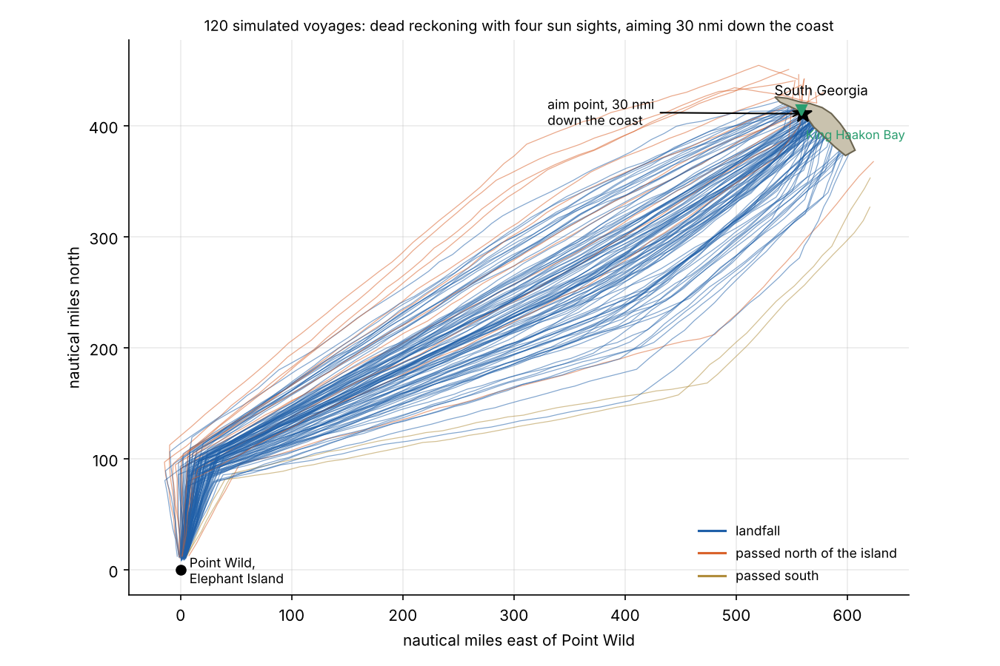
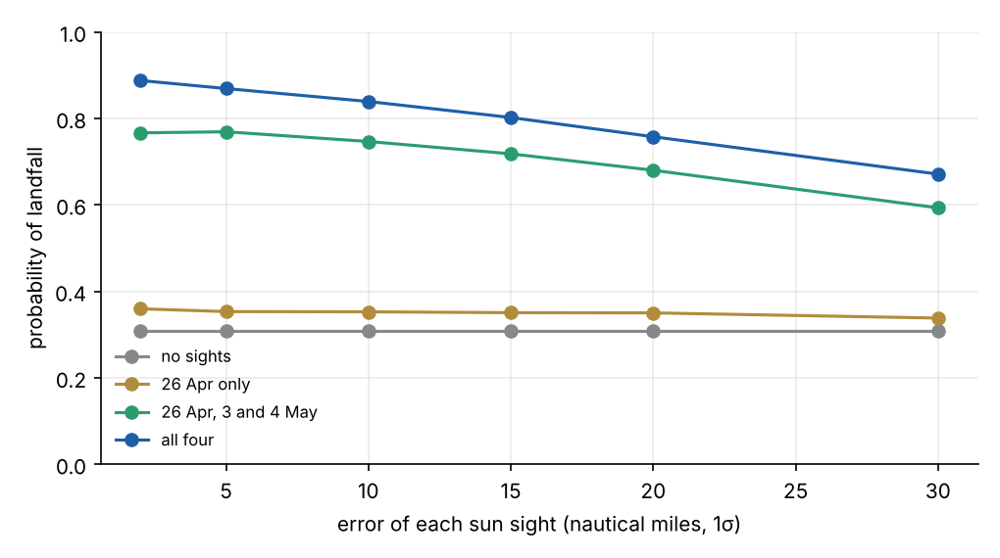
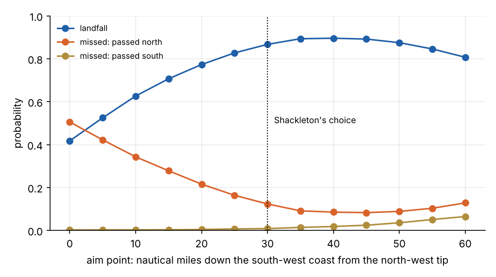

```{=html}
<style>
.cd-grid { display: grid; grid-template-columns: 1.6fr 1fr; gap: 1rem; align-items: start; }
.cd-map { width: 100%; height: 360px; border-radius: 6px; }
.cd-side { display: flex; flex-direction: column; gap: .4rem; font-size: .85rem; }
.cd-side label { display: flex; flex-direction: column; }
.cd-side input[type=range] { width: 100%; }
.cd-sights { display: flex; flex-wrap: wrap; gap: .2rem .7rem; }
.cd-sights label { flex-direction: row; gap: .25rem; }
.cd-run { font-size: .85rem; padding: .15rem .8rem; border: 1px solid #1f5fa8; border-radius: 5px; background: #1f5fa8; color: #fff; cursor: pointer; align-self: flex-start; }
.cd-out { font-size: .9rem; }
@media (max-width: 700px) { .cd-grid { grid-template-columns: 1fr; } }
</style>
```

In April 1916, the 28 men of Shackleton's Imperial Trans-Antarctic Expedition were on Elephant Island, a
glacier-covered rock off the tip of the Antarctic Peninsula. Their ship *Endurance* had been crushed in the Weddell
Sea ice five months earlier. They had camped on the drifting floes, then rowed and sailed three open boats to the
island. Nobody knew where they were, and nobody would come.

So on 24 April, Shackleton and five men set off in the *James Caird*, a 7 m whaler that the carpenter Harry McNish
had decked over with canvas and sledge runners, for the whaling stations on South Georgia. Port Stanley in the
Falklands was nearer, at 540 miles, but against the prevailing north-westerly winds. South Georgia, about 700
nautical miles away in a straight line and 800 by the route they took, lay downwind in the belt of westerlies. It is
also a 170 km island in an empty ocean. A boat that passed it could not beat back against the wind, and the next
land was Africa.

The navigator was Frank Worsley, the *Endurance*'s captain. This post works through how he found the island:
the astronomy of a sun sight, the errors that build up between sights, and the decision about where to aim.

## Position from the sun

Worsley had a sextant, a chronometer that he had checked against the sun when they left, and tables. Those give a
position in two halves.

**Latitude from the noon sight.** At local noon the sun crosses the meridian and reaches its highest altitude $h$.
Its angle from the zenith is then exactly the angle between the observer's latitude and the sun's declination
$\delta$, which the almanac gives for every day:

$$
\phi = \delta - (90^\circ - h) \qquad \text{(sun to the north, observer in the south).}
$$

In early May the sun's declination is about 16° north. At 57° south, the noon sun is only about 17° above the
horizon. One minute of arc of error in the altitude is one nautical mile of error in latitude.

**Longitude from the clock.** The sun crosses the Greenwich meridian at 12:00 Greenwich apparent time and moves
west at 15° an hour. Timing local noon, or any sight away from noon, against a chronometer keeping Greenwich time
gives longitude: four seconds of clock error is one minute of longitude. At 55° south, a minute of longitude is
0.57 nautical miles, so a chronometer that has drifted by 10 seconds puts the boat 1.4 nautical miles out. The
clock was the smaller worry.

**The sextant was the larger one.** A sight measures the angle from the sea horizon to the sun. In the Southern
Ocean in May, with waves several metres high, the horizon from a small boat is usually the next wave. Worsley
knelt on a thwart with two men holding him, waited for the boat to rise on a crest, brought the sun down to what
he hoped was the true horizon, and called "Stop!" so Shackleton could note the chronometer time. A few minutes of arc
of error, a few nautical miles, was a good sight. The sun showed itself four times in fourteen days, on 26 April and
on 3, 4 and 7 May.

## Between sights: dead reckoning

The rest of the time, Worsley worked by dead reckoning: course steered, times speed, added up. Every term in the sum
is uncertain. The compass can be misread in a pitching boat, and the boat makes leeway, sliding sideways down
wind and sea. Speed comes from guesswork and the run of the sea. And the Antarctic Circumpolar Current sets the
whole ocean eastward at an unknown rate of several miles a day.

Errors in dead reckoning grow as the voyage goes on, and a steady bias grows fastest. A course error of just 5°
held for 700 miles puts the boat 60 miles to one side of its intended track, more than the width of the target. A
sight resets the position, to within its own error, and the uncertainty starts growing again from there. This
predict-and-correct cycle is the structure of the Kalman filter in the
[quadcopter post](../../electronics/quadcopters-kalman/index.qmd). Here the predictions run for days and the
corrections come once or twice a week.

## A Monte Carlo of the voyage

To see what those errors mean for landfall, simulate the voyage thousands of times. Each simulated boat:

- runs north for two days, as Shackleton did, to get clear of the pack ice, then steers for an aim point on
  South Georgia's south-west coast;
- sails about 48 nautical miles a day through the water, with a 12% random error in speed;
- carries a steady steering bias drawn with a spread of 6°, plus random yawing;
- is set east by a current of 8 ± 4 nautical miles a day that the navigator cannot measure;
- takes sun sights on the four real dates, each with an error of 5 nautical miles in each direction, and steers
  from the corrected position afterwards;
- cannot sail back west into the westerlies once it has passed the island.

The island is a simplified outline. All of these numbers are assumptions chosen to be plausible, not
measurements from the voyage. Aiming 30 nautical miles down the coast, as Shackleton did:



About **87%** of these simulated voyages reach the island, and the sights are what make that possible. With
dead reckoning alone, landfall falls to about 30%. With only the first sight it is 33%. The two May sights do most
of the work: they come late enough that the error left to accumulate before landfall is small.



The result is not very sensitive to the quality of each sight. Going from 5 to 15 nautical miles of error per sight
costs about 7 percentage points (87% to 80%), because a rough fix on 3 May still clears away ten days of dead-reckoning error. Having
a sight at all mattered much more than having a good one.

## Aiming to miss

Shackleton's account explains his course. Missing the northern end of the island would have been fatal, because
the westerlies would have carried the boat past with no way back, so he deliberately steered for a point about thirty
miles down the coast. Navigators call this **aiming off**. When the uncertainty is wide compared with the target,
aim where an error in the dangerous direction still hits.

The simulation agrees with him:



Aiming at the north-western tip gives a coin toss: about 42% landfall, with half the boats passing north of the
island. Aiming 30 nautical miles down the coast gives 87%, and the best in this model, about 35 to 45 nautical miles
down, gives 89–90%. Aiming further still costs landfalls again, as the aim point nears the narrow south-eastern end.
Shackleton's choice was within a few per cent of the best this model can find, and he made it with a scrap of
chart.

The real voyage reached the island, after a hurricane that nearly drove them onto the cliffs. They landed in King
Haakon Bay on the south-west coast on 10 May. That coast was the uninhabited side, so Shackleton, Worsley and Tom Crean
then crossed the unmapped mountains of the interior in 36 hours to the whaling station at Stromness. Shackleton's
fourth rescue attempt reached Elephant Island on 30 August 1916, and every one of the 22 men left there survived.

## Try it

Set the aim point and the errors, choose which sights to take, and run the voyage 300 times.

```{ojs}
//| echo: false
cairdView = {
  const host = htl.html`<div></div>`;
  const mod = await import(new URL("caird.js", document.baseURI).href);
  mod.mountCaird(host);
  return host;
}
```

*Next: [Part 2](../../probability/endurance-search/index.qmd), Worsley's other famous position, the one where*
Endurance *sank, and how it led to the wreck 106 years later.*

*The simulation and figure scripts are in [`src/shackleton`](https://github.com/paulmilne/paulmilne.github.io/tree/main/src/shackleton).*

## References

- E. Shackleton, [*South*](https://standardebooks.org/ebooks/ernest-shackleton/south/text/chapter-9), Heinemann
  (1919), chapter 9: the boat journey.
- F. A. Worsley, *Shackleton's Boat Journey*, Hodder & Stoughton (1933).
- ["Endurance captain Frank Worsley, Shackleton's gifted navigator, knew how to stay the course"](https://bigthink.com/the-past/endurance-captain-frank-worsley/), Big Think (2022).
- [The Endurance Expedition and the voyage of the James Caird](https://jamescairdsociety.com/the-endurance-expedition/), James Caird Society: dates of the sights and the landing.
- N. Bowditch, *The American Practical Navigator*, US National Geospatial-Intelligence Agency (2019 edition):
  noon sights, time sights and dead reckoning.
