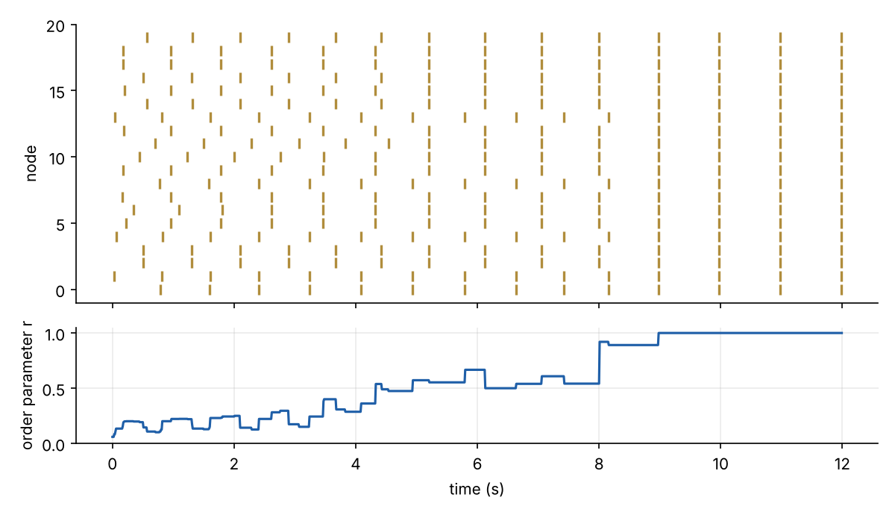
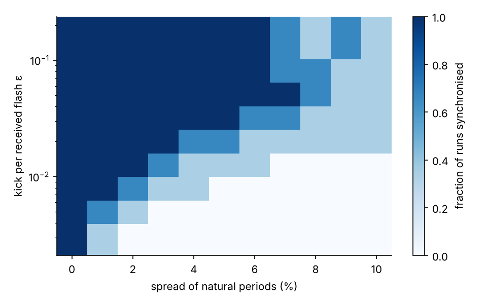
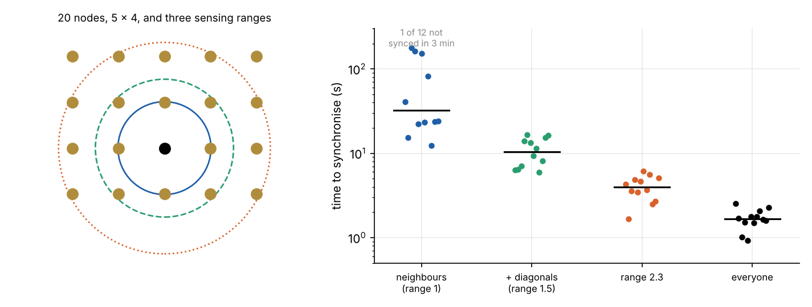

In the mangroves of Southeast Asia, thousands of male *Pteroptyx* fireflies on a single tree flash together,
about once a second, for hours. In the Great Smoky Mountains, *Photinus carolinus* do it in bursts. Nobody leads.
Each firefly has an internal clock, sees its neighbours' flashes, and nudges its clock in response.

That is a different kind of coupling from the [Kuramoto model](../kuramoto-synchronisation/index.qmd). There, every
oscillator feels a continuous pull from the others' phases. A firefly feels nothing between flashes, then a sudden
kick when one arrives. The same is true of pacemaker cells in the heart, which interact through brief electrical
pulses, and of neurons. It is also true of any group of devices that can send each other a short message: a
synchronised network of ESP32 boards can be built from exactly this rule.

This post works through the standard model of pulse coupling, simulates it with the imperfections of a real radio
link, and ends with firmware for ESP32 boards.

## Integrate and fire

In 1975 Charles Peskin modelled a cardiac pacemaker cell as a capacitor charging through a resistor towards a
voltage above its firing threshold. When it reaches the threshold it fires and resets. Charging slows as the voltage
approaches its target, so the voltage against time is concave: steep at first, flattening towards the threshold.

Renato Mirollo and Steven Strogatz turned this into a clean model in 1990. Each oscillator has a phase $\phi$ that
increases steadily from 0 to 1 and a state $x = f(\phi)$, where $f$ is increasing and concave with $f(0) = 0$ and
$f(1) = 1$. When $x$ reaches 1 the oscillator fires and both reset to 0. When an oscillator fires, every other
oscillator's state is kicked up by $\varepsilon$:

$$
x \;\to\; \min\!\left(1,\; x + \varepsilon\right) .
$$

Anyone kicked to 1 fires at once, at the same instant as the oscillator that kicked it. From then on the two are
identical and stay together. Mirollo and Strogatz called this **absorption**. Here, as in their paper,
$f(\phi) = \ln\!\left(1 + (e^b - 1)\phi\right)/b$ with $b = 3$.


The concavity is what makes it work. Seen in phase, the same kick is a small advance early in the cycle and a large
one late in the cycle, and late enough it becomes an immediate firing. The right-hand plot is the **phase response
curve**, the standard way biologists characterise an oscillator, and the one quantity you could measure on a real
firefly by flashing a light at it.

### Why they synchronise

For two identical oscillators, Mirollo and Strogatz followed the phase of one each time the other fires. That
"firing map" has one fixed point, where the two fire half a cycle apart. With concave $f$ the map is expanding, so
the fixed point repels, and the gap between the two grows each cycle until one absorbs the other. For $N$
oscillators coupled all-to-all, they proved that the same happens for almost every starting condition: absorptions
reduce the number of groups one at a time until a single group remains.

Twenty simulated nodes, all hearing each other, with a weak kick of $\varepsilon = 0.008$:



The order parameter rises in steps, not smoothly as it does in the Kuramoto model. Each step is an absorption, and
once nodes have been absorbed they never separate.

## A radio link is not a firefly

The ESP32 boards will flash an LED and send an ESP-NOW broadcast, a short connectionless Wi-Fi frame that every board
in range receives. Compared with the model, that link has four imperfections:

- **Delay.** A broadcast arrives a few milliseconds after it was sent, after the firing node has already reset.
- **Loss.** Some frames are not received.
- **Clock spread.** No two boards' clocks run at exactly the same rate. Crystal oscillators agree to a few parts per
  million, so the firmware detunes them deliberately by up to 2% to make the experiment interesting.
- **Range.** In a large layout, not every board hears every other.

Delay is the dangerous one. Suppose the whole group fires together. A few milliseconds later, every node receives
19 flashes from the others, just after resetting to phase zero. With a kick of 0.05, that is a total kick of 0.95,
which is close enough to the threshold, and the group fires again. The echo of that firing arrives a few
milliseconds later, and so on:


With a 3 ms delay and nothing else, the group never settles. It fires in a continuous storm, roughly once per round
trip of the radio, and the order parameter is meaningless. The fix is the one biology already uses: a **refractory
period**. A heart cell cannot fire again for a while after it has fired, and a firefly ignores flashes just after its
own. If each node ignores any flash heard within 50 ms of its own, the echoes are discarded and the group locks.

Delay affects pulse coupling more deeply than this artefact suggests. Ernst, Pawelzik and Geisel showed in 1995 that
with delays, excitatory pulse coupling no longer synchronises reliably, and the population can settle into several
clusters. When Werner-Allen and colleagues built the firefly algorithm into wireless sensor nodes in 2005, they had
to redesign it around radio delays. They timestamped each message and applied all the phase advances heard in a
cycle at the start of the next.

In the radio-like panel, with 3–5 ms of delay and jitter, 10% packet loss and clocks spread by 2%, the group locks in
about a second and stays locked. It flashes at the rate of its fastest member: every cycle that node fires first, a few milliseconds ahead of the
others, and absorbs the rest. A synchronised firefly group is driven by its fastest flasher in the same way.

## How much coupling is enough

With identical clocks, any positive kick eventually synchronises an all-to-all group. With a spread of clocks it is
like the Kuramoto model: the coupling has to be strong enough to overcome the spread. Each cycle, a slow node falls
behind the group by about the difference in periods, and the group's flash has to advance it by at least that much.



The boundary runs diagonally: double the spread of clocks, and the kick needed roughly doubles. That is the pulse-coupled
version of $K_c \propto \gamma$ from [the first post](../kuramoto-synchronisation/index.qmd). For a few percent of
detuning and twenty nodes, a kick of a few hundredths is ample. The firmware uses 0.05.

The link to the Kuramoto model is more than an analogy. For weak coupling, averaging the effect of the pulses over
a cycle gives each pair of oscillators a continuous interaction that depends only on their phase difference. Its
shape is set by the phase response curve. The Kuramoto model is the case where that interaction is a pure sine.

## When not everyone can see everyone

Fireflies in a tree see only the flashes within their line of sight. Put 20 nodes on a 5 × 4 grid and let each
hear only the nodes within some range:



With all-to-all coupling the group locks in under two seconds. With only nearest neighbours it takes half a minute
on median, and one run had not settled after three minutes. Synchrony then has to spread across the grid, and
neighbouring patches that have locked at different phases have to be merged across their boundaries. Each node in
the middle of the grid now has at most four neighbours, so the total kick it receives per cycle is a fifth of what
it gets with all-to-all coupling.

## Building it

The firmware is in [`src/fireflies`](https://github.com/paulmilne/paulmilne.github.io/tree/main/src/fireflies) on
the blog's repository: a PlatformIO project for any ESP32 board with an LED on a GPIO pin. Every node runs the same
code, about 150 lines:

- a clock whose period is 1 s detuned by a random ±2%, starting at a random phase;
- on reaching phase 1: LED on for 60 ms, and an ESP-NOW broadcast;
- on hearing a flash outside the 50 ms refractory window: $x = f(\phi) + \varepsilon$, fire at once if $x \ge 1$,
  otherwise jump to the phase $f^{-1}(x)$.

The heart of it is the receive step in `loop()`:

```cpp
float phase = (now - cycleStartMs) / periodMs;
if (phase >= 1.0f) { flash(now); return; }

if (newFlashes && (now - lastFlashMs) >= REFRACTORY_MS) {
  float x = f(phase) + EPS * newFlashes;
  if (x >= 1.0f) { flash(now); return; }        // absorbed: fire with the group
  float p = finv(x);
  cycleStartMs = now - (uint32_t)(p * periodMs); // jump the phase forward
}
```

A separate `logger` build turns one extra board into a listener that prints the time and sender of every flash it
hears over USB, which is enough to plot a raster of a real group like the simulated one above.

The firmware has been checked against both the 2.x and 3.x Arduino-ESP32 interfaces, but not yet flashed to boards. The
experiments to run once it is:

1. **Absorption.** Power the boards one at a time and watch each new one join the group within a few cycles.
2. **Refractory period.** Set `REFRACTORY_MS` to 0 and look for the echo storm.
3. **Coupling against detuning.** Raise `DETUNE` or lower `EPS` until the group fails to lock, and compare with the map above.
4. **Light instead of radio.** Replace the radio with an LED and a phototransistor on each board. Range then
   depends on line of sight, as for the fireflies, and the layout determines who can see whom.

## References

- C. S. Peskin, *Mathematical Aspects of Heart Physiology*, Courant Institute of Mathematical Sciences (1975).
- J. Buck, "Synchronous rhythmic flashing of fireflies. II", *Quarterly Review of Biology* 63, 265–289 (1988).
- R. E. Mirollo and S. H. Strogatz, "Synchronization of pulse-coupled biological oscillators", *SIAM Journal on
  Applied Mathematics* 50, 1645–1662 (1990).
- U. Ernst, K. Pawelzik and T. Geisel, "Synchronization induced by temporal delays in pulse-coupled oscillators",
  *Physical Review Letters* 74, 1570–1573 (1995).
- G. Werner-Allen, G. Tewari, A. Patel, M. Welsh and R. Nagpal, "Firefly-inspired sensor network synchronicity
  with realistic radio effects", *ACM SenSys* (2005).
- S. H. Strogatz, *Sync: The Emerging Science of Spontaneous Order*, Hyperion (2003).
