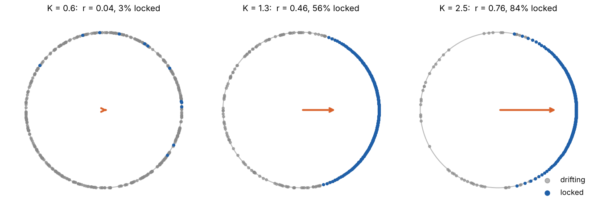
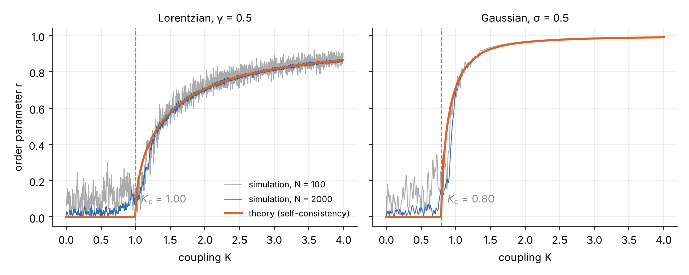
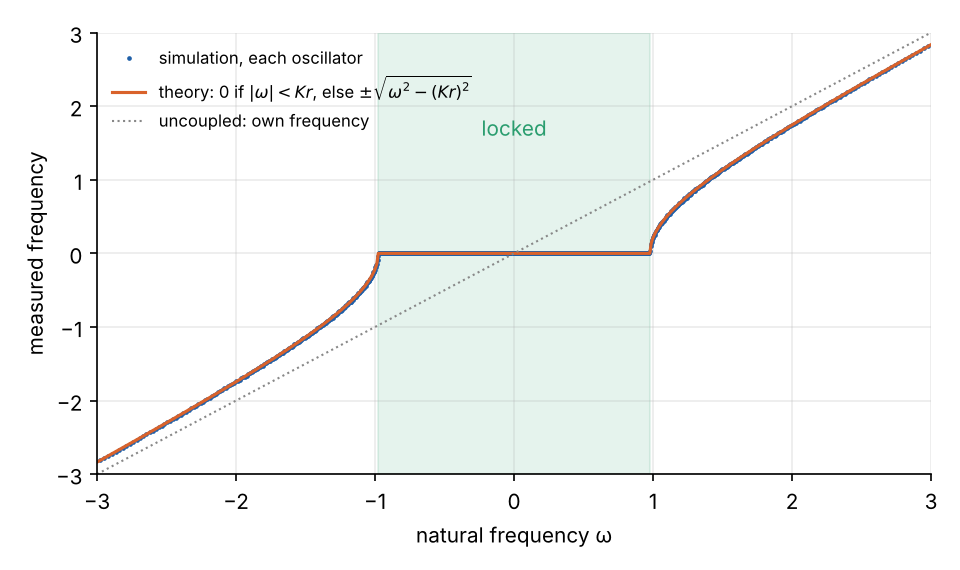

Fireflies in a mangrove tree flash in unison. Pacemaker cells in the heart fire together. An audience's applause
drifts into a shared rhythm, and the footsteps of a crowd on a bridge can lock to its sway. In each case there is no
conductor. Every member has its own natural rhythm and listens only to the others, and above some strength of
coupling a large fraction of them fall into step anyway.

In 1975 Yoshiki Kuramoto wrote down the simplest model that does this and, unusually for a nonlinear system of
many bodies, solved it. This post simulates the model, derives its critical coupling, and shows why the onset of
synchronisation is a phase transition of the same mean-field kind as a magnet's. It follows the first of
Konstantinos Efstathiou's lectures *Dynamics and synchronization of globally coupled oscillators* (Warwick summer
school on complex networks, 2019), with the simulations added.

## The model

Each of $N$ oscillators is reduced to a phase $\theta_i$ on a circle. Left alone it turns at its own natural
frequency $\omega_i$, drawn from a distribution $g(\omega)$. Every pair is coupled with the same strength, through
the sine of their phase difference:

$$
\dot\theta_i = \omega_i + \frac{K}{N}\sum_{j=1}^{N}\sin(\theta_j - \theta_i), \qquad i = 1,\dots,N .
$$

The sine pulls an oscillator forward if its neighbour is ahead and back if it is behind. At $K = 0$ every oscillator
runs at its own speed and the population is incoherent. At large $K$ they lock together. The question is what
happens in between.

Reducing an oscillator to a phase is less drastic than it looks. Any stable limit cycle that is weakly perturbed
moves mostly along the cycle, because displacements across it decay. The phase is the slow variable that is left,
and averaging the coupling over a cycle gives a function of the phase difference whose first Fourier term is the
sine. The same reduction applied to a field of Stuart–Landau oscillators gives the complex Ginzburg–Landau
equation of the [CGLE explainer](../../explainers/cgle-pattern-morphology/index.qmd) and section 2.1.3 of
[my MSc dissertation](../../papers/rg-critical-phenomena/index.qmd)
([p. 10](../../papers/rg-critical-phenomena/milne-2022-rg-functional-equations-critical-phenomena.pdf#page=10)).

## The order parameter

Kuramoto's key step was to measure the population's coherence by the centroid of the phases on the unit circle:

$$
r\,e^{i\psi} = \frac{1}{N}\sum_{j=1}^{N} e^{i\theta_j} .
$$

If the phases are spread uniformly round the circle, $r \approx 0$. If they all coincide, $r = 1$. The angle $\psi$
is the population's average phase. Multiplying by $e^{-i\theta_i}$ and taking the imaginary part rewrites the model
exactly as

$$
\dot\theta_i = \omega_i + K r \sin(\psi - \theta_i) .
$$

Every oscillator now feels only the mean field $r e^{i\psi}$, pulling it towards the average phase with a strength
$Kr$ that grows with the coherence. That is the feedback that makes synchronisation possible: a little coherence
strengthens the pull, which recruits more oscillators, which raises the coherence.

Here are 400 oscillators with Lorentzian frequencies of width $\gamma = 0.5$, after 200 time units at three
couplings. The orange arrow is $r e^{i\psi}$, rotated to point right:



## Simulating it

The mean-field form makes the simulation cost $O(N)$ per step rather than $O(N^2)$:

```python
import numpy as np

def kuramoto(omega, K, T=200, dt=0.02, seed=0):
    rng = np.random.default_rng(seed)
    theta = rng.uniform(0, 2 * np.pi, len(omega))
    r_t = []
    for _ in range(int(T / dt)):
        z = np.exp(1j * theta).mean()                 # r e^{i psi}
        r, psi = abs(z), np.angle(z)
        theta += dt * (omega + K * r * np.sin(psi - theta))
        r_t.append(r)
    return theta, np.array(r_t)

N, gamma = 2000, 0.5
i = np.arange(1, N + 1)
omega = gamma * np.tan(np.pi * (i / (N + 1) - 0.5))    # Lorentzian quantiles
```

Drawing the frequencies at the distribution's quantiles, rather than at random, removes most of the sample-to-sample
noise in $g(\omega)$, so a few thousand oscillators behave like the infinite population.

Sweeping $K$ slowly upwards and recording $r$ gives the central result:



Below a critical coupling $K_c$ the population stays incoherent, apart from fluctuations of order $1/\sqrt N$
(visible in the grey $N = 100$ runs). Above it, $r$ rises continuously from zero. The rest of this post explains
where $K_c$ comes from and the shape of the curve.

## Locked and drifting oscillators

Take the infinite population with a frequency distribution symmetric about zero, and look for a steady state in which
$r$ is constant and $\psi$ is fixed (working in the frame that rotates with the mean frequency, $\psi = 0$ without
loss of generality). Each oscillator then obeys a one-dimensional equation

$$
\dot\theta = \omega - K r \sin\theta ,
$$

and there are two kinds of solution.

- **Locked**, if $|\omega| \le Kr$. The oscillator settles at a fixed point $\sin\theta^* = \omega / (Kr)$: it turns at
  the common frequency, offset in phase by an amount that grows with how far its natural frequency is from the
  centre.
- **Drifting**, if $|\omega| > Kr$. There is no fixed point, and the oscillator keeps slipping round the circle,
  slowing near $\theta = \pm\pi/2$ and speeding up opposite. Integrating $dt = d\theta/\dot\theta$ over one turn
  gives its average frequency, $\sqrt{\omega^2 - (Kr)^2}$.

Measuring each oscillator's average frequency in the simulation at $K = 1.6$ shows both at once:



The coupling has drawn a whole band of frequencies onto one plateau. Oscillators just outside it are dragged towards
the common frequency without being captured.

## Self-consistency and the critical coupling

The order parameter has to be produced by the oscillators it is acting on. That gives an equation for $r$.

Drifting oscillators contribute nothing to $r$. Each spends time at angle $\theta$ in proportion to $1/|\dot\theta|$,
and for a symmetric $g$ the contributions from $\omega$ and $-\omega$ cancel. The locked oscillators sit at
$\sin\theta = \omega/(Kr)$, so

$$
r = \int_{-Kr}^{Kr} \cos\theta^*(\omega)\, g(\omega)\, d\omega
  = K r \int_{-\pi/2}^{\pi/2} \cos^2\theta\; g(Kr\sin\theta)\, d\theta ,
$$

substituting $\omega = Kr\sin\theta$. The incoherent state $r = 0$ always solves it. A coherent solution must satisfy

$$
1 = K \int_{-\pi/2}^{\pi/2} \cos^2\theta\; g(Kr\sin\theta)\, d\theta ,
$$

and it appears as $r \to 0^+$, when the integral becomes $g(0)\,\pi/2$. So the critical coupling is

$$
K_c = \frac{2}{\pi\, g(0)} .
$$

It depends only on the density of oscillators at the centre frequency: the more of them share the central frequency,
the less coupling it takes to start a cluster. For a Gaussian of width $\sigma$, $K_c = 2\sigma\sqrt{2/\pi} \approx 1.6\sigma$,
which is 0.80 in the right-hand panel above.

For a Lorentzian, $g(\omega) = \gamma / \big(\pi(\gamma^2 + \omega^2)\big)$, the integral can be done in closed form,
and the whole curve comes out:

$$
K_c = 2\gamma, \qquad r = \sqrt{1 - \frac{K_c}{K}} \quad (K > K_c) .
$$

The simulation at $K = 1.6$ settles at $r = 0.611$; the formula gives 0.612.

## A phase transition

Expanding the self-consistency equation for small $r$ (with $g''(0) < 0$, as for any single-peaked distribution)
gives, near any $K_c$,

$$
r \propto (K - K_c)^{1/2} .
$$

That square root is the signature of a mean-field phase transition. The magnetisation of a ferromagnet in the
Curie–Weiss approximation grows as $(T_c - T)^{1/2}$ below the Curie temperature, and it comes from a self-consistency
equation of the same form, $m = \tanh(\beta J m)$, worked through in the
[mean-field explainer](../../explainers/mean-field-annealed-disorder/index.qmd). The order parameter exponent
$\beta = 1/2$ is the mean-field entry in the table of critical exponents in section 2.1.4 of
[my dissertation](../../papers/rg-critical-phenomena/milne-2022-rg-functional-equations-critical-phenomena.pdf#page=11)
(pp. 11–13), alongside the Ising model's exact values in two and three dimensions.

The comparison goes further. In Landau's theory (section 2.1.1,
[p. 9](../../papers/rg-critical-phenomena/milne-2022-rg-functional-equations-critical-phenomena.pdf#page=9)), an
order parameter near a continuous transition obeys a pitchfork normal form. The Kuramoto model has one too: for
Lorentzian frequencies, the Ott–Antonsen reduction of 2008 collapses the infinite population exactly onto

$$
\dot r = -\gamma r + \frac{K}{2}\, r\left(1 - r^2\right) ,
$$

a supercritical pitchfork whose stable branch is $r = \sqrt{1 - 2\gamma/K}$. That reduction, and what it says about
two-humped frequency distributions, is [the next post](../ott-antonsen-bimodal/index.qmd).

Kuramoto synchronisation is a phase transition with no temperature and no energy. The "disorder" is the spread of
natural frequencies, and the coupling plays the part of inverse temperature.

## Why mean field is exact here, and when it is not

Mean-field theory is usually an approximation, and it fails where fluctuations matter: below an upper critical
dimension, which the renormalisation group (section 2.2 of
[the dissertation](../../papers/rg-critical-phenomena/milne-2022-rg-functional-equations-critical-phenomena.pdf#page=17))
exists to handle. In the Kuramoto model every oscillator is coupled to every other with equal weight, so the mean
field is the only thing each one feels, and as $N \to \infty$ the theory is exact. Finite populations fluctuate
about it by $O(1/\sqrt N)$, which the $N = 100$ curves show.

Put the oscillators on a lattice with nearest-neighbour coupling and the picture changes: in low dimensions,
fluctuations destroy long-range phase order, as they destroy magnetic order in a one-dimensional Ising chain. Real
synchronising systems, from fireflies to power grids, sit somewhere between all-to-all and local coupling. That is
where the network structure starts to matter.

## A note on the lecture

Two details for anyone working through Efstathiou's slides. The example with a bimodal frequency distribution quotes
$K_c = 0.5$ where its own parameters give 5. And the accompanying Mathematica code takes the mean phase
$\psi$ to be zero throughout. That holds in the steady state for a symmetric $g$, but
during a transient the mean phase wanders and the full $|\langle e^{i\theta}\rangle|$ is needed, as in the code above.

*Next: [Two Crowds, One Rhythm](../ott-antonsen-bimodal/index.qmd), on the Ott–Antonsen reduction and the explosive synchronisation of a population with two preferred frequencies.*

## References

- Y. Kuramoto, "Self-entrainment of a population of coupled non-linear oscillators", *International Symposium on
  Mathematical Problems in Theoretical Physics*, Lecture Notes in Physics 39, Springer (1975).
- S. H. Strogatz, "From Kuramoto to Crawford: exploring the onset of synchronization in populations of coupled
  oscillators", *Physica D* 143, 1–20 (2000).
- E. Ott and T. M. Antonsen, "Low dimensional behavior of large systems of globally coupled oscillators",
  *Chaos* 18, 037113 (2008).
- K. Efstathiou, *Dynamics and synchronization of globally coupled oscillators*, Lecture 1, PhD summer school
  "Complex networks: dynamics and control", University of Warwick (2019).
- P. Milne, [*RG Functional Equations & Critical Phenomena in Thermodynamics and Financial Markets*](../../papers/rg-critical-phenomena/index.qmd),
  MSc dissertation, The Open University (2022).
