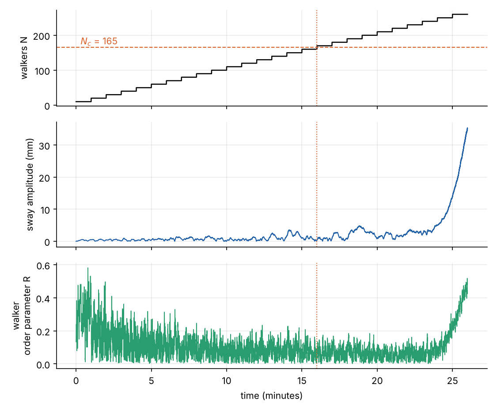
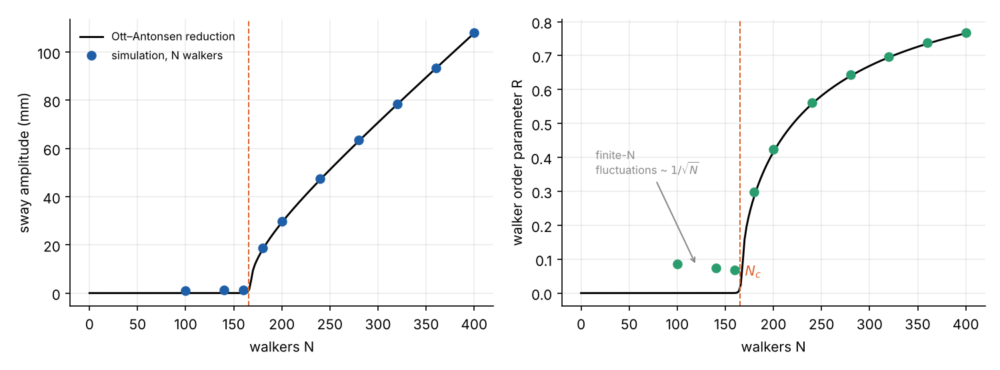
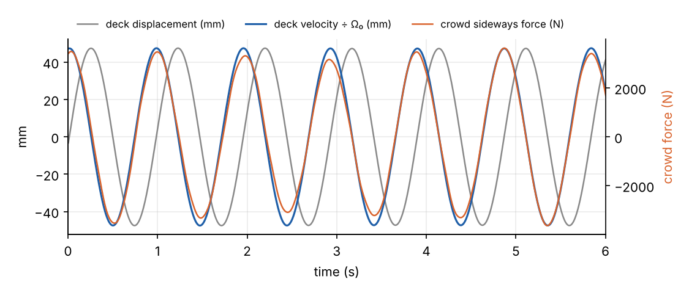

London's Millennium Bridge opened on 10 June 2000. Up to 100,000 people crossed it that day, with up to 2,000 on
the deck at once, and the deck swayed sideways enough that people grabbed the handrails and walked with their feet
apart. Two days later it was closed. It reopened in 2002 after the engineers, Arup, had fitted 37 fluid viscous
dampers and a set of tuned mass dampers, at a cost reported as about £5 million.

The bridge was not weak. It was the right stiffness for its load, and it would have been fine with a few people on
it, or a few hundred. The wobble needed a crowd above a critical size, and once past that size it appeared
suddenly. That is the signature of the transition in the
[previous](../kuramoto-synchronisation/index.qmd) [two](../ott-antonsen-bimodal/index.qmd) posts, and in 2005
Steven Strogatz and colleagues published a Kuramoto model of it in *Nature*. This post rebuilds that model, reduces
it with Ott and Antonsen's method, and runs a simulated crowd test.

## What a walker does to a bridge

Walking is a controlled fall from one foot to the other. Each step pushes the body's centre of mass sideways, so a
walker presses on the ground with an alternating sideways force at half the step frequency: about 1 Hz for a normal
pace of two steps a second, with an amplitude of some tens of newtons.

On a rigid floor those forces from a crowd add up with random phases and largely cancel. The Millennium Bridge had
lateral modes close to that 1 Hz, among them the north span's at 1.05 Hz. A crowd's random forces shake such a mode
a little. The question is why a little became a lot.

Arup's measurements gave the engineering answer. On a swaying deck, the average sideways force from a pedestrian is
proportional to the deck's sideways *velocity*. A force in phase with velocity is a negative damping: it feeds
energy into the motion every cycle. Each walker adds a little, and when the crowd's negative damping exceeds the
structure's own damping, the sway grows. In a crowd test on the north span in December 2000, Arup added people in
steps; the sway stayed small and then grew sharply at around 165 people.

## The model

Strogatz, Abrams, McRobie, Eckhardt and Ott asked where the velocity-proportional force comes from, and answered
with synchronisation. They modelled one lateral mode of the bridge as a damped oscillator driven by the walkers:

$$
M\ddot X + B\dot X + K X = G\sum_{i=1}^{N}\sin\Theta_i ,
$$

where $X$ is the sideways displacement of the mode, $M$, $B$ and $K$ its modal mass, damping and stiffness, and each
walker $i$ pushes with a force $G\sin\Theta_i$ at gait phase $\Theta_i$. Each walker has a natural frequency
$\Omega_i$ and adjusts their gait to the motion underfoot:

$$
\dot\Theta_i = \Omega_i + C A \sin(\Psi - \Theta_i + \alpha) ,
$$

with the deck's motion written as $X = A\sin\Psi$, and $C$ a sensitivity: how strongly a sway of amplitude $A$
pulls a walker's phase. With $\alpha = \pi/2$, a walker locked to the bridge pushes a quarter-cycle ahead of the
displacement, in phase with the velocity: exactly the negative damping Arup measured.

Compare it with the Kuramoto model. The walkers are the oscillators, but they do not see each other; they see the
bridge. The bridge sums their forces, so it plays the part of the order parameter. Unlike the Kuramoto mean field it
has a mass and a resonance of its own, so it responds most to the component of the crowd's force near its natural
frequency.

The values below are from the papers that built this model: modal mass and frequency for the north span mode, a
force of 25 N per walker, and the sensitivity $C$ that Strogatz et al. estimated from the crowd-test data. Natural
pacing frequencies are Lorentzian, centred on the bridge frequency, with a half-width of 0.074 Hz (7.2% of the
frequency), and the damping ratio is 0.75% of critical.

| Symbol | Meaning | Value |
| --- | --- | --- |
| $M$ | Modal mass | 113,000 kg |
| $\Omega_0/2\pi$ | Lateral mode frequency, $\sqrt{K/M}$ | 1.03 Hz |
| $\zeta$ | Damping ratio, $B / 2\sqrt{KM}$ | 0.0075 |
| $G$ | Peak sideways force per walker | 25 N |
| $C$ | Walker sensitivity to sway | 16 m⁻¹ s⁻¹ |
| $\Delta$ | Half-width of pacing frequencies | 0.072 $\Omega_0$ |
| $\alpha$ | Phase lag | $\pi/2$ |

## Reducing the crowd

The previous post's Ott–Antonsen reduction applies with one change: the mean field that pulls each walker is the
bridge's motion, $C A e^{i(\Psi + \alpha)}$, instead of $K r e^{i\psi}$. For a Lorentzian crowd the walkers' order
parameter $z = R e^{i\phi} = \langle e^{i\Theta}\rangle$ obeys a single equation.

The bridge is a lightly damped oscillator driven near resonance, so it can be described by a slowly varying complex
amplitude $a = A e^{i\Psi} = \dot X/\Omega_0 + iX$, keeping only the part of the crowd's force that rotates with it.
In the frame rotating at $\Omega_0$, the whole system of a bridge and an infinite crowd becomes two complex
equations:

$$
\dot a = -\zeta\Omega_0\, a - i\,\frac{G N}{2M\Omega_0}\, z, \qquad
\dot z = -\Delta\, z + \frac{C}{2}\left(e^{i\alpha} a - e^{-i\alpha}\,\bar a\, z^2\right) .
$$

The first is the bridge: it decays at its damping rate, and the crowd's coherent force drives it. The second is the
crowd: the spread of pacing frequencies dephases it, and the bridge's sway pulls it into step.

Linearising about $a = z = 0$ gives a 2 × 2 problem. With $\alpha = \pi/2$ the product of the cross-couplings is
positive, $GNC/(4M\Omega_0)$, so it is a feedback loop that amplifies itself: sway recruits walkers, walkers drive
sway. The quiet state loses stability when that loop gain exceeds the product of the two decay rates,
$\zeta\Omega_0\,\Delta$, which gives the critical crowd

$$
N_c = \frac{4 M \Omega_0^2\, \zeta\, \Delta}{G\, C} = \frac{4\,\zeta K}{\pi\, G C\, P(\Omega_0)} ,
$$

where $P(\Omega_0) = 1/(\pi\Delta)$ is the density of walkers whose natural pace matches the bridge. It has the same
structure as the Kuramoto threshold $K_c = 2/(\pi g(0))$, and with the values above it is **165 people**, the
size of crowd at which the north span started to sway in the test.

Each factor says something to a designer:
- $N_c \propto \zeta$. Doubling the damping doubles the crowd the bridge can carry. Arup's fix raised the damping
  of the critical modes many times over.
- $N_c \propto K$. A stiffer deck needs a bigger crowd. But stiffening was the hard option for the long, shallow
  centre span, whose first lateral mode is at 0.49 Hz, so the fix added damping instead.
- $N_c \propto \Delta$. A crowd with a wider spread of paces is harder to recruit.
- Below $N_c$ there is no warning. The crowd adds negative damping in proportion to its size, but the sway stays at
  the noise level until the total damping crosses zero.

## A simulated crowd test

Simulating the full model, with walkers added in groups of ten every minute like the real test:

The sway and the walkers' coherence rise together, the "dual aspects of a single instability" in Strogatz et al.'s
words. Neither comes first. Before $N_c$, $R$ sits at the $1/\sqrt N$ level of a random crowd: high when there are ten
walkers, low when there are a hundred and fifty.

The onset is also late. The crowd passes 165 at sixteen minutes, but the sway does not take off until about
twenty-four. Just above threshold the growth rate is proportional to $N - N_c$, so with a few people to spare the
instability takes minutes to build. That is the critical slowing down of any continuous transition, and it makes the
real crowd test harder to read than a threshold sounds: a group can stand above $N_c$ for a while before anything
happens.

Running the full model to a steady state at fixed crowd sizes, and comparing it with the two reduced equations:

The reduction matches the full simulation to within a millimetre. Just above $N_c$, both the sway and the
coherence grow as $(N - N_c)^{1/2}$: the mean-field exponent $\beta = 1/2$ from the
[first post](../kuramoto-synchronisation/index.qmd) and from the table of critical exponents in section 2.1.4 of
[my MSc dissertation](../../papers/rg-critical-phenomena/milne-2022-rg-functional-equations-critical-phenomena.pdf#page=11).
Further above, the sway grows nearly linearly with the crowd: each extra walker adds roughly the same amount, about
0.4 mm.

In the locked state, the crowd's net force tracks the deck's velocity, not its displacement:

Their correlation is 0.998. In the steady state the crowd's force exactly cancels the structural damping force,
which is why the amplitude stops growing. The model reproduces Arup's empirical rule, force proportional to velocity,
from synchronisation.

## Cause or effect?

The Kuramoto account is elegant, and it got the critical crowd right with one fitted parameter. It is not the last
word.

In 2009 John Macdonald modelled each pedestrian as an inverted pendulum ([explainer](../../explainers/inverted-pendulum-walker/index.qmd)) who keeps their balance by choosing where to
put each foot, a rule from biomechanics. On a moving deck, that balance strategy alone produces a sideways force with
a component in phase with the deck's velocity, without any change in the walker's pace. In 2017 Igor Belykh and
colleagues coupled such balance-based walkers to a bridge and found that wobbling could start without the crowd
locking its phase: the onset involved many uncoordinated adjustments and phase slips, and lock-in became important
only at larger amplitudes. On that reading, synchrony is mostly a consequence of the wobble rather than its cause.

The two accounts agree on the feedback loop and the threshold: something the walkers do on a moving deck feeds energy
back into the deck, and the bridge goes unstable when the total exceeds its damping. They disagree about what
happens inside each walker. The phase model makes all of it a gait adjustment, the balance models make it mostly
foot placement. Both predict a critical crowd proportional to the damping, which is why Arup's dampers work either
way.

For this series, the bridge adds one thing to the Kuramoto model: the mean field can be a physical object with its own
dynamics. Synchronisation through a shared medium, rather than direct mutual coupling, turns up elsewhere: in
Huygens' two pendulum clocks on one beam, in metronomes on a rolling board, and in the
power grid, where generators stay in step through the network that connects them.

## References

- P. Dallard, A. J. Fitzpatrick, A. Flint, S. Le Bourva, A. Low, R. M. Ridsdill Smith and M. Willford,
  ["The London Millennium Footbridge"](https://www.istructe.org/journal/volumes/volume-79-(published-in-2001)/issue-22/the-london-millennium-footbridge/),
  *The Structural Engineer* 79(22), 17–33 (2001).
- [Stabilising the London Millennium Bridge](https://ingenia.org.uk/articles/stabilising-the-london-millennium-bridge/),
  *Ingenia* (Royal Academy of Engineering).
- S. H. Strogatz, D. M. Abrams, A. McRobie, B. Eckhardt and E. Ott,
  ["Crowd synchrony on the Millennium Bridge"](https://dmabrams.esam.northwestern.edu/pubs/Strogatz%20Abrams%20McRobie%20Eckhardt%20Ott%20-%20Crowd%20synchrony%20on%20the%20Millennium%20Bridge%20-%20Nature%202005.pdf),
  *Nature* 438, 43–44 (2005).
- B. Eckhardt, E. Ott, S. H. Strogatz, D. M. Abrams and A. McRobie,
  ["Modeling walker synchronization on the Millennium Bridge"](https://dmabrams.esam.northwestern.edu/pubs/Eckhardt%20et%20al%20-%20Modeling%20walker%20synchronization%20on%20the%20Millennium%20Bridge%20-%20PRE%202007.pdf),
  *Physical Review E* 75, 021110 (2007).
- M. M. Abdulrehem and E. Ott, ["Low dimensional description of pedestrian-induced oscillation of the Millennium
  Bridge"](https://arxiv.org/abs/0809.0358), *Chaos* 19, 013129 (2009).
- J. H. G. Macdonald, "Lateral excitation of bridges by balancing pedestrians", *Proceedings of the Royal Society A*
  465, 1055–1073 (2009).
- I. Belykh, R. Jeter and V. Belykh, ["Foot force models of crowd dynamics on a wobbly
  bridge"](https://ar5iv.labs.arxiv.org/html/1610.05366), *Science Advances* 3, e1701512 (2017).
