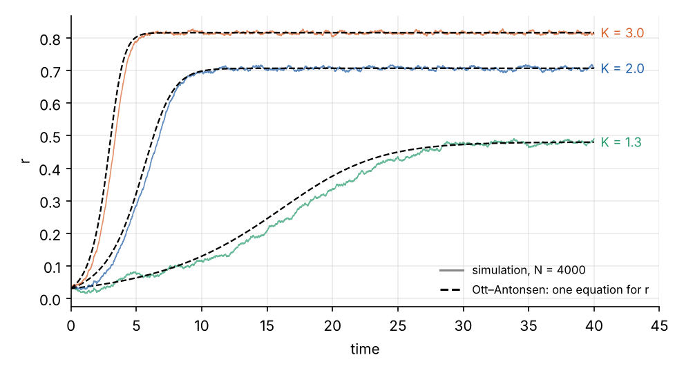
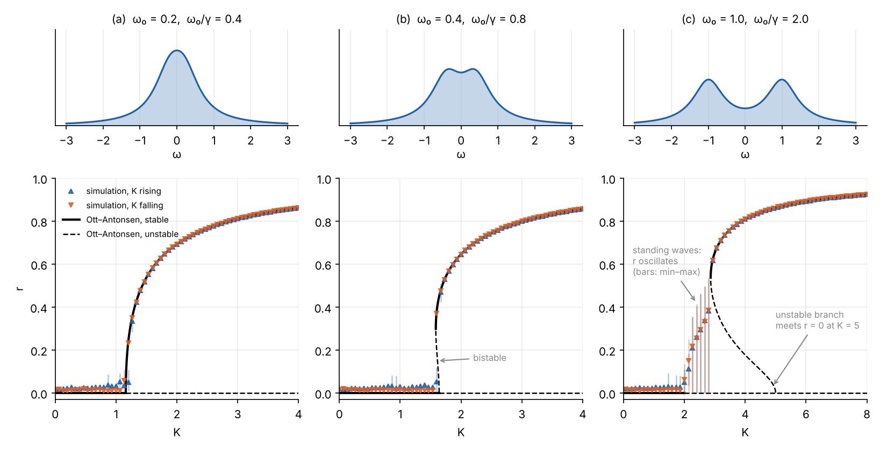
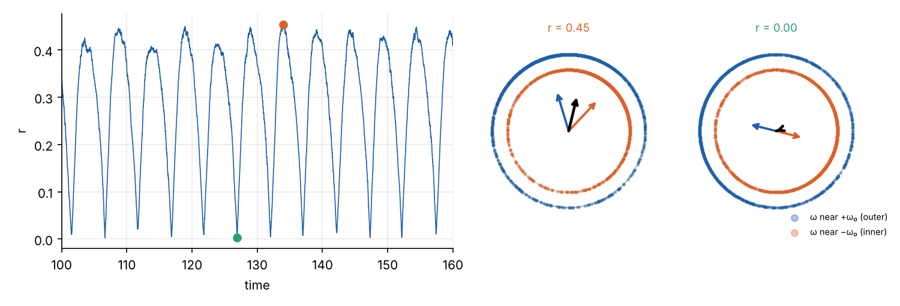
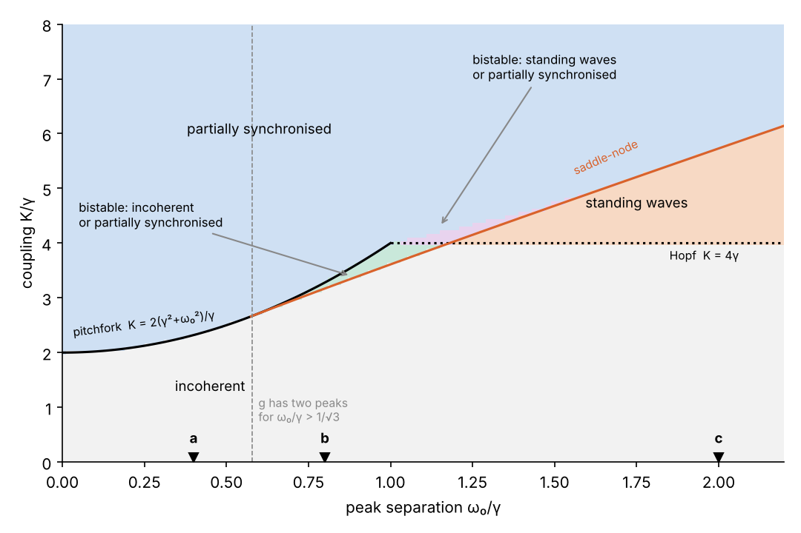

[The previous post](../kuramoto-synchronisation/index.qmd) found the Kuramoto model's critical coupling from a
self-consistency argument. That argument finds steady states, but says nothing about how the population gets there,
or whether something other than a steady state is possible. In 2008 Edward Ott and Thomas Antonsen found that, for
some frequency distributions, the dynamics of an infinite population collapse exactly onto a handful of ordinary
differential equations.

This post uses their reduction to explore a population drawn from two groups with different preferred frequencies.
Depending on how far apart the groups are, synchronisation sets in smoothly, abruptly with hysteresis, or through
a state in which the two groups chase each other round the circle. It follows the second half of Konstantinos
Efstathiou's lecture (see the [previous post](../kuramoto-synchronisation/index.qmd)), and completes the exercise
that the lecture ends on.

## From oscillators to a density

With infinitely many oscillators, describe the population by a density $f(\theta, \omega, t)$: the fraction of
oscillators with natural frequency $\omega$ at phase $\theta$. Oscillators are neither created nor destroyed, so $f$
obeys a continuity equation, like a fluid flowing round the circle with velocity $v = \dot\theta$:

$$
\frac{\partial f}{\partial t} + \frac{\partial}{\partial\theta}\left(f\, v\right) = 0, \qquad
v = \omega + \frac{K}{2i}\left(z\,e^{-i\theta} - \bar z\, e^{i\theta}\right),
$$

where $z = r e^{i\psi} = \iint e^{i\theta} f\, d\theta\, d\omega$ is the order parameter, and the velocity is
$\omega + Kr\sin(\psi - \theta)$ written in exponentials.

## The ansatz

Expand $f$ in a Fourier series in $\theta$. Ott and Antonsen's idea was to look for solutions in which every
Fourier coefficient is a power of the first:

$$
f(\theta, \omega, t) = \frac{g(\omega)}{2\pi}\left[1 + \sum_{n=1}^{\infty}
\left(\alpha(\omega, t)^n e^{-in\theta} + \bar\alpha(\omega, t)^n e^{in\theta}\right)\right] .
$$

For $|\alpha| < 1$ the series sums to a Poisson kernel: at each frequency, the phases are spread in a smooth,
single-humped way (a wrapped Cauchy distribution) whose concentration is $|\alpha|$ and whose peak is at
$\arg\alpha$. Substituting into the continuity equation, every Fourier mode gives the same equation for $\alpha$:

$$
\frac{\partial\alpha}{\partial t} = i\omega\,\alpha + \frac{K}{2}\left(z - \bar z\,\alpha^2\right),
\qquad z(t) = \int g(\omega)\,\alpha(\omega, t)\, d\omega .
$$

So the family is invariant: a population that starts in this form stays in it. It is an exact low-dimensional
manifold inside an infinite-dimensional system. The equation is also the equation for a single oscillator's
$e^{i\theta}$, which is no coincidence: the reduction works because the sinusoidal coupling acts on the circle as a
Möbius transformation, which maps Poisson kernels onto Poisson kernels.

The remaining question is the integral for $z$. For a Lorentzian it can be done by residues.

## The Lorentzian: one equation for r

$g(\omega) = \gamma / \big(\pi((\omega - \omega_0)^2 + \gamma^2)\big)$ has poles at $\omega_0 \pm i\gamma$.
If $\alpha$ continues analytically into the upper half of the complex $\omega$ plane and decays there (which the
equation preserves, because there $i\omega\alpha$ damps it), closing the contour through the upper half-plane picks
up only the pole at $\omega_0 + i\gamma$:

$$
z(t) = \alpha(\omega_0 + i\gamma,\ t) .
$$

The whole population's order parameter is the ansatz function evaluated at one complex frequency. Substituting
$\omega = \omega_0 + i\gamma$ into the equation for $\alpha$ and writing $z = r e^{i\psi}$:

$$
\dot r = -\gamma r + \frac{K}{2}\, r\left(1 - r^2\right), \qquad \dot\psi = \omega_0 .
$$

Two terms compete. The spread of frequencies, $\gamma$, dephases the population at a rate proportional to the
coherence. The coupling builds coherence, saturating as $r \to 1$. The incoherent state $r = 0$ loses stability when
$K/2 > \gamma$, at $K_c = 2\gamma$, and the coherent fixed point $r = \sqrt{1 - 2\gamma/K}$ takes over. This is the
self-consistency result of the previous post, now with its dynamics. It is the normal form of a supercritical
pitchfork bifurcation, the same shape as Landau's expansion of a free energy near a continuous transition
(section 2.1.1 of
[my MSc dissertation](../../papers/rg-critical-phenomena/milne-2022-rg-functional-equations-critical-phenomena.pdf#page=9))
and the symmetry-breaking equation in the [bifurcation explainer](../../explainers/bifurcation-vs-langevin/index.qmd).

Comparing the one equation with 4,000 simulated oscillators, started on the manifold (each phase drawn from a
wrapped Cauchy distribution with $r = 0.03$):

The small differences early on are finite-size noise: $1/\sqrt{4000} \approx 0.016$, comparable to the starting
coherence. From a start off the manifold, such as phases drawn uniformly at random, the transient differs, but Ott
and Antonsen showed in 2009 that for this model the manifold attracts, so the long-run behaviour is the same.

## Two groups of oscillators

Now suppose the population is a mixture of two groups, with natural frequencies centred at $\pm\omega_0$:

$$
g(\omega) = \frac{1}{2}\left[\frac{\gamma}{\pi\left((\omega - \omega_0)^2 + \gamma^2\right)}
+ \frac{\gamma}{\pi\left((\omega + \omega_0)^2 + \gamma^2\right)}\right] .
$$

The distribution has two peaks once $\omega_0 > \gamma/\sqrt3$, and a dip at zero frequency, which is where the
self-consistency argument says a synchronised cluster should form. (The lecture's slide drops the factor of ½, so as
printed its distribution integrates to 2. Its plot is of the normalised version.)

The integral for $z$ now picks up two poles, one per group:

$$
z = \tfrac12\left(z_1 + z_2\right), \qquad z_1 = \alpha(\omega_0 + i\gamma), \quad z_2 = \alpha(-\omega_0 + i\gamma),
$$

and each group's order parameter obeys its own equation, coupled to the other through the total:

$$
\dot z_{1,2} = \left(\pm i\omega_0 - \gamma\right) z_{1,2} + \frac{K}{2}\left(z - \bar z\, z_{1,2}^2\right) .
$$

That is four real equations, the four-dimensional system in the first hint of the lecture's exercise. Because the
model is symmetric under a common phase rotation, one angle can be removed, leaving three. The encoded second hint
points to Martens, Barreto, Strogatz, Ott, So and Antonsen (2009), who worked out the full bifurcation diagram.

### Where incoherence fails

Linearising about $z_1 = z_2 = 0$ gives a 2 × 2 problem with eigenvalues

$$
\lambda = -\gamma + \frac{K}{4} \pm \sqrt{\frac{K^2}{16} - \omega_0^2} .
$$

There are two ways for the incoherent state to lose stability.

- If the groups are close, $\omega_0 < \gamma$, a real eigenvalue crosses zero at
  $K = 2(\gamma^2 + \omega_0^2)/\gamma$. That is $2/(\pi g(0))$ again: the self-consistency threshold.
- If they are far apart, $\omega_0 > \gamma$, a complex pair crosses first, at $K = 4\gamma$. That is a Hopf
  bifurcation, which starts an oscillation rather than a steady state.

### Three kinds of onset

Steady partially synchronised states have $z_2 = \bar z_1$ by symmetry, and can be traced numerically, including
the unstable ones. Here they are for three separations, with the full $N = 2000$ model swept up and then down in
$K$ (γ = 0.5):

**(a) Close groups.** The distribution still has a single peak, and synchronisation sets in continuously, as in the
previous post.

**(b) Two shallow peaks.** The branch now leaves $r = 0$ bending backwards, as an unstable branch, and turns round
at a saddle-node at $K = 1.59$. Between that and the linear threshold at 1.64, incoherence and partial
synchronisation are both stable. Sweeping up, the population stays incoherent until 1.64 and then jumps to
$r \approx 0.45$. Sweeping down, it holds on to synchrony until 1.59. A discontinuous transition with hysteresis is
the mark of a first-order phase transition: the Kuramoto analogue of a liquid boiling, where (a) was the analogue
of a magnet's Curie point.

**(c) Well-separated groups.** These are the parameters of the lecture's "explosive synchronisation" example. The
steady branch is born at a saddle-node at $K = 2.86$ and its unstable half meets $r = 0$ at $K = 5$: the $K_c$ that
the slide prints as 0.5. But incoherence does not last until either. It fails at the Hopf point $K = 2$, and between
2 and 2.86 the simulation shows neither incoherence nor a steady state: the order parameter oscillates between about
0 and 0.45. The lecture's grey simulation trace has the same large fluctuations between 2 and 2.9, which look like
noise but are this oscillation.

### Standing waves

In that window each group synchronises internally, but the two groups do not lock to each other. Each forms a
cluster turning at its own frequency, one forwards and one backwards. Once per cycle they pass through each
other and the total order parameter peaks; half a cycle later they are on opposite sides and it nearly cancels:

Martens and co-authors call these standing waves, by analogy with two counter-propagating waves. Raising $K$
further, the coupling between the groups eventually pulls them together into a single cluster, at the saddle-node
where the partially synchronised state appears.

## The phase diagram

Integrating the four Ott–Antonsen equations from a near-incoherent start and from a near-synchronised start, on a
grid of separations and couplings, and classifying where each ends up, gives the full map:

Moving right along the bottom of the diagram, the population turns from one crowd into two. The single
continuous transition of the unimodal case splits: first into a jump with a bistable window, where the outcome
depends on history, and then into a sequence in which the two groups synchronise separately before they
synchronise with each other. Just above $\omega_0 = \gamma$ the standing waves and the partially synchronised state
overlap, which is another bistable region. For wider separations the standing waves end where the synchronised state
is born.

The interesting structure lies off the line studied in the previous post. A model with one frequency peak has one
transition, and its critical behaviour (the square root, $\beta = 1/2$) is universal. With two peaks, the order of the
transition, and whether there is a steady state at all, depend on the details of $g$. Where in nature a population
mixes two kinds of oscillator, that is the case to expect.

## Where this goes next

The Ott–Antonsen reduction is exact only for the infinite population, for sinusoidal coupling and for distributions
whose integrals can be closed by residues, but within those limits it has become the standard tool. It reduces
networks of spiking neurons to "next-generation" neural mass models, and it explains the chimera states found in
two-population models, where one population synchronises while an identical one stays incoherent.

The [next post](../millennium-bridge/index.qmd) turns from mathematics to engineering: the London Millennium Bridge,
where the coupling ran through the bridge's sway, and the people on it were the oscillators.

## References

- E. Ott and T. M. Antonsen, "Low dimensional behavior of large systems of globally coupled oscillators",
  *Chaos* 18, 037113 (2008).
- E. Ott and T. M. Antonsen, "Long time evolution of phase oscillator systems", *Chaos* 19, 023117 (2009).
- E. A. Martens, E. Barreto, S. H. Strogatz, E. Ott, P. So and T. M. Antonsen, "Exact results for the Kuramoto model
  with a bimodal frequency distribution", *Physical Review E* 79, 026204 (2009),
  [arXiv:0809.2129](https://arxiv.org/abs/0809.2129).
- K. Efstathiou, *Dynamics and synchronization of globally coupled oscillators*, Lecture 1, PhD summer school
  "Complex networks: dynamics and control", University of Warwick (2019).
- P. Milne, [*RG Functional Equations & Critical Phenomena in Thermodynamics and Financial Markets*](../../papers/rg-critical-phenomena/index.qmd),
  MSc dissertation, The Open University (2022).
