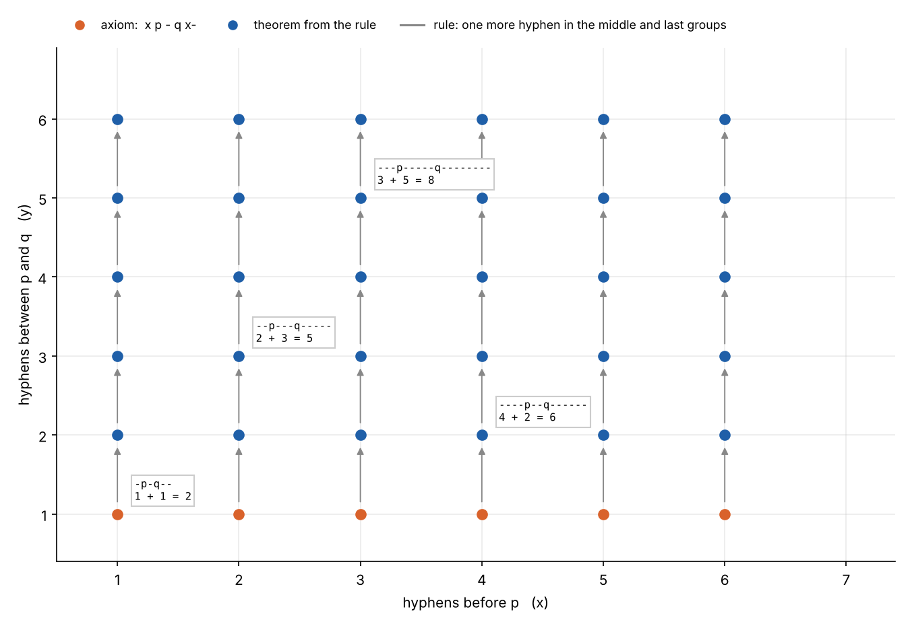
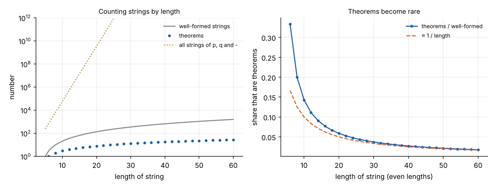

```{=html}
<style>
.pq-box { border: 1px solid #d6dbe2; border-radius: 8px; padding: .8rem 1rem; margin: .8rem 0; font-size: .88rem; }
.pq-h { font-weight: 600; margin-bottom: .45rem; }
.pq-read { display: flex; flex-wrap: wrap; align-items: center; gap: .35rem; }
.pq-read select { font-size: .88rem; padding: .05rem .2rem; }
.pq-verdict { margin: .6rem 0; }
.pq-ok { color: #2a9d6f; font-weight: 600; } .pq-half { color: #b08d3c; font-weight: 600; } .pq-no { color: #c0392b; font-weight: 600; }
.pq-table { display: flex; flex-direction: column; gap: .15rem; }
.pq-row { display: grid; grid-template-columns: 11rem 7rem 1fr 3.5rem; gap: .5rem; align-items: center; }
.pq-row code, .pq-steps code { font-size: .85rem; background: none; padding: 0; }
.pq-non { color: #777; }
.pq-tag { font-size: .75rem; color: #888; }
.pq-t { color: #2a9d6f; font-weight: 600; } .pq-f { color: #c0392b; font-weight: 600; } .pq-dim { color: #999; }
.pq-row2 { display: flex; gap: .5rem; }
.pq-in { font-family: ui-monospace, Menlo, monospace; font-size: .95rem; width: 16rem; padding: .1rem .3rem; }
.pq-go { font-size: .82rem; padding: .15rem .7rem; border: 1px solid #1f5fa8; border-radius: 5px; background: #1f5fa8; color: #fff; cursor: pointer; }
.pq-steps { margin: .2rem 0; padding-left: 2rem; }
@media (max-width: 640px) { .pq-row { grid-template-columns: 1fr 1fr; } }
</style>
```

[Part 1](../mu-puzzle/index.qmd) was about a formal system whose strings meant nothing. The MU puzzle was a
question about which strings the rules could reach, and answering it took a step outside the system. Chapter II of
*Gödel, Escher, Bach* is titled "Meaning and Form in Mathematics", and it introduces a second system, just as
mechanical, whose theorems turn out to say something. The question is where that meaning comes from.

## The system

The pq-system has three symbols: **p**, **q** and the hyphen. A *well-formed* string is some hyphens, then p, then
some hyphens, then q, then some hyphens, such as `--p---q-----`. Write $x$, $y$ and $z$ for the three groups of
hyphens.

There are infinitely many axioms, all made from one pattern:

> **Axiom pattern.** $x$**p-q**$x$**-** is an axiom whenever $x$ is a string of one or more hyphens.

So `-p-q--`, `--p-q---` and `---p-q----` are axioms. There is a single rule:

> **Rule.** If $x$**p**$y$**q**$z$ is a theorem, so is $x$**p**$y$**-q**$z$**-**.

The rule adds one hyphen to the middle group and one to the last. Starting from the axiom `--p-q---` and applying the
rule twice gives `--p--q----` and then `--p---q-----`.

Hofstadter suggests working out which strings are theorems before reading on. A quick look at a few is usually
enough: the last group of hyphens is always as long as the first two together.

## The pattern, and a decision procedure

Every axiom has $z = x + 1$ with $y = 1$, and the rule adds one to both $y$ and $z$. So every theorem has
$z = x + y$, with $x$ and $y$ each at least one. Conversely, any string of that form can be reached: start from the
axiom with the right $x$ and apply the rule $y - 1$ times.



This gives a **decision procedure**: a mechanical test that says, for any string, whether it is a theorem. Count
the three groups of hyphens and check that the third is the sum of the other two.

There is also a cruder test, which works because both the axiom pattern and the rule make strings *longer*. To decide
whether a string of length $n$ is a theorem, generate every theorem up to length $n$ and see if it is among them.
Nothing longer can ever shrink back to it. The MIU system had no such guarantee, because rules III and IV shorten
strings. That is why the MU puzzle could not be settled by searching and needed an invariant instead.

## Meaning by isomorphism

Now read the symbols as words:

| Symbol | Reading |
|:--|:--|
| p | plus |
| q | equals |
| a string of $n$ hyphens | the number $n$ |

Then `--p---q-----` reads "2 plus 3 equals 5", a true statement. Every theorem reads as a true sum, and every true
sum of positive numbers is a theorem. Well-formed strings that are not theorems, like `--p--q-----`, read as false
sums ("2 plus 2 equals 5").

Hofstadter's point is that this correspondence is an **isomorphism**: a one-to-one mapping between two structures
that preserves the structure. Here it maps the theorems onto the true additions, and the non-theorems onto the false
ones. The meaning of p and q is nothing more than that mapping. The system itself contains no notion of addition. It
shuffles hyphens, and it is we who notice that the shuffling tracks something we already understand.

He calls this *passive* meaning. The rules do not use the meaning, and a string's being a theorem does not depend on
it. Yet the meaning is not arbitrary either: given the system, "plus" and "equals" are the readings that fit.

## Try it

Choose what p and q mean and the panel tests the reading against 25 theorems and 99 near-miss non-theorems. A reading
is an isomorphism only if it makes every theorem true *and* every non-theorem false. Below that, type any string to
check it and see its derivation.

```{ojs}
//| echo: false
pqView = {
  const host = htl.html`<div></div>`;
  const mod = await import(new URL("pq.js", document.baseURI).href);
  mod.mountPQ(host);
  return host;
}
```

Some readings worth trying:

- **p = equals, q = taken from.** Then `--p---q-----` says "2 equals 3 taken from 5". This is Hofstadter's own second
  reading, and it is an isomorphism too. The meaning is not unique: two quite different readings fit perfectly.
- **p = plus, q = is at least.** Every theorem is true, but so is "2 plus 2 is at least 3", which is not a theorem.
  The reading is consistent with the system but says less than the system does.
- **p = times, q = equals.** One theorem comes out true, `--p--q----`, because 2 × 2 happens to equal 2 + 2.
  Everything else is false.

## The isomorphism, proved

The claim "the theorems are exactly the true sums" has two halves. **Soundness**: every theorem is a true sum.
**Completeness**: every true sum is a theorem. Together they are the isomorphism. Both are short proofs in Lean 4.

A hyphen string is fully described by its length, so the Lean version records a string by the three lengths. (That
is itself a small isomorphism, between strings of hyphens and natural numbers.)

```lean
/-- Axioms: x p - q x-  for any x of at least one hyphen.
    Rule:   from x p y q z, derive x p y- q z-. -/
inductive PQ : Nat → Nat → Nat → Prop
  | ax {x} : 0 < x → PQ x 1 (x + 1)
  | rule {x y z} : PQ x y z → PQ x (y + 1) (z + 1)

/-- Soundness of the addition reading: every theorem is a true sum. -/
theorem PQ.sound {x y z : Nat} (h : PQ x y z) : x + y = z ∧ 0 < x ∧ 0 < y := by
  induction h with
  | ax hx => omega
  | rule _ ih => omega

/-- Completeness: every true sum of positive numbers is a theorem. -/
theorem PQ.complete {x y : Nat} (hx : 0 < x) (hy : 0 < y) : PQ x y (x + y) := by
  induction y with
  | zero => omega
  | succ y ih =>
    cases y with
    | zero => exact PQ.ax hx
    | succ y =>
      have := PQ.rule (ih (by omega))
      simpa [Nat.add_assoc] using this

/-- So the theorems are exactly the true additions. -/
theorem PQ.iff {x y z : Nat} : PQ x y z ↔ (0 < x ∧ 0 < y ∧ x + y = z) := by
  constructor
  · intro h; have := h.sound; omega
  · rintro ⟨hx, hy, rfl⟩; exact PQ.complete hx hy

/-- The subtraction reading: x p y q z says x = z − y. -/
theorem PQ.sound_subtraction {x y z : Nat} (h : PQ x y z) : x = z - y := by
  have := h.sound; omega

/-- A decision procedure, extracted from the characterisation. -/
instance (x y z : Nat) : Decidable (PQ x y z) :=
  decidable_of_iff _ PQ.iff.symm

example : PQ 2 3 5 := by decide        -- --p---q-----   (2 + 3 = 5)
example : ¬ PQ 2 2 5 := by decide      -- --p--q-----    (2 + 2 ≠ 5)
```

Soundness is an induction over derivations, as in Part 1: the axiom is a true sum, and the rule turns a true sum
into another one. Completeness is an induction on $y$: build the derivation of $x$**p**$y$**q**$(x+y)$ from the one
for $y - 1$. The last few lines turn the characterisation into a decision procedure, which Lean then runs: `decide`
checks that `--p---q-----` is a theorem and `--p--q-----` is not.

## How rare meaning is

Most well-formed strings are not theorems. Of the strings of length $n$, roughly $n^2/2$ are well formed, but only
about $n/2$ are theorems, so the share falls off like $1/n$. Among all strings of p, q and hyphens, theorems are
vanishingly rare.



The system is a precise filter. Its rules pick out, from a sea of strings, exactly the ones that our reading makes
true. That precision is what lets the reading carry over: once a reading fits every theorem we have checked and the
proof says it fits them all, we can treat a newly derived theorem as a new fact about numbers.

## Where this goes

The pq-system is a toy, but it sets up the strategy of the whole book. Hofstadter will build a formal system rich
enough to express statements about all of arithmetic, Typographical Number Theory, and give its symbols meaning by
isomorphism in exactly this way. Then he will use Gödel's trick, coding strings as numbers, so that some statements
about numbers are, through the isomorphism, also statements about the system's own theorems. The meaning that the
pq-system acquires passively becomes, in a richer system, the route to self-reference.

He also comes back to the question of interpretation by way of geometry. Euclid's parallel postulate looked like a
statement about the one true space, until other consistent geometries showed that the same axioms, minus that one,
admit several readings. Which interpretation a system has depends on its axioms, and a change of axiom can force a
change of meaning.

*The Lean file and figure scripts are in [`src/geb`](https://github.com/paulmilne/paulmilne.github.io/tree/main/src/geb).*

## References

- D. R. Hofstadter, *Gödel, Escher, Bach: an Eternal Golden Braid*, Basic Books (1979; 20th-anniversary edition 1999),
  chapter II, "Meaning and Form in Mathematics", and chapter IV, "Consistency, Completeness, and Geometry".
- L. de Moura and S. Ullrich, "The Lean 4 theorem prover and programming language", *Automated Deduction –
  CADE 28*, Lecture Notes in Computer Science 12699, 625–635 (2021).
