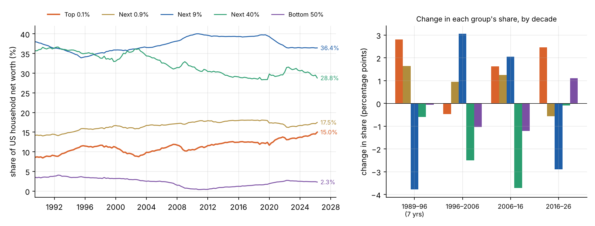
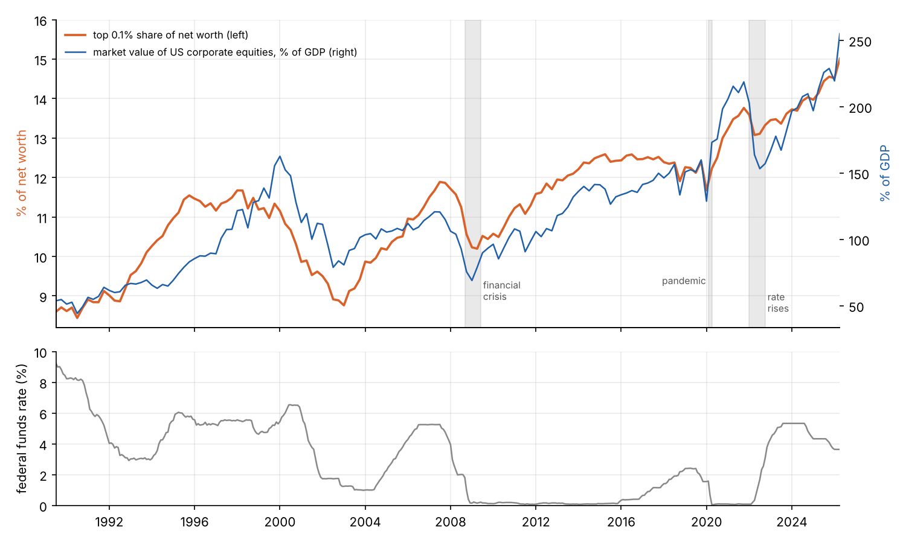
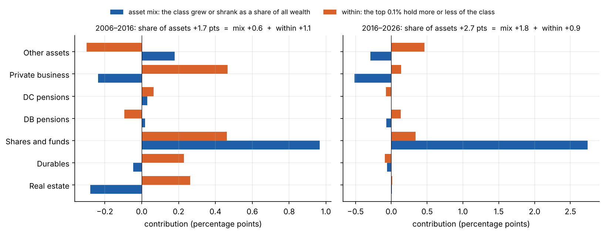
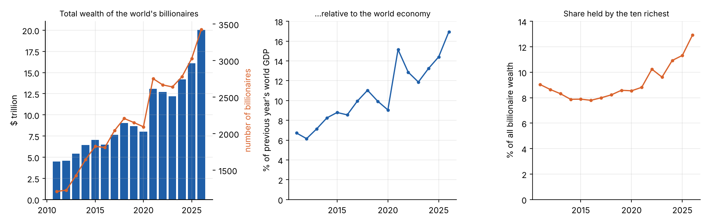
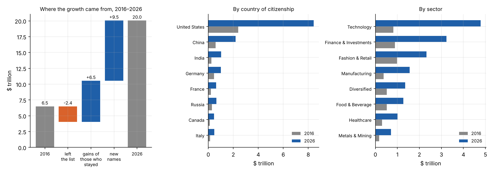
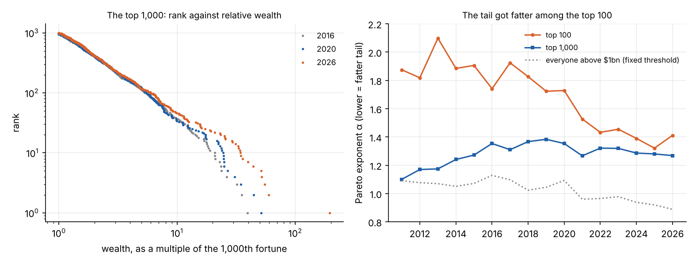
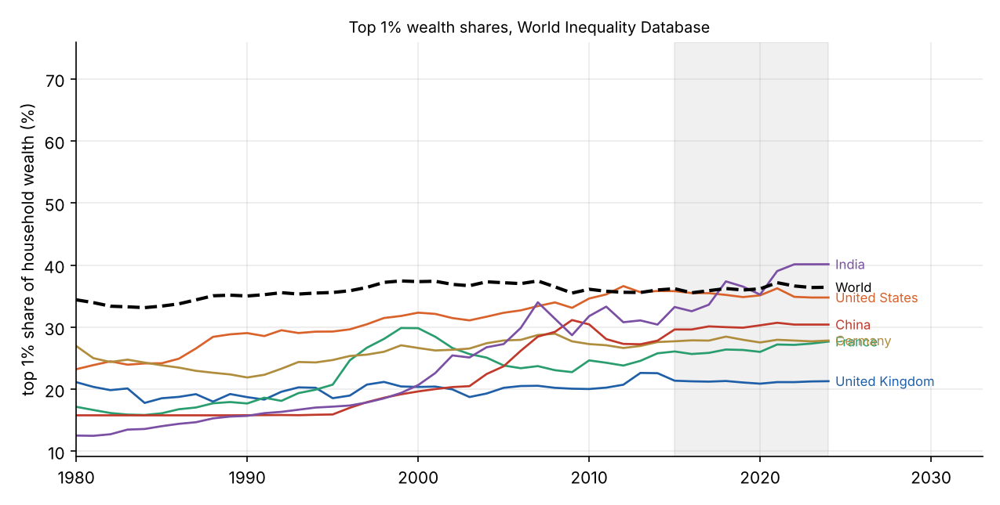

```{=html}
<style>
.dfa-top { font-size: .9rem; margin-bottom: .4rem; } .dfa-top select { font-size: .9rem; }
.dfa-checks { display: flex; flex-wrap: wrap; gap: .2rem .9rem; font-size: .84rem; margin-bottom: .3rem; }
.dfa-checks label { display: flex; align-items: center; gap: .25rem; }
.dfa-sw { width: .8rem; height: .8rem; border-radius: 2px; display: inline-block; }
.dfa-canvas { border: 1px solid #e0e3e8; border-radius: 6px; display: block; }
.dfa-read { font-size: .84rem; margin-top: .35rem; display: flex; flex-wrap: wrap; gap: .1rem .8rem; }
.dfa-val { font-weight: 600; }
.dfa-note { font-size: .78rem; color: #777; margin-top: .2rem; }
</style>
```

It is widely said that wealth has been concentrating in fewer and fewer hands, faster than ever. This series tries
to work out whether that is true, why it has happened, which feedback loops are involved, and what has ended such
episodes in the past. The plan is:

1. **What the data shows** (this part).
2. The candidate causes, each tested against data: interest rates, superstar firms and network effects, private
   markets, tax, labour, globalisation, the pandemic and the AI boom.
3. A model of the feedback loops, and what it predicts about the shape of the distribution.
4. How concentrations of wealth have ended historically, and what would have to happen for this one to level
   off, reverse or persist.
5. The strongest counter-arguments and the limits of the measurements.

The series is about what happened and why. Whether it is a problem, and what if anything should be done, are separate
questions on which people reasonably disagree, and I will try to keep them apart.

## The short answer

- **At the very top, concentration has accelerated.** The world's billionaires went from \$6.5 trillion in 2016 to
  \$20.1 trillion in 2026, doubling relative to the world economy after rising by a quarter in the five years before.
  In the US, the share of household wealth held by the top 0.1% rose from 12.6% to a record 15.0%. That is faster
  than its long-run pace, though not unprecedented: the ten years to 2013 saw a larger rise.
- **Below the very top, it has not.** The rest of the US top 1% *lost* share over the decade, the next 9% lost more,
  and the bottom half gained. In the World Inequality Database, the top 1% share of wealth is flat since 2015 for
  the world, the US and the UK.
- **It happened in two bursts**, 2020–21 and 2023–26, not steadily.
- **It was carried by listed shares.** Two-thirds of the top 0.1%'s gain was corporate equity, and most of the rise
  in their share comes from shares outgrowing every other kind of asset.
- **It is concentrated even among billionaires.** Ten people account for a third of the gains of those who were
  billionaires throughout.

So the claim in its usual form needs sharpening. Among billionaires the acceleration is clear and recent. In the
broader US data it shows up as a record share for the top thousandth and a faster pace since 2020, while everyone
else in the top 10% lost ground.

## Three sources

| Source | What it measures | Covers |
|:--|:--|:--|
| Federal Reserve, Distributional Financial Accounts (DFA) | Net worth of US households by wealth group, by type of asset | US, quarterly, 1989 to 2026 Q2 |
| Forbes World's Billionaires lists | Estimated net worth of each billionaire | World, annual (March), 2011 to 2026 |
| World Inequality Database (WID), via Our World in Data | Top wealth shares, estimated from tax, survey and national accounts data | Many countries, annual, to 2024 |

Each has weaknesses, covered [at the end](#what-is-uncertain). They measure different things, and where they disagree
that is informative.

## The United States, by wealth group

The DFA splits households into five groups by net worth: the top 0.1% (about 130,000 households), the next 0.9%,
the next 9%, the next 40%, and the bottom half.



| | 1989 | 2006 | 2016 | 2026 | Change 2016–26 |
|:--|--:|--:|--:|--:|--:|
| Top 0.1% | 8.6% | 10.9% | 12.6% | 15.0% | **+2.5** |
| Next 0.9% | 14.2% | 16.8% | 18.0% | 17.5% | −0.6 |
| Next 9% | 38.0% | 37.3% | 39.3% | 36.4% | −2.9 |
| Next 40% | 35.7% | 32.6% | 28.9% | 28.8% | −0.1 |
| Bottom 50% | 3.5% | 2.4% | 1.2% | 2.3% | +1.1 |

Three things stand out.

**The top 0.1% pulled away from the rest of the top 1%.** In the decade to 2016, the whole of the top 10% gained
together. In the decade since, only the top thousandth did. The top 1% as a whole rose from 30.6% to 32.5%, a
*smaller* rise than in the previous decade (27.7% to 30.6%).

**The pace is above average, but not a record.** The top 0.1% share has risen by an average of 0.17 points a year
since 1989, by 0.25 a year over the last decade, and by 0.40 a year since the end of 2019. The share is now the
highest in the series. But the size of a ten-year change depends heavily on where the window starts. Measured from
the trough after the dot-com crash, the ten years to early 2013 saw a rise of 3.2 points, more than the latest 2.5.
On this source alone, the last decade is a strong continuation of a 35-year trend more than a break from it.

**The bottom half gained, from a very low base.** Its share bottomed out at 0.4% at the end of 2010, after the housing
crash wiped out much of its home equity. It has since recovered to 2.3%, still below the 3.5% of 1989. In real terms
its net worth nearly tripled between 2016 and 2026. The top 0.1%'s rose by a factor of 1.85, and the groups in
between by about 1.5.

**The timing was uneven.** The top 0.1% share was flat from 2016 to the end of 2019 (12.6% to 12.4%). It rose 1.4
points in 2020–21, fell half a point in 2022, and rose another 1.7 points to mid-2026.

All groups grew richer in real terms over the decade. Total household net worth went from \$86 trillion to \$186
trillion, against a 39% rise in prices. What changed is how the total was divided.

### Explore the data

```{ojs}
//| echo: false
dfaView = {
  const host = htl.html`<div></div>`;
  const mod = await import(new URL("dfa.js", document.baseURI).href);
  await mod.mountDFA(host);
  return host;
}
```

## The top's share follows the stock market

The top 0.1% share tracks the value of the stock market closely.



The value of US corporate equities was 54% of GDP in 1989, 135% in 2016 and 255% in mid-2026. The top 0.1% share
moves with it: across quarters, the correlation between the change in the share and the percentage change in the
equity ratio is 0.81. Both dips in the share during the last 25 years, in 2000–02 and 2008–09, were stock market
falls, and so was the smaller one in 2022.

The reason is in the portfolios. In 2026 the top 0.1% hold:

- 25% of all directly held shares and mutual funds,
- 29% of all private business equity,
- but only 4% of housing.

Shares and funds make up 57% of their assets, up from 44% in 2016. The bottom half's assets are 47% housing and 21%
cars and other durables, with under 4% in shares. A rise in share prices relative to everything else raises the top's
share of wealth almost mechanically.

One caution. The Fed builds the DFA by taking the national total for each asset class and dividing it between groups
using a household survey that is run every three years. Between surveys, movements in the shares mostly reflect
changes in asset prices applied to each group's holdings. So some of that close fit is built into the method.

## Decomposing the rise: asset mix against share of each asset

A group's share of total assets can rise in two ways. The assets it holds most of can grow faster than other assets
(**asset mix**). Or the group can come to hold a bigger share of each kind of asset (**within**). Writing $w_a$ for
asset class $a$'s share of all household assets and $s_a$ for the top 0.1%'s share of that class, the top's overall
share is $\sum_a w_a s_a$, and its change splits exactly into

$$
\Delta \sum_a w_a s_a \;=\; \underbrace{\sum_a \Delta w_a \, \bar s_a}_{\text{asset mix}} \;+\; \underbrace{\sum_a \bar w_a \, \Delta s_a}_{\text{within}} ,
$$

where bars are averages of the start and end values.



In the decade to 2016, the top 0.1%'s share of assets rose 1.7 points, of which 0.6 came from asset mix and 1.1
from holding more of each class. In the decade to 2026 it rose 2.7 points: **1.8 from asset mix and 0.9 from
within**. The mix effect is all listed shares and funds, which grew as a proportion of all wealth (+2.7 points), partly offset by
private business and other assets shrinking as a proportion.

So the acceleration of the last decade was mainly a *revaluation*. The top did not suddenly capture a much bigger
slice of each asset class. The class they already held most of, corporate equity, became worth far more relative to
houses, pensions and deposits. Of the \$17 trillion the top 0.1% gained, 66% was shares and funds, 12% private
business and 6% housing.

This says which asset carried the rise. It does not say why equities rose so much, or why so much of the equity is
held by so few. Those are questions for Part 2.

## The world's billionaires

The Forbes list gives a view of the extreme top across the world.



| | 2011 | 2016 | 2021 | 2026 |
|:--|--:|--:|--:|--:|
| Billionaires | 1,209 | 1,811 | 2,754 | 3,428 |
| Total wealth | \$4.5tn | \$6.5tn | \$13.1tn | \$20.1tn |
| As a share of world GDP | 6.7% | 8.6% | 15.1% | 16.9% |
| Held by the ten richest | 9.0% | 7.8% | 8.8% | 12.9% |

Relative to the world economy, billionaire wealth rose by a quarter in the five years to 2016 and then doubled in
the ten years after. As in the US data, it came in bursts: a jump in the year to March 2021, a fall back to 11.9% by
2023, and a new high in 2026.

### Where the growth came from



- **Those on both lists** (1,068 people) saw their combined wealth rise from \$4.0 trillion to \$10.5 trillion, a
  factor of 2.6. Over 2011–16 the equivalent factor was 1.2. The typical member did less well, with a median factor
  of 1.7, because the gains were concentrated: **the ten largest gainers account for 34% of the group's gains, and
  one person for 13%.**
- **New names** (2,359) hold \$9.5 trillion. This overstates new fortunes, because heirs who inherit appear as
  new names, as do people whose names Forbes records differently between years.
- **By country**, the US accounts for \$6.0 trillion of the \$13.6 trillion rise, and its share of billionaire wealth
  went from 37% to 42%. China added \$1.6 trillion and India \$0.8 trillion.
- **By sector**, technology added \$4.0 trillion and went from 13% to 24% of the total. Finance and investments
  added \$2.3 trillion.
- Forbes classes about two-thirds of this wealth as self-made rather than inherited (63% in 2016, 68% in 2026).

American billionaires, 541 people in 2016 and 991 in 2026, held wealth equal to 2.8% of US household net worth in
2016 and 4.9% in 2026. That two-point rise is about the same size as the whole rise in the top 0.1%'s share. The two
sources are built differently and cannot simply be subtracted, but the comparison suggests that most of the top
0.1%'s gain is the gain of about a thousand people within it.

### The shape of the tail

Among the very rich, wealth follows a **Pareto distribution**: the number of people with more than $w$ falls off
as $w^{-\alpha}$. On a plot of rank against wealth with both axes logarithmic, that is a straight line with slope
$-\alpha$. A smaller $\alpha$ means a fatter tail, with more of the total held by the few at the top.



How the exponent is measured matters. Estimated over everyone above \$1 billion, it fell from 1.13 in 2016 to 0.89 in
2026. That figure is misleading. The distribution is not an exact Pareto, and as the whole list grows richer past a
fixed \$1 billion line, the estimate drifts down whether or not the shape has changed.

Measured over a fixed number of people, the picture is more specific:

- For the **top 1,000**, the exponent has barely moved since 2016 (1.35 to 1.27).
- For the **top 100**, it was about 1.8 before 2020 and has been about 1.4 since.

On the left-hand chart the three years lie on top of one another from rank 1,000 up to about rank 100, and separate
above it. The ten richest held 9.4% of the wealth of the top 1,000 in 2016, 10.7% in 2020 and 17.4% in 2026.

So the change in shape is confined to roughly the hundred largest fortunes, and it dates from 2020. Below that, the
world's billionaires are distributed much as they were ten years ago. [Part 3](../wealth-3-the-model/index.qmd) builds
a model of why.

## Other countries



| Top 1% share | 1995 | 2005 | 2015 | 2024 |
|:--|--:|--:|--:|--:|
| World | 35.6% | 37.2% | 36.2% | 36.4% |
| United States | 29.3% | 32.3% | 35.8% | 34.8% |
| United Kingdom | 18.6% | 20.2% | 21.4% | 21.3% |
| France | 20.7% | 23.8% | 26.1% | 27.7% |
| Germany | 24.7% | 27.9% | 27.7% | 27.8% |
| China | 15.9% | 23.7% | 29.6% | 30.4% |
| India | 17.2% | 27.3% | 33.2% | 40.1% |

On this measure, the large rises came *before* 2015: in the US from the 1980s, and in China and India from the
1990s. Since 2015 the top 1% share has been roughly flat for the world, the US, the UK and Germany. India is the
exception.

This is consistent with the US picture above. The recent change is not visible at the level of the top 1%. It is
happening inside the top 1%, at the level of the top 0.1% and beyond.

For the UK, a caution: the official Wealth and Assets Survey is known to under-record the very wealthy. The
Resolution Foundation estimated in 2021 that the top 1% held almost £800 billion more than the survey showed. A
later part will look at the UK in more detail.

## What is uncertain {#what-is-uncertain}

- **The sources disagree on levels.** For the US top 1% in 2024, the DFA gives about 31% and WID about 35%. They use
  different methods and units (households against adults).
- **Estimating top wealth from tax data is contested.** Wealth is not reported to tax authorities, so it is
  inferred from the income it generates. Saez and Zucman's estimates show a large rise in the top 0.1% share since
  1980. Smith, Zidar and Zwick, allowing returns to differ between people, find a rise about half as large. A similar
  dispute exists for incomes between Piketty, Saez and Zucman on one side and Auten and Splinter on the other.
- **What counts as wealth matters.** None of these sources counts the value of future state pensions. Catherine,
  Miller and Sarin estimate that including US Social Security entitlements removes most of the rise in top wealth
  shares since 1989, because those entitlements are large for ordinary households and have grown as interest rates
  fell. Whether an entitlement that cannot be sold or inherited is wealth in the same sense is itself debated.
- **The very top is the least well measured.** The survey underlying the DFA excludes the Forbes 400 by design.
  Forbes's figures are journalists' estimates: reliable for stakes in listed companies, rough for private holdings.
- **These are valuations, not cash.** A fortune held in one company's shares can halve in a year. The 2022 fall shows
  the series can go down as well as up.

None of these overturns the main finding, since the disputes concern levels and long-run trends more than the last
decade at the extreme top. But they mean the numbers carry real uncertainty, and that the statement "inequality
has risen" depends on which measure and which part of the distribution is meant.

## What needs explaining

The data narrows the question for the rest of the series:

1. Why did listed equity become worth so much more relative to the economy, with the ratio nearly doubling in ten
   years?
2. Why is so much of that equity held by so few, and why did a handful of founders' stakes grow fastest of all?
3. Why did the rise come in two bursts, in 2020–21 and 2023–26, after three flat years?
4. Why is it most pronounced in the US, and in technology?
5. Why did the hundred largest fortunes pull away from the rest after 2020 and not before?

[Part 2](../wealth-2-the-causes/index.qmd) takes the candidate explanations one at a time and tests each against these facts.

*The data comes from public sources and is downloaded by [`fetch_data.py`](https://github.com/paulmilne/paulmilne.github.io/tree/main/src/economics); the analysis and figures are in `part1.py` in the same folder.*

## References

- Board of Governors of the Federal Reserve System, [Distributional Financial Accounts](https://www.federalreserve.gov/releases/z1/dataviz/dfa/),
  data to 2026 Q2. Method: M. Batty et al., "Introducing the Distributional Financial Accounts of the United
  States", Finance and Economics Discussion Series 2019-017.
- Forbes, World's Billionaires lists, 2011 to 2026.
- World Inequality Database, top 1% net personal wealth shares, via [Our World in Data](https://ourworldindata.org/grapher/wealth-share-richest-1-percent).
- World Bank, world GDP in current US dollars.
- E. Saez and G. Zucman, "Wealth inequality in the United States since 1913: evidence from capitalized income tax
  data", *Quarterly Journal of Economics* 131(2), 519–578 (2016).
- M. Smith, O. Zidar and E. Zwick, ["Top wealth in America: new estimates under heterogeneous returns"](https://zidar.princeton.edu/sites/g/files/toruqf3371/files/documents/wealth2023.pdf),
  *Quarterly Journal of Economics* 138(1), 515–573 (2023).
- G. Auten and D. Splinter, "Income inequality in the United States: using tax data to measure long-term trends",
  *Journal of Political Economy* 132(7) (2024); and the reply by T. Piketty, E. Saez and G. Zucman,
  ["Income inequality in the United States: a comment"](https://gabriel-zucman.eu/files/PSZ2024.pdf) (2024).
- S. Catherine, M. Miller and N. Sarin, "Social Security and trends in wealth inequality", *Journal of Finance* (2025).
- Resolution Foundation, ["Top 1 per cent has almost £800 billion more wealth than official statistics show"](https://www.resolutionfoundation.org/press-releases/top-1-per-cent-has-almost-800-billion-more-wealth-than-official-statistics-show/) (2021).
