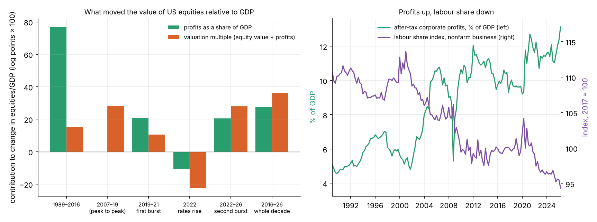
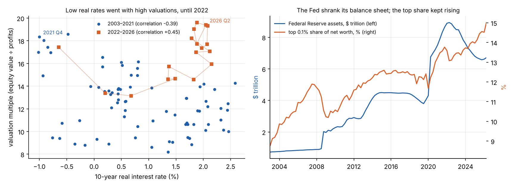
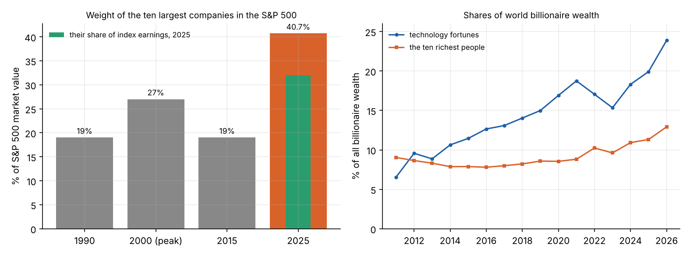
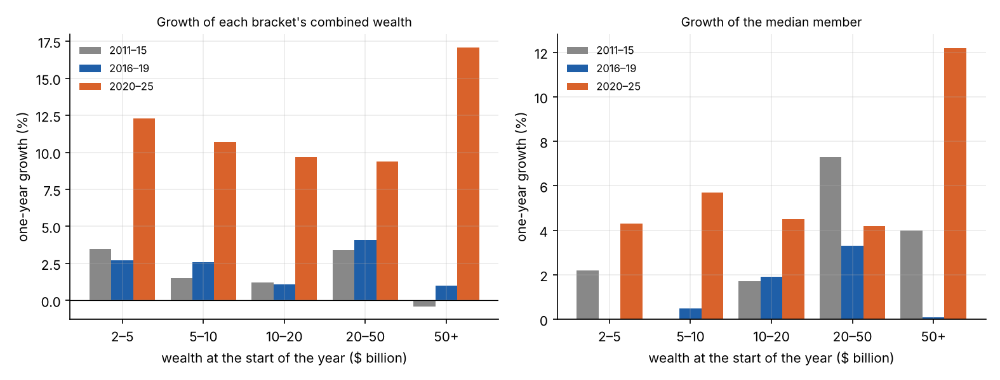
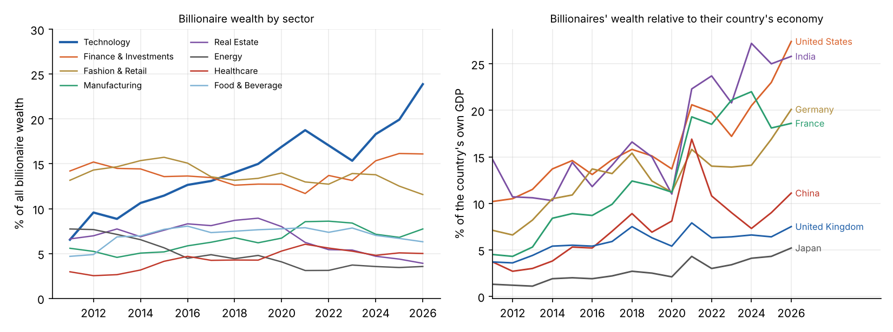

[Part 1](../wealth-1-the-facts/index.qmd) established where wealth has concentrated: among the top 0.1% of American
households and the world's billionaires, in two bursts (2020–21 and 2023–26), carried by listed shares, and most
strongly in the US and in technology. It ended with five questions. This part takes the usual explanations one at a
time and asks whether each fits those facts.

A hypothesis that explains why the well-off in general got richer is not enough. The next 9% of American households
lost share over the decade, and so did most of the top 1%. A good explanation has to account for a gain confined to
the very top, and for its timing.

## The scorecard

| Explanation | Verdict | Why |
|:--|:--|:--|
| Low interest rates and QE | **Up to 2021, yes. Since, no** | Explains about four-fifths of the rise in valuations to 2021; valuations then rose further as rates went up |
| Rising profits, falling labour share | **Yes** | After-tax profits rose from 10.0% to 13.1% of GDP; 43% of the rise in equity values over the decade |
| A few dominant firms | **Yes** | Ten firms went from 19% to 41% of the S&P 500; technology from 13% to 24% of billionaire wealth |
| Expectations about AI | **Yes, for 2023–26** | Valuations rose against rising rates; the largest firms are valued well ahead of their current earnings |
| Bigger fortunes earn higher returns | **Only at the extreme, only since 2020** | Fortunes over \$50bn grew fastest in 2020–25; no such pattern before |
| Private equity and hedge funds | **Not directly** | 3.8% of billionaire wealth, a share that has not risen |
| Founders keeping control | **Enabling** | About half of technology flotations now have dual-class shares |
| Tax | **Enabling; does not explain the timing** | The richest 400 Americans' total tax rate fell from 30% to 24%; unrealised gains are untaxed |
| Globalisation and emerging markets | **Not this decade** | The US share of billionaire wealth rose; China's fell after 2021 |
| The pandemic response | **Trigger for the first burst** | 2020–21: profits, easy money and a jump in the top share |
| Housing | **No** | Under 4% of housing is held by the top 0.1%; property fortunes halved as a share |
| Inheritance | **Not yet** | The self-made share of billionaire wealth rose slightly |
| Political influence | **Not tested here** | Left for Part 4 |

The rest of this post goes through the evidence.

## Why did equities rise? Profits and valuations

Part 1 found that the top's share follows the value of the stock market. The value of US corporate equities relative
to GDP can be split exactly into two factors:

$$
\frac{\text{equity value}}{\text{GDP}} \;=\; \frac{\text{profits}}{\text{GDP}} \times \frac{\text{equity value}}{\text{profits}} .
$$

The first is the share of national output that goes to shareholders as after-tax profit. The second is the
**valuation multiple**: how many dollars investors will pay for a dollar of current profit, which depends on interest
rates and on how fast they expect profits to grow.

| | Equities, % of GDP | Profits, % of GDP | Multiple | Real 10-year rate | Fed assets |
|:--|--:|--:|--:|--:|--:|
| 1989 | 54 | 4.6 | 11.6 | | |
| 2007 | 121 | 9.7 | 12.5 | 2.5% | \$0.9tn |
| 2016 | 135 | 10.0 | 13.5 | 0.2% | \$4.5tn |
| 2019 | 160 | 9.7 | 16.5 | 0.2% | \$4.0tn |
| 2021 | 219 | 11.9 | 18.4 | −1.0% | \$8.6tn |
| 2022 | 157 | 10.7 | 14.7 | 1.5% | \$8.7tn |
| 2026 | 255 | 13.1 | 19.4 | 2.1% | \$6.7tn |

Different things drove different periods:

- **1989 to 2016: profits.** Equities went from 54% to 135% of GDP, and five-sixths of that was profits doubling as a
  share of the economy. The multiple barely moved. Over the same period, labour's share of business income fell.
- **2007 to 2019: valuations.** Profits were flat as a share of GDP. The whole rise came from the multiple.
- **2019 to 2021: mostly profits**, with valuations adding a third.
- **2022: valuations fell** by a fifth as interest rates rose.
- **2022 to 2026: both.** Profits reached a record 13.1% of GDP, and the multiple a record 19.4.

Over the whole decade to 2026, **43% of the rise was profits and 57% was valuation.**

## Low interest rates and quantitative easing

After the 2008 crisis and again in 2020, central banks cut interest rates to near zero and bought government bonds
on a huge scale. That does not send money into shares directly. It leaves the sellers of the bonds holding cash that
earns nothing, they move into riskier assets, and prices rise. Low rates also raise the present value of profits
expected far in the future, which favours growth companies. The Bank of England concluded in 2012 that its own
purchases had raised share prices by at least as much as bond prices, and that the benefit went mainly to the
households holding the most financial assets.

The data fits that story well, up to a point.

From 2003 to 2021, lower real interest rates went with higher valuations (a correlation of −0.39). Between 2007 and
2021 the real 10-year rate fell by 3.5 points and the multiple rose by 47%.

The rate rises of 2022 give a rough measure of the sensitivity. Real rates rose 2.5 points in a year and the
multiple fell 20%, or about 9% per point. Applying that to the fall in rates from 2007 to 2021 predicts a rise in the
multiple of 37%, against the 47% that happened. On that reckoning, **falling interest rates account for roughly
four-fifths of the rise in valuations up to 2021.** One episode is a thin basis for a sensitivity, so this is an
indication, not a measurement.

**Then the relationship broke.** From late 2022 to mid-2026, real rates rose a further 0.6 points and the Federal
Reserve shrank its balance sheet by \$1.9 trillion. On the earlier pattern, valuations should have fallen. They rose
32%, to a record, and the top 0.1% share rose 1.7 points with them. Since 2022 the correlation between real rates
and the multiple has been positive.

So cheap money built the base, and explains the first burst. It cannot explain the second, which took the top share
to its record. Over the decade as a whole, real interest rates ended nearly two points *higher* than they began.

## Profits and labour

The other half of the equity story is that shareholders' profits take a larger share of output. After-tax corporate
profits were 4.6% of GDP in 1989, 10.0% in 2016 and 13.1% in 2026. The official index of labour's share of
business-sector income fell from 109 to 99.5 between 1989 and 2016, and to 94 by 2026.

Why the labour share fell is itself disputed. The candidates include automation, globalisation, weaker unions, the
growth of firms with market power, and the rise of highly profitable firms that employ few people relative to their
revenue. This series cannot settle that. What the data does show is that a three-point rise in the profit share in
ten years is large, and that it accounts for a little under half of the rise in equity values.

Lower interest costs and lower corporate tax rates also raise after-tax profits, so this is not wholly separate from
the previous section or from tax.

## A few dominant firms

The gains in the stock market have not been evenly spread across companies.

According to RBC Wealth Management, the ten largest companies made up about 19% of the S&P 500 in 1990 and again in
2015, and 27% at the peak of the dot-com boom in 2000. At the end of 2025 they were 41%, a record.

The billionaire data shows the same thing from the owners' side. Technology fortunes were 6.5% of billionaire wealth
in 2011, 12.6% in 2016 and 23.9% in 2026. In 2016 four of the ten richest people in the world had made their fortunes in
technology, alongside the owners of a clothing retailer, a telecoms group, an industrial conglomerate and a
financial-data company. In 2026, seven of the ten made theirs at American technology companies that they founded or
run.

This is the "superstar firm" pattern described by Autor and colleagues: in markets where the best product can serve
everyone at almost no extra cost, and where each user makes the product more valuable to the others, a few firms
take most of the market. Their founders hold large stakes. That is the most direct answer to why the gain was
confined to so few people: **it is concentrated in the shareholders of about ten companies, and above all in their
founders.**

## A bet on the future

The ten largest companies were 41% of the S&P 500 by value at the end of 2025, but were expected to produce about
32% of its earnings. In 2015, the two figures were roughly equal. The gap is the market's expectation that
their profits will grow much faster than everyone else's.

That fits what the decomposition showed for 2022–26: valuations rose 32% while interest rates were rising. With
rates pushing the other way, the only thing that can lift the multiple is a belief in faster profit growth.
The obvious source of that belief is artificial intelligence.

So far, AI appears in the national accounts mainly as *spending*. The St. Louis Fed estimated that investment in
computing equipment, software, research and data centres contributed about one percentage point to US growth in the
first nine months of 2025, or 39% of the total. Building data centres adds to GDP as any construction does. It is
not evidence that the economy has become more productive, and a clear economy-wide productivity gain from AI has yet
to be shown. That is normal for a technology of this kind: electricity and computers both took decades to show up in
productivity.

The implication for this series is that **a large part of the second burst is capitalised expectation.** If the
expected profits arrive, the valuations will be justified and the concentration will persist. If they do not, or if
they arrive at different firms, the top share will fall, as it did by two and a half points between 2000 and 2003.
Part 4 returns to this.

## Do bigger fortunes grow faster?

A feedback loop needs wealth to help make more wealth. One version is that returns rise with the size of the
fortune, because the very rich can take more risk, pay for better advice, and get access to investments closed to
others. Studies using Scandinavian tax records, which cover everyone, do find this across the whole population.

The Forbes lists allow a rough test at the top. For everyone on the list in two successive years, compare growth in
wealth by its size at the start.

Before 2020 there is no sign that larger fortunes grew faster. Since 2020, fortunes above \$50 billion grew by 17%
a year, against 9% to 12% for the brackets below. Excluding the single largest fortune, the figure is 13%. The
median fortune above \$50 billion grew 12% a year, two to three times the median in the other brackets.

This is suggestive only. The top bracket is 35 people, and its growth swings widely from year to year. The test also
has a bias: people whose wealth falls below \$1 billion drop off the list, which flatters the lowest bracket, so that
bracket is left out of the figure.

The reading that fits best is that these are not higher returns on a diversified portfolio. They are **founders'
stakes in the few companies that the market has revalued most.** The largest fortunes grew fastest because they are
the most concentrated in the superstar firms.

## Private equity and hedge funds

Private markets have grown enormously, and their managers are paid a share of the gains. Have they produced the new
concentration? Directly, the Forbes data says no.

| Share of billionaire wealth | 2011 | 2016 | 2021 | 2026 |
|:--|--:|--:|--:|--:|
| Private equity | 1.4% | 1.1% | 1.1% | 1.4% |
| Hedge funds | 2.6% | 2.8% | 1.9% | 1.9% |
| Venture capital | 0.2% | 0.3% | 0.4% | 0.5% |
| All finance and investments | 14.2% | 13.6% | 11.7% | 16.1% |
| Technology | 6.5% | 12.6% | 18.7% | 23.9% |
| Real estate | 6.6% | 8.3% | 6.2% | 3.9% |

Fortunes made in private equity, hedge funds and venture capital together are under 4% of billionaire wealth, and
their share has not risen. Finance as a whole has kept pace with the total without leading it.

Private markets may matter in less direct ways that this data cannot show. Companies now stay private for longer, so
more of their early growth accrues to founders and specialist funds before the public can buy shares. And private
holdings are valued infrequently, so wealth held that way is measured less well.

## Founders keeping control

A founder's stake normally shrinks as a company raises money and matures, and investors can remove a founder who
performs badly. Dual-class shares, which give the founder's shares many votes each, weaken both effects.

Jay Ritter's data on US flotations shows how far this has spread. From 1980 to 2000, about 5% of technology companies
going public had dual-class shares. In 2015 it was 37%, and in 2025 it was 48%.

This does not create wealth by itself. It lets founders keep control without keeping a majority of the shares, and
makes it easier to hold a concentrated stake for decades. It also means that ownership figures understate
concentration of *control*. A founder can hold a small minority of the shares and a majority of the votes, and so direct the whole
company's resources. Wealth statistics do not capture that.

## Tax

Two claims need separating.

**How much tax the very rich pay.** Using administrative data, Balkir, Saez, Yagan and Zucman estimate that the 400
wealthiest Americans paid a total tax rate, counting all taxes, of 24% of their economic income in 2018–20. That
compares with 30% for the population as a whole and 45% for the highest earners from employment. Their rate had been
about 30% in 2010–17. The main reason the rate is low is structural: most of their income is the rising value of
shares they do not sell, and unrealised gains are not taxed. These estimates have been challenged, by the Cato Institute among others, and they depend on counting gains that have not been realised as income.

**Whether tax explains the last decade.** Lower tax at the top lets fortunes compound faster, so it belongs among
the enabling conditions. It does not fit the timing. The US cut corporate and top personal rates in 2017, and the
top 0.1% share was flat from 2016 to 2019. The bursts came in 2020–21 and 2023–26, when there was no comparable
change. And a six-point fall in a tax rate is small beside fortunes that multiplied by 2.6.

This bears on the long-running argument over supply-side economics, the claim that lower tax rates at the top raise
growth enough to benefit everyone. The evidence is contested. Hope and Limberg, studying fifty years of major tax
cuts for the rich in eighteen OECD countries, found that they raised the top 1%'s share of income and had no
significant effect on growth or unemployment. Against that, Romer and Romer, and Mertens and Ravn, find that tax
changes in general have substantial effects on output, and reviews by the Tax Foundation conclude that most studies
find taxes harm growth. The data in this series cannot settle it. It measures how wealth is divided, not what growth
would otherwise have been. What it does show is that every group's real wealth rose over the decade, and that the
recent surge at the top is not well explained by tax changes.

## Globalisation

From the 1990s to the mid-2010s, much of the growth in the number of billionaires came from China, India, Russia and
other emerging economies. In the last decade the centre of gravity moved back.

| Billionaire wealth, % of own GDP | 2011 | 2016 | 2021 | 2026 |
|:--|--:|--:|--:|--:|
| United States | 10.2 | 13.1 | 20.6 | 27.4 |
| India | 14.7 | 11.8 | 22.3 | 25.8 |
| Germany | 7.1 | 13.7 | 15.8 | 20.1 |
| France | 4.5 | 8.7 | 19.3 | 18.6 |
| China | 3.7 | 5.2 | 16.9 | 11.1 |
| United Kingdom | 3.7 | 5.4 | 7.9 | 7.5 |
| Japan | 1.3 | 1.9 | 4.3 | 5.2 |

Three things stand out. The rise is not only American: India's is as large, and Germany's and France's are
substantial. It is far from uniform: the UK and Japan have much less billionaire wealth relative to their economies,
and theirs has grown slowly. And **China reversed.** Its billionaires' wealth tripled relative to GDP between 2016
and 2021, then fell by a third. That fall coincided with a regulatory campaign against large technology companies
and a collapse in the property market. Whatever one thinks of the policy, it is a recent example of a concentration
of wealth being reduced by a government's decision, which is relevant to Part 4.

## What does not explain it

- **Housing.** The top 0.1% hold under 4% of American housing, and housing was 6% of their gain. Property fortunes
  fell from 8.3% to 3.9% of billionaire wealth. Rising house prices matter a great deal for the gap between owners
  and renters, but not for the extreme top.
- **Inheritance.** Forbes classes 63% of billionaire wealth as self-made in 2016 and 68% in 2026. The median
  billionaire is 66, up from 64. Inheritance will matter more as this generation dies, but it has not driven the
  recent rise.
- **A closed elite.** Of the hundred richest people in 2016, 50 were still in the top hundred five years later, and
  the figure was 54 for 2011–16 and 52 for 2021–26. Turnover at the top has not slowed. Only five of 2016's ten
  richest were still in the top ten in 2026.

## Putting it together

The evidence points to a chain with four links, each necessary:

1. **Profits took a larger share of output**, while labour's share fell. This is a 35-year trend that continued.
2. **Investors paid more for each dollar of profit.** Until 2021 that was mainly falling interest rates. Since 2022
   it has been expectations of growth, chiefly from AI.
3. **Both effects were concentrated in about ten firms**, in markets where scale and network effects favour a single
   winner.
4. **The founders of those firms kept large stakes**, helped by share structures that preserve control and by a tax
   system that does not tax gains until they are realised.

Remove any one and the outcome is different. High valuations spread across thousands of firms with dispersed
ownership would have enriched pension funds and the top 10% generally, which is roughly what happened from 2009 to
2016. What changed after 2020 is that the gains narrowed to a few firms whose ownership was already concentrated.

This also answers the questions from Part 1. The rise came in bursts because valuations move in bursts. It is
strongest in the US and in technology because that is where the dominant firms are. And the tail of the distribution
got fatter after 2020 because the largest fortunes were the ones most concentrated in the firms that were revalued.

Several of these links feed on themselves. A high share price is a cheap currency for buying competitors, hiring
scarce people and funding enormous investment, which reinforces dominance, which supports the share price. Those are
the feedback loops that [Part 3](../wealth-3-the-model/index.qmd) models, along with the forces that might limit them.

## What this part did not test

- **Political influence**: whether concentrated wealth shapes the tax and competition policy that then protects it.
- **Causation between the links**: for example, how far low interest rates themselves raised profits and
  concentration by making debt cheap for large firms.
- **Tax across countries**: a proper comparison of countries that cut top rates with those that did not.
- **The UK in detail**, where billionaire wealth is far lower relative to the economy than in the US.

*Data and code: [`src/economics`](https://github.com/paulmilne/paulmilne.github.io/tree/main/src/economics), in `fetch_data.py` and `part2.py`.*

## References

- D. Autor, D. Dorn, L. Katz, C. Patterson and J. Van Reenen, "The fall of the labor share and the rise of superstar
  firms", *Quarterly Journal of Economics* 135(2), 645–709 (2020).
- A. Balkir, E. Saez, D. Yagan and G. Zucman, ["How much tax do US billionaires pay? Evidence from administrative data"](https://www.nber.org/papers/w34170),
  NBER Working Paper 34170 (2025); and the critique by the Cato Institute, ["What's the tax rate of the Forbes 400?"](https://www.cato.org/blog/whats-tax-rate-forbes-400) (2025).
- Bank of England, ["The distributional effects of asset purchases"](https://www.bankofengland.co.uk/-/media/boe/files/quarterly-bulletin/2012/the-distributional-effects-of-asset-purchases.pdf),
  *Quarterly Bulletin* 2012 Q3.
- A. Fagereng, L. Guiso, D. Malacrino and L. Pistaferri, "Heterogeneity and persistence in returns to wealth",
  *Econometrica* 88(1), 115–170 (2020).
- D. Hope and J. Limberg, ["The economic consequences of major tax cuts for the rich"](https://researchonline.lse.ac.uk/id/eprint/107919),
  *Socio-Economic Review* 20(2), 539–559 (2022).
- K. Mertens and M. Ravn, "The dynamic effects of personal and corporate income tax changes in the United States",
  *American Economic Review* 103(4), 1212–1247 (2013).
- RBC Wealth Management, ["The 'Great Narrowing': S&P 500 concentration"](https://www.rbcwealthmanagement.com/en-us/insights/the-great-narrowing-sp-500-concentration) (2026).
- J. Ritter, ["Initial public offerings: dual class structure of IPOs through 2025"](https://site.warrington.ufl.edu/ritter/files/IPOs-Dual-Class.pdf),
  University of Florida (2025).
- C. Romer and D. Romer, "The macroeconomic effects of tax changes: estimates based on a new measure of fiscal
  shocks", *American Economic Review* 100(3), 763–801 (2010).
- Federal Reserve Bank of St. Louis, ["Tracking AI's contribution to GDP growth"](https://www.stlouisfed.org/on-the-economy/2026/jan/tracking-ai-contribution-gdp-growth) (January 2026).
- Tax Foundation, ["Reviewing the recent evidence of the effect of taxes on economic growth"](https://taxfoundation.org/research/all/federal/reviewing-recent-evidence-effect-taxes-economic-growth/).
- Data: Federal Reserve (Financial Accounts, Distributional Financial Accounts, H.4.1), Bureau of Economic Analysis
  and Bureau of Labor Statistics via FRED; Forbes World's Billionaires lists 2011–2026; World Bank.
