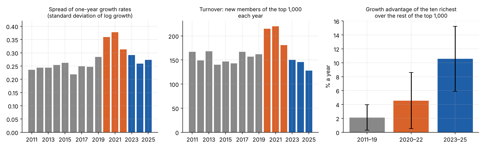
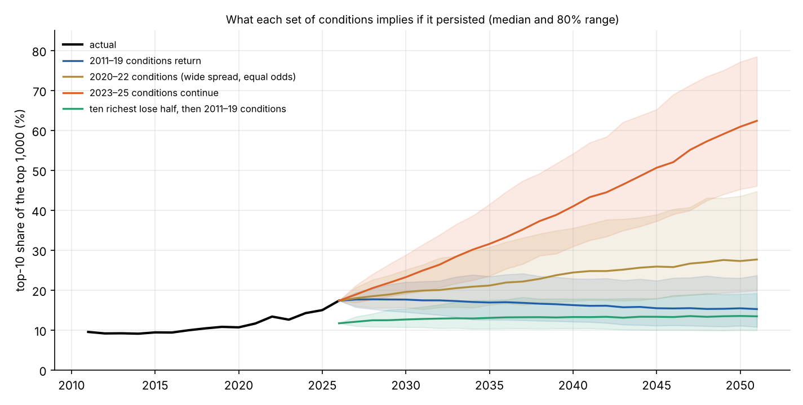

```{=html}
<style>
.ws-grid { display: grid; grid-template-columns: minmax(0, 1fr) 250px; gap: 1.1rem; align-items: start; margin: 1rem 0; }
.ws-canvas { border: 1px solid #e0e3e8; border-radius: 6px; display: block; margin-bottom: .4rem; }
.ws-side { display: flex; flex-direction: column; gap: .5rem; font-size: .85rem; min-width: 0; }
.ws-side label { display: flex; flex-direction: column; } .ws-side input[type=range] { width: 100%; max-width: 320px; }
.ws-row { display: flex; flex-wrap: wrap; gap: .35rem; align-items: center; }
.ws-row button { font-size: .8rem; padding: .12rem .55rem; border: 1px solid #999; border-radius: 5px; background: #fff; color: #222; cursor: pointer; }
.ws-row button.ws-go { background: #1f5fa8; border-color: #1f5fa8; color: #fff; min-width: 4.2rem; }
.ws-read { font-size: .88rem; } .ws-dim { color: #777; font-size: .8rem; }
@media (max-width: 760px) { .ws-grid { grid-template-columns: 1fr; } }
</style>
```

[Part 1](../wealth-1-the-facts/index.qmd) showed that wealth has concentrated among roughly the hundred largest
fortunes since 2020, and [Part 2](../wealth-2-the-causes/index.qmd) traced that to profits, valuations, a few
dominant firms and founders who kept their stakes. This part asks the systems question. Which feedback loops are at
work, how strong is each, and does the process limit itself?

The approach is to build the simplest model that can reproduce the data, fit it to fifteen years of billionaire
lists, check it against periods it was not tuned to, and then ask what it implies.

## The loops

A **reinforcing loop** amplifies whatever is already happening. A **balancing loop** pushes back towards some level.
Whether a system grows without limit, settles, or collapses depends on which kind dominates.

```{mermaid}
flowchart TB
  W["Size of a fortune"] -->|"more"| G["Growth in money terms<br/>(same % on a bigger base)"]
  G -->|"more"| W
  W -->|"more"| D["Dominance of the firm<br/>(scale, network effects)"]
  D -->|"more"| P["Profits and<br/>expected profits"]
  P -->|"more"| V["Share price"]
  V -->|"more"| W
  V -->|"more"| C["Cheap capital for<br/>acquisitions, talent, investment"]
  C -->|"more"| D
  W -->|"more"| I["Political influence"]
  I -.->|"more (untested)"| K["Favourable tax and<br/>competition policy"]
  K -.->|"more"| W
  P -->|"more"| E["Entry of competitors<br/>and new fortunes"]
  E -->|"less"| D
  W -->|"more"| X["Death, division among heirs,<br/>giving, diversification"]
  X -->|"less"| W
  V -->|"more"| M["Valuation above<br/>what profits support"]
  M -->|"less"| V
  W -->|"more"| B["Public and political<br/>reaction"]
  B -.->|"less"| K
```

*Solid arrows are links supported by the data in Parts 1 and 2. Dotted arrows are plausible links this series has not
tested. "More" means that more of the first leads to more of the second; "less" means it leads to less.*

Reading round the diagram:

- **Compounding** (fortune → growth → fortune): a fortune grows by a percentage, so a larger one adds more in money
  terms. This is the basic reinforcing loop, and the model below is built on it.
- **Dominance** (fortune → dominance → profits → share price → fortune): the superstar-firm loop from Part 2.
- **Cheap capital** (share price → capital → dominance → profits → share price): a highly valued company can buy
  rivals, hire scarce people and fund large investments with its own shares.
- **Entry** (profits → entry → dominance): high profits attract competitors and create new fortunes, which dilute the
  old ones. Balancing.
- **Division** (fortune → death and division → fortune): fortunes are split among heirs, given away, taxed and
  diversified. Balancing.
- **Valuation** (share price → overvaluation → share price): prices that run ahead of profits eventually correct.
  Balancing, but with long and irregular delays.
- **Politics**: wealth may buy influence over the rules, and concentration may provoke a reaction. Untested here.

## The simplest loop concentrates wealth by itself

Start with compounding alone. Take a thousand people with identical fortunes. Each year, every fortune changes by a
random percentage, drawn from the same distribution for everyone. Nobody has any advantage. Nobody is more skilled.
The typical spread of annual changes is 25%, which is what the Forbes lists show for 2011–19.


With nothing else going on, the ten richest hold 15% of the total after 25 years, 29% after 50 and over half after a
century, and the share goes on rising for ever. This is a well-known result, sometimes called Gibrat's law. Because
the changes multiply, the *logarithm* of each fortune performs a random walk, and the spread between random walkers
grows without limit. **Equal odds, applied multiplicatively, produce unlimited inequality.** No advantage for the
rich is required.

The blue line adds one balancing loop: turnover. Each year some members leave and newcomers arrive near the bottom.
Now the share of the ten richest settles at about 12%. That is close to the actual figure for 2011–20, which was
between 9% and 11%.

This combination is where the Pareto distribution of Part 1 comes from. Random proportional growth spreads fortunes
out; turnover removes them and restarts them near the bottom. The balance between the two is a power-law tail, with
an exponent set by their relative strength. In the textbook version, where fortunes grow at average rate $\mu$ with
volatility $\sigma$ relative to an entry threshold growing at rate $g$, and are removed at rate $\delta$, the
exponent $\alpha$ solves

$$
\tfrac{1}{2}\sigma^2 \alpha^2 + \left(\mu - g - \tfrac{1}{2}\sigma^2\right)\alpha - \delta = 0 .
$$

The tail gets fatter (smaller $\alpha$) when fortunes grow faster relative to the economy, when their growth is more
volatile, or when turnover is slower. Piketty's argument about the gap between the return on capital and the growth
rate is the $\mu - g$ term in this equation. The equation also shows the two other levers, volatility and turnover,
which get less attention.

## Measuring the loops

The Forbes lists from 2011 to 2026 give the inputs directly. To avoid the measurement problem found in Part 1,
everything here is defined by rank: the system is **the 1,000 richest people**, and wealth is measured relative to the
1,000th. A boom that lifts everyone equally then drops out, and only relative movement counts.



| | 2011–19 | 2020–22 | 2023–25 |
|:--|--:|--:|--:|
| Spread of annual growth (standard deviation) | 0.25 | 0.35 | 0.28 |
| New members of the top 1,000 a year | 156 | 205 | 141 |
| Growth advantage of the ten richest, % a year | 2.1 ± 1.8 | 4.5 ± 4.0 | 10.5 ± 4.7 |

Two further measurements matter:

- **Growth does not persist.** People whose wealth grew fastest between 2020 and 2023 did no better than anyone else
  between 2023 and 2026: the correlation across 1,547 people is 0.005. Year to year it is slightly negative. There
  is no sign of a class of people who reliably outperform.
- **Within the top 1,000, size hardly matters to growth**, except for the top ten in the most recent period.

## A model of the top 1,000

The model takes the real list in a starting year and moves it forward one year at a time:

1. Every member draws a growth rate at random from the growth rates that members of the top 1,000 actually had that
   year. In the **equal odds** version, everyone draws from the same pool. In the **by rank** version, the top 10,
   ranks 11–100 and ranks 101–1,000 each draw from their own group's pool.
2. Members leave the list at the rate observed for their rank group.
3. New members arrive, as many as actually joined the top 1,000 that year, with wealth drawn from those actual
   newcomers.
4. The top 1,000 are kept.

The model contains no assumptions about why growth rates are what they are. Its only free choice is whether size
affects the draw. Running it from each starting year and comparing the result with what happened is therefore a test
of one question: **was this period consistent with equal odds?**


| Period | Start | Actual end | Equal odds: median | Where the actual falls |
|:--|--:|--:|--:|:--|
| 2011 → 2016 | 9.5% | 9.4% | 10.6% | 22nd percentile |
| 2016 → 2020 | 9.4% | 10.7% | 10.4% | 57th percentile |
| 2020 → 2023 | 10.7% | 12.6% | 12.8% | 46th percentile |
| 2023 → 2026 | 12.6% | 17.4% | 13.7% | **93rd percentile** |

## Three regimes

**2011 to 2020: a steady state.** Equal odds reproduces the decade. Random growth spread the fortunes out, turnover
of about 15% a year pulled them back, and the share of the ten richest stayed near 10%. The reinforcing and balancing
loops were in balance.

**2020 to 2023: the spread widened.** The first burst is also consistent with equal odds. What changed was the
*spread* of outcomes, which rose by 40%. In a multiplicative process, a wider spread concentrates wealth faster, in
proportion to the square of the spread. That was enough to take the top-ten share from 10.7% to 12.6% with no
advantage for the largest fortunes. Turnover rose too, which partly offset it.

This fits Part 2's account of the period. The pandemic and the policy response to it produced unusually large gains
for some companies and losses for others. The wide spread of corporate outcomes became a wide spread of fortunes.

**2023 to 2026: the top outgrew the rest.** Equal odds fails here. The actual outcome is at the 93rd percentile of
the simulations for the top ten, and the 97th for the top hundred. When the ten largest fortunes are given the growth
rates that the ten largest actually had, the model fits. They outgrew the rest of the top 1,000 by about ten
percentage points a year.

That is the one period in which the data shows something beyond equal odds: a regime where **size itself went with
faster growth**. It coincides with the AI-driven revaluation of the largest technology companies described in Part 2.

A caution: this advantage is measured on ten people over three years. It is about two standard errors from zero.
It could be a durable change in how the system works, or a run of luck for a few individuals whose companies were
revalued together.

## What each regime implies

The model can be run forward from the 2026 list under each set of conditions. These are not forecasts. Each line
answers the question: *if these conditions persisted, where would they lead?*



| If these conditions persisted | In 5 years | In 10 years | In 25 years | Eventually |
|:--|--:|--:|--:|:--|
| 2011–19 conditions | 17% | 17% | 15% | settles near 13% |
| 2020–22 conditions | 20% | 22% | 28% | settles between 30% and 40% |
| 2023–25 conditions | 25% | 33% | 62% | no steady state |
| The ten richest lose half, then 2011–19 conditions | 13% | 13% | 13% | settles near 13% |

Three conclusions follow.

**Under the conditions of 2011–19, the system is stable.** Left alone, it settles with the ten richest holding about
13% of the top 1,000's wealth.

**Under the conditions of 2023–25, it is not.** With the largest fortunes growing ten points a year faster than the
rest, there is no level at which turnover catches up. The share of the ten richest rises to a third in a decade and
passes 60% in 25 years. In the model it approaches 100%. A reinforcing loop without an adequate balancing loop does
this. The model does not say the conditions *will* persist. It says that if they did, the outcome would be one that
cannot physically happen, so something outside the model would have to change first.

**Concentration is sticky.** If the conditions of 2011–19 returned tomorrow, the share would not fall back quickly.
It would still be 17% in ten years and 15% in 25. Turnover erodes large fortunes slowly. The only fast route down is
a fall in the value of the largest fortunes themselves: halve them, and the share drops to 12% at once.

## Why a rising share is not exponential for ever

A group whose wealth grows faster than everyone else's by a constant margin $\Delta$ does not see its *share* grow
exponentially. If $s$ is the share, then

$$
\frac{ds}{dt} = \Delta\, s\,(1 - s), \qquad\text{so}\qquad s(t) = \frac{1}{1 + \frac{1-s_0}{s_0}\,e^{-\Delta t}} .
$$

This is the logistic curve. It looks exponential while the share is small, then bends over as the share approaches
its ceiling, because there is less and less of everyone else's wealth to outgrow. The ten richest went from 9.4% to
17.4% of the top 1,000 between 2016 and 2026, which corresponds to $\Delta$ of about 7% a year.

So a share cannot explode. What the logistic curve leaves open is the more important question: what stops $\Delta$
itself? In the model, nothing does. In reality there are limits the model does not contain:

- **A company cannot be larger than its market.** Profits cannot exceed GDP, and the profit share cannot rise
  indefinitely.
- **Valuations depend on expectations**, which can reverse. Part 2 found that the second burst is largely capitalised
  expectation.
- **Dominant firms are displaced.** Only five of the ten richest people of 2016 were still in the top ten in 2026.
- **Governments act.** China's billionaires' wealth fell by a third relative to its economy after 2021.

Whether a system like this ends in saturation, a sharp correction or a change of rules cannot be read off the model.
It depends on which of those limits binds first. That is the subject of Part 4.

## Try it

This is a simplified version of the model, with the measured inputs as sliders. The three buttons set the conditions
of each period. It starts from the real 2026 list.

```{ojs}
//| echo: false
wsView = {
  const host = htl.html`<div></div>`;
  const mod = await import(new URL("wealthsim.js", document.baseURI).href);
  await mod.mountWealthSim(host);
  return host;
}
```

Things to try:

- Set the conditions of 2011–19 and run. The share drifts down slowly.
- Set the conditions of 2023–25 and run. It climbs without settling.
- Set the extra growth of the ten richest to zero and raise the spread. Concentration rises with no advantage for anyone.
- Set new members to zero. With no turnover, even equal odds concentrates without limit.
- Press "Ten richest lose half" and watch how long the recovery takes under each set of conditions.

## What the model leaves out

- **It describes the top 1,000 only**, relative to each other. It says nothing about their share of all wealth, or
  about anyone else.
- **It takes growth rates as given.** It does not model companies, prices or policy, so it cannot say why the spread
  widened or why the largest fortunes outgrew the rest. Part 2 is the evidence on that.
- **Fifteen years is a short record**, and it contains only one period like 2023–25.
- **Forbes's figures are estimates**, and matching people between years by name is imperfect.
- **Projections hold conditions fixed.** Real conditions change, partly in response to the concentration itself.

## Summary

- Multiplicative growth with equal odds is a reinforcing loop that concentrates wealth without limit. Turnover is
  the balancing loop that produces a stable Pareto tail.
- From 2011 to 2020 the two were in balance, with the ten richest holding about a tenth of the top 1,000's wealth.
- In 2020–22 the spread of outcomes widened, which raised concentration with no advantage for the largest fortunes.
- In 2023–25 the largest fortunes grew about ten points a year faster than the rest. That is the only period that
  departs from equal odds, and it rests on few observations.
- If that last regime persisted, the model has no steady state. If earlier conditions returned, concentration would
  decline only slowly.
- The share follows a logistic curve, so it saturates. What limits the underlying advantage lies outside the model.

*Code: [`src/economics`](https://github.com/paulmilne/paulmilne.github.io/tree/main/src/economics), in `wealth_model.py` and `part3.py`.*

## References

- R. Gibrat, *Les inégalités économiques*, Sirey (1931).
- D. Champernowne, "A model of income distribution", *Economic Journal* 63, 318–351 (1953).
- X. Gabaix, "Zipf's law for cities: an explanation", *Quarterly Journal of Economics* 114(3), 739–767 (1999).
- W. Reed, "The Pareto, Zipf and other power laws", *Economics Letters* 74(1), 15–19 (2001).
- J.-P. Bouchaud and M. Mézard, "Wealth condensation in a simple model of economy", *Physica A* 282, 536–545 (2000).
- X. Gabaix, J.-M. Lasry, P.-L. Lions and B. Moll, "The dynamics of inequality", *Econometrica* 84(6), 2071–2111 (2016).
- T. Piketty, *Capital in the Twenty-First Century*, Harvard University Press (2014).
- D. Meadows, *Thinking in Systems*, Chelsea Green (2008): reinforcing and balancing loops.
- Data: Forbes World's Billionaires lists, 2011–2026.
