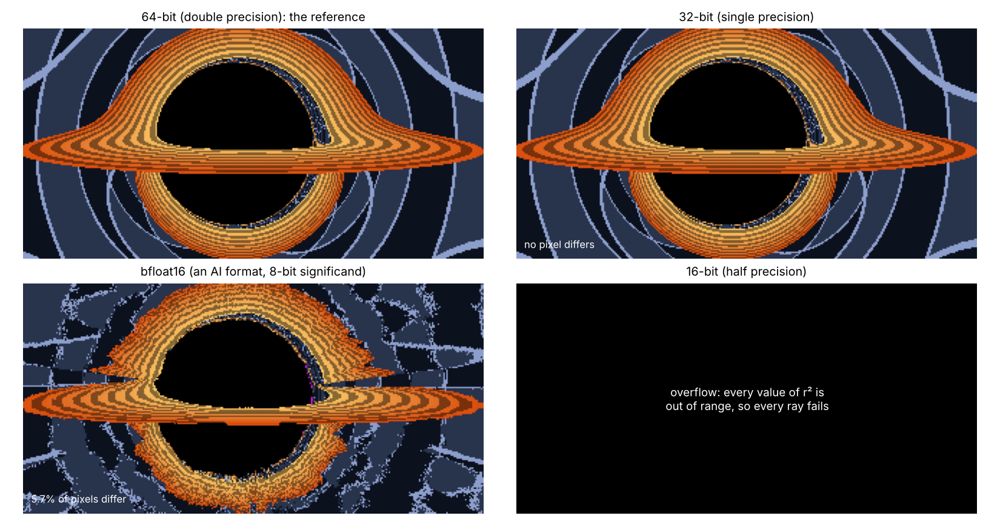

```{=html}
<style>
.gg-wrap { display: grid; grid-template-columns: minmax(0, 1fr) 250px; gap: 1rem; align-items: start; margin: 1rem 0; }
.gg-canvas { width: 100%; border-radius: 6px; background: #000; display: block; touch-action: none; cursor: grab; }
.gg-fps { font-size: .78rem; color: #777; margin-top: .25rem; }
.gg-side { display: flex; flex-direction: column; gap: .45rem; font-size: .84rem; min-width: 0; }
.gg-side label { display: flex; flex-direction: column; } .gg-side input[type=range] { width: 100%; }
.gg-side select { font-size: .82rem; } .gg-check { flex-direction: row !important; align-items: center; gap: .3rem; }
.gg-lab { color: #555; } .gg-dim { color: #888; font-size: .76rem; overflow-wrap: anywhere; }
.gg-go { font-size: .84rem; padding: .25rem .6rem; border: 1px solid #1f5fa8; border-radius: 5px; background: #1f5fa8; color: #fff; cursor: pointer; }
.gg-go:disabled { opacity: .5; }
.gg-out { font-size: .82rem; line-height: 1.35; }
@media (max-width: 760px) { .gg-wrap { grid-template-columns: 1fr; } }
</style>
```

Work on *Interstellar*'s black hole began in May 2013. Over the following year, the visual-effects company Double
Negative and the physicist Kip Thorne built a renderer that traced light through the curved spacetime of a spinning
black hole, and used it to make the images of Gargantua that appear in the film. The
[Gargantua post](/sci-fi/gargantua/) rebuilt those images in Python.

This post uses the same problem as a yardstick for what has happened to computing since. It turns out to be a good
yardstick, because it exposes three things that headline figures hide:

1. **The speed-up came almost entirely from parallel processors.** A single CPU core is under three times faster
   than the ones that rendered the film. A graphics processor's 32-bit throughput is 22 times higher.
2. **2013's hardware could already have done it in seconds.** The film's frames took hours by choice, not necessity.
3. **Most of the new computing power is the wrong kind.** The fastest-growing capability is low-precision
   arithmetic for AI. An experiment below shows that a black hole needs 32-bit arithmetic: the 16-bit formats fail
   completely. Meanwhile 64-bit arithmetic, which most scientific simulation depends on, has barely improved on
   consumer hardware in twelve years.

## How Gargantua was rendered

The Double Negative Gravitational Renderer (DNGR) is described in a paper the team published with Thorne in 2015.
Its appendix gives the details:

- about 40,000 lines of C++;
- 23 million pixels per IMAX frame, each traced not as a single ray but as a **ray bundle**, a narrow beam whose
  cross-section is evolved along with it, so that stars stay sharp and do not flicker on a giant screen;
- integration by an adaptive Runge–Kutta–Fehlberg method with tolerances "empirically determined";
- from **30 minutes to several hours per frame on 10 CPU cores**;
- a render farm of 1,633 Dell M620 blade servers, each with two 10-core Intel Xeon E5-2680 processors and 156 GB
  of memory, of which several hundred were typically used for DNGR.

The paper is explicit about two choices. The bulk of the work ran on the CPU render farm, although the company had
many GPU workstations. And "a primary goal is smoothness of the images… fast throughput has been only a secondary
concern."

## What changed in the hardware

Until the mid-2000s, each new generation of chips ran faster at the same power, because smaller transistors switched
faster and used less energy. That rule, Dennard scaling, broke down around 2005: transistors kept shrinking, but
clock speeds and power density could not keep rising. After that, extra performance had to come from doing more
things at once.


**CPUs.** The Xeon E5-2680 v2 scores 1,776 on PassMark's single-thread test. The fastest desktop processors of 2024
score between 4,700 and 5,100, or about 2.7 times as much, eleven years later. That is roughly 9% a year. Apple's M4
scores 4,490 at a fraction of the power. Using all cores, the gain is larger, about five times, because there are more
of them.

**GPUs.** Nvidia's GTX Titan of February 2013 and its RTX 5090 of January 2025:

| | GTX Titan (2013) | RTX 5090 (2025) | Ratio |
|:--|--:|--:|--:|
| 32-bit (FP32) | 4.7 TFLOPS | 104.8 TFLOPS | 22× |
| 64-bit (FP64) | 1.57 TFLOPS | 1.64 TFLOPS | **1.04×** |
| 16-bit tensor (AI) | none | 210 TFLOPS | |
| 8-bit tensor (AI) | none | 838 TFLOPS | |
| 4-bit tensor (AI) | none | 1,680 TFLOPS | |
| Transistors | 7.1 billion | 92.2 billion | 13× |
| Power | 250 W | 575 W | 2.3× |
| Launch price | \$999 | \$1,999 | 2× |

The GTX Titan ran 64-bit arithmetic at a third of its 32-bit speed. Every flagship since has run it at a sixty-fourth
or slower, so in twelve years double-precision throughput on Nvidia's top consumer card has gone up by 4%. Data-centre
chips followed the money too: Nvidia's H100 did 67 TFLOPS of 64-bit arithmetic on its tensor cores, while its newest
B300 does about 1, in favour of more than 14 *thousand* TFLOPS of 4-bit arithmetic for AI.

## Render it yourself

This is a complete Kerr ray tracer running on your device's graphics processor, with the film's spin
($a = 0.6\,M$) and a camera 25 $M$ from the hole. Every pixel integrates its own light ray backwards through
spacetime, using the same equations, camera model and step-size rule as the Python code used for the experiments
below, in 32-bit arithmetic. Drag to look around, and press the benchmark button to time your own hardware.

```{ojs}
//| echo: false
ggView = {
  const host = htl.html`<div></div>`;
  const mod = await import(new URL("gargantua_gl.js", document.baseURI).href);
  await mod.mountGargantua(host);
  return host;
}
```

This renderer is much simpler than DNGR. It traces one ray per pixel rather than a bundle, has no motion blur or
anti-aliasing, and uses a fixed-step integrator. Its disk is a thin, painted texture, not the film's volumetric
gas. What it shares with DNGR is the expensive part: integrating null geodesics of the Kerr metric for every pixel.
Checked against the Python code at the same view, it agrees on the fate of 99.99% of pixels, and on where each escaping
ray ends up to within the precision of the comparison.

## Could 2013 hardware have done it?

Each integration step of a ray costs about 350 floating-point operations, including 36 divisions and 9
trigonometric functions. A typical ray needs about 110 steps to reach the hole, the disk or open space. So a single-ray
IMAX frame of 23 million pixels needs roughly 0.9 trillion operations.

- On a **GTX Titan of 2013**, at its peak of 4.7 TFLOPS, that is 0.2 seconds. Divisions and trigonometry run slower
  than multiplications, so a realistic figure is a second or two.
- That matches an independent measurement. **GRay**, a GPU ray tracer for black holes published in 2013, integrated
  about one photon step per nanosecond on a single Nvidia Tesla card, in 32-bit arithmetic. At that rate, a 23-million-ray
  frame takes about 2.5 seconds.
- On an **RTX 5090**, at its peak of 104.8 TFLOPS, it is under a hundredth of a second.

DNGR took from half an hour to several hours. The difference is not mainly the hardware. DNGR traced bundles rather
than rays, adding equations for the evolving shape of each beam. It added motion blur, which the paper says roughly
doubled the cost, and careful filtering of star images. It ran on CPUs, which suited a render farm built for
conventional visual effects. And it was tuned for smoothness, not speed.

This is **Blinn's law**, named after the computer-graphics pioneer Jim Blinn: as technology advances, rendering time
remains constant. Faster computers do not make film frames quicker to render. They let artists ask for more in each
frame. DNGR spent its budget on IMAX-quality smoothness, as most film rendering spends any increase in power.

## Which kind of compute does a black hole need?

The largest gains in hardware since 2013 are in low-precision arithmetic. Could a black hole use it?

Floating-point formats differ in two ways: how many significant bits they keep, which sets their precision, and how
many bits of exponent, which sets their range.

| Format | Significand | Relative precision | Largest value | Main use |
|:--|--:|--:|--:|:--|
| 64-bit (double) | 53 bits | 1 part in 9 × 10¹⁵ | 10³⁰⁸ | scientific computing |
| 32-bit (single) | 24 bits | 1 part in 17 million | 3 × 10³⁸ | graphics, games, rendering |
| bfloat16 | 8 bits | 1 part in 256 | 3 × 10³⁸ | AI training |
| 16-bit (half) | 11 bits | 1 part in 2,048 | 65,504 | graphics, AI |

To find out, the same view was rendered with every arithmetic operation carried out in each format, and compared
with the 64-bit result:



| Format | Pixels with the wrong fate | Error in sky direction (median) | (99th percentile) |
|:--|--:|--:|--:|
| 32-bit | none of 51,200 | 0.0002 pixel | 0.002 pixel |
| bfloat16 | 5.7% | 31 pixels | 163 pixels |
| 16-bit | every pixel | (overflow) | |
| *64-bit with half the step size, for comparison* | *0.008%* | *0.23 pixel* | *0.79 pixel* |

- **32-bit is ample.** Its rounding errors are about a thousand times smaller than the error the integrator itself
  makes by taking finite steps, shown in the last row.
- **bfloat16 fails.** With only 8 significant bits, the disk tears, stars land in the wrong place, and 6% of pixels
  show the wrong object.
- **16-bit fails before precision matters.** Its largest number is 65,504, and $(r^2 + a^2)^2$ exceeds that once
  $r$ is above 16. Every ray overflows at the first step.

### The photon sphere amplifies errors

The hardest rays are those that skim the **photon sphere**, the radius at which light can orbit the hole. A ray
that passes close to it winds round several times before escaping, and each half-orbit multiplies any error by
about $e^{\pi} \approx 23$ ([light bending explainer](/explainers/light-bending-schwarzschild/)). Following single rays
at impact parameters $b$ approaching the critical value $b_c$:


The 32-bit error grows as $\varepsilon/(b/b_c - 1)$, where $\varepsilon$ is the precision of the format, because a
ray's deflection depends on the logarithm of its distance from the critical orbit. It reaches one pixel only for rays
that pass within about 1 part in 10,000 of the critical value, after about one and a half orbits. Those rays occupy
an extremely thin ring in the image. bfloat16 is already off by more than a pixel for rays that never orbit at all.

So Gargantua is a job for 32-bit arithmetic: too demanding for the AI formats, but not demanding enough to need 64-bit.
That is lucky. It is precisely the format in which consumer GPUs have grown 22-fold.

Many scientific problems are less lucky. Long-running simulations of climate, orbits or fluids accumulate errors over
millions of steps, and usually need 64-bit arithmetic, which has seen almost none of the hardware gains of the last
decade. Nvidia says it is not abandoning 64-bit computing and offers ways to emulate it on its AI tensor cores, but the
direction of investment is clear.

## Energy per frame

A rough comparison, with large uncertainties:

- **DNGR, 2013–14.** Ten cores is one of the blade's two processors, rated at 115 W, plus a share of its memory and
  other components: perhaps 150 to 200 W. For half an hour to three hours per frame, that is roughly **0.1 to
  0.5 kilowatt-hours per frame**.
- **A single-ray frame on an RTX 5090 today.** At a realistic third of peak throughput, about 0.03 seconds at 575 W:
  roughly **0.005 watt-hours**.

That is a factor of 20,000 to 100,000, but it overstates the like-for-like gain, because DNGR's frames did several
times more work per pixel. The fairer statement is that the hardware gain for this kind of computation over twelve
years is a factor of tens, and the rest came from choosing a GPU and a simpler method.

## The connection to the AI boom

The processors that now render black holes in real time are the same ones whose demand has driven much of the
stock-market concentration described in the [economics series](/economics/wealth-2-the-causes/). Their designers have
followed that demand, steering each new generation's transistors towards the low-precision matrix arithmetic that
trains and runs AI models. For graphics and for 32-bit physics the result has been spectacular. For anything that
needs 64-bit arithmetic, the last twelve years have brought very little.

## Summary

- DNGR took 30 minutes to several hours per IMAX frame on 10 CPU cores, by design: ray bundles, motion blur and
  smoothness came before speed.
- Since then, single-thread CPU speed has risen about 2.7-fold, and GPU 32-bit throughput 22-fold.
- A single-ray Gargantua frame needed about a second on a 2013 GPU, and needs about a hundredth of a second on a 2025 one.
- Gargantua needs 32-bit arithmetic. The 16-bit formats that dominate AI hardware fail, and 64-bit, essential for
  much of science, has barely improved on consumer hardware since 2013.
- Blinn's law holds: film frames still take hours, because the extra power goes into the image.

*Code: [`src/compute`](https://github.com/paulmilne/paulmilne.github.io/tree/main/src/compute), with `kerr.py` (the ray tracer in any number format), `precision.py`, `photonsphere.py` and `figs.py`. The browser renderer is `gargantua_gl.js` in this post's folder.*

## References

- O. James, E. von Tunzelmann, P. Franklin and K. S. Thorne, ["Gravitational lensing by spinning black holes in
  astrophysics, and in the movie *Interstellar*"](https://arxiv.org/abs/1502.03808), *Classical and Quantum Gravity*
  32, 065001 (2015), appendix A.
- C. Chan, D. Psaltis and F. Özel, ["GRay: a massively parallel GPU-based code for ray tracing in relativistic
  spacetimes"](https://arxiv.org/abs/1303.5057), *Astrophysical Journal* 777, 13 (2013).
- M. Pharr, W. Jakob and G. Humphreys, *Physically Based Rendering*, 4th edition (2023),
  [section 1.6](https://pbr-book.org/4ed/Introduction/A_Brief_History_of_Physically_Based_Rendering): Blinn's law.
- J. Hennessy and D. Patterson, "A new golden age for computer architecture", *Communications of the ACM* 62(2),
  48–60 (2019): the end of Dennard scaling.
- HPCwire, ["Nvidia says it's not abandoning 64-bit computing"](https://www.hpcwire.com/2025/12/09/nvidia-says-its-not-abandoning-64-bit-computing/) (December 2025).
- GPU specifications: TechPowerUp GPU database and hmc-tech.com. CPU scores: PassMark (cpubenchmark.net), November 2026.
