```{=html}
<style>
main table { display: block; overflow-x: auto; max-width: 100%; }
span.math.display { display: block; overflow-x: auto; max-width: 100%; }
td code, th code { white-space: nowrap; }
pre > code.sourceCode { white-space: pre-wrap; }  /* wrap code without a page-specific Bootstrap build */
</style>
```

# Overview

This post is a recreation of my undergraduate final year electronics project from 1984. Of course the technology available today, would have looked like pure science fiction back then, even if one had the imagination!  The post describes a simulated continuous-wave (CW) proton NMR spectrometer
built around a **marginal oscillator**: a JFET Hartley oscillator whose tank
inductor is also the sample coil, run just above the threshold of oscillation.
When the protons in the sample absorb RF energy, the tank loses Q, and the
oscillation amplitude falls. A diode detector picks up that drop, an audio
preamplifier amplifies it, and the result is shown on an oscilloscope or
recovered with a lock-in amplifier.

The project contains two independent implementations of the same physics; all the files are in [`src/nmr_hartley`](https://github.com/paulmilne/paulmilne.github.io/tree/main/src/nmr_hartley) (see @sec-repro):

| File | Role |
|---|---|
| `nmr_marginal_osc_sim.m` | Stand-alone script (base MATLAB, fixed-step RK4). Produces `fig1`–`fig3`. |
| `nmr_params.m` | Parameter set for the Simulink model; runs as its `PreLoadFcn`/`InitFcn`. |
| `build_nmr_model.m` | Builds `nmr_marginal_osc.slx` programmatically. |
| `nmr_marginal_osc.slx` | System-level Simulink model (ode45). |
| `verify_nmr_model.m` | Runs the model in all three modes, compares with the script, saves `simulink_check.png` and diagram images. |

The model works at the **system level**. It does not simulate the JFET
transistor by transistor at 20 MHz, which would take $\sim10^6$ RF cycles per
modulation period. Instead it uses the *averaged* (slowly varying envelope)
equation for the oscillator amplitude, coupled to a set of Bloch equations in
the rotating frame. That is accurate whenever the envelope changes slowly
compared with the RF period, which holds here by many orders of magnitude.

# Physics of the measurement

## Protons in a magnetic field

A proton has spin ½ and a magnetic moment $\boldsymbol\mu=\gamma\hbar\mathbf I$,
with gyromagnetic ratio

$$
\frac{\gamma}{2\pi}=42.577\ \text{MHz/T}.
$$

In a static field $B_0\hat z$ the magnetisation precesses at the Larmor
frequency $\omega_L=\gamma B_0$. For an oscillator frequency
$f_0 = 20$ MHz, resonance happens at

$$
B_\text{res}=\frac{2\pi f_0}{\gamma}=0.46974\ \text{T}.
$$

In thermal equilibrium the sample has a small net magnetisation given by
Curie's law,

$$
M_0=\frac{\chi_0 B_0}{\mu_0},\qquad \chi_0\approx 4\times10^{-9}\ \text{(protons in water, SI)}.
$$

## Bloch equations in the rotating frame

The coil produces a linearly polarised RF field $2B_1\cos\omega_0 t\,\hat x$.
This splits into two counter-rotating components of amplitude $B_1$, and only
the one rotating with the spins matters. In a frame rotating at $\omega_0$, with
magnetisation normalised to $M_0$ ($m = M/M_0$) and offset
$\Delta=\gamma B_z-\omega_0$, the Bloch equations become

$$
\begin{aligned}
\dot m_x &= \Delta\, m_y - \frac{m_x}{T_2},\\
\dot m_y &= -\Delta\, m_x + \omega_1 m_z - \frac{m_y}{T_2},\\
\dot m_z &= -\omega_1 m_y - \frac{m_z-1}{T_1},
\end{aligned}
\qquad \omega_1=\gamma B_1 .
$$ {#eq-bloch}

$m_x$ is the **dispersion** component (in phase with $B_1$) and $m_y$ is the
**absorption** component (in quadrature, so it extracts energy). With a constant
$\Delta$ the steady state is

$$
m_y=\frac{\omega_1T_2}{1+\Delta^2T_2^2+s},\qquad
m_x=\Delta T_2\, m_y,\qquad
s=\omega_1^2T_1T_2 ,
$$

where $s$ is the saturation parameter. The sample is doped with CuSO~4~ to make
it relax quickly: $T_1=2$ ms and $T_2=1$ ms. That gives a homogeneous width of
$1/(\pi T_2)=318$ Hz FWHM, which is 7.5 µT in field.

## Complex susceptibility

Linear-response theory relates the absorption component to the imaginary part
of the RF susceptibility, $\chi=\chi'-i\chi''$:

$$
\chi''=\frac{\mu_0 M_v}{2B_1}
      =\frac{\chi_0 B_\text{res}\, m_y}{2B_1}
      \;\xrightarrow{\text{steady state}}\;
      \frac{\chi_0\,\omega_0T_2}{2}\,\frac{1}{1+\Delta^2T_2^2+s}.
$$ {#eq-chi2}

With the model parameters ($B_1 = 1$ µT at the operating level, so
$\omega_1 = 267.5$ s^−1^ and $s = 0.143$), the peak value is
$\chi''_\text{pk}=2.2\times10^{-4}$. This is about 55 000 times larger than
$\chi_0$, because the factor $\omega_0 T_2$ is large.

## Magnet inhomogeneity: the isochromat ensemble

A real magnet is not uniform across the sample. The model represents the field
spread as a Gaussian with $\sigma_B = 5$ µT (11.8 µT FWHM, 501 Hz). The spread
is sampled by $N$ **isochromats**: sub-ensembles at fixed field offsets
$\delta B_k\in[-4\sigma_B,4\sigma_B]$ with Gaussian weights $w_k$. Each one
obeys @eq-bloch with its own

$$
\Delta_k=\gamma\left(B_\text{res}+B_\text{ext}(t)+\delta B_k\right)-\omega_0 ,
$$

and the measured absorption is the weighted sum $M_v\propto\sum_k w_k m_{y,k}$.
In steady state the result is a Voigt line (a Lorentzian convolved with a
Gaussian). The isochromats are also needed for **transient** effects:
wiggles, passage distortion and dephasing all come from them, and a single
Lorentzian cannot reproduce these.

## Field modulation and passage regimes

$B_\text{ext}(t)$ is the sum of a slow offset or sweep from the magnet supply
and a sinusoidal modulation field from a pair of Helmholtz coils:

$$
B_\text{ext}(t)=B_\text{off}+\dot B_\text{sw}\,t+B_\text{mod}\sin(2\pi f_m t).
$$

The model runs in two very different regimes:

* **Scope mode** ($f_m = 100$ Hz, $B_\text{mod} = 50$ µT). The modulation
  sweeps far across the whole line twice per period, at up to
  $2\pi f_m B_\text{mod}=31$ mT/s. The line (about 12 µT wide) is crossed in about
  0.3–0.4 ms, which is shorter than $T_2$, so the spins are in the
  **intermediate passage** regime. The response lags and is distorted, and it
  is not the steady-state lineshape. On the oscilloscope the result is two
  absorption "blips" per modulation period.
* **Lock-in mode** ($f_m = 200$ Hz, $B_\text{mod} = 1.5$ µT $\ll$ linewidth, with
  a slow ±30 µT sweep over 1.5 s). The modulation probes a small part of the
  line, and the first harmonic of the response is proportional to
  $B_\text{mod}\,\partial\chi''/\partial B$. So the lock-in records the
  **derivative** of the absorption line.

### Interactive model: spins in a swept field

The model below integrates @eq-bloch live for nine isochromats spread across
the field distribution, with the modulation sweeping the field through
resonance. In the rotating frame, each isochromat precesses about the
effective field $\mathbf B_\text{eff}=(B_1,0,\Delta/\gamma)$. Far from
resonance $\mathbf B_\text{eff}$ is almost parallel to $B_0$ and the
magnetisation stays near the pole. As the sweep passes resonance,
$\mathbf B_\text{eff}$ swings towards $B_1$, $\mathbf M$ tips over, and $m_y$
shows the absorption blip that loads the tank. Afterwards the isochromats fan
out (dephasing from the inhomogeneity) while $T_1$ restores $m_z$. Raising
$B_1$ shows saturation, and moving the field offset bunches the blips towards
one end of the sweep, as in the off-resonance scope trace. Time and field are
scaled so the motion is visible.

::: {.content-visible when-format="html"}
```{=html}
<link rel="stylesheet" href="widgets/nmr_widgets.css">
<script src="widgets/three.min.js"></script>
<div id="bloch-widget"></div>
<script src="widgets/bloch_sweep.js"></script>
```
:::

::: {.content-visible unless-format="html"}
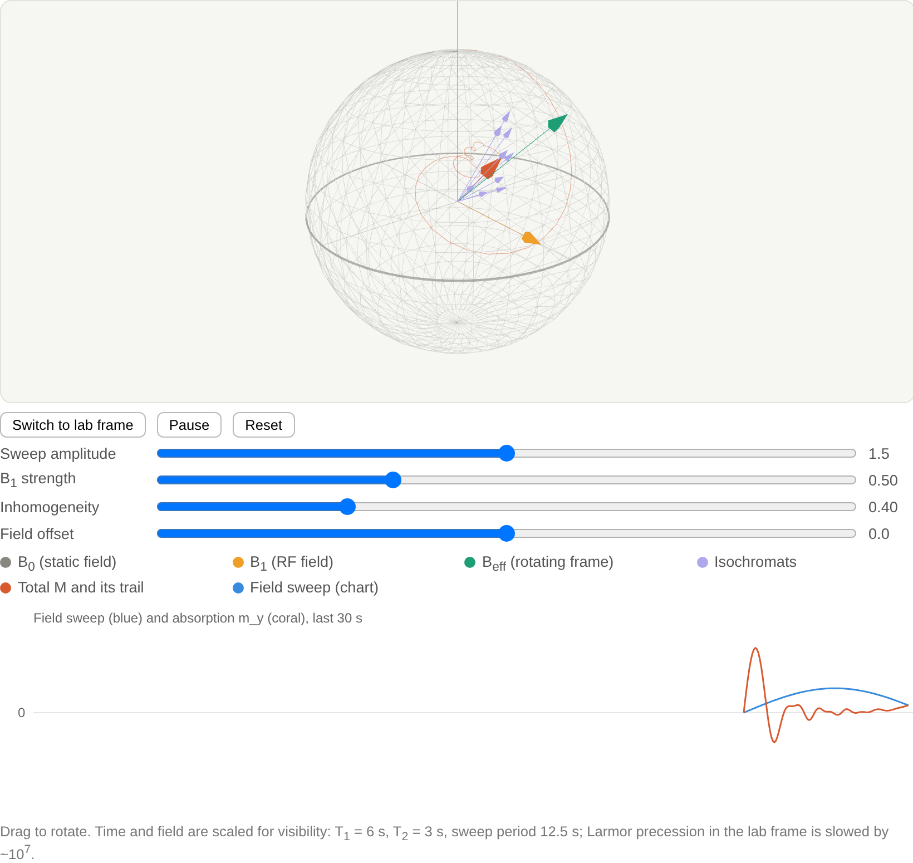{#fig-bloch3d width=85%}
:::

# The electronic circuit

The spectrometer has three parts. The **RF head** is the oscillator, sample coil and detector. The **modulation chain** is a two-channel generator, a voltage-to-current driver and Helmholtz coils with a current-sense resistor (@sec-magnet). The **signal chain** is the preamp, oscilloscope and lock-in (@fig-system). All schematics are drawn with TikZ/`circuitikz`. The sources are in `circuits/*.tex`.

::: {.content-visible when-format="html"}
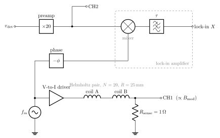{#fig-system width=90%}
:::

::: {.content-visible unless-format="html"}
{#fig-system width=90%}
:::

## JFET Hartley oscillator

::: {.content-visible when-format="html"}
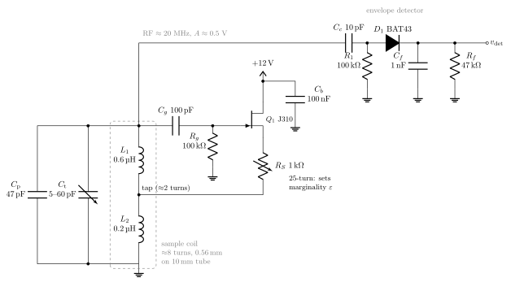{#fig-hartley width=100%}
:::

::: {.content-visible unless-format="html"}
{#fig-hartley width=100%}
:::

The detector couples to the top of the tank through $C_c$. $R_1$ gives the diode
a DC return path. $D_1$ charges $C_f$ to the RF peak, and $R_f C_f$ is chosen
long compared with the 50 ns RF period but short compared with the passage time
(about 0.3 ms), so that $v_\mathrm{det}$ follows the envelope $A(t)$. With
$R_f = 47$ kΩ and $C_f = 1$ nF, $R_fC_f = 47$ µs.

The tank is the **sample coil** $L = L_1 + L_2 + 2M$ in parallel with a tuning
capacitor $C$:

$$
f_0=\frac{1}{2\pi\sqrt{LC}}\approx 20\ \text{MHz}.
$$

**Choosing the tank values.** A coil of about 8 turns of 0.56 mm enamelled wire
on a 10 mm sample tube gives $L\approx0.8$ µH. (Wheeler's formula, with
radius 5.5 mm and length 5 mm.) The labels $L_1 \approx 0.6$ µH and
$L_2 \approx 0.2$ µH give each section's share of that total, with the tap
about 2 turns from the grounded end. 20 MHz then needs
$C = 1/(\omega_0^2L) \approx 79$ pF. The 47 pF padder $C_\mathrm{p}$, the
5–60 pF trimmer $C_\mathrm{t}$ and roughly 10 pF of stray capacitance together
give 62–117 pF. That tunes from about 16.4 MHz to 22.6 MHz, so 20 MHz is near
the middle of the range.

The parallel loss resistance is
$R_p = Q_0\omega_0L \approx 8$ kΩ. The detector's 100 kΩ load lowers Q by
about 8 %, and this loading is already included in the model's $Q_0$. The
gate-leak time constant $R_gC_g = 10$ µs is about the same as the amplitude
relaxation time $\tau_A$. Keeping it this short avoids squegging, which is
self-pulsing of the amplitude.

The JFET is a source follower with its source connected to the coil **tap**.
The tap ratio $n\approx L_2/L$ sets how much of the source current is fed back
into the tank. A source follower has voltage gain just under 1 and the tap
gives a $1/n$ voltage step-up, so the loop gain is enough to sustain
oscillation. The gate-leak network $C_g R_g$ rectifies on positive peaks. This
develops a negative bias that lowers $g_m$ as the amplitude grows, and that is
the gain-compression mechanism that sets the amplitude.

## Why "marginal"

Let $R_p=Q\omega_0L$ be the tank's parallel loss resistance and $G(v)$ the
amplitude-dependent transconductance the JFET presents to the tank. Oscillation
needs $G R_p\ge 1$. A marginal oscillator is set (with $R_S$, or a
drain-supply potentiometer) so that

$$
G_1R_p=1+\varepsilon,\qquad \varepsilon\ll 1 ,
$$

where $G_1$ is the small-signal value. Close to threshold, the steady amplitude
depends strongly on the loss. A small change in $R_p$ gives a large change in
amplitude, and this is the oscillator's detection gain. Taking $\varepsilon$
smaller increases sensitivity but also increases noise and the risk that the
oscillator stops. The model uses $\varepsilon = 0.05$.

## How the spins load the tank

The spins change the coil inductance to $L(1+\eta\chi)$, where $\eta = 0.6$ is
the filling factor. The impedance gains a term $\omega_0 L\eta\chi''$ in series,
which is a resistance, so

$$
\frac1Q=\frac1{Q_0}+\eta\chi''.
$$

The dispersion part $\chi'$ pulls the frequency by $-\tfrac12\eta\chi'\omega_0$.
The model holds $\omega_0$ fixed and ignores this (see
@sec-limitations).

## Averaged amplitude equation

Model the tank voltage as $v$, with the active device injecting a cubic current
$i = G_1v - G_3v^3$. This is a van der Pol oscillator. Write
$v = A(t)\cos(\omega_0t+\phi)$ and average over one RF cycle (Krylov–Bogoliubov).
Using $1/(R_pC)=\omega_0/Q_0$, this gives

$$
\dot A=\frac{\omega_0}{2Q_0}\left(\varepsilon-\frac{A^2}{A_s^2}\right)A
       -\frac{\omega_0}{2}\,\eta\chi''A,
\qquad A_s^2=\frac{4}{3G_3R_p}.
$$ {#eq-osc}

* With no spins, $A_0=A_s\sqrt\varepsilon$. The model sets $A_0 = 0.5$ V at the
  detector.
* Linearising about $A_0$ gives a relaxation time
  $\tau_A = Q_0/(\omega_0\varepsilon)=12.7$ µs. The amplitude follows the spins
  almost instantly, but this time constant still makes the ODE system stiff.
* For a small, slowly varying $\chi''$:

$$
\frac{\Delta A}{A_0}\approx-\frac{Q_0\,\eta\,\chi''}{2\varepsilon}.
$$ {#eq-dip}

The factor $1/(2\varepsilon)=10$ is the "marginal gain". With the homogeneous
peak value of $\chi''$, @eq-dip predicts a 10.5 % dip. That is an upper bound.
Inhomogeneous broadening and the fast passage reduce the simulated dip to
about 5.8 %.

The RF amplitude also sets $B_1$. The model uses $B_1=k_{B1}A$ with
$k_{B1}$ = 1 µT per 0.5 V, so the oscillator level directly controls how much
the spins saturate. This two-way coupling, from $A$ to $\omega_1$ to $m_y$ to
$\chi''$ and back to $A$, is the core of the model.

## Detector, preamplifier and noise

1. **Diode envelope detector.** Treated as ideal, so its output is $A(t)$. The
   DC level $A_0$ is subtracted, which is what a DC-blocking capacitor does.
2. **Detector noise.** White noise, 2 mV rms referred to the detector within
   the preamp bandwidth.
3. **Audio preamp.** Gain $G_\text{pre} = 20$, two identical 1 kHz low-pass
   poles, and 2 Hz AC coupling.

::: {.content-visible when-format="html"}
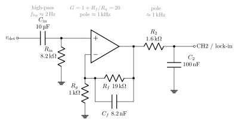{#fig-preamp width=85%}
:::

::: {.content-visible unless-format="html"}
{#fig-preamp width=85%}
:::

@fig-preamp shows one way to build the preamp the model assumes:

* $C_\mathrm{in}R_\mathrm{in}$ gives $1/(2\pi\cdot8.2\,\text{k}\Omega\cdot10\,\mu\text{F})=1.9$ Hz, which is the `AC coupling` block.
* The gain is $1+R_f/R_g=20$, which is `P.Gpre`.
* $R_fC_f$ puts a pole at 1.02 kHz. Strictly, the gain falls toward 1 rather
  than 0 above the pole, but that makes no difference in the audio band.
* $R_2C_2$ gives the second pole at 0.99 kHz.

Together these match `conv([1/(2*pi*P.flp) 1],[1/(2*pi*P.flp) 1])` in the model.

The noise source is specified *within the preamp bandwidth*. For two cascaded
first-order poles the equivalent noise bandwidth is $\text{ENBW}=\pi f_c/4$.
The per-sample standard deviation of the discrete white noise is therefore

$$
\sigma_w=v_n\sqrt{\frac{f_s}{2\,\text{ENBW}}}=16\ \text{mV}\ (f_s=100\ \text{kHz}),
$$

and the Simulink *Band-Limited White Noise* block gets
`Cov` $=\sigma_w^2T_s$.

## Modulation coils and the scope channels

A Helmholtz pair (N = 20 turns, R = 25 mm) gives a field at the centre of

$$
B=\left(\tfrac45\right)^{3/2}\frac{\mu_0NI}{R}=k_\text{coil}I,\qquad
k_\text{coil}=7.19\times10^{-4}\ \text{T/A}.
$$

So 50 µT needs 69.6 mA peak. A 1 Ω sense resistor in series turns this into
**CH1**, 69.6 mV peak, which is in phase with the field. **CH2** is the preamp
output.

* **YT display.** On resonance ($B_\text{off}=0$) the line is crossed at each
  zero of the modulation, so the blips are evenly spaced 5 ms apart. With a
  +20 µT offset, resonance happens where $\sin(2\pi f_mt)=-0.4$, so the blips
  pair up around the negative peak of the modulation.
* **XY display.** CH1 on X and CH2 on Y. The upward and downward sweeps trace
  separate curves for two reasons:
  1. the two-pole preamp lag, $2\arctan(f_m/f_c)=11.4°$ (0.32 ms) at 100 Hz;
  2. the lag of the spins themselves in intermediate passage.

  A matching phase shifter on X (in the script, two identical 1 kHz poles)
  removes the first. The split that remains is caused by the spins.

## Lock-in amplifier

* The reference is $2\sin(2\pi f_mt-\phi)$, in phase with the coil current.
  The preamp lag $\phi=2\arctan(f_m/f_c)=22.6°$ at 200 Hz is subtracted.
* The mixer output goes through a two-pole low-pass filter with
  $\tau = 20$ ms per pole.
* The output is proportional to $\partial A/\partial B$. Because the amplitude
  *dips* on resonance, this is $-\partial\chi''/\partial B$: negative below
  resonance and positive above it.

# Magnet and field control {#sec-magnet}

The model needs two fields. The first is a static $B_0\approx0.47$ T. The
second is a small, controllable addition
$B_\text{off}+\dot B_\text{sw}t+B_\text{mod}\sin 2\pi f_mt$ of tens of µT. These
come from different hardware.

{#fig-3d width=100%}

## Permanent magnet for $B_0$

0.47 T would need about 26 000 ampere-turns from air coils. A permanent
magnet is the practical choice:

* **Magnets.** Two N42–N52 NdFeB discs, Ø50 × 15 mm, magnetised through the
  thickness, with opposite poles facing across the gap.
* **Yoke.** A mild-steel H-frame: 20 mm side plates and top and bottom bars,
  60 mm deep. It gives the flux a low-reluctance return path. The
  calculation in @sec-magcalc shows it raises the gap field from 0.26 T to
  0.45 T, and keeps the steel at about 1.2 T, below saturation.
* **Pole caps.** 5 mm soft-iron discs, Ø50, on the magnet faces, each with
  a raised **Rose rim** 1.5 mm high and 2 mm wide around its edge. Iron
  smooths out the magnetisation variations of the NdFeB. The rim pushes field
  back into the edge of the gap, where it would otherwise sag, and makes the
  field about 20 times more uniform (@sec-magcalc). Face the caps flat and
  parallel.
* **Gap.** 20 mm between the cap faces, so 17 mm between the rims. An
  ideal magnetic circuit with no leakage would give
  $B\approx B_r\,2t_m/(2t_m+g)\approx0.8$ T. Flux leaking around the magnets
  lowers this to the calculated **0.42 T, so $f_0$ = 18.0 MHz**, inside the
  oscillator's tuning range.
* **Sample access.** A 16 mm hole in the top bar lets the sample tube drop
  in vertically. The RF coil axis, and so $B_1$, is then vertical, which is
  perpendicular to $B_0$ as it must be (@fig-gap).

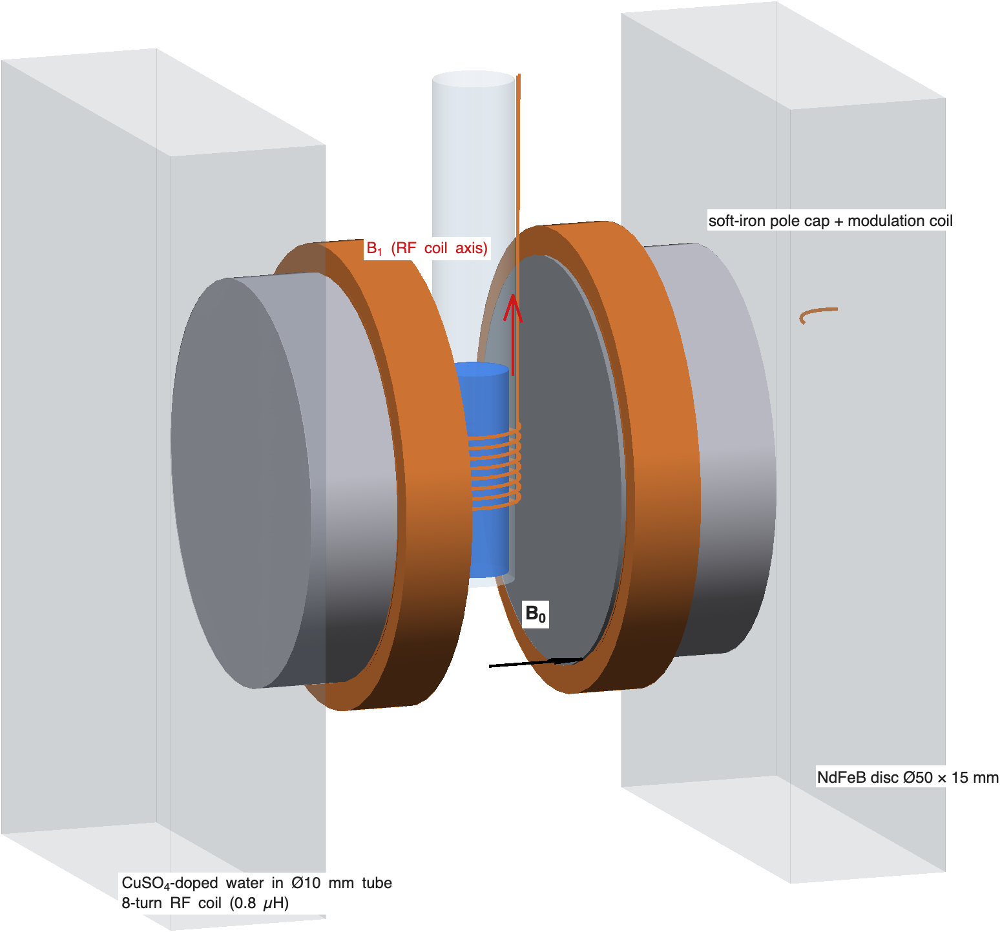{#fig-gap width=75%}

The magnet behaves differently from the model's ideal field in three ways:

* **The field is whatever the magnet gives.** Measure it once with a Hall
  probe (RS has no affordable DC gaussmeter, see @sec-bom), then set
  $f_0=\gamma B_0/2\pi$ with the trimmer. The tank tunes from 16.4 to 22.6 MHz,
  which covers 0.385–0.53 T. A frequency counter on the RF then gives $B_0$ to
  better than 1 ppm.
* **Temperature.** NdFeB changes by about −0.11 %/K. At 0.47 T that is
  −0.5 mT/K, which moves the line by about 22 kHz per kelvin. Wrap the magnet
  in foam, let it settle, and track the line with the trimmer or the
  generator's DC offset.
* **Homogeneity.** With flat Ø50 caps the field varies by about 3000 ppm
  across a Ø10 × 10 mm sample ($\sigma\approx$ 280 µT, compared with 5 µT in the model).
  That would make the line about 60 times wider and the signal correspondingly
  weaker. The Rose rim is therefore essential. The final adjustment is still
  done by experiment (@sec-magcalc).

Large NdFeB discs snap together with crushing force. Assemble the magnet with
non-magnetic spacers and slide the parts into place, never letting them jump.


## Calculating the field {#sec-magcalc}

To check the field level and its uniformity, `magnet_fd3d.m` solves the 3D
magnetostatic problem on a 0.5–1 mm grid, using base MATLAB only. It uses the
reduced scalar potential $u=\mu_0\varphi$, with $\mathbf B=-\mu_r\nabla u+\mathbf B_r$:

$$
\nabla\cdot(\mu_r\nabla u)=\nabla\cdot\mathbf B_r .
$$

* **Materials.** NdFeB with $\mu_r=1.05$ and $B_r=1.3$ T (N42), steel with
  $\mu_r=1000$ (linear), and air.
* **Discretisation.** The potential is stored at cell centres. Neighbouring
  cells are coupled through the harmonic mean of their permeabilities, and
  the remanence term at each face is $\mu_f(B_{rL}/2\mu_L+B_{rR}/2\mu_R)$,
  which comes from treating the two half-cells as in series.
* **Symmetry.** The model computes one eighth of the magnet:
  $u=0$ on the mid-plane between the poles, mirror planes at $y=0$ and $z=0$,
  and $u=0$ on an outer box. Moving the box from 40 mm to 120 mm outside the
  steel changes $B_0$ by less than 0.01 %.
* **Solver.** Preconditioned conjugate gradients with an incomplete-Cholesky
  preconditioner. 1 mm runs take a few seconds and 0.5 mm runs about a
  minute.
* **Validation.** The solver matches a 1D magnet/steel circuit exactly
  (0.7639 T in both). For two bare Ø50 discs it is within 1.6 % of the exact
  on-axis formula. Halving the grid from 1 mm to 0.5 mm changes $B_0$ by
  0.5 % and the peak-to-peak uniformity by about 10 %.

`magnet_design.m` runs the validation, the gap sweep and the design
comparison, and produces @fig-magnet and @tbl-magnet.

{#fig-magnet width=100%}

| Design | Sample | $B_0$ (T) | $f_0$ (MHz) | p-p (ppm) | $\sigma$ (µT) | steel (T) |
|---|---|--:|--:|--:|--:|--:|
| Baseline: Ø50 flat caps, 20 mm gap | Ø10 × 10 | 0.445 | 18.93 | 3160 | 276 | 1.16 |
|  | Ø5 × 5 | 0.445 | 18.93 | 671 | 66 | 1.16 |
| **A: + Rose rim 1.5 × 2 mm** | Ø10 × 10 | 0.423 | 18.01 | 164 | 9.2 | 1.18 |
|  | Ø5 × 5 | 0.423 | 18.01 | 18 | 1.6 | 1.18 |
| B: Ø80 flat caps, 30 mm yoke, 22 mm gap | Ø10 × 10 | 0.507 | 21.60 | 390 | 38 | 1.15 |
|  | Ø5 × 5 | 0.507 | 21.60 | 86 | 9.6 | 1.15 |

: Calculated gap field and uniformity. p-p and $\sigma$ are over the sample volume; "steel" is the 99th-percentile flux density in the yoke. {#tbl-magnet}

What the calculation shows:

1. **The field level is right.** A 20 mm gap gives 0.42–0.45 T, which is
   18–19 MHz and inside the tuning range. There is no need to widen the gap.
   Narrowing it to 16 mm would raise the field to 0.51 T.
2. **Flat Ø50 caps are not uniform enough.** The pole diameter is only 2.5
   times the gap. The field rises toward the poles along $B_0$ and falls
   toward the edge of the gap along the tube, which is the saddle shape in @fig-magnet.
   Over Ø10 × 10 mm that gives $\sigma\approx$ 280 µT.
3. **The Rose rim is the cheapest fix.** A 1.5 × 2 mm rim brings the
   variation down to 164 ppm ($\sigma\approx$ 9 µT), close to the model's 5 µT. With a
   Ø5 mm sample it drops to 18 ppm. Larger Ø80 magnets (design B) also help,
   but cost more and need a thicker yoke, and are still worse than the rimmed
   Ø50 caps.
4. **The optimum is sharp.** A 1.0 × 2 mm rim gives 1300 ppm, and the grid
   resolves only 0.5 mm steps. Treat the 1.5 × 2 mm rim as the starting point,
   then adjust by experiment. Machine the rim slightly high, measure the line
   width (with the oscillator signal, or by watching the wiggles in the YT
   trace), and skim the rim down in about 0.1 mm steps until the line is
   narrowest. Commercial permanent magnets are shimmed in the same way.

The model ignores several things: steel saturation (the steel is assumed
linear), the sample hole in the top bar, variation in the magnets'
remanence, and mechanical tolerances. In a real magnet, misalignment of the
pole faces by more than about 0.05 mm, or a 1 % mismatch between the two
magnets, adds tilt and gradient terms of a few hundred ppm. These can be
reduced by shimming, or electrically with small gradient coils.

### Interactive model: the Rose rim

The 3D model below shows the magnet at its design dimensions: Ø50 × 15 mm
NdFeB discs, 5 mm soft-iron caps with the 1.5 × 2 mm Rose rim, a 20 mm gap
and the H-frame yoke, with the sample tube and RF coil in the gap. Switching
the rim off restores the flat caps. The green ellipsoid marks the region
where the calculated field is within ±50 ppm of the centre value: about
±0.9 × ±1.3 mm for flat caps and ±4 × ±7 mm with the rim. The chart plots
the finite-difference profiles from `magnet_design_results.mat` through the
gap centre, along $B_0$ or along the tube. The field-line curvature in the 3D
view is schematic.

::: {.content-visible when-format="html"}
```{=html}
<div id="rose-widget"></div>
<script src="widgets/rose_ring.js"></script>
```
:::

::: {.content-visible unless-format="html"}
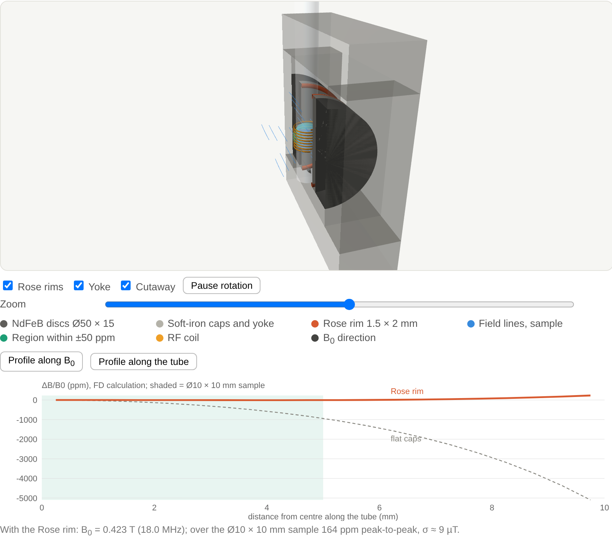{#fig-rose3d width=85%}
:::

## Modulation, offset and sweep coils

The Helmholtz pair is wound directly on the pole caps: 20 turns of 0.56 mm
wire each, radius about 26 mm, with centres about 25 mm apart. That spacing is
roughly the Helmholtz condition (spacing = radius). One pair does three jobs:

| Field term | Model | Coil current |
|---|---|---|
| modulation $B_\text{mod}\sin2\pi f_mt$ | 50 µT (scope) / 1.5 µT (lock-in) | 70 mA / 2 mA peak |
| offset $B_\text{off}$ | 0 / +20 µT | 0 / 28 mA DC |
| sweep $\dot B_\text{sw}t$ | ±30 µT in 1.5 s | ±42 mA ramp |

The iron pole caps act like magnetic mirrors, so the coil constant in the
magnet is larger than the free-space $k_\text{coil}=0.72$ mT/A. Calibrate it
using the spins themselves:

1. Centre the blips with the generator's DC offset.
2. Change the oscillator frequency by a measured $\Delta f$.
3. Re-centre with an offset change $\Delta V$.

Then the field per volt is $(2\pi\Delta f/\gamma)/\Delta V$, which is
23.5 µT per kHz of frequency shift divided by $\Delta V$.

## Voltage-to-current coil driver

The coils have to pass DC, so an AC-coupled audio amplifier cannot drive
them. The driver in @fig-driver is DC-coupled and controls current, not
voltage:

* **U3A** sums the generator's modulation (CH1) and sweep/offset (CH2)
  outputs and scales them by −0.1.
* **U3B** with the BD139/BD140 push-pull pair forces the current through the
  coils so that the voltage across the 1 Ω sense resistor equals $v_1$. The
  result is $I = v_1/R_\text{sense}$: 100 mA per volt from the generator.
* Feedback cancels the push-pull crossover distortion and the coils' L/R
  phase shift. The voltage across $R_\text{sense}$ is therefore an exact copy
  of the field, and that is what the model's CH1 assumes.
* $C_c$ (1 nF) keeps the loop stable with the inductive load.

Limit the DC current to about ±150 mA, which gives roughly ±100 µT. At that
current a transistor dissipates up to about 1.8 W, so give each one a small
clip-on heatsink. Swapping the coil leads reverses the sign of the field.

::: {.content-visible when-format="html"}
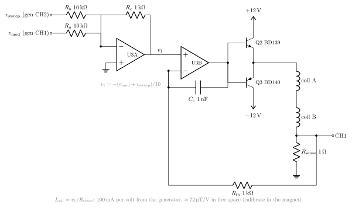{#fig-driver width=95%}
:::

::: {.content-visible unless-format="html"}
{#fig-driver width=95%}
:::

## Waveform generator

A two-channel function or arbitrary-waveform generator supplies everything:

| Mode | CH1 → driver $v_\text{mod}$ | CH2 → driver $v_\text{sweep}$ | Reference |
|---|---|---|---|
| Scope, on resonance | sine 100 Hz, about 0.7 V pk (about 50 µT) | DC offset to centre the blips | CH1 sync → scope trigger |
| Lock-in | sine 200 Hz, about 20 mV pk (about 1.5 µT) | ramp, 1.5 s, ±0.4 V (about ±30 µT) | CH1 sync → lock-in reference |

The values in µT assume the free-space coil constant. Use the calibrated
value from the procedure above.

Any two-channel DDS bench generator with DC offset and a sync output will do
this. A sound card will not, because it cannot output DC. The lock-in
amplifier itself is optional: digitise CH2 and the sync signal with a USB
scope or DAQ, then mix and filter in MATLAB exactly as
`nmr_marginal_osc_sim.m` does.

## Finding the resonance

1. Measure $B_0$ with the Hall probe and set the oscillator near
   $\gamma B_0/2\pi$, checking with the frequency counter.
2. Turn R~S~ down until the oscillator only just runs, with a small, steady
   RF amplitude.
3. Apply large modulation (100 Hz, 100–200 µT). Slowly tune C~t~ while
   watching CH2 for blips.
4. Use the CH2 DC offset to make the blips evenly spaced (@fig-yt). You are
   then on resonance.
5. For a lock-in spectrum, reduce the modulation to about 1–2 µT, switch CH2
   to a slow ramp, and record the lock-in output against the ramp.

# MATLAB implementation

## Parameters: `nmr_params.m`

All parameters are in one struct `P`. The script is attached to the model as
`PreLoadFcn` and `InitFcn`, so it runs again every time the model is
simulated. It picks the operating mode from the base-workspace variable
`nmr_mode`:

```matlab
nmr_mode = 'scope';      % 100 Hz, 50 uT, on resonance (default)
nmr_mode = 'scope_off';  % same, B0 offset +20 uT
nmr_mode = 'lockin';     % 200 Hz, 1.5 uT, slow ±30 uT sweep in 1.5 s
sim('nmr_marginal_osc')
```

The main blocks of parameters:

```matlab
% Spins and magnet
P.gamma = 2*pi*42.577e6;   P.f0 = 20e6;   P.w0 = 2*pi*P.f0;
P.Bres  = P.w0/P.gamma;                      % 0.46974 T
P.T1 = 2e-3;  P.T2 = 1e-3;  P.chi0 = 4e-9;
P.sigB  = 5e-6;  P.Niso = 101;
P.dB    = linspace(-4,4,P.Niso)'*P.sigB;     % isochromat offsets
P.wiso  = exp(-0.5*(P.dB/P.sigB).^2); P.wiso = P.wiso/sum(P.wiso);

% Marginal oscillator
P.eta = 0.6;  P.Q0 = 80;  P.eps = 0.05;  P.A0 = 0.5;
P.As  = P.A0/sqrt(P.eps);                    % so that A0 = As*sqrt(eps)
P.kB1 = 1e-6/P.A0;                           % B1 = 1 uT at A0
P.y0  = [zeros(2*P.Niso,1); ones(P.Niso,1); P.A0];   % [Mx; My; Mz; A]

% Noise scaled so the preamp-band rms is P.noise
enbw = pi*P.flp/4;
P.noisePower = (P.noise*sqrt((1/P.Tsn)/(2*enbw)))^2*P.Tsn;

% Lock-in reference phase correction (two-pole preamp)
P.phi = 2*atan(P.fm/P.flp);
```

The initial state starts all isochromats at equilibrium ($m_z = 1$) and the
oscillator at its no-signal amplitude, so no start-up transient needs to be
thrown away.

## Model structure

{#fig-top width=95%}

`build_nmr_model.m` builds the whole diagram from code using
`add_block`/`add_line`. It then groups blocks with
`Simulink.BlockDiagram.createSubsystem` and tidies the layout with
`arrangeSystem`. Because the build is scripted, the `.slx` can always be
regenerated from text, which suits version control. Signal flow:

| Subsystem / block | Contents | Physical counterpart |
|---|---|---|
| **B0 offset and sweep** | `Ramp`: `X0 = P.Boff`, `slope = P.sweep` | magnet supply |
| **Modulation coils** | `Sine Wave` (field, T) → `Gain` $R_\text{sense}/k_\text{coil}$ | Helmholtz pair + 1 Ω sense resistor → CH1 |
| **Field at sample** | `Sum` | total $B_\text{ext}$ |
| **Spins and oscillator** | `MATLAB Function` + vector `Integrator` | sample + Hartley tank |
| **Detector and preamp** | noise, `−A0`, gain 20, two-pole LPF, $s/(s+2\pi f_{hp})$ | diode detector + audio preamp → CH2 |
| **Lock-in amplifier** | reference `Sine Wave`, `Product`, two-pole LPF | lock-in |
| Sinks | `Scope` (YT), `XY Graph`, `Scope`, six `To Workspace` | instruments + logging |

## The core: spins and oscillator subsystem

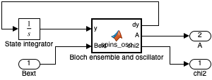{#fig-spins width=60%}

All $3N+1 = 304$ states are in **one vector Integrator**, with
`InitialCondition = P.y0`. A MATLAB Function block computes the derivative of
the whole vector. This is the usual Simulink pattern for a large ODE system
written as vectorised code. The MATLAB Function block has no state of its own,
so the solver treats it like any other continuous system:

```matlab
function [dy, A, chi2] = spins_osc(y, Bext, P)
% Rotating-frame Bloch equations for an isochromat ensemble, coupled to
% the averaged amplitude A of a marginal oscillator.
N  = numel(P.dB);
Mx = y(1:N); My = y(N+1:2*N); Mz = y(2*N+1:3*N);
A  = max(y(end), 1e-9);
D  = P.gamma*(P.Bres + Bext + P.dB) - P.w0;   % offsets, rad/s
w1 = P.gamma*P.kB1*A;                         % RF nutation rate
dMx = D.*My - Mx/P.T2;
dMy = -D.*Mx + w1*Mz - My/P.T2;
dMz = -w1*My - (Mz - 1)/P.T1;
chi2 = P.chi0*P.Bres*(P.wiso'*My)/(2*P.kB1*A);  % absorption chi''
dA = (P.w0/(2*P.Q0))*(P.eps - (A/P.As)^2)*A - (P.w0/2)*P.eta*chi2*A;
dy = [dMx; dMy; dMz; dA];
```

Line by line, against the equations:

* `D` is $\Delta_k$ for every isochromat at once (an N×1 vector). `Bext` is a
  scalar and `P.dB` is a vector, so implicit expansion does the rest.
* `dMx`, `dMy`, `dMz` are @eq-bloch, using element-wise products.
* `chi2` is @eq-chi2. The ensemble sum $\sum_k w_k m_{y,k}$ is the inner
  product `P.wiso'*My`, and $B_1$ is `P.kB1*A`. The $A$ in $\omega_1$ cancels
  the $1/B_1$, so $\chi''$ stays finite as the drive goes to zero. Even so,
  `max(A,1e-9)` prevents a division by zero if the oscillator stops.
* `dA` is @eq-osc.

The script sets `P` as a **non-tunable parameter** of the function block, not
as an input port:

```matlab
ch = rt.find('-isa','Stateflow.EMChart','Path',[mdl '/Bloch ensemble and oscillator']);
ch.Script = code;
d = ch.find('-isa','Stateflow.Data','Name','P');
d.Scope = 'Parameter';  d.Tunable = false;
```

Simulink then resolves `P` from the base workspace (where `InitFcn` creates
it) at compile time and treats it as a constant struct. Array sizes are fixed
before simulation and the block's code generation can fold the constants.

## Solver choices

```matlab
set_param(mdl,'Solver','ode45','StopTime','P.Tstop','MaxStep','P.maxStep', ...
              'RelTol','1e-5','PreLoadFcn','nmr_params','InitFcn','nmr_params');
```

* **ode45** (an explicit variable-step solver) works because the fastest
  physical time scale, $\tau_A = 12.7$ µs, is only about 80 times shorter than
  $T_2$. That is mildly stiff, not severely stiff.
* **MaxStep** is 2 µs in scope mode and 10 µs in lock-in mode. It does two
  jobs: it stops the solver stepping over the 10 µs samples of the noise
  source, and it keeps the steps short enough to resolve $\tau_A$ and the
  fast-passage dynamics.
* **RelTol 1e-5.** The dips are a few percent of $A_0$, so the default
  1e-3 would produce visible error.

## Detector, preamp and lock-in in Simulink

Each of these is ordinary linear blocks:

```matlab
% Preamp: two identical poles at flp, then AC coupling at fhp
'Denominator','conv([1/(2*pi*P.flp) 1],[1/(2*pi*P.flp) 1])'
'Numerator','[1 0]', 'Denominator','[1 2*pi*P.fhp]'
% Lock-in: reference 2*sin(w_m t - phi), mixer, two-pole LPF with tau per pole
'Amplitude','2', 'Frequency','2*pi*P.fm', 'Phase','-P.phi'
'Denominator','conv([P.tau 1],[P.tau 1])'
```

The factor 2 in the reference amplitude makes the DC output of the mixer equal
to the amplitude of the in-phase component.

## The stand-alone script: `nmr_marginal_osc_sim.m`

The script is an independent check that uses only base MATLAB:

* **Integrator.** A hand-written fixed-step RK4 (`run_sim`/`deriv`) with
  `dt` = 1 µs (scope) or 5 µs (lock-in), on the same state vector and the same
  derivative function as the model.
* **Isochromats.** 201 in scope mode and 101 in lock-in mode
  (`set_isochromats`).
* **Post-processing filters.** The detector chain runs on the stored envelope
  after integration. The filters are discrete first-order IIR sections:

  ```matlab
  function y = lp1(x, fc, dt)
      a = 1 - exp(-2*pi*fc*dt);
      y = filter(a, [1, -(1-a)], x, (1-a)*x(1));
  end
  ```

  The initial condition of `filter` is set so that the filter starts in steady
  state at `x(1)`.
* **Short runs.** A 2 Hz high-pass filter cannot settle in 40 ms, so for runs
  under 1 s the script removes the mean instead.
* **Lock-in.** The script computes both quadratures X and Y and rotates them
  by $\phi$: `LI = X*cos(phi) - Y*sin(phi)`. It also computes the expected
  Voigt absorption line and overlays it.
* **XY phase matching.** The phase-matched XY trace passes CH1 through the
  same two poles as the preamp.

Moving the noise and filters out of the ODE is what makes a fixed-step RK4
practical for the script. The Simulink model integrates them all together.

## Verification: `verify_nmr_model.m`

The verification script runs all three modes, extracts the key numbers from
the logged `timeseries`, and compares them with the script. Both use the same
noise level but different noise sequences.

| Quantity | Script | Simulink | Run time (Simulink) |
|---|---|---|---|
| Max dip, on resonance | 5.79 % | 5.79 % | 0.9 s |
| Max dip, +20 µT offset | 5.91 % | 5.91 % | — |
| Derivative peak-to-peak width | 12.0 µT | 14.4 µT | 2.7 s |

The dips agree to the stated precision. The peak-to-peak width is measured
from the noisy maximum and minimum, so it depends on the noise realisation by
roughly ±2 µT (see the flat-topped peaks in @fig-lockin). The model trace is
also shifted: its zero crossing is about +2.6 µT from resonance. The lock-in
low-pass filter delays by $2\tau = 40$ ms, and at a sweep rate of 40 µT/s that
moves the trace by about 1.6 µT.

# Results

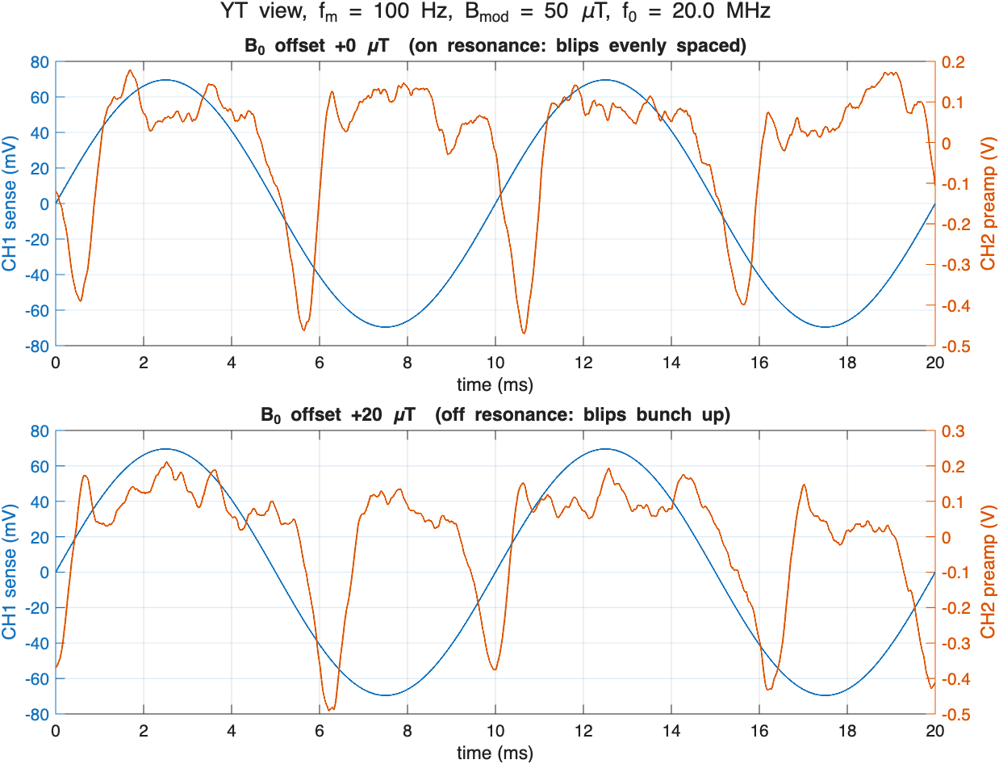{#fig-yt width=95%}

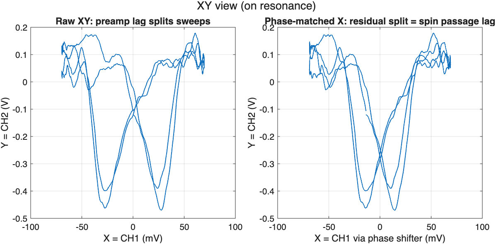{#fig-xy width=95%}

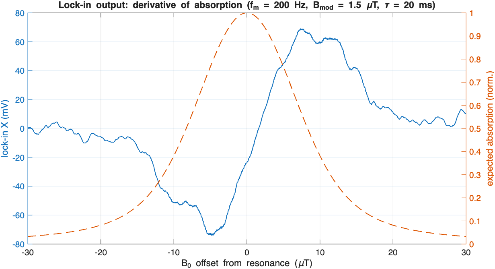{#fig-lockin width=95%}

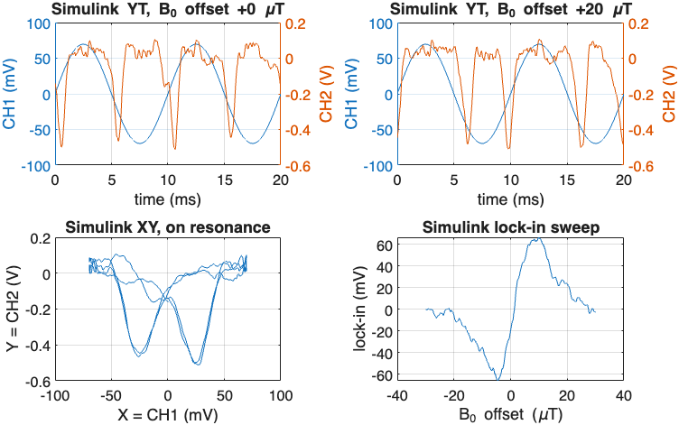{#fig-check width=90%}

What the figures show:

* **YT (@fig-yt).** The dips reach about −0.45 V at the preamp (about 5.8 % of
  0.5 V × 20, after low-pass filtering). Each dip has an overshoot on its
  trailing edge, which is the passage wiggle. The off-resonance pairing around
  the negative modulation peak is visible.
* **XY (@fig-xy).** There are two dips because the up and down sweeps reach
  resonance at different X positions. Phase matching moves them closer
  together but does not merge them, so the spin lag is a real effect, not just
  the electronics.
* **Lock-in (@fig-lockin).** The output is a clean dispersion-shaped
  derivative with a signal-to-noise ratio of several tens. The extrema sit
  near the inflection points of the dashed absorption curve.

# Model assumptions and limitations {#sec-limitations}

* **Fixed oscillator frequency.** The dispersion $\chi'$ would pull the
  frequency by about $\eta\chi'_\text{pk}\omega_0/2\approx 1$ kHz. In a real
  oscillator the frequency follows the tank, so this would slightly change
  $\Delta$ and add some FM. Neither effect is modelled.
* **Ideal cubic amplitude limiting.** Real gate-leak limiting has its own
  time constant ($R_gC_g$), which adds a slow pole to the amplitude loop and
  can cause squegging if it is too long.
* **Ideal envelope detector.** The model does not include the diode's square
  law or its threshold.
* **Simple noise model.** The noise is white and added at the detector. The
  real noise of a marginal oscillator includes amplitude noise that grows as
  $\varepsilon\to0$, plus 1/f noise.
* **Constant B1-to-amplitude ratio.** $k_{B1}$ is fixed, so the coil geometry
  and filling factor are folded into one constant.
* **Discrete isochromats.** A finite set of isochromats at fixed offsets
  produces artificial rephasing echoes at times $\sim 2\pi/(\gamma\,\delta B_\text{step})$.
  With 101 points over ±20 µT, $\delta B_\text{step}$ = 0.4 µT, so the echoes
  appear at about 60 ms. That is longer than one passage but within the
  lock-in sweep. They are suppressed because each isochromat also decays with
  $T_2$ = 1 ms.

# Appendix: parts list (RS Components UK) {#sec-bom}

These parts were looked up on [uk.rs-online.com](https://uk.rs-online.com/web/)
on 3 November 2026. Prices are ex VAT in GBP, for the RS pack size. The same
data is in `bom_rs_uk.csv`. Values follow @fig-hartley, @fig-preamp and @fig-driver.

| Ref | Function | Value | Mfr part | RS no. | Pack | Pack £ | Notes |
|---|---|---|---|---|--:|--:|---|
| Q1 | Oscillator JFET | J310, SOT-23 | onsemi MMBFJ310LT1G | 773-7813 | 10 | 1.06 | SMD only; alt. TO-92 J113 (806-1766) |
| C~t~ | Tank trimmer | 5–60 pF PTFE | Vishay BFC280908003 | 038-1419 | 5 | 60.60 | only in-stock trimmer |
| C~p~ | Tank padder | 47 pF C0G | KEMET C322C470J2G5TA | 538-1528 | 5 | 1.62 | |
| C~g~ | Gate coupling | 100 pF C0G | Vishay K101J15C0GF5TH5 | 852-3217 | 1 | 0.18 | |
| R~g~, R~1~ | Gate leak, detector return | 100 kΩ 1 % | Vishay MRS25000C1003FCT00 | 683-2923 | 25 | 2.18 | need 2 |
| R~S~ | Marginality | 1 kΩ 25-turn | Bourns 3296Y-1-102LF | 522-0063 | 1 | 1.53 | |
| C~b~ | Bypass / decoupling | 100 nF X7R | KEMET C322C104K5R5TA | 538-1433 | 5 | 3.27 | need 3 |
| — | Supply reservoir | 10 µF 25 V | Panasonic EEAFC1E100 | 449-1006 | 5 | 1.39 | |
| C~c~ | Detector coupling | 10 pF C0G | KEMET C315C100J5G5TA | 146-3557 | 20 | 2.56 | |
| D1 | Detector diode | Schottky | ST BAT43 | 251-3025 | 10 | 0.45 | last stock; alt. BAT85S-TR (180-8714) |
| C~f~ | Detector filter | 1 nF C0G | KEMET C322C102J2G5TA | 538-1382 | 5 | 1.99 | |
| R~f~ | Detector load | 47 kΩ 1 % | TE LR1F47K | 014-8893 | 10 | 0.50 | |
| U1 | Preamp op-amp | NE5532P | TI NE5532P | 197-7391 | 10 | 4.31 | ±12 V |
| C~in~ | AC coupling | 10 µF bipolar | Panasonic ECEA1EN100U | 176-3783 | 25 | 3.18 | |
| R~in~ | Input bias | 8.2 kΩ 1 % | TE LR1F8K2 | 014-8714 | 10 | 0.96 | |
| R~g~ (pre) | Gain set | 1 kΩ 1 % | TE LR1F1K0 | 125-1159 | 20 | 1.54 | need 2 |
| R~f~ (pre) | Feedback | 18 kΩ 1 % | TE LR1F18K | 014-8792 | 10 | 0.62 | + 1 kΩ in series = 19 kΩ |
| C~f~ (pre) | 1st pole | 8.2 nF PP | KEMET R75TI182050H3J | 212-6779 | 10 | 2.99 | 1.6 kV part, large |
| R~2~ | 2nd pole | 1.6 kΩ 1 % | TE LR1F1K6 | 014-8556 | 10 | 0.76 | |
| C~2~ | 2nd pole | 100 nF film | WIMA MKS2D031001A00KI00 | 108-2700 | 5 | 2.50 | |
| U3 | Coil driver op-amp | NE5532P | TI NE5532P | 197-7391 | — | — | from U1 pack |
| Q2 | Driver push-pull (NPN) | BD139 | ST BD139 | 168-6075 | 50 | 11.40 | needs small heatsink |
| Q3 | Driver push-pull (PNP) | BD140 | ST BD140 | 168-6074 | 50 | 12.20 | needs small heatsink |
| R~a~, R~b~ | Driver summing inputs | 10 kΩ 1 % | TE LR1F10K | 125-1164 | 20 | 1.50 | need 2 |
| R~c~, R~fb~ | Driver gain, feedback | 1 kΩ 1 % | TE LR1F1K0 | 125-1159 | — | — | from 1 kΩ pack |
| C~c~ (drv) | Driver compensation | 1 nF C0G | KEMET C322C102J2G5TA | 538-1382 | — | — | from 1 nF pack |
| R~sense~ | CH1 sense | 1 Ω 1 % 1 W | Vishay CPF11R0000FKE14 | 830-6937 | 1 | 6.13 | |
| — | Sample + Helmholtz coils | 0.56 mm Cu, 200 m | RS PRO | 035-7750 | 1 | 25.68 | |

: Parts list. Total about £151 ex VAT, of which the trimmer pack is £60.60. {#tbl-bom}

Notes:

* **Coil driver dissipation.** At 70 mA peak modulation the transistors run
  cool. Holding a DC offset of about 150 mA dissipates up to 1.8 W in one
  device, so fit clip-on SOT-32/TO-126 heatsinks.
* **Mounting the J310.** At 20 MHz it is normal to build "dead-bug" style on
  bare copper-clad board, so the SOT-23 package is not a problem. Keep the
  gate and tap leads short.
* **Not stocked at RS (or not affordable there).**
  * The NdFeB Ø50 × 15 mm discs: try specialist UK magnet suppliers.
  * Mild-steel bar for the yoke and the soft-iron pole caps: a metal
    stockholder or a machine shop.
  * A DC Hall gaussmeter. RS's RS PRO "gaussmeter" (106-5309) is a
    30–300 Hz EMF meter that reads to 200 µT, so it is useless here, and the
    Hirst instruments cost more than £1 300. A low-cost Hall-probe teslameter
    with a 0–2 T range from a general supplier is sufficient, or skip it and
    search for the line with the trimmer.
* **Not included.** A ±12 V supply, copper-clad board, BNC connectors, an
  enclosure, the CuSO~4~-doped water sample, and the test instruments
  (two-channel waveform generator, oscilloscope, frequency counter, and optionally a lock-in).

# Reproducing the results {#sec-repro}

The MATLAB scripts, the Simulink model, the circuit sources and the parts list are in [`src/nmr_hartley`](https://github.com/paulmilne/paulmilne.github.io/tree/main/src/nmr_hartley) in this blog's repository. The finite-difference results file `magnet_design_results.mat` (about 350 MB) is not included; `magnet_design` regenerates it.

```matlab
cd nmr_hartley
nmr_marginal_osc_sim        % script: prints a summary, writes fig1–fig3
build_nmr_model             % regenerate nmr_marginal_osc.slx (optional)
verify_nmr_model            % runs all modes, writes simulink_check.png, model_*.png
render_setup_3d             % 3D set-up renders: setup_3d_overview.png, setup_3d_gap.png
magnet_design               % 3D field calculation: magnet_design.png, magnet_design_results.mat (~6 min)
```

To rebuild the circuit diagrams (needs `pdflatex` with `circuitikz`, plus `pdf2svg`):

```bash
circuits/build.sh                             # circuits/*.tex -> .pdf + .svg
```
