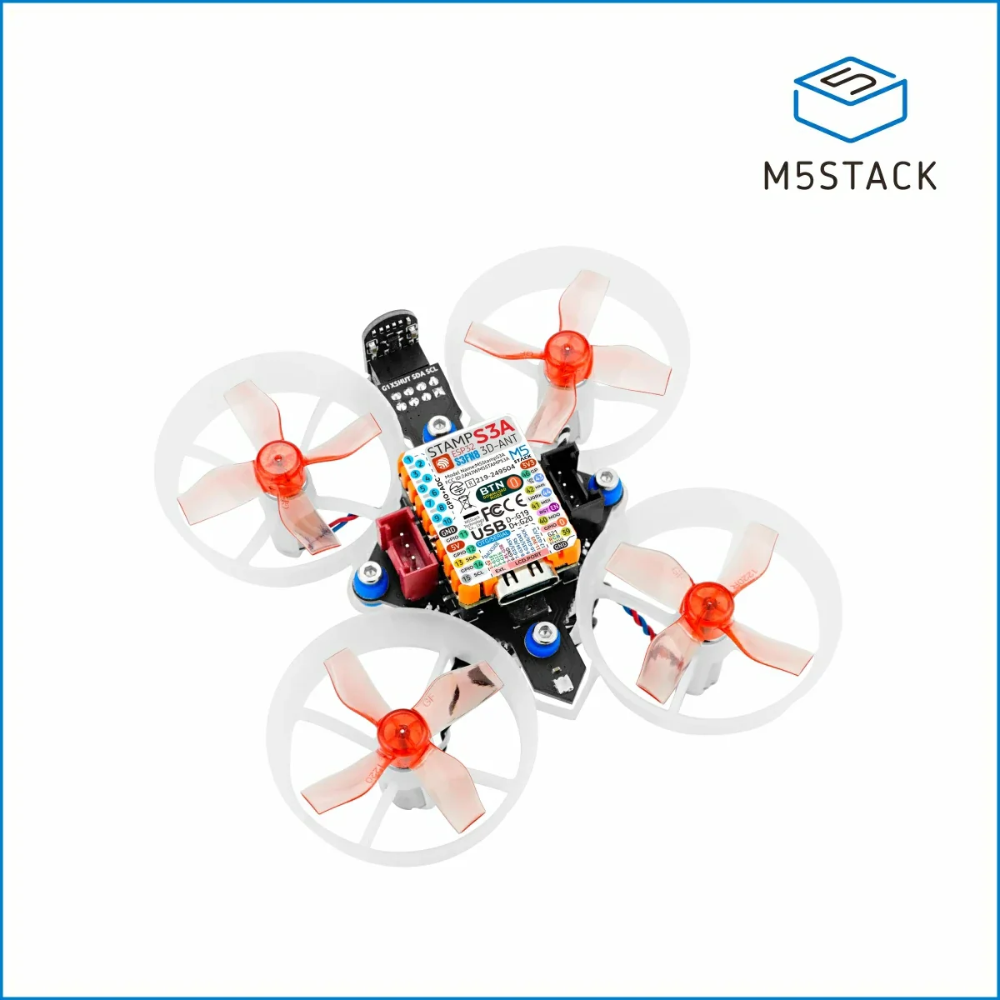
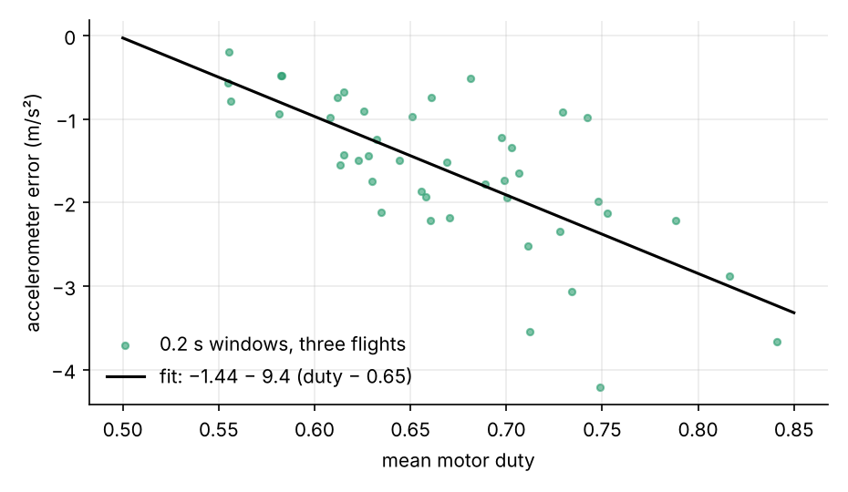
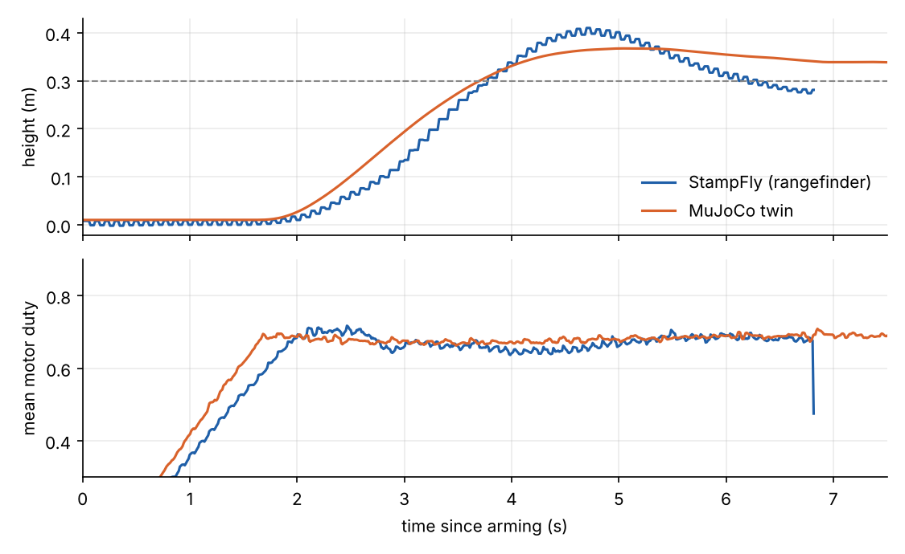
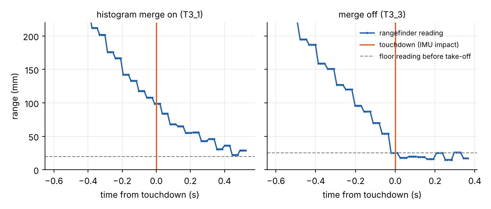
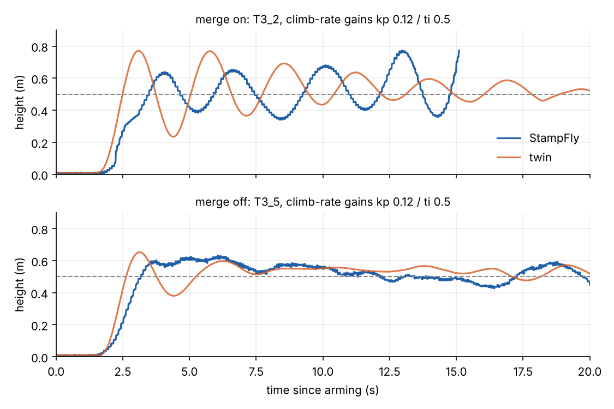

Over two days of test flights, a MuJoCo model of my M5Stack StampFly predicted the hover throttle to three
decimal places, ranked candidate fixes for a take-off overshoot in the order the real drone confirmed, and chose
position-hold gains that worked first time. Then it recommended altitude gains that made the real drone oscillate
until a safety cut dropped it. Working out why the twin was wrong turned up a 0.3 s lag inside the rangefinder's
driver. Removing it halved the altitude wander, and the gains that had failed then flew cleanly.

This post follows on from [Quadcopters: four fixed rotors, cheap sensors and the Kalman filter](../quadcopters-kalman/index.qmd),
which covers the physics and the estimators. Here the subject is the loop between a simulation and a physical
machine: what each one tells you that the other can't.

## The setup

The StampFly is M5Stack's 35.5 g open-source quadcopter: an ESP32-S3 controller, brushed coreless motors, a BMI270
gyroscope and accelerometer, a downward VL53L3CX time-of-flight rangefinder and a PMW3901 optical-flow sensor. Its
firmware runs a 400 Hz loop with a Madgwick attitude filter, cascaded angle and rate PIDs, and a three-state Kalman
filter (velocity, height, accelerometer bias) for altitude.

{width=60% fig-align="center"}

Two Claude sessions did the work, with me flying. One worked in VS Code with PlatformIO, changing the firmware,
flashing it and running scripted test flights that log 100 Hz records to flash. The other built and ran the
simulation and analysed the logs. They talked through a shared `NOTES.md` file in the repository: a flight log and
a request went one way, a fitted model, a table of simulated cases and a recommendation came back. Each flight was a test of
the previous recommendation.

## Building the twin from measurements

Every parameter in the model came from a measurement, mine or someone else's:

| Part | Value | Source |
| --- | --- | --- |
| Mass | 35.5 g (27 g airframe, 8.5 g battery) | Weighed |
| Geometry | Motors on a 46 mm square, 30 mm props | Measured |
| Inertia | I~xx~ 9.16, I~yy~ 13.3, I~zz~ 20.4 × 10⁻⁶ kg m² | Bifilar pendulum, [M5Fly-kanazawa/stampfly_ecosystem](https://github.com/M5Fly-kanazawa/stampfly_ecosystem) |
| Motors and props | DC motor model with a measured drive-circuit resistance table | Bench identification, same repository |
| Battery | Open-circuit curve, 0.145 Ω + 0.06 Ω polarisation (τ 3 s) | Fitted to my flight logs, 13–16 mV rms |
| Sensors | Noise, bias, rates | Fitted to ground runs and flights |
| Firmware | Filters, PIDs, mixer, take-off ramp | Ported line by line |

The motor model integrates rotor speed from duty and battery voltage, rather than assuming thrust is proportional to
duty squared:

$$
I = \frac{V - K_e\,\omega}{R_\text{out}(D)}, \qquad
J\dot\omega = K_t I - C_q\omega^2 - K_t\left(I_{0a} + I_{0b}\,\omega^2\right), \qquad
T = \eta\, C_t\, \omega^2 .
$$

The first equation is the motor's electrical circuit, the second is the torque balance on the rotor, and the third gives the
thrust; [A DC motor and propeller model](../../explainers/dc-motor-propeller/index.qmd) derives each one. Per
motor, with values from the Kanazawa bench identification:

| Symbol | Meaning | Value |
| --- | --- | --- |
| $D$ | PWM duty from the firmware's mixer, 0–1 | |
| $V$ | Battery voltage at the board | 3.3–4.3 V |
| $\omega$, $\dot\omega$ | Rotor speed and its rate of change | rad/s, rad/s² |
| $I$ | Motor current; zero below 1% duty | A |
| $K_e$ | Back-EMF constant | 5.9 × 10⁻⁴ V·s/rad |
| $K_t$ | Torque constant (equal to $K_e$ in SI units) | 5.9 × 10⁻⁴ N·m/A |
| $R_\text{out}(D)$ | Effective resistance of the motor and its drive circuit, a measured table against duty | 26 Ω at 10% duty, 0.9 Ω at 90% |
| $J$ | Moment of inertia of the rotor and propeller | 1.54 × 10⁻⁸ kg·m² |
| $C_q$ | Propeller drag-torque coefficient: drag torque $= C_q\omega^2$, which also yaws the body | 3.38 × 10⁻¹¹ N·m·s² |
| $I_{0a}$, $I_{0b}$ | No-load current, constant and speed-squared parts (bearing and brush friction) | 0.044 A, 2.9 × 10⁻⁹ A·s² |
| $C_t$ | Propeller thrust coefficient | 7.6 × 10⁻⁹ N·s² |
| $\eta$ | Thrust efficiency in flight relative to the bench | 0.976 |
| $T$ | Thrust from one rotor | N |

The drive circuit's effective resistance $R_\text{out}(D)$ falls from 26 Ω at 10% duty to under 1 Ω at 90%, which
flattens thrust against duty near hover. That turned out to matter: at duty 0.56 the drone still has 86% of its hover
thrust, which explained a climb the firmware session had flagged as impossible.

```{=html}
<figure class="twin-fig">
<style>
.twin-fig { margin: 1.2rem 0; }
.twin-fig svg { width: 100%; height: auto; max-width: 780px; display: block; margin: 0 auto; font-family: inherit; }
.twin-fig .bx { fill: var(--bs-body-bg, #fff); stroke: var(--bs-border-color, #c9ccd1); stroke-width: 1.2; }
.twin-fig .hd { fill: var(--bs-body-color, #222); font-size: 15px; font-weight: 650; }
.twin-fig .sub { fill: var(--bs-secondary-color, #666); font-size: 11.5px; }
.twin-fig .tx { fill: var(--bs-body-color, #333); font-size: 12.5px; }
.twin-fig .lr { fill: #c8561f; font-size: 12.5px; font-weight: 600; }
.twin-fig .ar { stroke: var(--bs-body-color, #444); stroke-width: 1.6; fill: none; marker-end: url(#tw-arrow); }
.twin-fig .al { fill: var(--bs-body-color, #444); font-size: 12px; font-style: italic; }
.twin-fig .loop { stroke: #c8561f; stroke-width: 1.4; stroke-dasharray: 5 4; fill: none; marker-end: url(#tw-arrow2); }
.twin-fig figcaption { font-size: .9rem; opacity: .75; margin-top: .4rem; }
</style>
<svg viewBox="0 0 780 520" role="img" aria-label="Structure of the StampFly digital twin">
<defs>
<marker id="tw-arrow" viewBox="0 0 10 10" refX="9" refY="5" markerWidth="7" markerHeight="7" orient="auto-start-reverse"><path d="M0,0 L10,5 L0,10 z" fill="currentColor"/></marker>
<marker id="tw-arrow2" viewBox="0 0 10 10" refX="9" refY="5" markerWidth="7" markerHeight="7" orient="auto-start-reverse"><path d="M0,0 L10,5 L0,10 z" fill="#c8561f"/></marker>
</defs>
<!-- Firmware port -->
<rect class="bx" x="10" y="10" width="330" height="168" rx="8"/>
<text class="hd" x="24" y="34">Firmware port (400 Hz)</text>
<text class="sub" x="24" y="51">ported line by line from flight_control.cpp</text>
<text class="tx" x="24" y="76">Madgwick attitude filter, β 0.1</text>
<text class="tx" x="24" y="95">Altitude Kalman filter: velocity, height, bias</text>
<text class="tx" x="24" y="114">Height → climb rate → thrust; angle → rate PIDs</text>
<text class="lr" x="24" y="133">Accelerometer correction from duty</text>
<text class="tx" x="24" y="152">Flow position hold; take-off ramp; mixer</text>
<text class="tx" x="24" y="171">Thrust0 from the motor model</text>
<!-- Motor + battery -->
<rect class="bx" x="440" y="10" width="330" height="168" rx="8"/>
<text class="hd" x="454" y="34">Motors and battery (Python)</text>
<text class="sub" x="454" y="51">Kanazawa bench identification; battery fitted to logs</text>
<text class="tx" x="454" y="76">Rotor speed ODE per motor, RK4 at 2 kHz</text>
<text class="tx" x="454" y="95">Drive resistance R(D): 26 Ω at 10% → 0.9 Ω at 90%</text>
<text class="tx" x="454" y="114">Thrust η·Ct·ω²; yaw torque Cq·ω² + J·dω/dt</text>
<text class="tx" x="454" y="133">Battery: OCV − I·0.145 Ω − polarisation</text>
<text class="tx" x="454" y="152">Hover duty 0.693 at 3.55 V, untuned</text>
<!-- MuJoCo -->
<rect class="bx" x="440" y="248" width="330" height="150" rx="8"/>
<text class="hd" x="454" y="272">Rigid body (MuJoCo)</text>
<text class="sub" x="454" y="289">0.5 ms steps; floor contact; ray-cast rangefinder</text>
<text class="tx" x="454" y="314">35.5 g; motors on a 46 mm square</text>
<text class="tx" x="454" y="333">Inertia 9.2 / 13.3 / 20.4 × 10⁻⁶ kg m² (bifilar)</text>
<text class="tx" x="454" y="352">Rotor drag; random disturbance torque</text>
<text class="tx" x="454" y="371">matched to hover rate noise</text>
<!-- Sensors -->
<rect class="bx" x="10" y="248" width="330" height="150" rx="8"/>
<text class="hd" x="24" y="272">Sensor models</text>
<text class="sub" x="24" y="289">noise and bias fitted to ground runs and flights</text>
<text class="tx" x="24" y="314">Gyro and accelerometer noise, bias, drift</text>
<text class="lr" x="24" y="333">Accelerometer error: −1.44 − 9.4 (duty − 0.65)</text>
<text class="lr" x="24" y="352">Rangefinder: 22 Hz, histogram-merge lag</text>
<text class="tx" x="24" y="371">Optical flow: 1.7 mrad/count, lost above 1 rad/s</text>
<!-- arrows -->
<path class="ar" d="M340,94 L438,94"/><text class="al" x="352" y="86">4 duties</text>
<path class="ar" d="M605,178 L605,246"/><text class="al" x="612" y="217">thrust, torque</text>
<path class="ar" d="M440,323 L342,323"/><text class="al" x="352" y="315">true motion</text>
<path class="ar" d="M175,248 L175,180"/><text class="al" x="182" y="217">gyro, accel, range, flow</text>
<!-- outer loop -->
<path class="loop" d="M605,398 L605,440 L175,440 L175,400"/>
<text class="lr" x="390" y="462" text-anchor="middle">Each flight: log → fit the twin → simulate the options → flash the best → fly</text>
<text class="sub" x="390" y="482" text-anchor="middle">orange: learned from flight logs, not from the bench or the datasheets</text>
</svg>
<figcaption>How the twin is built: four parts in a loop, each holding measured values. The orange items exist because a flight disagreed with the twin.</figcaption>
</figure>
```

The first check, with nothing tuned: the twin hovers at duty **0.693** at 3.55 V. The real drone, averaged over
the steady part of flight T2_1, hovered at **0.693** at 3.56 V.

## What the twin found that the drone was hiding

The early flights overshot their 0.3 m target to nearly 1 m. The logs showed the altitude filter's velocity estimate
going *negative* at lift-off, as if the drone were sinking while it climbed.

Comparing the logged vertical acceleration with what the motor model says the duties must produce gave the reason. The
accelerometer reads low in flight, and the error grows steeply with motor speed:



That is a positive feedback loop through the estimator. More thrust makes the accelerometer read lower, so the filter thinks
the drone is sinking, so the climb-rate controller adds more thrust. Vibration rectification is the likely mechanism; the raw
IMU stream will tell.

With that error in the twin, five candidate fixes were simulated. Correcting the accelerometer from duty
before the filter, plus setting the take-off thrust from the motor model instead of a voltage formula, cut the
simulated peak from 0.72 m to 0.38 m. Lowering the altitude gains, the obvious fix, did nothing for the peak and slowed the recovery. The firmware
session flashed the top pair. The next flight peaked at 0.43 m:



## Position hold: calibrate on the bench, tune in the twin

The StampFly has no position hold out of the box and drifts metres in a few seconds. The optical-flow sensor
measures image motion in counts. Its scale came from rocking the drone by hand over a patterned floor: during pure rotation the flow
equals the rotation angle, so the gyro calibrates it. That gave 1.69 mrad per count, against the 2.22 used in the Kanazawa
firmware, and a 30 cm sideways drift I saw in flight later read 0.33 m by flow.

The twin chose the gains. It also ruled out a velocity low-pass filter, whose lag destabilised the loop, and the
higher gain that Kanazawa used on their own controller. By the second flight with the hold it drifted 0.13 m each way; the last flight without it had
drifted 1.1 m.

## The prediction that failed

To tighten the altitude hold, the twin recommended a stronger climb-rate loop (gain 0.12, integral time 0.5 s). It held
±3–4 cm in simulation and survived a 40 ms stress delay. On the drone, flight T3_2 bobbed with a 2.5 s period
and growing amplitude until it crossed 0.8 m and the test cut the motors.

A twin that is wrong about stability is missing a delay or a state. The question was which one.

## Finding the hidden lag

The landings answered it. When the firmware decides it has landed it stops the motors, and from then on the
accelerometer shows whether the drone is in free fall or resting, while the gyro shows the touchdown knock. In the
landings I checked, the drone was already on the floor while the rangefinder still read about 10 cm:



A cross-correlation over whole flights agreed: changes in thrust showed up in the rangefinder's height about 0.32 s
later, of which the motors account for perhaps 40 ms.

The cause was in the sensor's driver. The VL53L3CX sends raw photon-timing histograms to the host, and ST's driver
merges up to six successive histograms by default (`VL53LX_TUNINGPARM_HIST_MERGE`, maximum size 6) to cut noise. That is a moving
average over about 0.28 s of 46 ms frames. The rangefinder also turned out to run at 22 Hz, not the 30 Hz the
firmware assumed.

With a six-frame merge and a further 130 ms of latency, the twin reproduced T3_2's oscillation at a similar
period. With the merge off, the same gains held. The firmware session switched the merge off with one call
(`VL53LX_SetTuningParameter`), the landing lag fell from about 350 ms to under 70 ms, and with the old gains the altitude
wander (standard deviation) fell from 0.10 m to 0.05 m. Then the gains that had failed in T3_2 were flown again as T3_5:



T3_5 held a standard deviation of 4.6 cm, with the lowest take-off overshoot of any 0.5 m flight (+0.15 m), and landed
normally. The twin had predicted 2.4–3.3 cm and a 0.65 m peak; the real peak was 0.65 m.

The same lag explains several earlier puzzles. More than once the logs showed the drone climbing faster while
its thrust fell, which looked impossible. The rangefinder was reporting where the drone had been a third of a second earlier.

## Predictions against outcomes

| Twin's prediction | What the StampFly did |
| --- | --- |
| Hover duty 0.693 at 3.55 V, untuned | 0.693 at 3.56 V (T2_1) |
| Duty correction + motor-model take-off: peak 0.72 → 0.38 m | about 1.0 → 0.43 m (T2_2 → T2_3) |
| 7% take-off thrust error on a part-charged pack: peak 0.72 m | 0.69 m (T2_5) |
| Velocity hold: metres of drift down to tens of centimetres | 1.1 m → 0.13 m (T2_4 → T2_6) |
| Climb-rate gain 0.12 / 0.5 s is stable | **Wrong**: growing 2.5 s oscillation (T3_2) |
| With the driver's 6-frame merge: oscillation, period ~2.8 s | T3_2: ~2.5–2.7 s |
| Merge off, same gains: 2.4–3.3 cm std, 0.65 m peak | 4.6 cm std, 0.65 m peak (T3_5) |

The twin runs slightly optimistic on altitude wander throughout, by about 1–2 cm. Some unmodelled disturbance is still
missing.

## What the loop taught

The successes were mostly about ranking. The twin didn't have to be exact to say that correcting the accelerometer
would beat lowering the gains, or that a velocity filter would hurt. It only had to contain the mechanisms that
mattered.

The failure was more instructive. A model only reproduces behaviour it has the states and delays to produce. In
Ashby's terms, it needs the variety of the system it regulates. The twin had no rangefinder latency, so
no amount of tuning inside it could have predicted T3_2. The real drone's disagreement was the measurement that
added that state. The comparison of the two found the fault; neither would have found it alone.

There is still a gap to close. The same logs show each rangefinder read blocking the control loop for about 5 ms,
so the "400 Hz" loop averages 336 Hz. Moving the read into a separate task on the ESP32-S3's other core is next.
Then the twin goes up a size: a 3D-printed, brushless 3-inch quad sized from motor bench data, with the same firmware
and sensors.

*The physical model's inertia and motor constants are from Kouhei Ito's
[stampfly_ecosystem](https://github.com/M5Fly-kanazawa/stampfly_ecosystem) (MIT licence). Simulation in
[MuJoCo](https://mujoco.org). See also the [Kalman filter explainer](../../explainers/kalman-filter/index.qmd).*
