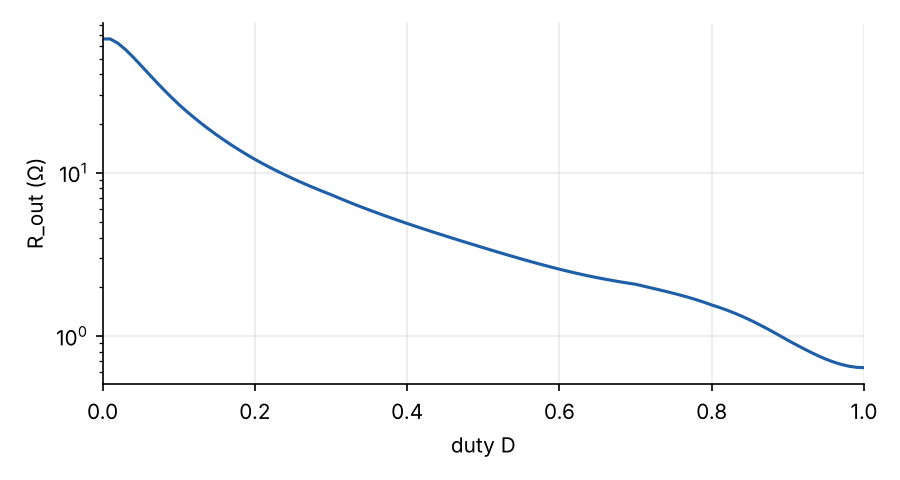
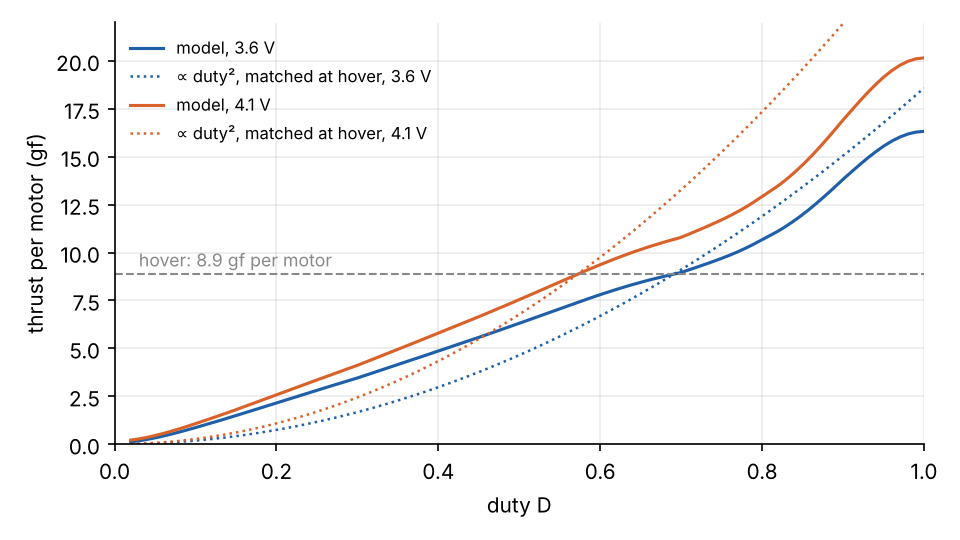
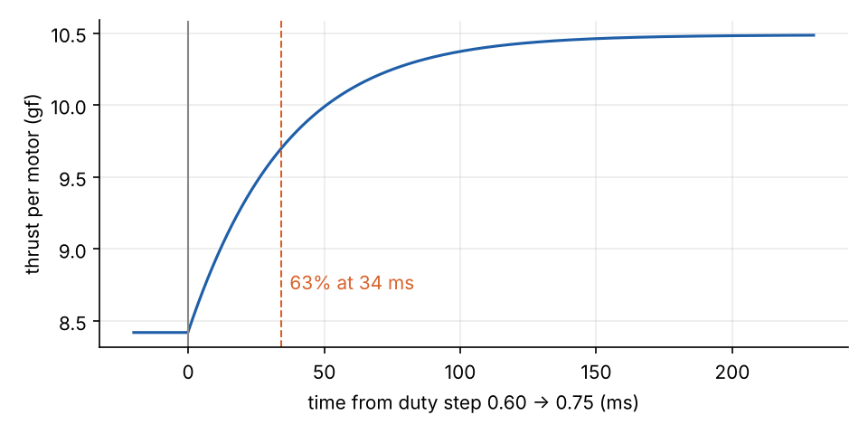

A small quadcopter's controller does not set thrust. It sets a PWM duty for each motor, and thrust follows through a
chain of physics: the duty and battery voltage drive a current, the current makes a torque, the torque spins the rotor
up against the propeller's drag, and the spinning propeller makes thrust. Three equations capture that chain:

$$
I = \frac{V - K_e\,\omega}{R_\text{out}(D)}, \qquad
J\dot\omega = K_t I - C_q\omega^2 - K_t\left(I_{0a} + I_{0b}\,\omega^2\right), \qquad
T = \eta\, C_t\, \omega^2 .
$$

This explainer derives each one, then puts them together to get the hover throttle and the rotor's response time. The
values are for the M5Stack StampFly's coreless brushed motors, from the bench identification in Kouhei Ito's
[stampfly_ecosystem](https://github.com/M5Fly-kanazawa/stampfly_ecosystem). The model is the motor half of the
digital twin in [The Twin and the Drone](../../electronics/stampfly-digital-twin/index.qmd).

| Symbol | Meaning | StampFly value |
| --- | --- | --- |
| $D$ | PWM duty, 0–1 | hover ≈ 0.69 at 3.6 V |
| $V$ | Battery voltage | 3.3–4.3 V |
| $\omega$ | Rotor speed | hover ≈ 3,430 rad/s (32,700 rpm) |
| $I$ | Motor current | hover ≈ 0.75 A |
| $K_e$, $K_t$ | Back-EMF and torque constants | 5.9 × 10⁻⁴ V·s/rad = N·m/A |
| $R_\text{out}(D)$ | Effective resistance of motor and drive, against duty | 26 Ω at 10%, 2.1 Ω at hover, 0.9 Ω at 90% |
| $J$ | Rotor and propeller inertia | 1.54 × 10⁻⁸ kg·m² |
| $C_q$ | Propeller drag-torque coefficient | 3.38 × 10⁻¹¹ N·m·s² |
| $I_{0a}$, $I_{0b}$ | No-load (friction) current, constant and ∝ ω² | 0.044 A, 2.9 × 10⁻⁹ A·s² |
| $C_t$ | Propeller thrust coefficient | 7.6 × 10⁻⁹ N·s² |
| $\eta$ | In-flight thrust relative to the bench | 0.976 |

## The motor's circuit

A brushed DC motor is a coil of wire turning in a magnetic field. Kirchhoff's voltage law says the voltage across its
terminals is used up three ways:

$$
V_\text{applied} = I R + L\frac{dI}{dt} + K_e\,\omega .
$$

- $IR$ is the drop across the winding and brushes.
- $L\,dI/dt$ is the coil's inductance resisting changes of current.
- $K_e\omega$ is the **back-EMF**. A coil moving through a magnetic field is a generator, so a spinning motor produces a
  voltage that opposes the supply, in proportion to its speed.

The inductance term can be dropped. It sets an electrical time constant $L/R$ that, for a small coreless motor, is far
shorter than the rotor's mechanical time constant of about 40 ms (below). The current settles almost instantly to
whatever voltage the back-EMF leaves:

$$
I = \frac{V_\text{applied} - K_e\,\omega}{R}.
$$

Back-EMF is why a motor draws a large current at start-up and much less once it is spinning. At hover the StampFly's
motors generate about 2.0 V of back-EMF from a 3.6 V battery.

### PWM and the effective resistance

The firmware does not set a voltage. It switches each motor on and off through a MOSFET at 150 kHz, with duty $D$ the
fraction of time it is on. The textbook simplification averages the switching to $V_\text{applied} = D\,V$. On the
StampFly, with a capacitor across each motor and a fast switching frequency, that average does not match what
the bench measures.

Kanazawa's model keeps the full battery voltage $V$ and lets the resistance depend on duty instead, as $R_\text{out}(D)$.
They calculated it from a circuit model and corrected it against measurements at nine duties. It falls steeply with
duty:

This empirical table carries everything the simple average misses, which is why it matters near hover (see the thrust
curve below).

## Why the back-EMF and torque constants are equal

The current makes a torque proportional to itself, $\tau = K_t I$. The same magnetic coupling sets both constants, and
energy conservation ties them together. The electrical power converted to mechanical work is the back-EMF times the
current, $K_e\,\omega\,I$. The mechanical power delivered is torque times speed, $K_t\,I\,\omega$. These must be equal,
so in SI units

$$
K_t = K_e .
$$

Datasheets often quote a speed constant $K_v$ in rpm per volt instead. It is the same quantity inverted:
$K_e = 60 / (2\pi K_v)$. The StampFly's 5.9 × 10⁻⁴ V·s/rad is about 16,000 rpm/V.

## The torque balance on the rotor

Newton's second law for rotation: inertia times angular acceleration equals the drive torque minus the load torques.

$$
J\dot\omega = \underbrace{K_t I}_\text{drive}
\;-\; \underbrace{C_q\,\omega^2}_\text{propeller drag}
\;-\; \underbrace{K_t\left(I_{0a} + I_{0b}\,\omega^2\right)}_\text{friction} .
$$

- **Propeller drag torque** grows as $\omega^2$ (next section). Its reaction on the motor mount is what yaws a quadcopter:
  two rotors spin each way, and the flight controller speeds up one pair to turn.
- **Friction** in the bearings and brushes is written as the current a motor draws with no propeller fitted: the torque
  needed to keep it turning, expressed in amps. A constant part covers brush and bearing friction, and a part growing
  with $\omega^2$ covers windage and speed-dependent losses. It is a convenient form because no-load current against speed is
  easy to measure.

## Thrust and drag scale with speed squared

A propeller's thrust depends on air density $\rho$, rotation rate $n$ (rev/s) and diameter $d$. The only dimensionless
combination these make with a force gives

$$
T = C_T\,\rho\,n^2 d^4, \qquad Q = C_Q\,\rho\,n^2 d^5 ,
$$

with $C_T$ and $C_Q$ dimensionless coefficients that depend on the blade shape and only weakly on speed at these scales.
For one propeller at a fixed air density, everything except speed folds into a single constant:

$$
T = C_t\,\omega^2, \qquad Q = C_q\,\omega^2 .
$$

The bench gives $C_t$ and $C_q$ directly, from thrust and torque measured against rpm. The factor $\eta = 0.976$ corrects bench thrust
to flight. Kanazawa found it by comparing flight data with the bench.

Their ratio sets how much yaw torque comes with each newton of thrust: $C_q/(\eta C_t) = 4.6$ mm for the StampFly.

## Putting them together

### Steady state and hover

At constant speed $\dot\omega = 0$. Substituting the current into the torque balance gives a quadratic in $\omega$:

$$
\left(C_q + K_t I_{0b}\right)\omega^2 + \frac{K_t K_e}{R_\text{out}(D)}\,\omega + K_t\!\left(I_{0a} - \frac{V}{R_\text{out}(D)}\right) = 0 ,
$$

whose positive root is the rotor speed for a given duty and voltage. Hover needs each of the four rotors to carry a quarter of
the weight, $\eta C_t\omega^2 = mg/4$: 8.9 gram-force at 35.5 g. That fixes the hover speed at about 3,430 rad/s,
whatever the battery voltage. The duty needed to reach it rises as the battery drains: 0.57 at 4.1 V, 0.69 at 3.6 V.
The flight logs showed 0.693 at 3.56 V, which the model predicted with nothing tuned.

The thrust curve is much flatter near hover than duty² would suggest. At 3.74 V, a duty of 0.56 still gives 86% of hover thrust,
where duty² predicts 75%. A flight controller built on the duty² assumption would expect much stronger braking than it gets.
That is what made a climb in one of the test flights look impossible until the model was in place.

The voltage dependence is also why the firmware sets its hover throttle from the measured battery voltage. At 3.6 V the
motors reach only 15.5 gf each at full duty: a thrust-to-weight ratio of 1.75, not much margin on top of hover.

### How fast the rotor responds

Linearising the torque balance about a steady speed $\bar\omega$ gives a first-order lag with time constant

$$
\tau = \frac{J}{\,2\left(C_q + K_t I_{0b}\right)\bar\omega + K_t K_e / R_\text{out}\,} .
$$

The denominator has two kinds of damping:
- **Aerodynamic and friction:** about 2.4 × 10⁻⁷ N·m·s at hover. The faster the rotor spins, the harder the air pushes back.
- **Electrical:** about 1.7 × 10⁻⁷ N·m·s. Back-EMF reduces the current as speed rises, and a lower resistance makes that feedback stronger.

With the rotor's inertia, $\tau$ comes to **38 ms at hover** at 3.6 V and 42 ms at 4.1 V. A full simulation of a duty step
from 0.60 to 0.75 reaches 63% of the change in thrust in 34 ms:

That lag sits inside every control loop on the drone, at the bottom of the chain. The altitude loop in particular has to
leave room for it, as the [digital-twin post](../../electronics/stampfly-digital-twin/index.qmd) found out the hard way.

## What is physics and what is measured

The structure is textbook: Kirchhoff's law, Newton's law for rotation, energy conservation and dimensional analysis.
The numbers all come from a bench:
- $C_t$ and $C_q$ from thrust and torque against rpm, with a load cell and an optical tachometer.
- $K_e$ from the voltage the motor generates when spun.
- $I_{0a}$ and $I_{0b}$ from current without a propeller.
- $J$ from spin-down.
- $R_\text{out}(D)$ from current against duty.

The same measurements, at larger scale, are what a brushless motor needs before it can go into a twin. A brushless motor
has the same three equations, with its speed controller in place of the effective-resistance table.
