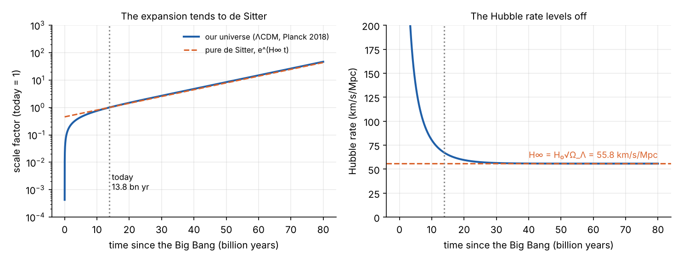

Willem de Sitter was a Dutch astronomer who, in 1917, found the first solution of Einstein's equations that describes
an empty universe with a cosmological constant. Space in his solution expands forever. Its mirror image, with the
opposite sign of the constant, is called **anti-de Sitter space**. Between them they appear in two of the largest
questions in physics: the future of our universe, and the attempt to understand gravity through quantum theory.

::: {.callout-note appearance="simple"}
## The mathematics behind this explainer

This page describes de Sitter and anti-de Sitter space. The seven-part series
[General Relativity from Scratch](/explainers/gr-1-manifolds/) builds the mathematics from the ground up (manifolds,
tensors, the metric, connections, curvature and Einstein's equations) and ends by
[deriving both spacetimes](/explainers/gr-7-de-sitter-solved/) from Einstein's equations.
:::

This is one of two explainers behind [Interstellar's Bulk](/sci-fi/interstellar-bulk/). The other,
[Branes and the Bulk](/explainers/branes-and-the-bulk/), shows how an anti-de Sitter bulk can hide an extra
dimension.

## Three perfectly symmetric spacetimes

Einstein's field equation with a cosmological constant $\Lambda$ is

$$
G_{\mu\nu} + \Lambda g_{\mu\nu} = \frac{8\pi G}{c^4} T_{\mu\nu}.
$$

The left side describes the curvature of spacetime, the right side its contents. Take away all matter and energy
($T_{\mu\nu} = 0$), and ask for a spacetime that looks the same at every point and in every direction. There are exactly
three, one for each sign of $\Lambda$:

| $\Lambda$ | Spacetime | Curvature | Behaviour |
|:--|:--|:--|:--|
| zero | Minkowski | flat | special relativity |
| positive | de Sitter | positive | everything flies apart, faster and faster |
| negative | anti-de Sitter | negative | everything is pulled back towards any centre |

Each curved one has a single length, its radius of curvature $\ell$, set by the constant: $\ell = \sqrt{3/|\Lambda|}$.

## Seeing them as surfaces

A sphere of radius $\ell$ is the set of points with $X^2 + Y^2 + Z^2 = \ell^2$ in flat three-dimensional space. de Sitter
and anti-de Sitter spaces can be drawn in the same way, as surfaces in a flat space that has an extra dimension, with
some of the minus signs of relativity in the equation:

$$
\text{de Sitter:}\quad -T^2 + X_1^2 + \dots + X_4^2 = \ell^2,
\qquad
\text{anti-de Sitter:}\quad -U^2 - V^2 + X_1^2 + \dots + X_3^2 = -\ell^2.
$$

With all but one space dimension removed, each is a hyperboloid:

The pictures show the main features:

- **de Sitter space expands.** Each horizontal circle is the whole of space at one moment, and after $T = 0$ the
  circles grow exponentially. Observers following free-fall paths (orange) fly apart ever faster.
- **anti-de Sitter time is circular.** The waist circle is the path of an observer at rest. It closes up after a time
  $2\pi\ell/c$. Physicists usually unwrap this circle, so that time runs forever without repeating, but the
  periodicity survives in the way things move.

## de Sitter space: our universe's future

In the right coordinates, de Sitter space looks like an expanding universe:

$$
ds^2 = -c^2\,dt^2 + e^{2Ht}\left(dx^2 + dy^2 + dz^2\right), \qquad H = c\sqrt{\Lambda/3}.
$$

Every distance grows by a factor of $e$ in each time $1/H$. Our universe is turning into this. Since the discovery of
cosmic acceleration in 1998, observations have fitted a model (called ΛCDM) in which about 68% of the energy today is a
cosmological constant. Matter thins out as space expands, but the cosmological constant does not, so it dominates more
and more:

The calculation gives an age of 13.8 billion years. The Hubble rate, now 67.4 km/s/Mpc, tends to
$H_\infty = H_0\sqrt{\Omega_\Lambda} \approx 56$ km/s/Mpc. From that, the cosmological constant is

$$
\Lambda = \frac{3H_\infty^2}{c^2} \approx 1.1 \times 10^{-52}\ \text{m}^{-2},
$$

so its curvature radius $c/H_\infty$ is about 17.5 billion light-years.

**Horizons.** In de Sitter space, distant galaxies recede faster than light can cross the growing gap. Each observer
therefore has a **cosmic event horizon**: events beyond it will never be seen, however long one waits. A causal diagram,
which squeezes infinite spacetime into a finite square while keeping light rays at 45°, shows it:

For our universe, the event horizon is now about 16.7 billion light-years away. Galaxies beyond it will never be seen
to do anything they are doing today: the light they emit now will never reach us. Over
hundreds of billions of years, everything outside our local group of galaxies will fade from view.

One caution: whether the cosmological constant is truly constant is an open question. Results from the Dark Energy
Spectroscopic Instrument (DESI) in 2024 and 2025 hinted that dark energy may be weakening over time. If that is
confirmed, the universe would not settle into exact de Sitter space.

## Anti-de Sitter space: a box

With negative $\Lambda$, everything is drawn back, as if by a harmonic potential centred wherever you stand:

- **Bodies always fall back.** Throw anything outwards from the centre, at any speed below that of light, and it
  returns after exactly the same time, $\pi\ell/c$. Anti-de Sitter space works like a perfectly harmonic bowl.
- **Light reaches infinity and returns.** The boundary of anti-de Sitter space is infinitely far away, yet a light ray
  reaches it in a finite time, $\pi\ell/2c$, as measured at the centre, and can be reflected back. Space behaves like a
  box with walls at infinity.

Our universe is not anti-de Sitter: its $\Lambda$ is positive. Anti-de Sitter space matters for two other reasons.

**Holding gravity to a brane.** Anti-de Sitter space can also be written in coordinates that cut it into slices, each a
copy of flat spacetime:

$$
ds^2 = e^{-2y/\ell}\,\eta_{\mu\nu}\,dx^\mu dx^\nu + dy^2 .
$$

This is exactly the warped bulk of Randall and Sundrum, with a brane at $y = 0$. The warp factor $e^{-2y/\ell}$ is the
harmonic-bowl behaviour again: gravity is held close to the brane, so a whole extra dimension can hide behind a
correction to Newton's law at distances shorter than $\ell$. Kip Thorne uses this "AdS layer" in his account of the bulk
in *Interstellar*.

**Holography.** In 1997, Juan Maldacena conjectured that a theory of quantum gravity inside anti-de Sitter space is
exactly equivalent to an ordinary quantum theory without gravity, living on its boundary. This "AdS/CFT
correspondence" is one of the most studied ideas in theoretical physics, and has been used to calculate properties of
black holes and of strongly interacting matter. It works because the boundary is close enough to talk to: light reaches
it in a finite time.

## Summary

- With no matter, Einstein's equations have three maximally symmetric solutions: flat (Minkowski), de Sitter
  ($\Lambda > 0$) and anti-de Sitter ($\Lambda < 0$).
- de Sitter space expands exponentially and has horizons. Our universe is approaching it, with a Hubble rate tending to
  about 56 km/s/Mpc, if dark energy is a true cosmological constant.
- Anti-de Sitter space behaves like a box: bodies fall back, light reaches infinity in finite time.
- Its warp factor can confine gravity to a brane, which is how Thorne's bulk hides an extra dimension.

## References

- W. de Sitter, "On the relativity of inertia: remarks concerning Einstein's latest hypothesis", *Proceedings of the
  Royal Netherlands Academy of Arts and Sciences* 19, 1217 (1917).
- S. W. Hawking and G. F. R. Ellis, *The Large Scale Structure of Space-Time* (Cambridge, 1973), section 5.2.
- Planck Collaboration, ["Planck 2018 results. VI. Cosmological parameters"](https://arxiv.org/abs/1807.06209),
  *Astronomy & Astrophysics* 641, A6 (2020).
- DESI Collaboration, ["DESI DR2 results II: measurements of baryon acoustic oscillations and cosmological constraints"](https://arxiv.org/abs/2503.14738) (2025).
- J. Maldacena, ["The large N limit of superconformal field theories and supergravity"](https://arxiv.org/abs/hep-th/9711200), *Advances in Theoretical and Mathematical Physics* 2, 231 (1998).
- L. Randall and R. Sundrum, ["An alternative to compactification"](https://arxiv.org/abs/hep-th/9906064), *Physical Review Letters* 83, 4690 (1999).

*Code: [`src/interstellar/figs.py`](https://github.com/paulmilne/paulmilne.github.io/tree/main/src/interstellar).*
