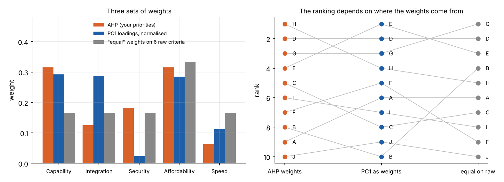

```{=html}
<style>
.ahp-grid { display: grid; grid-template-columns: minmax(280px, 1fr) minmax(280px, 1fr); gap: 1.4rem; margin: 1rem 0; font-size: .84rem; }
.ahp-h { font-weight: 600; margin: .4rem 0 .3rem; }
.ahp-pair { display: grid; grid-template-columns: 5.6rem 1fr 5.6rem; gap: .2rem .4rem; align-items: center; margin-bottom: .35rem; }
.ahp-pair input { width: 100%; }
.ahp-c { font-weight: 600; font-size: .8rem; } .ahp-cr { text-align: right; }
.ahp-say { grid-column: 1 / 4; color: #666; font-size: .76rem; margin-top: -.2rem; }
.ahp-say.ahp-bad { color: #c0392b; font-weight: 600; }
.ahp-btns { display: flex; gap: .4rem; flex-wrap: wrap; margin-top: .4rem; }
.ahp-btns button { font-size: .8rem; padding: .12rem .6rem; border: 1px solid #999; border-radius: 5px; background: #fff; color: #222; cursor: pointer; }
.ahp-mat table { border-collapse: collapse; font-size: .76rem; }
.ahp-mat th, .ahp-mat td { padding: .1rem .35rem; text-align: center; border: 1px solid #e3e3e3; }
.ahp-bar { display: grid; grid-template-columns: 6rem 1fr 3.4rem; align-items: center; gap: .4rem; margin: .12rem 0; }
.ahp-fill { height: .8rem; border-radius: 2px; display: block; }
.ahp-stack { display: flex; height: .8rem; } .ahp-stack span { display: block; height: 100%; }
.ahp-num { font-variant-numeric: tabular-nums; text-align: right; }
.ahp-cons { margin: .5rem 0; display: flex; flex-direction: column; gap: .2rem; }
.ahp-ok { color: #2a9d6f; } .ahp-no { color: #c0392b; } .ahp-dim { color: #666; }
@media (max-width: 760px) { .ahp-grid { grid-template-columns: 1fr; } }
</style>
```

Most decisions with several options and several criteria end up as a weighted score: rate each option on each
criterion, weight the criteria, add up. Two parts of that are hard. **Where do the weights come from?** And **are
the criteria really separate**, or do some of them measure the same thing twice?

Eigenvectors help with both, in two different ways. The Analytic Hierarchy Process (AHP) gets weights from a set of
pairwise judgements, and the weights are the principal eigenvector of the matrix of judgements. Principal component
analysis, the subject of the [previous explainer](../pca/index.qmd), takes the eigenvectors of the criteria's
covariance matrix, and shows how the criteria overlap and where the real trade-offs lie. They answer different
questions, and one of the main points of this explainer is that confusing them gives the wrong answer. Both rest on
the ideas in the [eigenvectors explainer](../eigenvectors/index.qmd).

## The example: choosing a data platform

An organisation is choosing between ten data platforms, A to J, on six criteria: capability, integration with
existing systems, security, licence cost, five-year total cost of ownership (TCO), and deployment time. The scores
are illustrative, generated to have the kind of structure real bids often have. Better platforms tend to cost more,
and the two cost measures move almost together.

| Option | Capability | Integration | Security | Licence (£k/yr) | Five-year TCO (£k) | Deployment (weeks) |
|:--|--:|--:|--:|--:|--:|--:|
| A | 7.6 | 7.5 | 6.2 | 390 | 1,940 | 8 |
| B | 5.8 | 4.0 | 6.7 | 70 | 350 | 9 |
| C | 7.3 | 7.6 | 6.9 | 360 | 1,700 | 12 |
| D | 7.3 | 7.0 | 6.3 | 140 | 760 | 11 |
| E | 7.3 | 7.5 | 5.8 | 240 | 1,250 | 8 |
| F | 8.3 | 7.8 | 5.6 | 360 | 1,800 | 13 |
| G | 7.6 | 7.3 | 7.1 | 350 | 1,530 | 7 |
| H | 8.4 | 8.1 | 7.5 | 400 | 2,110 | 12 |
| I | 7.7 | 6.7 | 6.4 | 350 | 1,660 | 11 |
| J | 6.8 | 7.1 | 5.8 | 280 | 1,350 | 13 |

## Part 1: weights from pairwise judgements (AHP)

Asking someone to "give security a weight between 0 and 1" rarely produces a considered answer. Thomas Saaty's
Analytic Hierarchy Process, developed in the 1970s, asks a series of easier questions instead: *for each pair of
criteria, which matters more, and by how much?* Answers go on a scale from 1 (equally important) through 3
(moderately more), 5 (strongly more) and 7 (very strongly more) to 9 (extremely more important).

The answers fill a matrix $A$, where $a_{ij}$ says how much more important criterion $i$ is than criterion $j$.
It is *reciprocal*: $a_{ji} = 1/a_{ij}$, and $a_{ii} = 1$.

### Why the weights are an eigenvector

Suppose the judgements came from true weights $w_1, \dots, w_n$, with each answer exactly the ratio
$a_{ij} = w_i / w_j$. Then multiplying $A$ by the weight vector gives
$$
(A w)_i = \sum_j \frac{w_i}{w_j}\, w_j = n\, w_i ,
\qquad\text{so}\qquad
A w = n\, w .
$$
The weights are an eigenvector of $A$, with eigenvalue $n$. In this ideal case, $A$ has rank one and every other
eigenvalue is zero.

Real judgements are not perfectly consistent. Someone might say capability is three times as important as
integration and twice as important as security, but also that security and integration matter equally. Consistency
would require integration to be two-thirds as important as security. AHP takes the weights to be the **principal eigenvector** of whatever matrix the
judgements produce, scaled to sum to one. The Perron–Frobenius theorem guarantees this is well defined: a matrix
with all positive entries has a single largest eigenvalue, and its eigenvector has all positive entries.

There is a second argument for the eigenvector, which links back to [repeated application](../eigenvectors/index.qmd#repeated-application-growth-rates-and-the-dominant-direction).
The entries of $A^2$ add up comparisons through one intermediate criterion ("capability beats security, which beats
speed"), $A^3$ through two, and so on. The normalised row sums of $A^k$ converge to the principal eigenvector as $k$
grows. So the weights take account of every chain of indirect comparisons, not just the direct ones. The same
idea ranks web pages (PageRank) and sports teams from their results (Keener, 1993).

### Measuring inconsistency with the largest eigenvalue

For a reciprocal matrix, the largest eigenvalue $\lambda_{\max}$ is always at least $n$, and equals $n$ only when the
judgements are perfectly consistent. So the excess is a measure of inconsistency:
$$
\text{CI} = \frac{\lambda_{\max} - n}{n - 1},
\qquad
\text{CR} = \frac{\text{CI}}{\text{RI}} .
$$
The **random index** RI is the average CI of matrices filled with random answers from the 1–9 scale. The consistency
ratio CR compares your inconsistency with that of random answers, and Saaty's rule of thumb is that CR should be
below 0.1. Simulating random matrices reproduces his published random index closely:


### Try it

The panel starts with one set of judgements for five decision criteria. The two cost measures are merged into one,
*affordability*, for reasons Part 2 explains. Drag a slider towards the criterion that matters more, and the matrix, the eigenvector weights, the consistency
ratio and the ranking of the ten platforms all update. The least consistent judgement is flagged in red: it is the
one most at odds with what your other answers imply. "Fix the worst judgement" replaces it with the value the other
judgements suggest.

```{ojs}
//| echo: false
ahpView = {
  const host = htl.html`<div></div>`;
  const mod = await import(new URL("ahp.js", document.baseURI).href);
  await mod.mountAHP(host);
  return host;
}
```

With the example judgements, the weights are capability 31.5%, affordability 31.5%, security 18.2%, integration 12.5%
and speed 6.2%, with $\lambda_{\max} = 5.13$ and CR = 0.03. Platform H ranks first, narrowly ahead of D and G.

### What to watch for in AHP

- **The geometric mean is a close alternative.** Taking the geometric mean of each row of $A$ and normalising gives
  the log-least-squares weights. For these judgements they differ from the eigenvector weights by less than one
  percentage point. The choice matters little unless the judgements are very inconsistent.
- **"More important" is ambiguous.** In an additive model, a weight should say how much you value moving from the
  *worst to the best option on that criterion*, compared with the others. Asking which criterion is "more important"
  in the abstract ignores how much the options differ. If every platform were equally secure, security would deserve
  no weight in this choice, however important security is in general. *Swing weighting*, from multi-attribute value
  theory, asks the question in terms of those ranges, and is a sound alternative or check.
- **Rank reversal.** When AHP is also used to compare the options pairwise on each criterion, adding or removing an
  option can change the order of the others (Belton and Gear, 1983). Rating options on fixed scales that do not depend
  on which options are present avoids this. The rescaling used here for simplicity, from the worst to the best option
  on each criterion, does depend on them, so it is not immune either.
- **The 0.1 threshold is a convention**, not a test. A high CR is a prompt to revisit the flagged judgements, not proof
  that the weights are wrong.
- **Groups.** To combine several people's judgements, take the geometric mean of their matrices entry by entry. This
  keeps the matrix reciprocal (Aczél and Saaty, 1983).

## Part 2: the structure of the criteria (PCA)

Before weighting anything, look at how the criteria relate to each other across the options. Turn every criterion
so that higher is better (low cost, fast deployment), standardise, and compute the correlations:


Three things stand out.

**Double counting.** Low licence cost and low TCO correlate at 0.99: they are one criterion measured twice. PCA
shows this as a sixth eigenvalue of almost zero (0.01, or 0.2% of the variance), whose eigenvector is very nearly
"TCO minus licence cost". A near-zero eigenvalue means a combination of criteria that hardly varies, and that means
redundancy. If the six criteria were each given an "equal" weight of 1/6, cost would in effect get a third of the
weight, twice what anyone intended. This is why the AHP panel merges them into one criterion, affordability.

**The main trade-off.** The first component explains 60% of the variation, and it is a contrast: capability and
integration at one end, low cost at the other. In this market, **more capable platforms cost more**. That is the
central trade-off, and most of the decision is about where to sit on it. Platform H is at the capable-but-costly
end, B at the cheap-but-basic end.

**An independent dimension.** The second component (20%) is security and fast deployment, which are almost
uncorrelated with the first trade-off. G stands out on it, F and J are weak.

### The GAIA plane and the decision stick

The PROMETHEE family of methods includes a picture of exactly this kind, the GAIA plane (Brans and Mareschal). It
projects the options and criteria onto the first two principal components, and adds the **decision stick**: the
weight vector projected onto the same plane. Options far out in the direction of the stick tend to score well with
those weights.

The *length* of the stick matters as much as its direction. It shows how much of the weight vector lies in the
plane. Here only 31% does, and the stick is short. The reason is instructive. The weights value capability and
affordability about equally, and those two point in opposite directions along PC1, so along the main trade-off the
weights largely cancel. The choice is then decided by smaller differences in other directions, which is why H, D and
G finish close together. A short stick is a warning that the plane alone cannot show which option wins.

### Dominated options

An option is *dominated* if another is at least as good on every criterion and better on at least one. No set of
weights can ever make it the best choice, so it can be set aside before weighting. Here only one is: E is at least as
good as J on every criterion (they tie on security) and better on the rest. That nearly every option survives is a sign of real trade-offs. Where many options are
dominated, the decision is easier than it looks.

## Part 3: PC1 loadings are not weights

A tempting shortcut is to use PCA to set the weights, taking each criterion's loading on the first component as its
importance. It feels objective, because it comes from the data rather than from anyone's judgement. It is a mistake,
and the example shows why.



- PC1 gives security a weight of 2%. That is not because security matters little, but because it varies
  *independently* of the main trade-off. PCA weights criteria by how much they move with the dominant pattern of
  variation, which has nothing to do with how much they matter to the decision.
- PC1 is a contrast, with capability and cost at opposite ends. Using its scores as a ranking would score the
  options by "cheapness minus capability", or the reverse, depending on an arbitrary sign.
- The rankings disagree. AHP puts H first; PC1-based weights put E first and H fourth; "equal" weights on the raw
  criteria put G first.

PCA describes **how the options differ**. Weights express **what you value**. The first is a fact about the data;
the second is a judgement that no analysis of the data can supply. The right use of PCA in a decision is to restructure
the criteria (merge duplicates, notice trade-offs, spot dominated options), not to weight them. Composite indicators
sometimes use PCA weights deliberately, to summarise variation rather than to express preferences, and the OECD's
handbook on composite indicators discusses when that is appropriate.

## Part 4: how robust is the choice?

### Too few options for a stable PCA

Ten options is a small sample for estimating correlations among six criteria. Resampling the options with
replacement and repeating the PCA shows how much the first component moves:


The cost and capability coefficients are stable: the main trade-off is real. Security's coefficient swings from
−0.5 to +0.5, so any reading of security's role in PC1 would be noise. The direction of PC1 moves by a median of 14°
between resamples, and by more than 26° in one resample in ten. With few options, treat the components as a sketch.

### Uncertain weights

Weights from any method are uncertain. Stochastic multicriteria acceptability analysis (SMAA, Lahdelma and
colleagues, 1998) turns the question round: instead of one set of weights, draw thousands from a distribution that
reflects the uncertainty, and record how often each option takes each rank. Here the weights are drawn from a
Dirichlet distribution centred on the AHP weights, with each weight varying by roughly a quarter to two-thirds of
its value.

The result, in the right-hand panel above, is more useful than a single ranking. H comes first 55% of the time, D
33% and G 10%. Nothing else has a realistic chance of winning, and J is last 77% of the time. So the shortlist is
H, D and G, and the decision between H and D turns on one question: how much is capability worth relative to
affordability? That is a far better question to put to the people deciding than "do you agree with these weights?".

## Other methods worth knowing

- **Multi-attribute value theory and swing weighting** (Keeney and Raiffa): the theoretical foundation of weighted
  scoring, with weights elicited against the ranges of the options.
- **TOPSIS:** ranks options by closeness to an ideal option and distance from a worst one.
- **PROMETHEE and ELECTRE:** *outranking* methods, which compare options pair by pair on each criterion and do not
  let a large advantage on one criterion fully compensate for a large disadvantage on another.
- **SMAA:** as above, for exploring what the data imply under uncertain or missing weights. It can be run with no
  weights at all, to show which options could win under *some* set of weights.
- **Value-focused thinking** (Keeney, 1992): begin with what you are trying to achieve, then find criteria and options,
  rather than scoring whatever options happen to be on the table.

## A workflow

1. **Structure** the objectives and criteria, and score the options.
2. **Check the criteria with PCA and correlations.** Merge duplicates (near-zero eigenvalues), identify the main
   trade-offs, and set aside dominated options.
3. **Elicit weights**, with AHP or swing weighting. With AHP, check the consistency ratio and revisit flagged judgements.
4. **Rank** the options with the weights.
5. **Test robustness**: vary the weights (SMAA) and the scores, and find which judgements the choice really turns on.
6. **Communicate** with a GAIA-style picture of the options, criteria and weights, noting how long the decision stick is.

Eigenvectors appear at three points in this: the AHP weights (the principal eigenvector of the judgements), the
consistency check (the principal eigenvalue), and the structure of the criteria (the eigenvectors of their
covariance). They answer different questions, and keeping them apart is most of the skill.

*The scenario, analysis and figure scripts are in [`src/decision`](https://github.com/paulmilne/paulmilne.github.io/tree/main/src/decision).*

## References

- T. L. Saaty, "A scaling method for priorities in hierarchical structures", *Journal of Mathematical Psychology*
  15, 234–281 (1977).
- T. L. Saaty, *The Analytic Hierarchy Process*, McGraw-Hill (1980).
- V. Belton and T. Gear, "On a short-coming of Saaty's method of analytic hierarchies", *Omega* 11(3), 228–230 (1983).
- J. Aczél and T. L. Saaty, "Procedures for synthesizing ratio judgements", *Journal of Mathematical Psychology*
  27, 93–102 (1983).
- G. Crawford and C. Williams, "A note on the analysis of subjective judgment matrices", *Journal of Mathematical
  Psychology* 29, 387–405 (1985).
- J. P. Keener, "The Perron–Frobenius theorem and the ranking of football teams", *SIAM Review* 35(1), 80–93 (1993).
- J.-P. Brans and B. Mareschal, "PROMETHEE methods", in J. Figueira, S. Greco and M. Ehrgott (eds), *Multiple Criteria
  Decision Analysis: State of the Art Surveys*, Springer (2005).
- R. Lahdelma, J. Hokkanen and P. Salminen, "SMAA – stochastic multiobjective acceptability analysis",
  *European Journal of Operational Research* 106, 137–143 (1998).
- R. L. Keeney and H. Raiffa, *Decisions with Multiple Objectives: Preferences and Value Tradeoffs*, Wiley (1976).
- R. L. Keeney, *Value-Focused Thinking*, Harvard University Press (1992).
- OECD and JRC, *Handbook on Constructing Composite Indicators: Methodology and User Guide*, OECD Publishing (2008).
