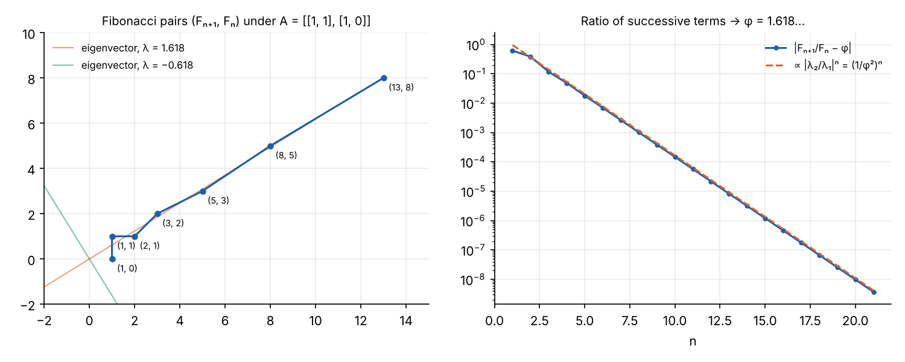
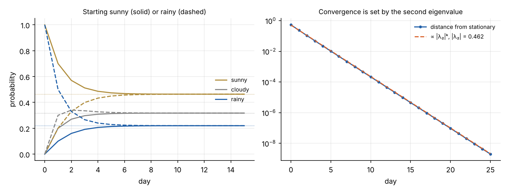
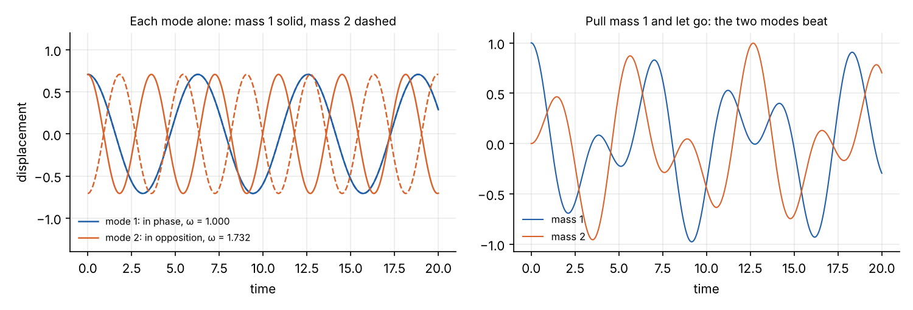
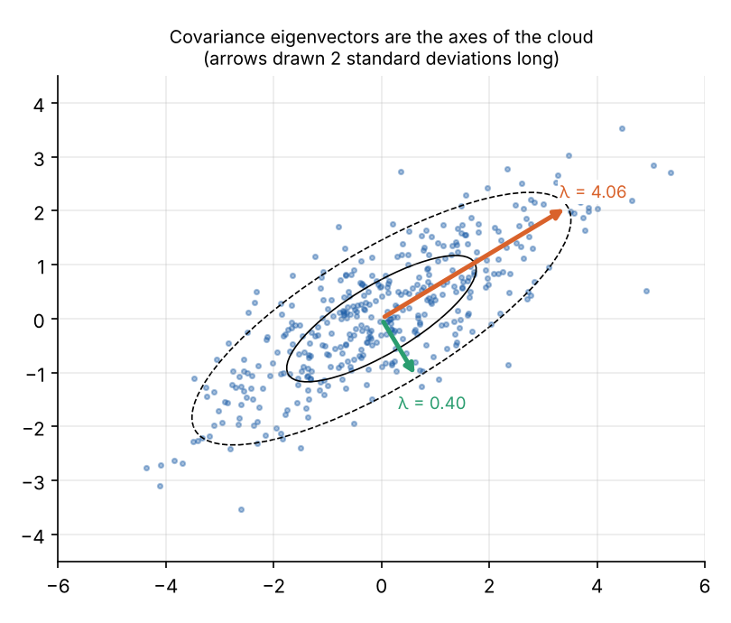

```{=html}
<style>
.ev-grid { display: grid; grid-template-columns: auto 1fr; gap: 1.2rem; align-items: start; margin: 1rem 0; }
.ev-canvas { border: 1px solid #d6dbe2; border-radius: 6px; touch-action: none; cursor: crosshair; }
.ev-side { display: flex; flex-direction: column; gap: .55rem; font-size: .86rem; min-width: 0; }
.ev-mat { display: flex; align-items: center; gap: .5rem; }
.ev-A { font-style: italic; font-size: 1.05rem; }
.ev-box { display: grid; grid-template-columns: 4.2rem 4.2rem; gap: .25rem; padding: .2rem .45rem; border-left: 2px solid #333; border-right: 2px solid #333; border-radius: 4px; }
.ev-box input { width: 4.2rem; font-size: .9rem; padding: .1rem .25rem; }
.ev-presets { display: flex; flex-wrap: wrap; gap: .3rem; }
.ev-presets button { font-size: .78rem; padding: .1rem .5rem; border: 1px solid #999; border-radius: 5px; background: #fff; color: #222; cursor: pointer; }
.ev-note { color: #777; font-size: .8rem; }
.ev-info { display: flex; flex-direction: column; gap: .3rem; }
.ev-dim { color: #555; }
@media (max-width: 700px) { .ev-grid { grid-template-columns: 1fr; } }
</style>
```

A square matrix is a machine that takes in a vector and puts out another one. Most vectors come out pointing
somewhere new. A few special directions come out pointing the same way, only stretched, shrunk or flipped.
Those are the **eigenvectors**, and the stretch factors are the **eigenvalues**. ("Eigen" is German for "own"
or "characteristic": these are the matrix's own directions.)

That sounds like a curiosity. It turns out to be the key to almost everything a matrix does when it is applied
repeatedly, or when it describes how a system changes in time. This explainer builds the idea from pictures,
then works through what eigenvalues mean in a range of settings. The [next explainer](../pca/index.qmd) applies
it to data, in principal component analysis.

## What a matrix does to the plane

Take
$$
A = \begin{pmatrix} 2 & 1 \\ 1 & 2 \end{pmatrix}.
$$
Apply it to every point on the unit circle and you get an ellipse. Apply it to a square grid and the grid is
sheared and stretched. Most arrows from the circle to the ellipse turn as well as stretch. Two directions do not.


Along the direction $(1, 1)$, $A$ simply triples a vector:
$$
\begin{pmatrix} 2 & 1 \\ 1 & 2 \end{pmatrix}\begin{pmatrix} 1 \\ 1 \end{pmatrix} = \begin{pmatrix} 3 \\ 3 \end{pmatrix} = 3\begin{pmatrix} 1 \\ 1 \end{pmatrix},
\qquad
\begin{pmatrix} 2 & 1 \\ 1 & 2 \end{pmatrix}\begin{pmatrix} 1 \\ -1 \end{pmatrix} = 1\begin{pmatrix} 1 \\ -1 \end{pmatrix}.
$$

In general, a nonzero vector $v$ is an eigenvector of $A$ with eigenvalue $\lambda$ if
$$
A v = \lambda v .
$$
Any multiple of an eigenvector is also one, so it is really a *direction* (a line through the origin) that matters,
not a particular arrow. The eigenvalue can be any number: bigger than 1 stretches, between 0 and 1 shrinks,
negative flips the vector to point the other way, and zero collapses that direction to nothing.

## Try it

Edit the matrix or pick a preset, then drag the blue vector $x$ around the circle. The purple arrow is $Ax$. When
the two line up, $x$ is an eigenvector and the arrow turns red. The dotted lines show the eigenvectors when they
exist, with arrows of length $\lambda$.

```{ojs}
//| echo: false
eigenView = {
  const host = htl.html`<div></div>`;
  const mod = await import(new URL("eigen.js", document.baseURI).href);
  mod.mountEigen(host);
  return host;
}
```

Pressing "Apply A to x" a few times shows the most important practical fact about eigenvectors. Whatever direction
you start with, it swings round towards the eigenvector with the largest $|\lambda|$. We'll come back to why.

## Finding them

Rewrite $Av = \lambda v$ as $(A - \lambda I)v = 0$. For this to have a nonzero solution, the matrix $A - \lambda I$
must squash some direction flat, which means its determinant is zero:
$$
\det(A - \lambda I) = 0 .
$$
This is the **characteristic equation**, a polynomial of degree $n$ in $\lambda$ for an $n \times n$ matrix. For a
$2 \times 2$ matrix $\begin{pmatrix} a & b \\ c & d \end{pmatrix}$ it is
$$
\lambda^2 - (a + d)\,\lambda + (ad - bc) = \lambda^2 - T\lambda + D = 0,
\qquad
\lambda = \frac{T}{2} \pm \sqrt{\frac{T^2}{4} - D},
$$
where $T$ is the trace (the sum of the diagonal) and $D$ the determinant. Two facts hold for any size of matrix:
**the eigenvalues add up to the trace, and multiply to the determinant.** For our example, $T = 4$ and $D = 3$, so
$\lambda = 2 \pm 1$, giving 3 and 1. With each $\lambda$ in hand, solving $(A - \lambda I)v = 0$ gives its eigenvector.

For larger matrices nobody solves the polynomial. Numerical libraries use the QR algorithm, which repeatedly
factorises and recombines the matrix until it becomes triangular, with the eigenvalues on its diagonal. In Python,
`numpy.linalg.eig` does this for any square matrix, and `numpy.linalg.eigh` is faster and more accurate for symmetric ones.

## A gallery of 2×2 matrices

Not every matrix has two nice eigenvectors. The cases worth recognising:


- **Symmetric matrices** ($A = A^\mathsf{T}$) are the best behaved. The *spectral theorem* says their eigenvalues are
  always real and their eigenvectors can be chosen perpendicular. Covariance matrices are symmetric, which is why
  PCA works so cleanly.
- **Non-symmetric matrices** can still have real eigenvalues, but the eigenvectors need not be perpendicular.
- **A shear** has a repeated eigenvalue but only one eigenvector. Such a matrix is called *defective*. It cannot be
  reduced to pure stretching along independent directions.
- **A rotation** leaves no direction fixed, so it has no real eigenvectors. Its eigenvalues are complex,
  $\lambda = r e^{\pm i\theta}$: the modulus $r$ is the scaling and the angle $\theta$ is the rotation per step.
- **A projection** has eigenvalue 0 along the direction it destroys. A zero eigenvalue means the matrix is
  singular: it has no inverse, because information along that direction is lost.

## Why eigenvectors simplify everything

If an $n \times n$ matrix has $n$ independent eigenvectors, any vector can be written as a mix of them:
$x = c_1 v_1 + \dots + c_n v_n$. Then $A$ acts on each piece separately, just by multiplying it:
$$
A x = c_1 \lambda_1 v_1 + \dots + c_n \lambda_n v_n,
\qquad
A^k x = c_1 \lambda_1^k v_1 + \dots + c_n \lambda_n^k v_n .
$$
Applying the matrix $k$ times reduces to raising numbers to the $k$th power. In matrix form this is
**diagonalisation**, $A = V \Lambda V^{-1}$, with the eigenvectors as the columns of $V$ and the eigenvalues on the
diagonal of $\Lambda$. In the coordinates set by the eigenvectors, the matrix is just a list of independent
stretches. Most uses of eigenvalues come down to this one idea.

## What they mean in different contexts

### Repeated application: growth rates and the dominant direction

In $A^k x$, the term with the largest $|\lambda|$ eventually swamps the others. So repeated application of a matrix
drives almost any starting vector towards the **dominant eigenvector**, and its length grows (or shrinks) by a
factor of the **dominant eigenvalue** per step. The other eigenvalues decide how quickly the rest fades: in
proportion to $|\lambda_2 / \lambda_1|^k$. This is the *power method*, and it is how the largest eigenvector of a
huge matrix is often computed in practice.

The Fibonacci numbers are an example. Each pair comes from the previous one by a matrix:
$$
\begin{pmatrix} F_{n+1} \\ F_n \end{pmatrix} = \begin{pmatrix} 1 & 1 \\ 1 & 0 \end{pmatrix}\begin{pmatrix} F_n \\ F_{n-1} \end{pmatrix},
\qquad
\lambda = \frac{1 \pm \sqrt 5}{2} = 1.618\ldots \text{ and } -0.618\ldots
$$
The dominant eigenvalue is the golden ratio $\varphi$. So the Fibonacci numbers grow by a factor of $\varphi$ each
step, and the ratio of successive terms tends to $\varphi$. Diagonalising gives an exact formula,
$F_n = (\varphi^n - (-1/\varphi)^n)/\sqrt 5$.



The same reasoning is behind **population models**. In a Leslie matrix, each entry gives the survival or birth
rate of an age group. Its dominant eigenvalue is the long-run growth rate of the population, and the dominant
eigenvector is the age structure the population settles into.

### Markov chains: the long-run state

A Markov chain moves between states with fixed probabilities. Collect them in a transition matrix $P$, where
$P_{ij}$ is the probability of going from state $i$ to state $j$; each row sums to 1. If $\pi_k$ is the row of
probabilities after $k$ steps, then $\pi_{k+1} = \pi_k P$. (The [Markov chains explainer](../markov-chains-diffusion/index.qmd)
covers this in detail.)

Because each row sums to 1, $\lambda = 1$ is always an eigenvalue, and no eigenvalue is larger in size. Its
(left) eigenvector is the **stationary distribution**, the long-run fraction of time spent in each state. The
second-largest $|\lambda_2|$ sets how fast the chain forgets where it started.

For a toy weather chain with sunny, cloudy and rainy days,
$$
P = \begin{pmatrix} 0.7 & 0.2 & 0.1 \\ 0.3 & 0.5 & 0.2 \\ 0.2 & 0.3 & 0.5 \end{pmatrix},
$$
the eigenvalues are 1, 0.462 and 0.238. The stationary distribution is 46% sunny, 32% cloudy and 22% rainy. The
distance from it shrinks by a factor of 0.462 a day, so the forecast forgets today's weather within about a week.



Google's original **PageRank** is the same idea applied to the web. A random surfer follows links, and a page's rank
is its share of the stationary distribution: the dominant eigenvector of the link matrix.

### Dynamics: stability and the shape of motion

For a system changing continuously in time, $\dot x = A x$, each eigenvector gives a solution $e^{\lambda t} v$
that keeps its direction and grows or decays at the rate $\lambda$. Everything else is a combination of these. So:

- If every eigenvalue has a **negative real part**, every solution decays to zero: the equilibrium is *stable*.
- If any eigenvalue has a positive real part, a disturbance along it grows: the equilibrium is *unstable*.
- An **imaginary part** means oscillation, at angular frequency $\operatorname{Im}\lambda$.

For a 2×2 system the trace and determinant settle it, because $T = \lambda_1 + \lambda_2$ and $D = \lambda_1\lambda_2$:


The same analysis works for nonlinear systems near an equilibrium. Replace $A$ by the **Jacobian** of the system
there, its matrix of partial derivatives. (It is the same object as the robot-arm Jacobian in the
[statics explainer](../statics-jacobian/index.qmd), applied to a vector field instead of a linkage.) Near the
equilibrium the system behaves like its linear approximation, unless an eigenvalue has zero real part. A
**bifurcation** is what happens when a parameter change pushes an eigenvalue across the imaginary axis. That is
how the unstable point in the [bifurcation explainer](../bifurcation-vs-langevin/index.qmd) arises: at the top of
the potential barrier, the Jacobian of the drift has a positive eigenvalue, and noise along its eigenvector decides
which class a sample falls into.

### Vibration: modes and natural frequencies

Two equal masses joined by three equal springs, between two walls, obey $\ddot x = -K x$ with
$K = \frac{k}{m}\begin{pmatrix} 2 & -1 \\ -1 & 2 \end{pmatrix}$. Try a solution $x = v \cos \omega t$ and the
equation becomes $K v = \omega^2 v$: an eigenvalue problem.

- $v = (1, 1)$, $\omega^2 = k/m$: the masses swing together and the middle spring never stretches.
- $v = (1, -1)$, $\omega^2 = 3k/m$: they swing in opposition, faster.

These are the **normal modes**. Any motion is a mix of the two, each at its own frequency. Pull one mass and let
go, and the energy passes back and forth between them as the modes drift in and out of step.



Real structures are the same with thousands of masses. The eigenvectors are the mode shapes and the eigenvalues
the squared natural frequencies. The [Millennium Bridge](../../complexity/millennium-bridge/index.qmd) wobbled because
walkers push sideways at about 1 Hz, half their step frequency, which was close to some of its lateral modes.

### Covariance: the shape of a cloud of data

For data with several variables, the covariance matrix $\Sigma$ records each variable's variance and how each pair
varies together. It is symmetric, so its eigenvectors are perpendicular: they are the **axes of the cloud**. Each
eigenvalue is the variance of the data along its axis.



This is **principal component analysis**: describe data by the directions of greatest variance, in order, and
drop the ones that carry little. It is the subject of the [next explainer](../pca/index.qmd). The same picture
describes the uncertainty in a [Kalman filter](../kalman-filter/index.qmd): the eigenvectors of its covariance
are the axes of the uncertainty ellipse, and the largest eigenvalue says which combination of states the filter
knows least well.

### More contexts, briefly

| Context | The eigenvector is… | The eigenvalue is… |
|:--|:--|:--|
| Linear map | a direction left pointing the same way | the stretch along it |
| Repeated application $x_{k+1} = Ax_k$ | the shape the system settles into | the growth factor per step |
| Markov chain | the stationary distribution ($\lambda = 1$) | 1, and $\lvert\lambda_2\rvert$ sets the mixing rate |
| Linear dynamics $\dot x = Ax$ | a mode of the motion | its growth rate (real part) and frequency (imaginary part) |
| Vibration | a mode shape | the squared natural frequency |
| Covariance matrix | an axis of the data | the variance along it |
| Network adjacency matrix | centrality: important nodes link to important nodes | the largest sets how fast things spread |
| Quantum mechanics | a state with a definite value of an observable | that value, the only possible measurement results |
| Pairwise comparisons (AHP) | the priority weights of the options | how consistent the comparisons are |
| Any matrix, through the SVD | a singular vector: an eigenvector of $A^\mathsf{T}A$ or $AA^\mathsf{T}$ | a singular value: the square root of their eigenvalue |

The AHP row leads on to the third explainer in this group, on decision analysis. In the Analytic Hierarchy Process,
decision makers compare criteria in pairs, and the weights are the principal eigenvector of their comparison
matrix. If the comparisons were perfectly consistent, the largest eigenvalue would equal the number of criteria
exactly; how far it exceeds that measures how much the judgements contradict each other.

## Summary

- An eigenvector is a direction a matrix only stretches; the eigenvalue is the stretch.
- They satisfy $\det(A - \lambda I) = 0$. The eigenvalues sum to the trace and multiply to the determinant.
- In eigenvector coordinates, a matrix is a set of independent stretches. Powers, exponentials and long-run
  behaviour all follow from the eigenvalues.
- The largest $|\lambda|$ governs repeated application, and the second-largest sets how fast the system settles.
- Real parts of eigenvalues decide stability; imaginary parts give oscillation.
- Symmetric matrices have real eigenvalues and perpendicular eigenvectors, which is what makes PCA possible.

*The figure scripts are in [`src/eigen`](https://github.com/paulmilne/paulmilne.github.io/tree/main/src/eigen).*

## References

- G. Strang, *Introduction to Linear Algebra*, 6th edition, Wellesley-Cambridge Press (2023), chapter 6.
- S. H. Strogatz, *Nonlinear Dynamics and Chaos*, 2nd edition, CRC Press (2015), chapters 5 and 6: linear
  systems and the trace–determinant plane.
- L. N. Trefethen and D. Bau, *Numerical Linear Algebra*, SIAM (1997), part V: eigenvalue algorithms.
- L. Page, S. Brin, R. Motwani and T. Winograd, "The PageRank citation ranking: bringing order to the web",
  Stanford InfoLab technical report (1999).
- T. L. Saaty, *The Analytic Hierarchy Process*, McGraw-Hill (1980).
