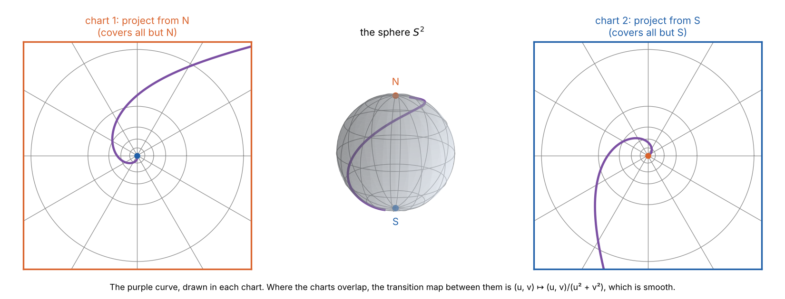

::: {.callout-note appearance="simple"}
## General Relativity from Scratch

1. **Manifolds** (this part)
2. [Tensors](/explainers/gr-2-tensors/)
3. [The metric and spacetime](/explainers/gr-3-metric-and-spacetime/)
4. [Connections and geodesics](/explainers/gr-4-connections-and-geodesics/)
5. [Curvature](/explainers/gr-5-curvature/)
6. [Einstein's equations](/explainers/gr-6-einstein-equations/)
7. [de Sitter and anti-de Sitter, solved](/explainers/gr-7-de-sitter-solved/)

The series builds the mathematics of general relativity from definitions, and ends by deriving de Sitter and
anti-de Sitter space ([the explainer](/explainers/de-sitter-and-anti-de-sitter/)) from Einstein's equations. Every
formula for a specific geometry is checked with a small SymPy library in
[`src/gr`](https://github.com/paulmilne/paulmilne.github.io/tree/main/src/gr).
:::

## Why gravity needs a new kind of space

Newton's gravity is a force acting in a fixed, flat space. Einstein's starting point was an observation that Newton
treated as a coincidence: **all bodies fall the same way**. A feather and a hammer dropped on the Moon land together;
Apollo 15's David Scott did it on camera. The ratio of gravitational to inertial mass is the same for all materials,
to about one part in $10^{15}$ (the MICROSCOPE satellite, 2022).

So an observer falling freely in a small enough laboratory cannot detect gravity at all: everything floats together.
This is the **equivalence principle**. Its consequence is that gravity is not a force in spacetime, but a property of
spacetime: freely falling bodies follow the straightest possible paths, and gravity is the way those paths converge
and diverge.

This needs a space that:

- **looks flat close up**, because a small freely falling laboratory sees special relativity;
- **need not be flat on a large scale**, because tides, the relative acceleration of nearby falling bodies, are real;
- **has no preferred coordinates**, because no one observer's grid is privileged.

The mathematical object with these properties is a **smooth manifold**. The earth's surface is the everyday example:
any small region can be mapped onto a flat page with little distortion, but no single flat map covers the whole globe
without tearing or infinite stretching.

## Charts and atlases

A manifold is built from flat pieces glued together smoothly. The pieces are charts.

**What a chart is, informally.** A chart is a way of putting coordinates on one patch of the manifold. The word comes
from map-making: a chart is one page of an atlas. It takes each point in its patch and gives it a list of $n$ numbers,
its coordinates, faithfully: no two points get the same numbers, and points that are close on the manifold get close
numbers, and vice versa. It is a flattening of a piece of the space onto ordinary coordinate space without tearing it.

The reason to want one is that a manifold, on its own, has no numbers attached to its points, so there is nothing to
differentiate. Calculus lives in $\mathbb{R}^n$, and a chart lets the manifold borrow it: to differentiate a function on
the manifold, differentiate it as a function of the chart's coordinates.

A chart only has to cover its own patch, and many manifolds cannot be covered by one. Every flat map of the whole Earth
either tears the globe somewhere, like the edge of a Mercator map, or stretches some point to infinity, like Mercator's
poles. So an atlas uses several overlapping pages. A point in an overlap has two sets of coordinates, one from each page,
and the rule converting one into the other is called the **transition map**. Requiring every transition map to be smooth
guarantees that a derivative calculated on one page agrees with the same derivative calculated on any other.

In general relativity this matters because coordinates are only labels, and most coordinate systems for spacetime cover
only part of it. When a metric "blows up", the question is always whether the chart has failed or the space has.

The precise definitions follow. They rely on the language of open sets and continuity, which the companion explainer
[Topology and Open Sets](/explainers/topology-and-open-sets/) introduces from the beginning.

::: {.callout-tip appearance="simple"}
## Definitions

A **topological manifold** of dimension $n$ is a topological space $M$ that is Hausdorff and second countable, and in
which every point has an open neighbourhood homeomorphic to an open subset of $\mathbb{R}^n$.

A **chart** $(U, \varphi)$ is an open set $U \subseteq M$ with a homeomorphism $\varphi: U \to \varphi(U) \subseteq \mathbb{R}^n$.
The components of $\varphi(p) = (x^1(p), \dots, x^n(p))$ are the **coordinates** of $p$.

An **atlas** is a collection of charts whose domains cover $M$.

Where two charts $(U, \varphi)$ and $(V, \psi)$ overlap, the **transition map**
$\psi \circ \varphi^{-1}: \varphi(U \cap V) \to \psi(U \cap V)$ is a map between open subsets of $\mathbb{R}^n$.
An atlas is **smooth** if all its transition maps are infinitely differentiable ($C^\infty$).

A **smooth manifold** is a topological manifold with a maximal smooth atlas: every chart compatible with the atlas
belongs to it.
:::

The conditions in the first definition rule out pathologies. Hausdorff means distinct points have disjoint
neighbourhoods, which excludes a line with two origins. Second countable means the topology has a countable base, which
guarantees partitions of unity, needed in Part 3 to show that every smooth manifold carries a metric.

Smoothness is the point of the construction. Calculus is defined in $\mathbb{R}^n$, and a manifold borrows it through
charts. A function is differentiable on $M$ if it is differentiable in a chart, and smooth transition maps guarantee
that the answer doesn't depend on which chart is used.

### Worked example: the sphere needs two charts

The unit sphere $S^2 = \{(x, y, z) \in \mathbb{R}^3 : x^2 + y^2 + z^2 = 1\}$ is a 2-dimensional manifold. It cannot be
covered by a single chart: $S^2$ is compact, and a homeomorphism would make the open set $\varphi(S^2) \subseteq \mathbb{R}^2$
compact too, but a non-empty open subset of $\mathbb{R}^2$ is never compact.

Two charts are enough. **Stereographic projection** from the north pole $N = (0, 0, 1)$ draws a line from $N$ through a
point $p$ of the sphere, and records where it meets the plane $z = 0$:

$$
\varphi_N(x, y, z) = (u, v) = \left(\frac{x}{1 - z}, \frac{y}{1 - z}\right), \qquad U_N = S^2 \setminus \{N\}.
$$

Projection from the south pole gives $\varphi_S(x, y, z) = \left(\frac{x}{1 + z}, \frac{y}{1 + z}\right)$ on
$U_S = S^2 \setminus \{S\}$. Together they cover the sphere.

On the overlap, which is the sphere without both poles, the transition map follows from
$u^2 + v^2 = \frac{x^2 + y^2}{(1 - z)^2} = \frac{1 - z^2}{(1 - z)^2} = \frac{1 + z}{1 - z}$:

$$
\varphi_S \circ \varphi_N^{-1}(u, v) = \frac{(u, v)}{u^2 + v^2}.
$$

This is inversion in the unit circle. It is smooth everywhere except at $(0, 0)$, which is the image of $S$ and is not in
the overlap. So the two charts form a smooth atlas.

Latitude and longitude $(\theta, \phi)$ are another chart, but not a global one. They fail at the poles, where $\phi$ is
undefined, and along the meridian where $\phi$ jumps from $2\pi$ to $0$. The same failures will appear in spacetime:
Schwarzschild's coordinates break down at a black hole's horizon, and many of de Sitter space's coordinate systems cover
only part of it (Part 7). A coordinate singularity is a failure of a chart, not of the manifold.

## Smooth functions and curves

A function $f: M \to \mathbb{R}$ is **smooth** if $f \circ \varphi^{-1}$ is smooth for every chart. Write
$C^\infty(M)$ for the smooth functions on $M$.

A **smooth curve** is a smooth map $\gamma: I \to M$ from an open interval $I \subseteq \mathbb{R}$, meaning that each
coordinate $x^\mu(\gamma(t))$ is a smooth function of $t$.

In general relativity, the history of a particle is a curve in spacetime: its **world line**. The parameter $t$ is just a
label. Part 3 will pick out a physical one, the time read by a clock carried along the curve.

## Tangent vectors

On a curved manifold, there is no ambient space to hold arrows. An arrow drawn on the sphere sticks out of it into
$\mathbb{R}^3$, but spacetime is not embedded in anything. So a tangent vector has to be defined from the manifold itself.

The answer is to define a vector by **what it does**. A velocity at $p$ tells you the rate of change of any function
along the direction of motion. That operation characterises the vector completely.

::: {.callout-tip appearance="simple"}
## Definition

A **tangent vector** at $p \in M$ is a linear map $V: C^\infty(M) \to \mathbb{R}$ that satisfies the Leibniz rule
$$
V(fg) = f(p)\,V(g) + g(p)\,V(f).
$$
Such maps are called **derivations at $p$**. They form a vector space, the **tangent space** $T_pM$.
:::

Every smooth curve through $p$ gives one: if $\gamma(0) = p$, its velocity is

$$
\gamma'(0)(f) = \left.\frac{d}{dt} f(\gamma(t))\right|_{t=0}.
$$

The Leibniz rule holds because it holds for ordinary derivatives.

**A basis from a chart.** Given coordinates $x^\mu$ near $p$, the partial derivatives

$$
\partial_\mu \big|_p : f \mapsto \left.\frac{\partial (f \circ \varphi^{-1})}{\partial x^\mu}\right|_{\varphi(p)}
$$

are derivations. A standard result, proved with Taylor's theorem with remainder, is that they form a basis of $T_pM$,
so $\dim T_pM = \dim M = n$. Any vector can be written $V = V^\mu \partial_\mu$, with components $V^\mu = V(x^\mu)$.
Here, and from now on, a repeated index, once up and once down, is summed (the **Einstein summation convention**).

For a curve, the chain rule gives the familiar form:

$$
\gamma'(0)(f) = \frac{\partial f}{\partial x^\mu}\frac{dx^\mu}{dt}
\quad\Longrightarrow\quad
\gamma'(0) = \frac{dx^\mu}{dt}\,\partial_\mu .
$$

### How components change with the chart

Change to new coordinates $x'^\mu$. The vector $V$ itself, a derivation, does not change. Its components do. By the
chain rule $\partial_\nu = \frac{\partial x'^\mu}{\partial x^\nu}\partial'_\mu$, so

$$
V = V^\nu \partial_\nu = V^\nu \frac{\partial x'^\mu}{\partial x^\nu} \partial'_\mu
\quad\Longrightarrow\quad
\boxed{V'^\mu = \frac{\partial x'^\mu}{\partial x^\nu} V^\nu .}
$$

This is the **vector transformation law**. Older textbooks use it as the definition of a vector: "a set of $n$ numbers
that transform like this". The derivation above shows why it holds.

For example, on the plane with Cartesian coordinates $(x, y)$ and polar coordinates $(r, \phi)$, the vector $\partial_x$
has components $(1, 0)$. Its polar components are $\left(\frac{\partial r}{\partial x}, \frac{\partial\phi}{\partial x}\right)$, so

$$
\partial_x = \cos\phi\,\partial_r - \frac{\sin\phi}{r}\,\partial_\phi .
$$

The coefficient $1/r$ appears because $\partial_\phi$ is not a unit vector: moving one radian in $\phi$ covers a distance
$r$. Coordinate basis vectors need not be unit length or perpendicular. Lengths and angles need a metric, the subject
of Part 3.

## Vector fields and their brackets

The tangent spaces of all points together form the **tangent bundle** $TM$, itself a smooth manifold of dimension
$2n$. A **vector field** $X$ assigns a tangent vector $X_p$ to each point, smoothly. It acts on a function to give another
function, $(Xf)(p) = X_p(f)$.

Two vector fields can be composed, but $XY$ is not a vector field: it is a second-order operator, and fails the
Leibniz rule. The difference of the two orders is a vector field, the **Lie bracket**:

$$
[X, Y] f = X(Yf) - Y(Xf), \qquad [X, Y]^\mu = X^\nu \partial_\nu Y^\mu - Y^\nu \partial_\nu X^\mu .
$$

The second-derivative terms cancel because partial derivatives commute. Coordinate basis fields always commute,
$[\partial_\mu, \partial_\nu] = 0$, and that property characterises them: a set of $n$ independent vector fields comes
from some chart if and only if their brackets all vanish. The bracket will reappear in Part 5, where curvature
measures the failure of a different kind of derivative to commute.

## Spacetime as a manifold

General relativity's arena is a **4-dimensional smooth manifold** $M$, whose points are events. Nothing more is
assumed yet: no distances, no time, no notion of a straight line. Each will be added as extra structure:

| Part | Structure added | What it provides |
|:--|:--|:--|
| 1 | smooth manifold | events, coordinates, smooth curves, vectors |
| 2 | tensors | quantities defined independently of coordinates |
| 3 | metric | distance, time, light cones |
| 4 | connection | parallel transport, straight lines (geodesics) |
| 5 | curvature | tides, the failure of parallel transport to commute |
| 6 | Einstein's equations | how matter curves spacetime |

Since physics cannot depend on how events are labelled, every law must be written in a form that holds in all charts.
The objects that make this possible are tensors, the subject of Part 2.

## Summary

- The equivalence principle makes spacetime locally flat but not globally flat: a smooth manifold.
- A manifold is covered by charts, with smooth transition maps. The sphere needs at least two.
- Coordinate singularities, like those at the poles in latitude and longitude, are failures of charts, not of the space.
- Tangent vectors are directional derivatives. A chart gives the basis $\partial_\mu$, and components transform as
  $V'^\mu = (\partial x'^\mu/\partial x^\nu)V^\nu$.

## References

- S. M. Carroll, *Spacetime and Geometry* (Addison-Wesley, 2004; Cambridge, 2019), chapter 2.
- J. M. Lee, *Introduction to Smooth Manifolds*, 2nd edition (Springer, 2013), chapters 1–3 and 8.
- R. M. Wald, *General Relativity* (Chicago, 1984), chapter 2.
- C. W. Misner, K. S. Thorne and J. A. Wheeler, *Gravitation* (Freeman, 1973), chapters 8–9.
- P. Touboul et al. (MICROSCOPE), ["MICROSCOPE mission: final results of the test of the equivalence principle"](https://arxiv.org/abs/2209.15487), *Physical Review Letters* 129, 121102 (2022).

*Code: [`src/gr`](https://github.com/paulmilne/paulmilne.github.io/tree/main/src/gr): `figs12.py` for the figures, `check12.py` for the transition map and the change of basis.*
