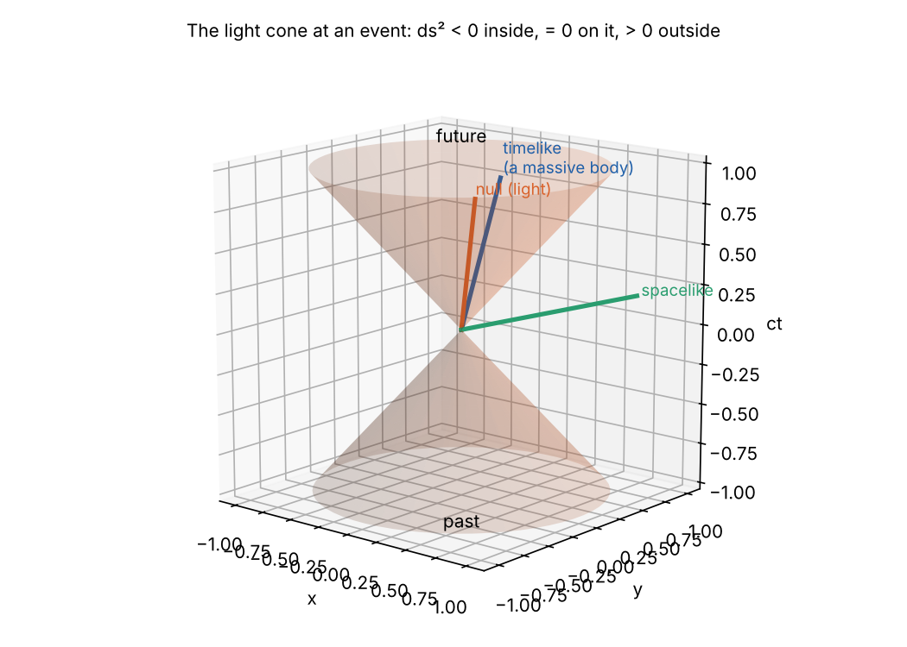

```{=html}
<style>
.gx-wrap { display: grid; grid-template-columns: auto minmax(220px, 1fr); gap: 1rem; align-items: start; margin: 1rem 0; }
.gx-canvas { display: block; border: 1px solid #ddd; border-radius: 6px; background: #fff; touch-action: none; cursor: crosshair; }
.gx-side { display: flex; flex-direction: column; gap: .6rem; font-size: .86rem; }
.gx-lab { display: flex; flex-direction: column; gap: .2rem; } .gx-lab input { width: 100%; }
.gx-out { display: flex; flex-direction: column; gap: .25rem; } .gx-dim { color: #777; font-size: .8rem; }
@media (max-width: 700px) { .gx-wrap { grid-template-columns: 1fr; } }
</style>
```

::: {.callout-note appearance="simple"}
## General Relativity from Scratch

1. [Manifolds](/explainers/gr-1-manifolds/)
2. [Tensors](/explainers/gr-2-tensors/)
3. **The metric and spacetime** (this part)
4. [Connections and geodesics](/explainers/gr-4-connections-and-geodesics/)
5. [Curvature](/explainers/gr-5-curvature/)
6. [Einstein's equations](/explainers/gr-6-einstein-equations/)
7. [de Sitter and anti-de Sitter, solved](/explainers/gr-7-de-sitter-solved/)
:::

A smooth manifold has no notion of size. A small circle and a large one, a second and a year, are indistinguishable
until something measures them. In general relativity that something is the metric, and it is the field that
describes gravity.

## The metric tensor

::: {.callout-tip appearance="simple"}
## Definition

A **metric** on $M$ is a $(0, 2)$ tensor field $g$ that is, at every point:

- **symmetric**: $g(U, V) = g(V, U)$;
- **non-degenerate**: if $g(U, V) = 0$ for every $V$, then $U = 0$.

At each point it can be brought, by a choice of basis, to a diagonal form with entries $\pm 1$. The number of each sign
is the same in every basis (Sylvester's law of inertia), and is called the **signature**. A metric with all signs
positive is **Riemannian**; one with a single minus sign is **Lorentzian**.
:::

In components, $g = g_{\mu\nu}\,dx^\mu \otimes dx^\nu$, usually written as the **line element**

$$
ds^2 = g_{\mu\nu}\,dx^\mu dx^\nu ,
$$

the squared length of an infinitesimal displacement $dx^\mu$. The inner product of two vectors is
$g(U, V) = g_{\mu\nu}U^\mu V^\nu$.

General relativity uses a Lorentzian metric of signature $(-, +, +, +)$, as in Misner, Thorne and Wheeler and in Carroll.
Some books use $(+, -, -, -)$; the physics is the same, with signs moved around.

**Existence.** Every smooth manifold admits a Riemannian metric: build one in each chart and glue them with a partition
of unity, using the second-countability assumed in Part 1. A Lorentzian metric is more demanding: it exists if and only
if the manifold has a nowhere-vanishing vector field, which holds for every non-compact manifold, but rules out, for
example, the 2-sphere (the hairy ball theorem).

### Examples

**The plane in polar coordinates.** From $x = r\cos\phi$, $y = r\sin\phi$, the Euclidean metric $dx^2 + dy^2$ becomes

$$
ds^2 = dr^2 + r^2\,d\phi^2 .
$$

The coefficient $r^2$ is the squared length of $\partial_\phi$, as found in Part 1.

**The sphere.** A surface in $\mathbb{R}^3$ inherits a metric by restriction (formally, the pullback of the Euclidean
metric by the embedding). On the sphere of radius $a$, with $x = a\sin\theta\cos\phi$ and so on,

$$
ds^2 = a^2\left(d\theta^2 + \sin^2\theta\,d\phi^2\right).
$$

After this, the embedding can be thrown away. Everything about the sphere's geometry, including its curvature, is
contained in these two functions of $\theta$. Gauss called this his *Theorema Egregium*, his remarkable theorem.

**Minkowski spacetime.** Special relativity is $\mathbb{R}^4$ with

$$
ds^2 = -c^2\,dt^2 + dx^2 + dy^2 + dz^2, \qquad g_{\mu\nu} = \eta_{\mu\nu} = \mathrm{diag}(-1, 1, 1, 1)
$$

in units where the time coordinate is $x^0 = ct$.

## Raising and lowering indices

Non-degeneracy means $g$ has an inverse, $g^{\mu\nu}$, with $g^{\mu\lambda}g_{\lambda\nu} = \delta^\mu_{\ \nu}$. The metric
then identifies vectors with covectors:

$$
V_\mu = g_{\mu\nu}V^\nu, \qquad \omega^\mu = g^{\mu\nu}\omega_\nu .
$$

This is why, in ordinary Euclidean space with Cartesian coordinates, nobody distinguishes vectors from covectors: the
metric is the identity matrix and the components are equal. In polar coordinates they differ: the gradient of a
function $f$ has covector components $(\partial_r f, \partial_\phi f)$ and vector components
$(\partial_r f, \partial_\phi f / r^2)$.

With a metric, any two indices can be contracted, and any tensor can be converted to any other type with the same total
number of indices. Part 2's rule against contracting two lower indices is lifted, because $g^{\mu\nu}$ does the
contraction: $T^\mu{}_\mu = g^{\mu\nu}T_{\mu\nu}$.

## Light cones and causality

In a Lorentzian metric, a vector's squared length can have any sign. A vector $V$ at a point is

- **timelike** if $g(V, V) < 0$: the direction of a massive body's motion;
- **null** if $g(V, V) = 0$ (and $V \ne 0$): the direction of a light ray;
- **spacelike** if $g(V, V) > 0$: a direction between two events that no signal can connect.

The null vectors at a point form a double cone, the **light cone**. It divides the tangent space into the future,
the past, and the elsewhere.



In general relativity, every tangent space has its own light cone, and the metric field says how they fit together.
Near a black hole they tip inwards, until inside the horizon every future direction points to smaller radius. The
light cones carry the causal structure of spacetime: which events can influence which.

## Proper time

A clock carried along a timelike world line $x^\mu(\lambda)$ measures its **proper time**:

$$
\tau = \frac{1}{c}\int \sqrt{-g_{\mu\nu}\frac{dx^\mu}{d\lambda}\frac{dx^\nu}{d\lambda}}\;d\lambda .
$$

It does not depend on the parameter $\lambda$: it is the Lorentzian length of the curve. Parametrising by $\tau$ itself
defines the **four-velocity** $u^\mu = dx^\mu/d\tau$, normalised by $g_{\mu\nu}u^\mu u^\nu = -c^2$.

In Minkowski spacetime, for a clock moving at speed $v$, this gives $d\tau = dt\sqrt{1 - v^2/c^2} = dt/\gamma$: moving
clocks run slow. The twin paradox is then a statement about lengths:


The traveller's path has a kink, and in Lorentzian geometry a kinked path between two timelike-separated events is
shorter than the straight one. This reversed triangle inequality is why, in Part 4, freely falling bodies follow paths
of **maximum** proper time.

## Isometries: Lorentz transformations

A change of coordinates that leaves the components of the metric unchanged is an **isometry**. For Minkowski space, the
linear ones are the Lorentz transformations $x'^\mu = \Lambda^\mu{}_\nu x^\nu$, defined by

$$
\Lambda^\alpha{}_\mu\,\Lambda^\beta{}_\nu\,\eta_{\alpha\beta} = \eta_{\mu\nu} .
$$

A boost at speed $v$ along $x$ is

$$
ct' = \gamma(ct - \beta x), \qquad x' = \gamma(x - \beta ct), \qquad \beta = v/c,\ \gamma = (1 - \beta^2)^{-1/2}.
$$

It is a hyperbolic rotation: with $\beta = \tanh\eta$, it mixes $ct$ and $x$ with $\cosh\eta$ and $\sinh\eta$, just
as an ordinary rotation mixes $x$ and $y$ with cosines and sines. The invariant curves are hyperbolae
$-c^2t^2 + x^2 = \text{constant}$, in place of circles. Drag the event and change the speed:

```{ojs}
//| echo: false
boostView = {
  const host = htl.html`<div></div>`;
  const mod = await import(new URL("boost.js", document.baseURI).href);
  mod.mountBoost(host);
  return host;
}
```

The moving observer's axes close up towards the light cone as $v$ approaches $c$. Events that are simultaneous in one
frame ($t = $ constant) are not simultaneous in the other. The interval, the metric's verdict, is the same in both.

## The volume element

Integration on a manifold needs a volume element that does not depend on coordinates. The coordinate volume $d^4x$
changes by the Jacobian determinant $J = \det(\partial x'/\partial x)$, while $\det g_{\mu\nu}$ changes by $J^{-2}$.
So the product

$$
\sqrt{-g}\;d^4x, \qquad g = \det g_{\mu\nu},
$$

is invariant. On the sphere, $\sqrt{g} = a^2\sin\theta$, giving the familiar area element $a^2\sin\theta\,d\theta\,d\phi$.
In general relativity, the action of the gravitational field is an integral of curvature against this volume (Part 6).

## Spacetime is flat close up

The equivalence principle says that a freely falling observer sees special relativity locally. The mathematical version
is a theorem about the metric.

::: {.callout-tip appearance="simple"}
## Local flatness

At any point $p$ of a Lorentzian manifold there are coordinates in which
$$
g_{\mu\nu}(p) = \eta_{\mu\nu}, \qquad \partial_\lambda g_{\mu\nu}(p) = 0 .
$$
In general, the second derivatives $\partial_\lambda\partial_\rho g_{\mu\nu}(p)$ cannot all be made zero.
:::

The proof is a count. Expand a new coordinate system about $p$ in a Taylor series,
$x^\mu = \frac{\partial x^\mu}{\partial x'^\alpha}x'^\alpha + \frac12\frac{\partial^2 x^\mu}{\partial x'^\alpha\partial x'^\beta}x'^\alpha x'^\beta + \dots$,
and compare the freedom at each order with what must be fixed. In four dimensions:

| Order | Metric data at $p$ | Coordinate freedom | Left over |
|:--|--:|--:|--:|
| $g_{\mu\nu}$ | 10 | 16 ($\partial x/\partial x'$) | none (6 freedoms remain: the Lorentz group) |
| $\partial g$ | 40 | 40 ($\partial^2 x$, symmetric in two indices) | none |
| $\partial\partial g$ | 100 | 80 ($\partial^3 x$, symmetric in three) | **20** |

The 20 numbers that no choice of coordinates can remove are real information about the geometry. They are the
independent components of the Riemann curvature tensor in four dimensions (Part 5). Coordinates of this kind are called
**locally inertial**: the laboratory of a freely falling observer, in which gravity vanishes at one point but tides do
not.

## Summary

- A metric is a symmetric, non-degenerate $(0, 2)$ tensor. Spacetime's is Lorentzian, with signature $(-, +, +, +)$.
- It measures lengths, angles and times, and lets indices be raised and lowered.
- Its null vectors form light cones, which give spacetime its causal structure.
- Proper time is the Lorentzian length of a world line. Straight world lines are the longest.
- At any point, coordinates exist in which the metric is Minkowskian with zero first derivatives. Twenty second
  derivatives remain: the curvature.

## References

- S. M. Carroll, *Spacetime and Geometry*, chapters 1–2.
- B. Schutz, *A First Course in General Relativity*, chapter 6 (the counting argument).
- R. M. Wald, *General Relativity*, chapter 2.
- B. O'Neill, *Semi-Riemannian Geometry with Applications to Relativity* (Academic Press, 1983), chapters 3 and 5.

*Code: [`src/gr`](https://github.com/paulmilne/paulmilne.github.io/tree/main/src/gr): `figs34.py`, `check34.py`. The spacetime diagram is `boost.js` in this post's folder.*
