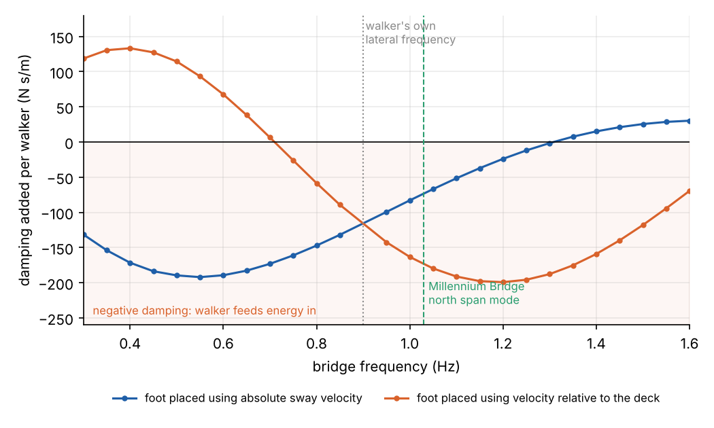
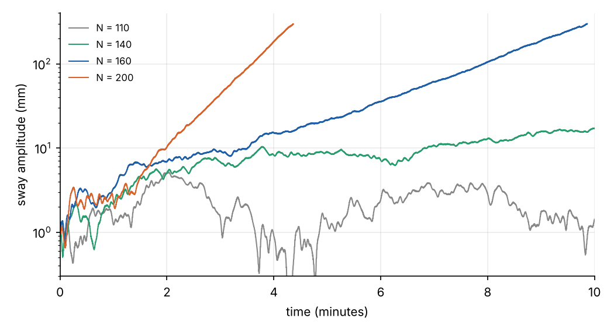

[A Bridge Full of Oscillators](../../complexity/millennium-bridge/index.qmd) explained the Millennium Bridge wobble
with the Kuramoto model: walkers adjust the *timing* of their steps to the sway, fall into step, and push the bridge
in time with its velocity. It ended with a rival account. In 2009 John Macdonald modelled each pedestrian as an
inverted pendulum who keeps their balance by adjusting *where* they put each foot, never when, and found that this
alone feeds energy into a swaying deck.

This explainer builds that model from the balance mechanics up. The core equation is the linear inverted pendulum
from [Planning the Falling Walk](../falling-walk/index.qmd), the last part of the Martian tripod series, with a
person in place of the tripod.

## Walking sideways is falling sideways

Seen from the front, a walker's centre of mass sways from side to side over the feet, once per stride: about 0.9 Hz
for a normal pace of 1.8 steps a second. Most of the time only one foot is on the ground, and the centre of mass
is never directly above it. The body is always falling towards one side or the other.

Treat the body as a point mass $m$ at height $L$ above the ground, on a massless leg that pivots at the centre of
pressure $u$ under the stance foot. For small sideways displacements $y$ of the centre of mass, gravity's moment
about the foot gives the **linear inverted pendulum**:

$$
\ddot y = \omega_0^2\,(y - u), \qquad \omega_0 = \sqrt{g/L} .
$$

The body accelerates *away* from the foot, in proportion to how far it is from it. That is
[part 4](../falling-walk/index.qmd)'s equation with the zero-moment point $z$ replaced by the centre of pressure
under one foot. For a person, $L$ is about 1.34 times the leg length, about 1.30 m for a 0.97 m leg, giving
$\omega_0 = 2.75$ s⁻¹ and a fall time constant $1/\omega_0 = 0.36$ s.

In the tripod's two-foot hinge phase, part 4 called this "a pure, uncontrolled fall". A walker is in that state for
almost every step. Once a foot is down, the centre of pressure can only move within that foot's width, so the body's
sideways motion for the rest of the step is decided. The control is the choice of where the *next* foot lands.

## Where to put the next foot

Part 4 split the pendulum's motion into a stable and an unstable part with the **divergent component of motion**:

$$
\xi = y + \frac{\dot y}{\omega_0}, \qquad \dot\xi = \omega_0\,(\xi - u) .
$$

All the instability is in $\xi$, which runs away from the foot exponentially, while the centre of mass simply
follows $\xi$. A foot placed exactly at $\xi$ brings the body to rest over it. Robotics calls $\xi$ the **capture
point**. Biomechanics found the same quantity independently: At Hof called it the **extrapolated centre of mass**,
and showed in 2005 that the condition for not falling sideways is that $\xi$ stays inside the base of support.

Hof's measurements of people walking suggested a simple rule. At each footfall, the new foot goes a small,
fixed distance $b_\text{min}$ *outside* the extrapolated centre of mass, on the side of the stepping foot:

$$
u_{n+1} = \xi(t_n) \pm b_\text{min} ,
$$

with $+$ for a right foot and $-$ for a left. The margin $b_\text{min}$ is the **margin of stability**, about
16 mm in his data. Placing the foot just outside $\xi$ means the body falls back towards the middle during the
step, and the next foot catches it on the other side. Step timing is fixed: one step every $T$ seconds.

### The step width falls out

The rule gives the gait in closed form. During a step on foot $u_n$, $\xi - u_n$ grows by a factor $e^{\omega_0 T}$.
It starts at $\mp b_\text{min}$ and ends at $\mp b_\text{min}\,e^{\omega_0 T}$. Adding the margin for the next
foot gives the distance between successive feet:

$$
w = b_\text{min}\left(1 + e^{\omega_0 T}\right) .
$$

At 0.9 Hz, $T = 0.56$ s and $e^{\omega_0 T} = 4.6$, so $w = 8.8$ cm: a realistic step width, from a 16 mm margin.
The body sways 2.1 cm from side to side. Simulating the pendulum and the rule on solid ground:

The sideways force on the ground is $F = -m\omega_0^2\,(y - u)$, the reaction to the body's acceleration. It
alternates sign with each step, peaking at **25 N** for a 75 kg walker. That is the per-walker force used in the
Kuramoto model of the bridge, from a balance law with one measured margin.

## On a moving deck

Now let the deck move sideways with displacement $X(t)$. A planted foot moves with the deck, so the stance foot's
absolute position is $u = X(t) + u_\text{rel}$, with $u_\text{rel}$ fixed at footfall. The body itself feels no
force from the deck except through the leg, so the pendulum equation is unchanged in absolute coordinates:

$$
\ddot y = \omega_0^2\,\big(y - X(t) - u_\text{rel}\big) .
$$

The walker's rule decides $u_\text{rel}$ from what they sense at each footfall: their position relative to the deck,
and their sideways velocity. Macdonald's model came in two versions, which differ in that velocity:
- **absolute**: velocity relative to the fixed world, as from vision of the surroundings or the inner ear;
- **relative**: velocity relative to the deck, as from what the feet feel.

Neither version changes the timing of a single step. What changes is where each foot lands, and so where the force
on the deck acts and how large it is. Because the pendulum and the placement rule are both linear in $X$, the walker's force on
the deck has a component at the bridge's frequency that is proportional to the bridge's motion.

### Damping and added mass

Write that component as

$$
F \approx -\Delta C\,\dot X - \Delta M\,\ddot X .
$$

$\Delta C$ is the damping the walker adds to the bridge, and $\Delta M$ the mass they appear to add. A
negative $\Delta C$ means the walker does net work on the bridge every cycle, the negative damping that Arup
measured on the real bridge. Both can be found by shaking the deck sinusoidally under a simulated walker and
correlating the force with the deck's velocity and acceleration, averaged over the walker's starting phase:

With the absolute-velocity rule, the walker is a negative damper for every bridge frequency below about 1.3 Hz,
with a peak around −190 N s/m. Arup's provisional design rule, from tests on the real bridge between 0.48 and
1.03 Hz, treats each pedestrian as a negative damper of 300 N s/m for any lateral mode below 1.3 Hz. The model gets
the same order of magnitude, and its zero crossing lands on Arup's 1.3 Hz cut-off. With the relative-velocity rule, the sign flips at 0.7 Hz. Bocian,
Macdonald and colleagues later tested both against people walking on a treadmill that was swung sideways, and
neither fitted every condition. Real walkers probably mix the two cues.

Two things stand out. The effect comes entirely from foot placement: the walker's gait frequency never changes,
so it never locks to the bridge. And the effect is **linear**: $\Delta C$ is the same at 1 mm of sway as at
10 mm. A Kuramoto walker needs some sway to pull it into step. A Macdonald walker damps or drives the bridge
from the first millimetre.

### Why it works

At each footfall the walker places the foot relative to where their extrapolated centre of mass is, judged
partly in a frame that is moving. When the deck is moving, the judgement is off by an amount that depends on the
deck's velocity, so the foot lands a little too far in or out. A misplaced foot changes the lever arm $y - u$ for
the whole step, and with it the sideways force. The misplacements recur at the deck's frequency, with a phase set
by $\omega_0$, the step time and the bridge frequency. Over a band of frequencies that phase puts part of the force
in step with the deck's velocity, and the walker pumps energy in.

## A crowd of pendulums on the bridge

Each walker adds a damping that depends on how their gait frequency compares with the bridge's. For the north span's
1.03 Hz mode and the absolute rule, walkers with gaits from 0.75 Hz upwards all add negative damping, from about
−10 to −100 N s/m. Averaging over a normal spread of paces (lateral gait 0.935 Hz, standard deviation 0.093 Hz,
from Pachi and Ji's measurements of step frequency) gives −75 N s/m per walker. The bridge's own damping coefficient
is $2M\zeta\Omega_0 \approx 11{,}000$ N s/m with the parameters of the [bridge post](../../complexity/millennium-bridge/index.qmd), so the
critical crowd is

$$
N_c = \frac{2M\zeta\Omega_0}{\left|\overline{\Delta C}\right|} \approx 147 .
$$

That is close to the Kuramoto model's 165 and the 165 at which the real north span took off, with no fitted
coupling constant at all. Simulating the bridge with $N$ inverted-pendulum walkers, each with a random pace and a
random starting phase:

Below the critical crowd, the sway stays at the millimetre level set by the walkers' uncorrelated forces. Above
it, the sway grows exponentially from the start, with no synchrony anywhere: the walkers' gait phases stay as
scattered as they began, with an order parameter of about $1/\sqrt N$. The 140-walker crowd creeps upwards
slowly. Its random sample of paces happens to sit near the threshold, and a few walkers whose gait is close to
1.03 Hz also drive the bridge directly.

In this linear model the growth never stops, because nothing in it saturates. Real people do not keep walking
normally on a deck swaying by centimetres: they widen their stance, slow down, hold the rail, and, as the Kuramoto
model says, start to fall into step. That is Belykh and colleagues' synthesis from 2017. Balance-driven foot
placement can start the wobble below any synchronisation threshold, and phase locking becomes important only once
the sway is large.

## Two models of one walker

| | Kuramoto walker (Strogatz et al.) | Inverted-pendulum walker (Macdonald) |
| --- | --- | --- |
| What adapts | Step timing (gait phase) | Step position |
| Force on the deck | Fixed amplitude, phase adjusts | Changes with each foot placement |
| Response to small sway | Phases pulled; net force grows only as walkers lock | Force changes linearly from the first millimetre |
| Synchrony | The mechanism | A possible consequence |
| Free parameter | Walker sensitivity $C$, fitted to the crowd test | None: $L$, $b_\text{min}$ and paces are measured; the velocity cue is a choice |
| Critical crowd, north span | 165 | ≈ 147 (absolute rule) |
| What caps the sway | Saturation of $R$ | Nothing in the linear model |

Both models agree on the engineering: each walker contributes a negative damping, the crowd's total is proportional
to its size, and the bridge goes unstable when that total exceeds the structure's damping.

## Where the leg went

The pendulum throws away the leg. In the [forward](../forward-kinematics/index.qmd) and
[inverse kinematics](../inverse-kinematics/index.qmd) explainers, putting a foot at a chosen point is a calculation
over joint angles. For a balance model of a person the leg is a stick, the foot is a point, and all the
coordination of hip, knee and ankle that lands it at $u_{n+1}$ is assumed to happen. The planning question, *where*
to put the foot, is part 4's; how the joints get it there is parts 1 and 2's.

## References

- J. H. G. Macdonald, "Lateral excitation of bridges by balancing pedestrians", *Proceedings of the Royal Society A*
  465, 1055–1073 (2009).
- A. L. Hof, M. G. J. Gazendam and W. E. Sinke, "The condition for dynamic stability", *Journal of Biomechanics* 38,
  1–8 (2005).
- A. L. Hof, R. M. van Bockel, T. Schoppen and K. Postema, "Control of lateral balance in walking: experimental
  findings in normal subjects and above-knee amputees", *Gait & Posture* 25, 250–258 (2007).
- M. Bocian, J. F. Burn, J. H. G. Macdonald and J. M. W. Brownjohn, ["From phase drift to synchronisation:
  pedestrian stepping behaviour on laterally oscillating structures and consequences for dynamic stability"](https://core.ac.uk/download/77602866.pdf),
  *Journal of Sound and Vibration* 392, 382–399 (2017).
- I. Belykh, R. Jeter and V. Belykh, ["Foot force models of crowd dynamics on a wobbly
  bridge"](https://ar5iv.labs.arxiv.org/html/1610.05366), *Science Advances* 3, e1701512 (2017).
- [Synchronous lateral excitation of footbridges](https://www-old.bridgeforum.org/files/pub/2004/austroads5/035_Low%20SLE%20Austroads04.pdf),
  A. Low (Arup), Austroads Bridge Conference (2004): the k = 300 N s/m rule and the 1.3 Hz limit.
- A. Pachi and T. Ji, "Frequency and velocity of people walking", *The Structural Engineer* 83(3), 36–40 (2005).
- J. Pratt, J. Carff, S. Drakunov and A. Goswami, "Capture point: a step toward humanoid push recovery",
  *IEEE-RAS International Conference on Humanoid Robots* (2006).
