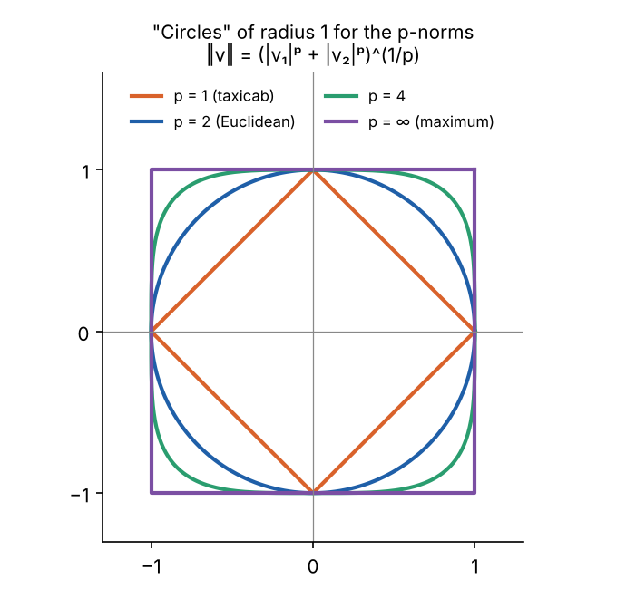
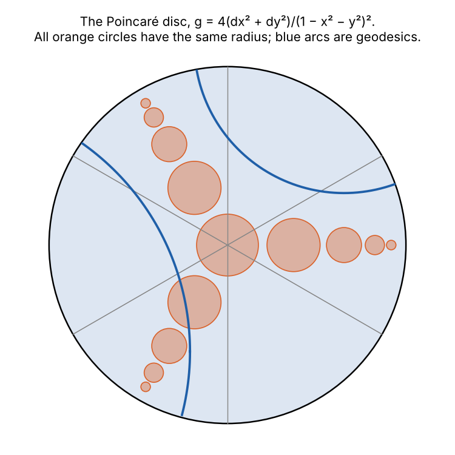

```{=html}
<style>
.mx-wrap { display: grid; grid-template-columns: auto minmax(220px, 1fr); gap: 1rem; align-items: start; margin: 1rem 0; }
.mx-canvas { display: block; border: 1px solid #ddd; border-radius: 6px; background: #fff; cursor: crosshair; }
.mx-side { display: flex; flex-direction: column; gap: .55rem; font-size: .86rem; } .mx-sel { font-size: .86rem; max-width: 100%; }
.mx-desc { color: #333; } .mx-out { display: flex; flex-direction: column; gap: .2rem; } .mx-mat { font-family: monospace; }
.mx-dim { color: #777; font-size: .8rem; }
@media (max-width: 700px) { .mx-wrap { grid-template-columns: 1fr; } }
</style>
```

::: {.callout-note appearance="simple"}
## Where this fits

This explainer supports [Part 2 (Tensors)](/explainers/gr-2-tensors/) and
[Part 3 (The metric and spacetime)](/explainers/gr-3-metric-and-spacetime/) of
[General Relativity from Scratch](/explainers/gr-1-manifolds/). Its companion,
[Topology and Open Sets](/explainers/topology-and-open-sets/), covers what can be said about a space before any
distances are measured.
:::

"Metric" means two different things in mathematics, and both appear in general relativity:

- a **metric** on a set is a **distance function**: a rule giving the distance between any two points;
- a **metric tensor** on a manifold is a smoothly varying **inner product** on its tangent spaces: a rule for the lengths
  of, and angles between, infinitesimal displacements.

The second gives rise to the first, by adding up lengths along curves. But they are different objects, and the
Lorentzian metric of spacetime is a metric tensor that does not give a distance at all. This explainer builds both and
the bridge between them.

## Metric spaces

::: {.callout-tip appearance="simple"}
## Definition

A **metric** on a set $X$ is a function $d: X \times X \to \mathbb{R}$ such that, for all $x, y, z$:

1. $d(x, y) \ge 0$, with $d(x, y) = 0$ only if $x = y$;
2. $d(x, y) = d(y, x)$;
3. $d(x, z) \le d(x, y) + d(y, z)$, the **triangle inequality**.

$(X, d)$ is a **metric space**.
:::

The axioms say what any reasonable notion of distance must satisfy, and nothing more. Many functions qualify:

| Space | Metric | Distance between... |
|:--|:--|:--|
| $\mathbb{R}^n$ | Euclidean, $\sqrt{\sum (x_i - y_i)^2}$ | points, as the crow flies |
| $\mathbb{R}^n$ | taxicab, $\sum \lvert x_i - y_i\rvert$ | points, along a street grid |
| $\mathbb{R}^n$ | maximum, $\max_i \lvert x_i - y_i\rvert$ | points, in king's moves on a chessboard |
| any set | discrete: 1 if $x \ne y$, else 0 | points, all equally far apart |
| strings of equal length | Hamming: number of positions that differ | codewords in error-correcting codes |
| the sphere | great-circle distance | cities, along the shortest route |
| continuous functions on $[0, 1]$ | $\max_t \lvert f(t) - g(t)\rvert$ | functions, by their largest gap |

**Every metric defines a topology.** Open balls $B_\varepsilon(x) = \{y : d(x, y) < \varepsilon\}$ generate open sets, exactly as
in [Topology and Open Sets](/explainers/topology-and-open-sets/). Different metrics can give the same topology. The taxicab
and Euclidean metrics on the plane do: their balls are diamonds and discs, but every disc contains a diamond around its
centre, and vice versa, so they agree on which sets are open.



## Norms and inner products

On a vector space, distances usually come from a **norm**, a length for each vector, through $d(u, v) = \|u - v\|$. A norm
satisfies $\|v\| \ge 0$ with equality only for $v = 0$, $\|\lambda v\| = |\lambda|\,\|v\|$, and the triangle inequality
$\|u + v\| \le \|u\| + \|v\|$. The **p-norms** $\|v\|_p = \left(\sum|v_i|^p\right)^{1/p}$ give the taxicab ($p = 1$),
Euclidean ($p = 2$) and maximum ($p \to \infty$) metrics.

An **inner product** is more: a symmetric, bilinear, positive-definite form $\langle u, v\rangle$. It gives a norm,
$\|v\| = \sqrt{\langle v, v\rangle}$, but also **angles**:

$$
\cos\theta = \frac{\langle u, v\rangle}{\|u\|\,\|v\|},
$$

which lie between −1 and 1 by the Cauchy–Schwarz inequality, $|\langle u, v\rangle| \le \|u\|\,\|v\|$. With angles come
perpendicularity, projections and Pythagoras' theorem.

**Which norms come from an inner product?** The answer, due to Jordan and von Neumann (1935), is: exactly those that
satisfy the **parallelogram law**

$$
\|u + v\|^2 + \|u - v\|^2 = 2\|u\|^2 + 2\|v\|^2 .
$$

Given such a norm, the inner product can be recovered as $\langle u, v\rangle = \frac14\left(\|u + v\|^2 - \|u - v\|^2\right)$.
Testing the p-norms with $u = (1, 0)$ and $v = (0, 1)$ (in
[`src/metrics/check.py`](https://github.com/paulmilne/paulmilne.github.io/tree/main/src/metrics)): for $p = 2$ both sides
are 4; for $p = 1$ the left side is 8; for $p = 3$ it is $2 \cdot 2^{2/3} \approx 3.17$; for $p = \infty$ it is 2. Only the
Euclidean norm has an inner product behind it.

This is why Riemann, in 1854, built geometry on infinitesimal inner products rather than general norms. An inner product
is the minimum structure that gives both lengths and angles, and it has a simple description in components, which is
the next step. (Geometry built on general norms exists too, as **Finsler geometry**, but it is not what general
relativity uses.)

## The Gram matrix: an inner product in components

Choose a basis $e_1, \dots, e_n$ of a vector space with an inner product. The numbers

$$
g_{ij} = \langle e_i, e_j\rangle
$$

form the **Gram matrix**: symmetric, and positive definite. Bilinearity then gives the inner product of any two vectors
from their components:

$$
\langle u, v\rangle = g_{ij}\,u^i v^j, \qquad \|v\|^2 = g_{ij}\,v^i v^j .
$$

The diagonal entries are the squared lengths of the basis vectors; the off-diagonal entries record the angles between
them, $\cos\theta_{ij} = g_{ij}/\sqrt{g_{ii}g_{jj}}$. An orthonormal basis has $g_{ij} = \delta_{ij}$, the identity matrix,
and only then does the length of a vector equal the square root of the sum of the squares of its components.

**Changing basis.** If $e'_j = A^i{}_j\,e_i$, then $g'_{kl} = \langle A^i{}_k e_i, A^j{}_l e_j\rangle = A^i{}_k A^j{}_l\,g_{ij}$, or in
matrices, $g' = A^\mathsf{T} g A$. One factor of the change-of-basis matrix per index: this is the transformation law of a
$(0, 2)$ tensor from [Part 2](/explainers/gr-2-tensors/). The Gram matrix is not a tensor by coincidence: an inner product
**is** a $(0, 2)$ tensor, a bilinear map that eats two vectors and returns a number, and the Gram matrix is its components.

The inner product does not change; its components do, so that $g_{ij}u^iv^j$ comes out the same in every basis.

## The metric tensor on a manifold

On a manifold there is a tangent space at every point ([Part 1](/explainers/gr-1-manifolds/)), and nothing yet to compare
lengths in one with lengths in another. A **Riemannian metric** supplies an inner product $g_p$ on each tangent space
$T_pM$, varying smoothly with $p$. In a chart, its Gram matrix in the coordinate basis $\partial_i$ is

$$
g_{ij}(x) = g(\partial_i, \partial_j),
$$

a matrix of functions. The **line element** $ds^2 = g_{ij}\,dx^i dx^j$ is the squared length of the infinitesimal displacement
$dx^i$. From it:

- the **length of a curve** $x^i(t)$ is $L = \int \sqrt{g_{ij}\,\dot x^i \dot x^j}\;dt$;
- the **angle** between two curves crossing at a point is the angle between their velocities, using $g$ there;
- the **area** (or volume) of a region is $\int \sqrt{\det g}\;dx^1\cdots dx^n$, as in [Part 3](/explainers/gr-3-metric-and-spacetime/).

**Induced metrics.** A surface in $\mathbb{R}^3$ inherits a metric by measuring its tangent vectors with the Euclidean dot
product. If the surface is given by $\vec X(q^1, q^2)$, then $g_{ij} = \partial_i\vec X \cdot \partial_j\vec X$. For the sphere of
radius $a$, $\vec X = a(\cos\varphi\cos\lambda, \cos\varphi\sin\lambda, \sin\varphi)$ in latitude and longitude, giving

$$
ds^2 = a^2\left(\cos^2\varphi\;d\lambda^2 + d\varphi^2\right).
$$

Classical surface theory calls this the **first fundamental form**. The same recipe, with the Minkowski metric in place of
the dot product, gives de Sitter space its metric in [Part 7](/explainers/gr-7-de-sitter-solved/).

## One space, many charts

A metric tensor's components depend on the chart; the geometry does not. The clearest way to see this is to draw what a
small circle on the surface, the set of points at a fixed true distance from a centre, looks like in each chart. In
cartography these shapes are **Tissot's indicatrices**, after Nicolas Auguste Tissot, who introduced them in 1859 to
compare map projections.


All three charts describe the same sphere. Each metric has a different formula, but the curvature computed from each
(with the [SymPy library](https://github.com/paulmilne/paulmilne.github.io/tree/main/src/gr) used in the series) is
$1/a^2$ at every point:

| Chart | Metric | Gaussian curvature |
|:--|:--|:--:|
| latitude–longitude $(\lambda, \varphi)$ | $a^2(\cos^2\varphi\,d\lambda^2 + d\varphi^2)$ | $1/a^2$ |
| Mercator $(x, y)$, $y = \operatorname{arsinh}(\tan\varphi)$ | $a^2\operatorname{sech}^2 y\,(dx^2 + dy^2)$ | $1/a^2$ |
| stereographic $(u, v)$ | $\dfrac{4a^2}{(1 + u^2 + v^2)^2}(du^2 + dv^2)$ | $1/a^2$ |

Explore them, and others, here:

```{ojs}
//| echo: false
metricView = {
  const host = htl.html`<div></div>`;
  const mod = await import(new URL("metric.js", document.baseURI).href);
  mod.mountMetric(host);
  return host;
}
```

**Conformal metrics.** Mercator's and the stereographic metric are both a function times the flat metric,
$g_{ij} = \Omega^2(x)\,\delta_{ij}$. Such metrics are **conformal**: they preserve angles, so small circles stay circles, though
their sizes vary. That is why Mercator's projection was so useful for navigation, where a straight line on the chart is a
line of constant compass bearing, and why it makes Greenland look as large as Africa.

**No perfect map.** A chart in which the sphere's metric was simply $dx^2 + dy^2$ would preserve all distances. It cannot
exist, because the curvature computed from $dx^2 + dy^2$ is zero, and curvature does not depend on the chart: this is
Gauss's *Theorema Egregium*. Every flat map of the Earth distorts something. Cartographers choose what: Mercator keeps
angles, equal-area projections keep areas, and no projection keeps both.

## From a metric tensor back to distance

A Riemannian metric defines a distance function. The distance between two points is the length of the shortest path
between them, or, more carefully, the greatest lower bound of the lengths of all curves joining them:

$$
d(p, q) = \inf_{\gamma:\,p \to q}\int \sqrt{g(\dot\gamma, \dot\gamma)}\;dt .
$$

This satisfies the metric axioms, and the topology it generates is the manifold's own topology, so a Riemannian manifold
is also a metric space. Shortest paths, when they exist, are geodesics
([Part 4](/explainers/gr-4-connections-and-geodesics/)). The **Hopf–Rinow theorem** says that if the manifold is complete as
a metric space, every pair of points is joined by at least one shortest geodesic.

**The Poincaré disc** shows how different the true distances can be from the coordinates. Its metric
$4(dx^2 + dy^2)/(1 - x^2 - y^2)^2$ makes the open unit disc into the **hyperbolic plane**, with constant curvature −1. The
distance from the centre to coordinate radius $r$ is

$$
\int_0^r \frac{2\,ds}{1 - s^2} = 2\operatorname{artanh} r = \ln\frac{1 + r}{1 - r},
$$

which grows without bound as $r \to 1$. The edge of the disc is infinitely far away.



## When the metric is not a distance

General relativity's metric tensor is **Lorentzian**: its Gram matrix at each point has signature $(-, +, +, +)$, so
$g(v, v)$ can be negative, zero or positive ([Part 3](/explainers/gr-3-metric-and-spacetime/)). It is still a symmetric,
non-degenerate $(0, 2)$ tensor, and everything in the Gram-matrix section carries over: components, the transformation law,
raising and lowering indices. What fails is the link to distance:

- the "length" of a null vector is zero, though the vector is not;
- squared lengths of timelike vectors are negative;
- for timelike curves, the triangle inequality is **reversed**: a straight world line is the longest, not the shortest, which
  is the twin paradox.

So a Lorentzian manifold is not a metric space under its metric. The terminology reflects this, though usage varies:

| Term | Meaning |
|:--|:--|
| metric (on a set) | a distance function satisfying the three axioms |
| Riemannian metric | a positive-definite metric tensor; gives a distance |
| pseudo-Riemannian (or semi-Riemannian) metric | any non-degenerate symmetric metric tensor |
| Lorentzian metric | pseudo-Riemannian with exactly one negative sign |

Physicists say "the metric" for the Lorentzian metric tensor of spacetime, and the rest of the series does too.

## Metrics elsewhere

The same structures appear well beyond geometry and physics:

- **Statistics.** The family of probability distributions with parameters $\theta$ carries the **Fisher information
  metric**, $g_{ij} = \mathbb{E}\left[\partial_i \log p\;\partial_j \log p\right]$. It measures how distinguishable nearby
  distributions are, and its geometry underlies the Cramér–Rao bound. The family of normal distributions, with the mean
  and standard deviation as coordinates, turns out to be a hyperbolic plane.
- **Machine learning.** Embedding models place words and documents in high-dimensional spaces and compare them by the
  angle between vectors, an inner-product quantity (cosine similarity).
- **Coding theory.** The Hamming distance between codewords sets how many errors a code can correct: a code whose codewords
  are at least $d$ apart can correct up to $\lfloor (d - 1)/2 \rfloor$ errors.

## Summary

- A metric on a set is a distance function: positive, symmetric, obeying the triangle inequality. It defines a topology.
- An inner product gives lengths and angles. A norm comes from one exactly when the parallelogram law holds; among the
  p-norms only $p = 2$ does.
- In a basis, an inner product is its Gram matrix $g_{ij} = \langle e_i, e_j\rangle$, which transforms as a $(0, 2)$ tensor.
- A metric tensor is a smoothly varying inner product on a manifold's tangent spaces. Its components depend on the chart,
  and its curvature does not.
- A Riemannian metric defines a distance, the infimum of curve lengths. A Lorentzian metric does not: it is a metric tensor
  but not a metric in the distance sense.

## References

- B. Riemann, "Über die Hypothesen, welche der Geometrie zu Grunde liegen" (1854), *Abhandlungen der Königlichen Gesellschaft der Wissenschaften zu Göttingen* 13 (1868).
- P. Jordan and J. von Neumann, "On inner products in linear, metric spaces", *Annals of Mathematics* 36, 719 (1935).
- W. A. Sutherland, *Introduction to Metric and Topological Spaces*, 2nd edition (Oxford, 2009).
- J. M. Lee, *Introduction to Riemannian Manifolds*, 2nd edition, chapters 2–3.
- M. P. do Carmo, *Differential Geometry of Curves and Surfaces* (Prentice Hall, 1976), chapter 2 (the first fundamental form).
- J. P. Snyder, *Map Projections: A Working Manual*, US Geological Survey Professional Paper 1395 (1987): Tissot's indicatrix.
- S. Amari, *Information Geometry and Its Applications* (Springer, 2016).

*Code: [`src/metrics`](https://github.com/paulmilne/paulmilne.github.io/tree/main/src/metrics): `check.py` (curvature in each chart, the parallelogram law, Poincaré distance), `figs.py`. The explorer is `metric.js` in this post's folder.*
