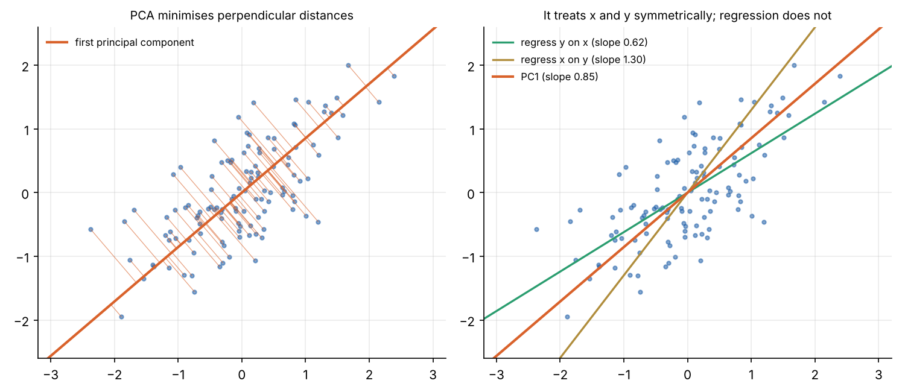
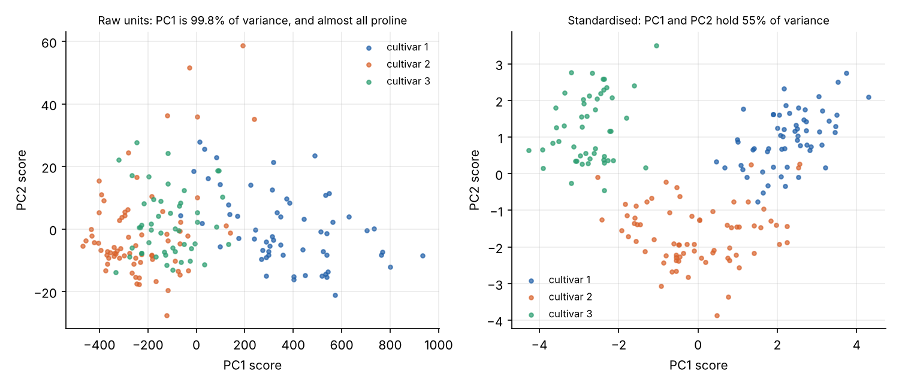
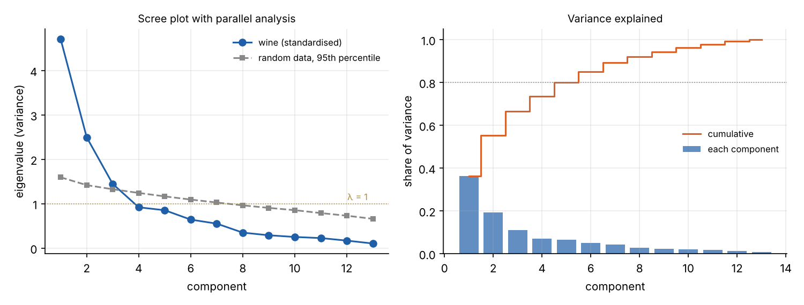
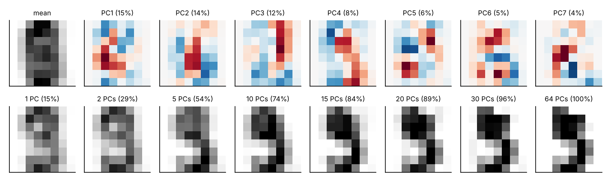
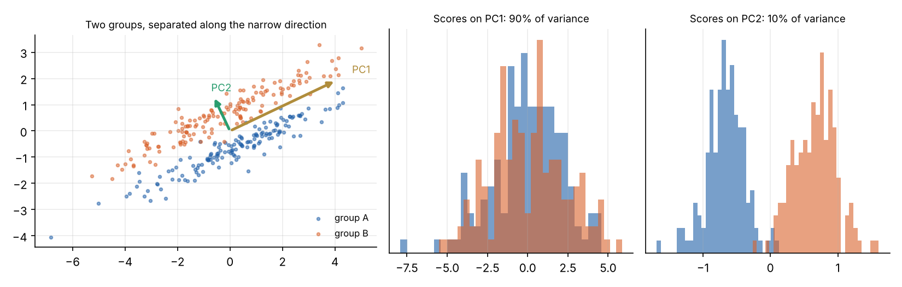

```{=html}
<style>
.pc-grid { display: grid; grid-template-columns: auto 1fr; gap: 1.2rem; align-items: start; margin: 1rem 0; }
.pc-canvas { border: 1px solid #d6dbe2; border-radius: 6px; touch-action: none; cursor: crosshair; }
.pc-curve { border: 1px solid #e3e6ea; border-radius: 4px; }
.pc-side { display: flex; flex-direction: column; gap: .5rem; font-size: .86rem; min-width: 0; }
.pc-side label { display: flex; flex-direction: column; }
.pc-side input[type=range] { width: 100%; max-width: 360px; }
.pc-row { display: flex; flex-wrap: wrap; gap: .35rem; }
.pc-row button { font-size: .8rem; padding: .12rem .55rem; border: 1px solid #999; border-radius: 5px; background: #fff; color: #222; cursor: pointer; }
.pc-note { color: #777; font-size: .8rem; }
.pc-info { display: flex; flex-direction: column; gap: .25rem; }
.pc-m { font-family: ui-monospace, Menlo, monospace; font-size: .82rem; }
.pc-dim { color: #666; font-size: .8rem; }
@media (max-width: 700px) { .pc-grid { grid-template-columns: 1fr; } }
</style>
```

Measure thirteen chemical properties of 178 wines and you have a table that is hard to look at. Many of the
columns move together: wines high in one kind of phenol tend to be high in the others. Principal component
analysis (PCA) finds new axes for the data, ordered by how much of its variation each one captures, so that a
handful of them can stand in for all thirteen.

The [eigenvectors explainer](../eigenvectors/index.qmd) ended with a cloud of points whose covariance matrix had
eigenvectors along the axes of the cloud. PCA is that observation, turned into a method. Karl Pearson described it
in 1901 as finding "lines and planes of closest fit", and Harold Hotelling named the principal components in 1933.

## The variance along a direction

Centre the data, so each variable has mean zero, and collect it in a matrix $X$ with one row per observation. Its
covariance matrix is
$$
\Sigma = \frac{1}{n-1} X^\mathsf{T} X ,
$$
with each variable's variance on the diagonal and the covariances off it.

Now pick a direction, a unit vector $u$, and project every point onto it. The projected values are $Xu$, and their
variance is
$$
\operatorname{Var}(Xu) = \frac{1}{n-1}\,(Xu)^\mathsf{T}(Xu) = u^\mathsf{T} \Sigma\, u .
$$

**PCA asks for the direction that makes this as large as possible**, with $u$ kept at length 1. Using a Lagrange
multiplier $\lambda$ for the constraint $u^\mathsf{T} u = 1$ and setting the derivative to zero gives
$$
\frac{\partial}{\partial u}\left[u^\mathsf{T}\Sigma u - \lambda (u^\mathsf{T} u - 1)\right] = 2\Sigma u - 2\lambda u = 0
\quad\Longrightarrow\quad
\Sigma u = \lambda u .
$$
So the best direction is an eigenvector of the covariance matrix. Multiplying both sides by $u^\mathsf{T}$ shows that
the variance along it is $u^\mathsf{T}\Sigma u = \lambda$. The direction with the most variance is the eigenvector
with the **largest eigenvalue**: the first principal component.

The second principal component is the direction of greatest variance perpendicular to the first, and it turns out
to be the eigenvector with the second-largest eigenvalue. And so on. Because $\Sigma$ is symmetric, its
eigenvectors are perpendicular and its eigenvalues are real and non-negative, so this always works. The eigenvalues
add up to the total variance (the trace of $\Sigma$), so $\lambda_k / \sum_j \lambda_j$ is the share of the variance
that component $k$ explains.

## Try it

Turn the orange line through the cloud. The small orange dots are the projections of the points onto it, and the
plot on the right shows their variance as the line turns. The peak is at the first eigenvector, and its height is
$\lambda_1$; the trough is at the second, with height $\lambda_2$. Shift-click to add an outlier and watch how far a
single point can swing the components.

```{ojs}
//| echo: false
pcaView = {
  const host = htl.html`<div></div>`;
  const mod = await import(new URL("pca.js", document.baseURI).href);
  mod.mountPCA(host);
  return host;
}
```

## Two other ways to see it

**Closest fit.** For each point, the squared distance to the origin splits into a part along $u$ and a part
perpendicular to it. The total is fixed, so making the variance along $u$ as large as possible is the same as making
the perpendicular distances as small as possible. That was Pearson's description: PC1 is the line that passes
closest to the points. This is not the same as a regression line, which minimises vertical distances only and
treats one variable as the thing to predict.



**Best approximation.** Keep the first $k$ components and drop the rest, and you get an approximation to the data
of rank $k$. The Eckart–Young theorem says no other rank-$k$ approximation is closer. PCA is the best possible
linear compression of the data to $k$ numbers per observation.

## How it is computed

1. **Centre** each variable by subtracting its mean.
2. **Standardise** each variable by dividing by its standard deviation, if the variables are in different units
   (more on this below). This makes $\Sigma$ the correlation matrix.
3. **Decompose.** Find the eigenvectors and eigenvalues of $\Sigma$, sorted from the largest eigenvalue down.
4. **Project.** The *scores*, $Z = XV$, are the data in the new coordinates, where $V$ holds the eigenvectors as columns.

In practice, libraries skip forming $\Sigma$ and take the singular value decomposition of the data directly,
$X = U S V^\mathsf{T}$. Its right singular vectors $V$ are the principal components, and the eigenvalues are
$s_k^2/(n-1)$. This is more accurate numerically, and it is what `sklearn.decomposition.PCA` does. The figures in this
post compute PCA both ways and check that they agree.

## A worked example: 178 wines

The wine dataset records thirteen measurements for wines from three grape cultivars grown in the same region of
Italy: alcohol, acidity, phenols, colour, the amino acid proline and so on.

### Scaling matters

Run PCA on the raw numbers and the first component explains 99.8% of the variance. That sounds like a triumph, but
the component is almost exactly the proline axis (its loading is 0.9998). Proline is measured in units that run into
the hundreds and thousands, while most other variables are below 10, so its variance dwarfs everything else. PCA has
found the variable with the biggest units.

Standardising each variable first puts them on an equal footing. Then the first two components explain 36% and 19%
of the variance, and the three cultivars separate cleanly, even though PCA was never told which wine came from which.



The rule of thumb is to standardise when the variables are in different units, and to consider leaving them alone
when they share units and their spread is itself meaningful, as with pixel intensities.

### How many components to keep

No rule is definitive, but several are in common use:

- **Scree plot:** plot the eigenvalues in order and look for the "elbow" where they level off.
- **Cumulative variance:** keep enough components for a target share, such as 80%. For the wine data, that takes five.
- **Kaiser's rule:** with standardised data, keep components with $\lambda > 1$, those that carry more variance than
  a single original variable. That keeps three.
- **Parallel analysis:** compare each eigenvalue with what you would get from random data of the same size, with no
  structure at all, and keep the components that beat it. This is usually the most reliable. It also keeps three.



### Reading the components: loadings and the biplot

A component is a weighted mix of the original variables, and the weights say what it means. The **loadings** are
usually reported as the correlation between each original variable and the component's scores. In the wine data:

- **PC1** (36%) correlates strongly with flavanoids (0.92), total phenols (0.86) and the OD280/OD315 absorbance
  ratio (0.82), and negatively with nonflavanoid phenols (−0.65), malic acid (−0.53) and alcalinity of
  ash (−0.52). It is broadly a phenolic-content axis.
- **PC2** (19%) correlates with colour intensity (0.84), alcohol (0.76) and proline (0.58), and negatively with hue
  (−0.44). It is broadly a body-and-colour axis.

A **biplot** draws the observations and the variables on the same axes. Variables pointing the same way are
positively correlated, those at right angles are roughly unrelated, and observations lie towards the variables they
are high in.


The sign of each component is arbitrary: $-u$ is as good an eigenvector as $u$. Software can return either, so a
component that "means" high phenols in one run can come out as low phenols in another. The convention here makes
each component's largest loading positive.

## Another example: compressing handwritten digits

Each of 1,797 handwritten digits is an 8 × 8 grey image: 64 numbers. PCA of the images gives components that are
themselves images, and any digit can be rebuilt as the average digit plus a mix of them.



Thirteen components keep 80% of the variance and 21 keep 90%: a three-fold compression with little visible loss.
The same idea applied to photographs of faces gave the "eigenfaces" of early face recognition.

## Where PCA misleads

- **Variance is not importance.** PCA finds the directions in which the data varies most. Whether those directions
  matter for the question you care about is a separate matter. In the example below, two groups differ only along
  the direction with the *least* variance. Keeping PC1 alone would throw the difference away entirely. If you have an
  outcome to predict, methods that use it, such as linear discriminant analysis or partial least squares, are better
  suited.



- **Scaling decides the answer.** As the wine data showed, changing the units changes the components.
- **Outliers pull hard.** Variance squares the distances, so a single extreme point can swing the components. The
  interactive above shows this.
- **It is linear.** PCA finds flat subspaces. Data on a curved surface, like a spiral, needs nonlinear methods.
- **Components are not causes.** A component is a convenient summary of correlated variables. It need not
  correspond to any single real factor, and naming it ("phenolic content") is an interpretation, not a finding.
- **Small samples give unstable components.** With few observations, components with similar eigenvalues can swap
  or rotate from one sample to the next. The [decision-analysis explainer](../decision-analysis/index.qmd) shows this with a bootstrap.

## Where it is used

- **Exploration:** the first look at almost any table of many numeric variables.
- **Compression and noise reduction:** keep the components above the noise, as with the digits.
- **Finance:** the daily changes in interest rates across maturities are mostly explained by three components, which
  traders call level, slope and curvature (Litterman and Scheinkman, 1991).
- **Genetics:** PCA of genetic variation across Europe reproduces a map of Europe (Novembre and colleagues, 2008).
- **Preprocessing:** decorrelating or reducing inputs before regression or machine learning.
- **Decisions:** reducing many correlated criteria for comparing options. That is the subject of the
  [next explainer](../decision-analysis/index.qmd),
  together with the Analytic Hierarchy Process, which uses the principal eigenvector in a different way.

## Summary

- PCA finds the directions of greatest variance in data. They are the eigenvectors of the covariance matrix, and
  the eigenvalues are the variances along them.
- Equivalently, PC1 is the line of closest fit, and the first $k$ components give the best rank-$k$ approximation.
- Standardise variables in different units; otherwise the biggest units win.
- Choose the number of components with a scree plot or, better, parallel analysis.
- Interpret components through their loadings, with care: variance is not importance, signs are arbitrary, and
  outliers and small samples can mislead.

*The figure scripts are in [`src/pca`](https://github.com/paulmilne/paulmilne.github.io/tree/main/src/pca).*

## References

- K. Pearson, "On lines and planes of closest fit to systems of points in space", *Philosophical Magazine* 2(11),
  559–572 (1901).
- H. Hotelling, "Analysis of a complex of statistical variables into principal components", *Journal of
  Educational Psychology* 24, 417–441 (1933).
- I. T. Jolliffe and J. Cadima, "Principal component analysis: a review and recent developments",
  *Philosophical Transactions of the Royal Society A* 374, 20150202 (2016).
- J. L. Horn, "A rationale and test for the number of factors in factor analysis", *Psychometrika* 30, 179–185 (1965).
- C. Eckart and G. Young, "The approximation of one matrix by another of lower rank", *Psychometrika* 1, 211–218 (1936).
- R. Litterman and J. Scheinkman, "Common factors affecting bond returns", *Journal of Fixed Income* 1(1), 54–61 (1991).
- J. Novembre et al., "Genes mirror geography within Europe", *Nature* 456, 98–101 (2008).
- M. Turk and A. Pentland, "Eigenfaces for recognition", *Journal of Cognitive Neuroscience* 3(1), 71–86 (1991).
- Wine and optical handwritten digits datasets, UCI Machine Learning Repository, as distributed with scikit-learn.
