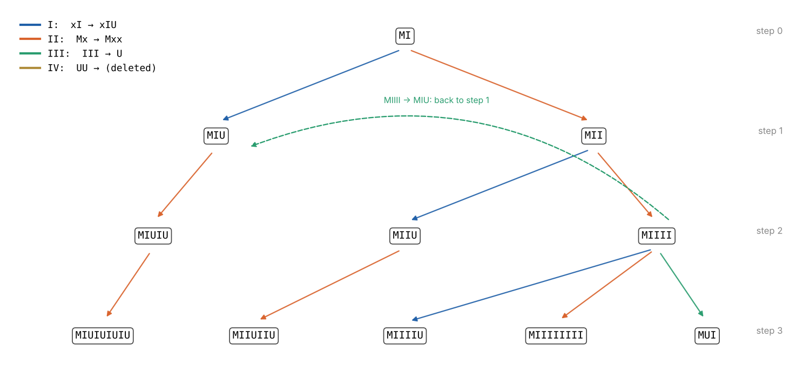
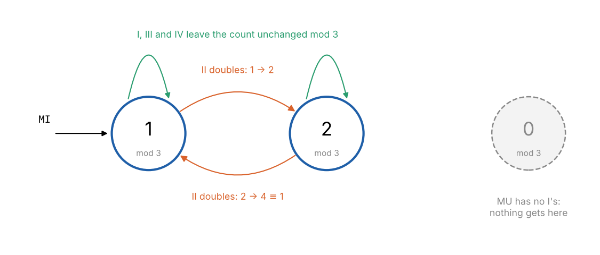

```{=html}
<style>
.miu-box { border: 1px solid #d6dbe2; border-radius: 8px; padding: .8rem 1rem; margin: .8rem 0; font-size: .9rem; }
.miu-head { font-weight: 600; margin-bottom: .4rem; }
.miu-str { font-family: ui-monospace, SFMono-Regular, Menlo, monospace; letter-spacing: .04em; }
.miu-big { font-size: 1.7rem; word-break: break-all; }
.miu-str mark { background: #ffe3a3; padding: 0 1px; border-radius: 2px; }
.miu-inv { color: #555; margin: .1rem 0 .6rem; }
.miu-win { color: #c0392b; font-weight: 600; }
.miu-label { color: #777; font-size: .8rem; margin: .5rem 0 .25rem; }
.miu-moves { display: flex; flex-direction: column; gap: .3rem; align-items: flex-start; }
.miu-move { font-size: .85rem; text-align: left; padding: .2rem .6rem; border: 1px solid #bbb; border-left-width: 4px; border-radius: 5px; background: #fff; color: #222; cursor: pointer; max-width: 100%; overflow-wrap: anywhere; }
.miu-move:disabled { opacity: .45; cursor: default; }
.miu-move.r1 { border-left-color: #1f5fa8; } .miu-move.r2 { border-left-color: #d9622b; }
.miu-move.r3 { border-left-color: #2a9d6f; } .miu-move.r4 { border-left-color: #b08d3c; }
.miu-rule { display: inline-block; min-width: 2.2em; font-weight: 600; color: #555; }
.miu-row { display: flex; flex-wrap: wrap; gap: .5rem; align-items: center; margin-top: .5rem; }
.miu-row button, .miu-go { font-size: .82rem; padding: .15rem .7rem; border: 1px solid #999; border-radius: 5px; background: #fff; color: #222; cursor: pointer; }
.miu-go { background: #1f5fa8; border-color: #1f5fa8; color: #fff; }
.miu-in { font-family: ui-monospace, Menlo, monospace; font-size: .95rem; padding: .1rem .3rem; }
.miu-trail { font-family: ui-monospace, Menlo, monospace; font-size: .8rem; color: #444; overflow-wrap: anywhere; }
.miu-cols { display: grid; grid-template-columns: 1fr 1fr; gap: 1rem; }
.miu-h { font-weight: 600; font-size: .85rem; }
.miu-steps { font-size: .8rem; padding-left: 2.2rem; margin: .2rem 0; overflow-wrap: anywhere; max-height: 20rem; overflow-y: auto; }
.miu-why { color: #888; }
@media (max-width: 640px) { .miu-cols { grid-template-columns: 1fr; } }
</style>
```

Douglas Hofstadter's *Gödel, Escher, Bach* is about how systems built from meaningless rules can come to
refer to themselves, and what that has to do with minds. It reaches Gödel's incompleteness theorem by chapter
IX, but it starts with a puzzle small enough to try at the kitchen table. This is the first post in a series
working through the book's ideas as models you can run.

## The MIU system

A **formal system** is a set of strings you start with (axioms) and rules for making new strings from old ones.
Every string you can make is a **theorem**. The rules are purely mechanical: they look at the shape of a string,
never at what it might mean.

Hofstadter's MIU system uses the letters M, I and U. There is one axiom, **MI**, and four rules. In each,
$x$ and $y$ stand for any string, including the empty one.

| Rule | What it lets you do | Example |
|:---|:----------------------|:-------|
| I | If a string ends in I, you may add U to the end: $x\text{I} \to x\text{IU}$ | MI → MIU |
| II | You may double everything after the M: $\text{M}x \to \text{M}xx$ | MIU → MIUIU |
| III | You may replace III anywhere by U: $x\,\text{III}\,y \to x\,\text{U}\,y$ | MUIIIU → MUUU |
| IV | You may delete UU anywhere: $x\,\text{UU}\,y \to x\,y$ | MUUU → MU |

The puzzle: **is MU a theorem?** The example for rule IV produces MU, but only from MUUU, which would itself
need to be a theorem. Try it before reading on.

```{ojs}
//| echo: false
miuView = {
  const host = htl.html`<div></div>`;
  const mod = await import(new URL("miu.js", document.baseURI).href);
  mod.mountMIU(host);
  return host;
}
```

## Working inside the system

Most people start by applying rules and seeing what comes out. That is what a machine would do, and Hofstadter
calls it working in the **mechanical mode**. The theorems branch quickly:



A breadth-first search finds every theorem eventually. But it cannot answer the question. After eight steps
it has found nearly 16,000 theorems, the longest 257 symbols long, and none of them is MU. That proves nothing,
because MU could be the result of a longer derivation through even longer strings. Rule III shortens strings and
rule IV deletes, so a derivation can go a long way out before coming back.


The right-hand panel shows how indirect the routes can be. **MUUUUUUI**, just eight symbols, has no derivation
shorter than 18 steps. Every derivation of it, however long, passes through a string of at least 17 symbols on
the way.
Searching forwards gives no upper limit on how far out you need to look, so no amount of searching can show that
MU is unreachable.

## Stepping outside: an invariant

The answer comes from stepping outside the system and reasoning about it, which Hofstadter calls the
**intelligent mode**. Instead of asking which strings you can make, ask what every theorem has in common.

Count the I's. MI has one. Then look at what each rule does to the count $n$:

- Rule I adds a U: $n$ is unchanged.
- Rule II doubles everything: $n \to 2n$.
- Rule III replaces three I's with a U: $n \to n - 3$.
- Rule IV deletes two U's: $n$ is unchanged.

Now look at $n \bmod 3$. Rules I, III and IV leave it alone. Rule II doubles it, which swaps 1 and 2 and
leaves 0 at 0. Starting from 1, the count can only ever be 1 or 2 mod 3:



MU has no I's, and 0 is a multiple of 3. **MU is not a theorem.**

A property like this, true of the axiom and kept true by every rule, is an **invariant**. Invariants are how
mathematicians prove that something can never happen: that dominoes cannot tile a chessboard with two opposite
corners removed, that the 15 puzzle cannot swap two tiles, that a loop in a program cannot exit with the wrong
answer.

## The proof, checked by machine

An argument this short hardly needs checking, but it is a good first example of how a proof assistant
captures one. Here it is in [Lean 4](https://lean-lang.org), using only Lean's core library:

```lean
inductive Sym | I | U
open Sym

/-- The four rules, with MI as the only axiom (strings drop the leading M). -/
inductive Derivable : List Sym → Prop
  | mi : Derivable [I]
  | rule1 {x} : Derivable (x ++ [I]) → Derivable (x ++ [I, U])          -- xI → xIU
  | rule2 {x} : Derivable x → Derivable (x ++ x)                         -- Mx → Mxx
  | rule3 {x y} : Derivable (x ++ [I, I, I] ++ y) → Derivable (x ++ [U] ++ y)  -- III → U
  | rule4 {x y} : Derivable (x ++ [U, U] ++ y) → Derivable (x ++ y)      -- UU → (nothing)

def countI : List Sym → Nat
  | [] => 0
  | I :: s => countI s + 1
  | U :: s => countI s

theorem countI_append (a b : List Sym) : countI (a ++ b) = countI a + countI b := by
  induction a with
  | nil => simp [countI]
  | cons c a ih => cases c <;> simp [countI, ih] <;> omega

/-- The invariant: the number of I's is never a multiple of 3. -/
theorem countI_mod3 {s : List Sym} (h : Derivable s) : countI s % 3 ≠ 0 := by
  induction h with
  | mi => decide
  | rule1 _ ih => simp only [countI_append, countI] at *; omega
  | rule2 _ ih => simp only [countI_append] at *; omega
  | rule3 _ ih => simp only [countI_append, countI] at *; omega
  | rule4 _ ih => simp only [countI_append, countI] at *; omega

theorem MU_not_derivable : ¬ Derivable [U] := by
  intro h
  have := countI_mod3 h
  simp [countI] at this
```

The inductive type `Derivable` *is* the formal system: its five constructors are the axiom and the four rules,
and a value of type `Derivable s` is a derivation of `Ms`. The invariant is proved by induction over derivations,
one case per rule, exactly as in the argument above. Each case reduces to a fact about natural numbers, such as
"if $n \bmod 3 \ne 0$ then $2n \bmod 3 \ne 0$", which the `omega` tactic settles automatically. Lean 4.24 checks
the whole file in under half a second.

There is a pleasing loop here, of the kind the book is full of. Lean is itself a formal system, with its own
axioms and rules, and the proof above is a theorem of that system about the MIU system.

## Everything else is a theorem

The invariant rules out every string whose count of I's is a multiple of 3. Remarkably, that is the *only*
obstruction: **M$x$ is a theorem if and only if $x$ is made of I's and U's and its number of I's is not a multiple
of 3.**

Here is a recipe that derives any such string. Suppose $x$ has $c$ I's and $u$ U's.

1. Double MI with rule II until the number of I's, a power of 2, is at least $c + 3u$ and leaves the same
   remainder as $c$ when divided by 3. Powers of 2 alternate between 1 and 2 mod 3, so this always happens.
2. The surplus of I's, beyond the $c + 3u$ needed, is a multiple of 3. It will become a run of trailing U's. If
   that run would have odd length, first add one U to the end with rule I so that the U's can be deleted in pairs.
3. Work through $x$ from the left. Keep an I for each I in $x$, and use rule III to turn the next three I's into a
   U for each U in $x$.
4. Turn the remaining I's into U's with rule III, then delete them in pairs with rule IV.

The interactive above uses this recipe, and also searches for the shortest derivation. I checked the recipe
against all 1,365 allowed strings with up to ten letters after the M. As the figure shows, it is rarely the shortest route. For
MIUUUUUU it takes 36 steps where 10 will do, but it always arrives.

So the MIU system is **decidable**: there is a simple test that says, for any string, whether it is a theorem.
That is unusual. For most formal systems, the only general method is to list the theorems one by one and wait,
which confirms a theorem eventually but can never confirm a non-theorem. For a formal system rich enough to
express arithmetic, Gödel, Church and Turing showed that no decision procedure can exist.

## Where this goes

The MU puzzle seems like a warm-up, but Hofstadter comes back to it. In chapter IX he gives each symbol a number,
M = 3, I = 1 and U = 0, so that every string becomes a number and every rule becomes an arithmetic operation.
"MU is a theorem" turns into a statement about numbers. That is Gödel's trick in miniature: a system that talks
about numbers can, through such a coding, talk about its own strings and so about itself. A later post in this
series will build Gödel numbering in full.

*The simulation, figure scripts and the Lean file are in [`src/geb`](https://github.com/paulmilne/paulmilne.github.io/tree/main/src/geb).*

## References

- D. R. Hofstadter, *Gödel, Escher, Bach: an Eternal Golden Braid*, Basic Books (1979; 20th-anniversary edition 1999),
  chapter I, "The MU-puzzle", and chapter IX, "Mumon and Gödel".
- L. de Moura and S. Ullrich, "The Lean 4 theorem prover and programming language", *Automated Deduction –
  CADE 28*, Lecture Notes in Computer Science 12699, 625–635 (2021).
- A. Turing, "On computable numbers, with an application to the Entscheidungsproblem",
  *Proceedings of the London Mathematical Society* s2-42, 230–265 (1937).
