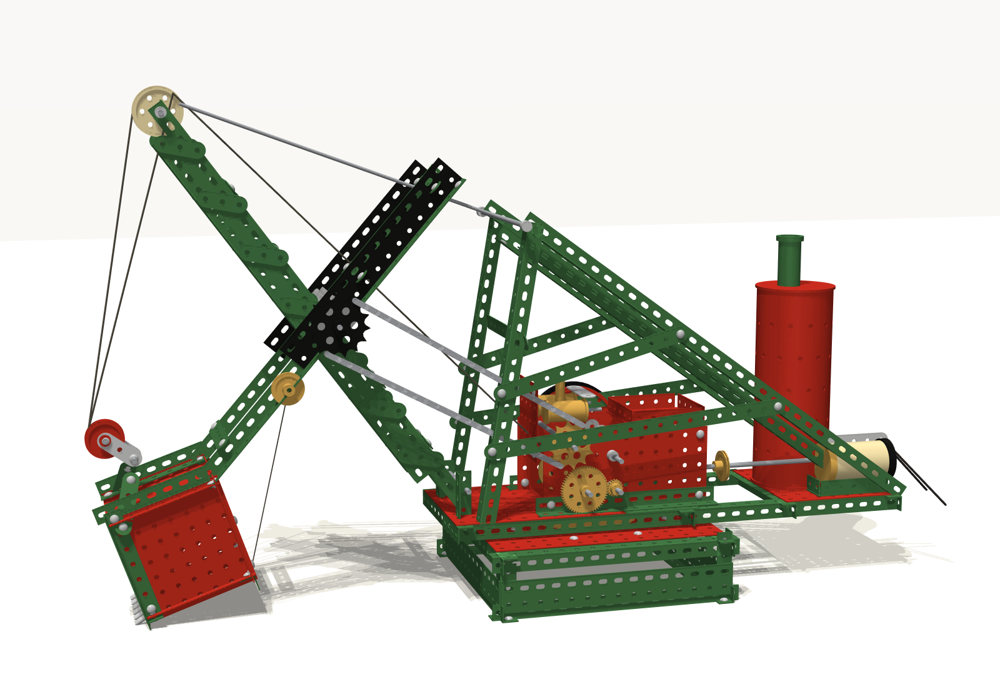

# Meccano steam shovel in MuJoCo

A model of a Meccano steam shovel, taken from two photographs
(`out/photo_side.png`, `out/photo_front.png`). It is built part by part, as
the real one was: perforated strips, angle girders, flat and flanged plates,
brass gears and pulleys, nuts and bolts. It is simulated with real joints, a
real hoist rope, and a heap of gravel to dig.



## Running it

```bash
uv sync
uv run python render.py --still             # studio stills from the two photo viewpoints
uv run python render.py --video             # one dig cycle, out/shovel_dig_work.mp4
uv run python render.py --video --camera dig
uv run mjpython view.py                     # interactive, digging over and over (macOS)
uv run mjpython view.py --still             # just the model
```

The part meshes are generated into `assets/` the first time the model is built
(about a second).

## How it is built

**Parts (`shovel/parts.py`).** Meccano is a ½-inch system: holes are 5/32 inch
across on ½-inch centres, and strips and girder flanges are ½ inch wide. Each
part is cut as a 2-D outline with real holes (shapely), then extruded into a
mesh (trimesh):

- strips with rounded ends;
- angle girders, with round holes in one flange and slots in the other;
- flat and flanged plates;
- 38-diametral-pitch gears (57-tooth, 19-tooth pinion, the 133-tooth roller race);
- sprockets, chain links and pulleys;
- the perforated boiler, cut with manifold3d;
- hex nuts and round bolt heads.

The parts are made from steel or brass with their real densities, so the
model's weight comes from its parts: 4.2 kg, about what a model this size
weighs.

**Assembly (`shovel/build.py`).** The machine has the following groups:

- **Base:** girder rings with flat-girder sides and a red top plate, carrying
  the geared roller race.
- **Superstructure:** turns on the race. It carries:
  - a long deck of girders and red plates;
  - the machinery between two red side plates: hoist drum, gearing (two
    19-to-57 reductions, 9:1 from crank to drum),
    crankshaft with a red flywheel and black tyre, twin brass cylinders and the
    crowd sprocket;
  - the vertical boiler and chimney;
  - the electric motor at the back.
- **Gantry:** A-frame legs, doubled back-stays and ties, with an apex shaft.
- **Boom:** a lattice of angle girders. Four rods hang it from the apex. It
  carries the cream sheave at the head and the shipper shaft with its black
  chain wheel. Sprocket chain runs down from the shipper shaft to the
  machinery.
- **Dipper stick:** two girders with black flat girders along them, riding in
  saddle blocks.
- **Bucket:** red plates edged in green girders, with a row of teeth, a
  hinged door with a trip catch and cord, and a bail carrying the red pulley
  block.

Sizes come from the photographs, using the hole pitch as the scale, then
snapped to whole holes.

**Mechanics.** Four controls work the machine, as a driver's levers would:

| control | joint | how |
|---|---|---|
| slew | superstructure on the base, hinge | position servo |
| crowd | stick through its saddle, slide | position servo |
| hoist | rope drum → sheave → pulley block | **pull-only** servo on a spatial tendon |
| trip | bucket door, hinge | position servo |

Nothing drives the stick's angle on the shipper shaft. It is set by the hoist
rope against gravity, as on a real shovel. The pulley block swings freely on
the bail.

**The dig (`shovel/cycle.py`).** The cycle is a timetable of lever positions:

1. Pay out the rope so the bucket sits on the floor.
2. Crowd out along the floor into the bank of gravel. The crowd motor runs at
   its force limit as it cuts in.
3. Hoist up the face.
4. Lift clear and slew a quarter turn.
5. Pull the trip: the door swings open and the load falls out.
6. Swing back.

Everything else is physics. The gravel is 260 small spheres with rolling
resistance, so they stand in a bank rather than rolling like marbles, held in
a three-sided Meccano bin. One pass scoops and dumps about 60 stones.

The drum, gears, sheave, sprockets, flywheel and motor are turned in step with
the rope, the crowd and how hard the machine is working.

## Rendering

The two stills use cameras placed to match the two photographs. The setting is
a white paper sweep. A soft key light is made from four shadow-casting lights a
few degrees apart, which gives soft shadows. Enamel, brass and nickel each have
their own specular settings. Frames are rendered at twice the size and
averaged down, so the holes and strings stay crisp. Videos use a single
shadow light for speed.

## Next steps

- A Meccano lorry or a hopper to dump into.
- Drive the stick through a rack and pinion as well as the chain, and let the
  boom be raised on its suspension.
- A path-traced render (export to Blender) for photographic lighting.
