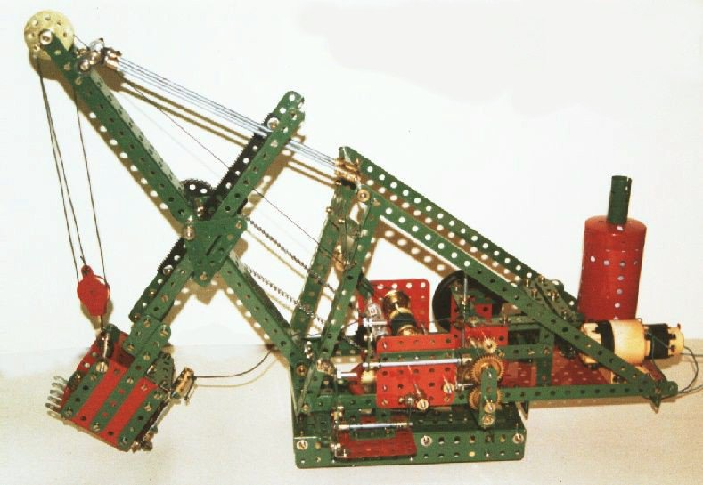
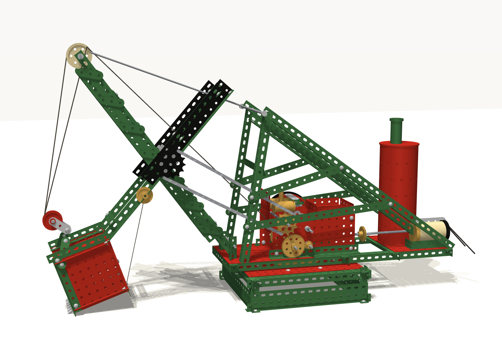
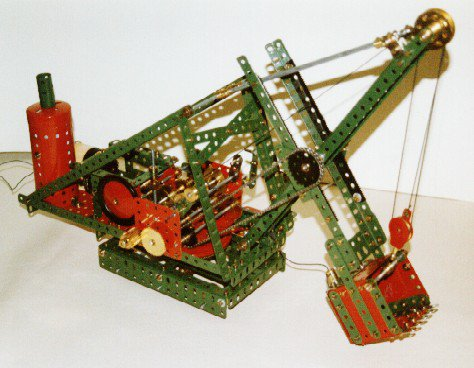
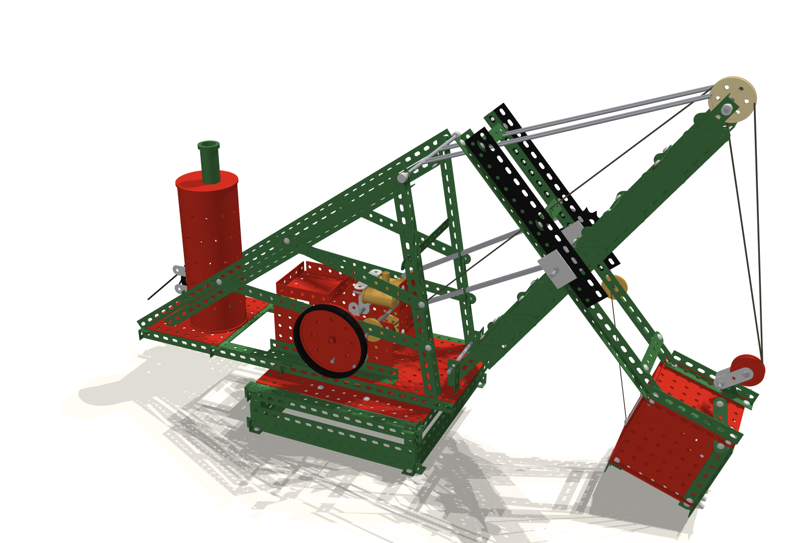

The two photographs below show a Meccano steam shovel: a face shovel of the kind that dug railway cuttings and canals. It is built in green girders and red plates, with a brass engine, a perforated boiler and a bucket on a long dipper stick. This post rebuilds it in **MuJoCo**, one strip, girder and nut at a time, and then asks how it works:

- why a construction set built on a ½-inch grid is full of Pythagorean triples, and why its gears always fit;
- how one rope, led over a pulley at the boom head and through a pulley block, both lifts the bucket and swings the stick;
- why the stick is really a pendulum, and what that means for where the bucket can reach and how it has to dig.



::: {.callout-note}
## About the model and the sources
The code lives in the `meccano-shovel` project alongside this blog, and every number printed below comes from running it. The model's dimensions were measured from the two photographs, using the hole spacing as a ruler, so they are a reconstruction rather than a published plan. The notes on Meccano's parts (tooth counts, slotted holes) are from memory of the system; check them against a Meccano parts list before quoting them.
:::

```{python}
#| label: setup
import sys, math, warnings
from pathlib import Path
from collections import Counter
warnings.filterwarnings("ignore")

here = Path.cwd().resolve()
ROOT = next(p for p in (here.parents[1] / "meccano-shovel", here.parent / "meccano-shovel",
                        here.parents[1] / "mechanics" / "meccano-shovel") if (p / "shovel").exists())
sys.path.insert(0, str(ROOT))

import numpy as np
import matplotlib.pyplot as plt
import mujoco

from shovel import parts as pt
from shovel.build import load, BOOM_FOOT, BOOM_TIP, BOOM_HOLES, SHIPPER, APEX, TURN_Z
from shovel.cycle import DigCycle, DIG, ids, DRUM_R

plt.rcParams.update({"figure.dpi": 110, "axes.grid": True, "grid.alpha": 0.25,
                     "axes.spines.top": False, "axes.spines.right": False})
GREEN, RED, BRASS, STEEL, BLUE, GREY = "#3d6e40", "#b8291c", "#b8860b", "#4a5a6a", "#2c7fb8", "#7f8c8d"
P = pt.P                                  # the hole pitch: 1/2 inch
g = 9.81

m = load()                                # the shovel without gravel
A, J = ids(m)
TEN = m.tendon("hoist").id
SR, BK = m.body("stick_rot").id, m.body("bucket").id
site = lambda d, name: d.site_xpos[m.site(name).id].copy()
up = lambda v: np.array(v) + [0, 0, TURN_Z]          # superstructure frame -> world (slew = 0)

print(f"MuJoCo {mujoco.__version__}: {m.nbody} bodies, {m.njnt} joints, {m.nu} actuators, "
      f"{m.ngeom} geoms, timestep {m.opt.timestep*1e3:.0f} ms")
print(f"total mass {m.body_subtreemass[0]:.2f} kg")
```

## From two photographs to a model

Meccano gives the modeller a gift: a ruler built into every part. The holes are on ½-inch centres, so counting holes along a girder in a photograph gives its length, and the scale of the whole picture follows. The model was measured that way, then every length was rounded to a whole number of holes, as the original builder had to. The cameras in the simulation were placed to match the photographs, and the renders are set beside them below.

::: {layout-ncol=2}







:::

Each part is generated as a mesh from a 2-D outline with real holes, then extruded: strips with rounded ends, angle girders with round holes in one flange and slots in the other, plates, gears on Meccano's tooth form, sprockets, pulleys, the perforated boiler, and the nuts and bolts. The parts carry the density of steel or brass, so the model's weight comes from its parts, not from a guess.

```{python}
#| label: parts
kinds = {"strip": "strips", "girder": "angle girders", "fgirder": "flat girders", "plate": "flat plates",
         "fplate": "flanged plates", "nut": "nuts", "bolt": "bolt heads", "chainlink": "chain links"}
wheels = {"gear57", "pinion19", "race", "sprocket12", "sprocket15"}
pulleys = {"pulley1", "sheave", "flywheel", "block_pulley", "bushwheel", "tyre"}
count = Counter()
for i in range(m.ngeom):
    if m.geom_type[i] != mujoco.mjtGeom.mjGEOM_MESH:
        continue
    name = m.mesh(m.geom_dataid[i]).name
    stem = name.split("_")[0]
    count[kinds.get(stem, "gears and sprockets" if name in wheels else
                    "pulleys and wheels" if name in pulleys else "other (boiler, chimney)")] += 1
for k, v in count.most_common():
    print(f"{k:24s} {v:4d}")
print(f"{'':24s} ----\n{'meshed parts':24s} {sum(count.values()):4d}")
```

## The lattice: Pythagoras on a half-inch grid

Every Meccano part is pierced on the same ½-inch grid. Write positions in holes, so that a point on a flat assembly is a pair of integers $(a, b)$. A strip with $n$ holes spans $n-1$ pitches between its end holes. To brace two points $(0,0)$ and $(a,b)$ with a straight strip, the distance between them must be a whole number of pitches:

$$
\sqrt{a^2 + b^2} = c, \qquad a,\ b,\ c \in \mathbb{Z}.
$$

So **every exact diagonal in a Meccano model is a Pythagorean triple**. Horizontal and vertical members are trivial; the first true diagonal is the $(3, 4, 5)$ brace, a 6-hole strip across a 3-by-4 rectangle of holes, and the next primitive ones are $(5, 12, 13)$, $(8, 15, 17)$ and $(7, 24, 25)$. The triples are sparse, and that matters to a builder: a diagonal at an arbitrary angle simply will not bolt up.

Meccano's answer is the **slotted hole**. Angle girders carry slots in one flange, which give a millimetre or two of play. That turns the exact condition into an approximate one:

$$
\left|\sqrt{a^2 + b^2} - c\right| \le \varepsilon, \qquad \varepsilon \approx \frac{1.75\ \text{mm}}{12.7\ \text{mm}} \approx 0.14\ \text{pitch},
$$

and a near miss becomes buildable. The figure counts how many brace angles each rule allows.

```{python}
#| label: fig-lattice
#| fig-cap: "Left: hole positions (a, b) that can be reached by a straight strip from the origin. Black dots are exact Pythagorean triples; open circles are near misses that a slotted hole can take up. Right: the number of distinct brace angles available as the longest strip allowed grows, exactly and with slots."
eps = (0.0035 / 2) / P
N = 24
exact, slotted = [], []
for a in range(1, N + 1):
    for b in range(1, N + 1):
        c = math.hypot(a, b)
        if c > N:
            continue
        err = abs(c - round(c))
        if err < 1e-9:
            exact.append((a, b))
        elif err <= eps:
            slotted.append((a, b))

fig, ax = plt.subplots(1, 2, figsize=(10, 4.4))
gx, gy = np.meshgrid(range(N + 1), range(N + 1))
ax[0].plot(gx, gy, ".", color="#dddddd", ms=2)
for (a, b) in exact:
    ax[0].plot([0, a], [0, b], color=GREEN, lw=0.4, alpha=0.6)
ax[0].plot(*zip(*exact), "o", color="black", ms=4, label="exact triple")
ax[0].plot(*zip(*slotted), "o", mfc="none", color=RED, ms=4, label="within a slot's play")
ax[0].set_aspect("equal"); ax[0].set_xlim(-0.5, N + 0.5); ax[0].set_ylim(-0.5, N + 0.5)
ax[0].set_xlabel("a (holes)"); ax[0].set_ylabel("b (holes)"); ax[0].legend(loc="upper right", fontsize=8)

def angles(maxc, tol):
    s = set()
    for a in range(0, maxc + 1):
        for b in range(1, maxc + 1):
            c = math.hypot(a, b)
            if c <= maxc and abs(c - round(c)) <= tol:
                s.add(round(math.degrees(math.atan2(b, a)), 3))
    return len(s)
L = range(2, 31)
ax[1].plot(L, [angles(n, 1e-9) for n in L], color="black", label="exact")
ax[1].plot(L, [angles(n, eps) for n in L], color=RED, label="with slotted holes")
ax[1].set_xlabel("longest brace (pitches)"); ax[1].set_ylabel("distinct brace angles in 0–90°")
ax[1].legend(); plt.tight_layout(); plt.show()

print(f"exact diagonals out to {N} pitches: {len(exact)}; extra ones a slot can take: {len(slotted)}")
print("primitive triples:", sorted({(min(a, b), max(a, b), round(math.hypot(a, b)))
                                    for a, b in exact if math.gcd(a, b) == 1}, key=lambda t: t[2]))
```

The shovel itself uses the lattice in a less obvious way. The A-frame, the back-stays and the boom all run at angles that are *not* lattice angles, because each is a long girder pinned only at its ends, where a single bolt lets it take any angle. Only the short ties between them have to land on holes, and on the model those ties span the members at points chosen so that the strip lengths come out whole.

### Why Meccano gears always fit

Gears have their own version of the problem. Two meshing gears must sit with their centres one *pitch radius* plus the other apart, and those centres are holes on the grid. Meccano gears are cut to a diametral pitch of 38 teeth per inch of diameter, and the classic sizes are multiples of 19 teeth: a ½-inch pinion with 19 teeth, a 1½-inch gear with 57, then 95 and 133. Writing a gear's tooth count as $N = 19k$, its pitch diameter is $k$ half-inches, and the centre distance of a pair is

$$
d = \frac{N_1 + N_2}{2 \times 38}\ \text{in} = \frac{k_1 + k_2}{4}\ \text{in} = \frac{k_1 + k_2}{2}\ \text{holes}.
$$

All the classic $k$ are odd (1, 3, 5, 7), so $k_1 + k_2$ is always even and **every pair lands exactly on the grid**. The 19 and 57 meshing in the shovel's hoist drive sit $(1+3)/2 = 2$ holes apart. A 57 and a 133 sit 5 holes apart, so they can even be mounted on a diagonal, at the $(3, 4)$ offset of the Pythagorean triple above.

```{python}
#| label: gears
sizes = [19, 57, 95, 133]
print(f"{'pair':>11s} {'centres (holes)':>16s}  {'lattice offsets that fit':s}")
for i, n1 in enumerate(sizes):
    for n2 in sizes[i:]:
        dist = (n1 + n2) / 38
        offs = [(a, b) for a in range(0, int(dist) + 1) for b in range(0, int(dist) + 1)
                if a <= b and abs(math.hypot(a, b) - dist) < 1e-9]
        print(f"{n1:>4d} + {n2:<4d} {dist:16.1f}  {offs}")
```

## How the rope lifts the stick and the bucket

The shovel has one hoist rope, and it does most of the work. Follow it from the engine:

1. It is wound on the **hoist drum** in the machinery house, which the engine turns through two pairs of gears.
2. It runs up beside the boom to the **head sheave**, the cream pulley at the top of the boom, and over it.
3. It drops to the **pulley block**, the red pulley hanging on the bucket's bail, passes round it,
4. and rises again to be tied off at the boom head.

So the block hangs in two parts of rope, the two *falls*. In the model the rope is a MuJoCo spatial tendon through four points, drum, sheave, block and boom head, and the hoist is a servo on the tendon's length that can only pull.

```{python}
#| label: fig-reeving
#| fig-cap: "The hoist in side view, with the bucket hanging clear of the ground. The rope (dark) runs from the drum over the head sheave, down round the pulley block and back up to the boom head. The stick and bucket pivot together on the shipper shaft S. The arrows are the two falls pulling on the block (2T in total, nearly vertical) and the weight of everything that hangs from the shipper shaft, acting at its centre of mass G."
def hold(L, crowd, seconds=3.0):
    d = mujoco.MjData(m)
    d.ctrl[A["hoist"]], d.ctrl[A["crowd"]] = L, crowd
    for _ in range(int(seconds / m.opt.timestep)):
        mujoco.mj_step(m, d)
    return d

d = hold(0.80, 0.0)
T_sim = -d.actuator_force[A["hoist"]]                 # tension in the rope (the servo can only pull)
S = d.xpos[SR].copy()                                 # shipper shaft
G = d.subtree_com[SR].copy()                          # centre of mass of stick + bucket + block
M = m.body_subtreemass[SR]
drum, tip_in, block, tip_out = (site(d, s) for s in ("drum_rope", "tip_in", "block_rope", "tip_out"))
u1, u2 = (tip_in - block) / np.linalg.norm(tip_in - block), (tip_out - block) / np.linalg.norm(tip_out - block)

fig, ax = plt.subplots(figsize=(8.5, 5.4))
foot, tip = up(BOOM_FOOT), up(BOOM_TIP)
ax.plot([foot[0], tip[0]], [foot[2], tip[2]], color=GREEN, lw=6, solid_capstyle="round", label="boom")
for leg in (up(APEX), ):
    ax.plot([tip[0], leg[0]], [tip[2], leg[2]], color=STEEL, lw=1.2, label="suspension rods")
teeth = site(d, "teeth")
R = d.xmat[m.body("stick").id].reshape(3, 3)
stick_ends = [d.xpos[m.body("stick").id] + R @ [x, 0, 0] for x in (-0.14, 0.15)]
ax.plot(*np.array(stick_ends)[:, [0, 2]].T, color=GREEN, lw=4, alpha=0.75, label="dipper stick")
Rb = d.xmat[BK].reshape(3, 3); ob = d.xpos[BK]
box = np.array([ob + Rb @ c for c in ([0, 0, 0], [0.076, 0, 0], [0.076, 0, -0.076], [0, 0, -0.076], [0, 0, 0])])
ax.fill(box[:, 0], box[:, 2], color=RED, alpha=0.75, label="bucket")
rope = np.array([drum, tip_in, block, tip_out])
ax.plot(rope[:, 0], rope[:, 2], color="#333333", lw=1.4, label="hoist rope")
ax.add_patch(plt.Circle((tip[0], tip[2] - 0.006), 0.019, fill=False, color=BRASS, lw=2))
ax.add_patch(plt.Circle((block[0], block[2] - 0.015), 0.015, fill=True, color=RED, alpha=0.8))
ax.add_patch(plt.Circle((drum[0], drum[2] - 0.0085), 0.0085, fill=True, color=BRASS))
sc = 0.02                                             # metres of arrow per newton
for vec, at, col, lab in ((T_sim * (u1 + u2), block + [0.035, 0, -0.03], "#333333", "2T on the block"),
                          ([0, 0, -M * g], G, BLUE, "weight Mg at G")):
    ax.annotate("", xy=(at[0] + sc * vec[0], at[2] + sc * vec[2]), xytext=(at[0], at[2]),
                arrowprops=dict(arrowstyle="-|>", color=col, lw=2))
    ax.text(at[0] + sc * vec[0] + 0.01, at[2] + sc * vec[2], lab, color=col, fontsize=9)
for pnt, lab in ((S, "S"), (G, "G"), (drum, "drum"), (tip, "head sheave"), (block, "block")):
    ax.plot(pnt[0], pnt[2], "k.", ms=6); ax.text(pnt[0] + 0.008, pnt[2] + 0.008, lab, fontsize=9)
ax.axhline(0, color="black", lw=0.8)
ax.set_aspect("equal"); ax.set_xlim(-0.03, 0.55); ax.set_ylim(-0.02, 0.45)
ax.set_xlabel("x (m, forward)"); ax.set_ylabel("z (m)"); ax.legend(loc="upper right", fontsize=8)
plt.tight_layout(); plt.show()
```

### The pulley block: two falls, twice the force, half the speed

Treat the sheaves as frictionless, so the tension $T$ is the same all along the rope. The block hangs in two falls, each pulling up on it with $T$, so when the falls are vertical the block is lifted by

$$
F_{\text{block}} = 2T .
$$

The same factor appears in the motion. If the block rises by $h$, both falls shorten by $h$, so the drum must wind in $2h$ of rope. The rope's length $L$ and the block's height are tied by $\mathrm{d}L = -2\,\mathrm{d}h$. Force goes up by two and speed goes down by two, and the work done is unchanged, as it must be: $T \cdot 2h = 2T \cdot h$. This is the *mechanical advantage* of the block: 2, for two falls.

### The bucket is lifted by a moment, not a force

The block does not simply lift the bucket straight up. The stick, bucket and block hang together from the shipper shaft $S$ halfway up the boom, and they can only turn about it. What the rope supplies is a **moment** about $S$, and the hanging weight $Mg$, acting at the centre of mass $G$, supplies the opposing moment. In equilibrium

$$
\left[(\mathbf r_B - \mathbf r_S) \times T(\hat{\mathbf u}_1 + \hat{\mathbf u}_2)\right]_y + \left[(\mathbf r_G - \mathbf r_S) \times (-Mg\,\hat{\mathbf z})\right]_y = 0,
$$

where $\mathbf r_B$ is the block and $\hat{\mathbf u}_{1,2}$ point up the two falls. Solving for $T$ gives the rope tension from the geometry alone.

There is a neater way to the same answer: **virtual work**. Let the stick turn by a tiny angle with the crowd held still. The rope shortens by $\mathrm{d}L$ and the centre of mass rises by $\mathrm{d}z_G$. The work the rope puts in is the work done against gravity:

$$
-T\,\mathrm{d}L = Mg\,\mathrm{d}z_G \quad\Longrightarrow\quad T = -Mg\,\frac{\mathrm{d}z_G}{\mathrm{d}L}.
$$

The tension is the hanging weight times a pure ratio of speeds: how fast the centre of mass rises for each unit of rope wound in. The block, the falls and the moment arms are all hidden inside that one derivative, which MuJoCo can compute directly by moving the joint and measuring the tendon length. The three answers can be set side by side:

```{python}
#| label: tension-check
r = lambda p: p - S
T_moment = (np.cross(r(G), [0, 0, -M * g])[1]) / -np.cross(r(block), u1 + u2)[1]

def kinematic(shipper, crowd):
    """Place the stick at a shipper angle and crowd, with the pulley block lined up along
    its two falls (where the rope pulls it); positions only, no dynamics."""
    dk = mujoco.MjData(m)
    dk.qpos[:] = m.qpos0
    dk.qpos[J["shipper"]], dk.qpos[J["crowd"]] = shipper, crowd
    for _ in range(4):
        mujoco.mj_fwdPosition(m, dk)
        b = site(dk, "block_rope")
        pull = sum((site(dk, s) - b) / np.linalg.norm(site(dk, s) - b) for s in ("tip_in", "tip_out"))
        Rb = dk.xmat[BK].reshape(3, 3)
        dk.qpos[J["block"]] = math.atan2(pull[0], pull[2]) - math.atan2(Rb[0, 2], Rb[0, 0])
    mujoco.mj_fwdPosition(m, dk)
    return dk

th, cr, h = d.qpos[J["shipper"]], d.qpos[J["crowd"]], 1e-4
d1, d2 = kinematic(th + h, cr), kinematic(th - h, cr)
T_vw = -M * g * (d1.subtree_com[SR][2] - d2.subtree_com[SR][2]) / (d1.ten_length[TEN] - d2.ten_length[TEN])

print(f"hanging mass (stick, bucket, block)   M  = {M*1000:6.0f} g   weight Mg = {M*g:5.2f} N")
print(f"rope tension in the simulation        T  = {T_sim:6.3f} N")
print(f"from the moment balance about S       T  = {T_moment:6.3f} N")
print(f"from virtual work, -Mg dz_G/dL        T  = {T_vw:6.3f} N")
print(f"lift on the block, |2T|                  = {np.linalg.norm(T_sim*(u1+u2)):6.3f} N "
      f"({np.linalg.norm(T_sim*(u1+u2))/(M*g):.0%} of the hanging weight)")
print(f"so the shipper shaft carries the rest:   {np.linalg.norm([0,0,-M*g] + T_sim*(u1+u2)):6.3f} N")
```

All three agree to a fraction of a percent; the small difference is the hoist servo still settling. The printout also shows how the load is shared. Each part of the rope pulls with only about a third of the hanging weight. The block, with its two falls, lifts about two thirds of it, and the shipper shaft carries the rest, because $G$ lies closer to $S$ than the falls do. The block has the longer lever, so the rope needs only a small pull.

### How hard the rope must pull, all the way up

As the rope is wound in, the stick swings up about $S$ and the geometry changes. The falls lean, the lever arm of the block about $S$ shortens, and the centre of mass moves out. The virtual-work formula gives the tension at every point of the swing without simulating anything: sweep the shipper angle, and differentiate $z_G$ with respect to $L$. The crowd setting slides the stick in or out through the shipper, which changes both arms.

```{python}
#| label: fig-tension
#| fig-cap: "Left: rope tension needed to hold the bucket, against the height of the teeth, for the stick drawn in, central and run out (virtual work on the kinematic model; the dots are full dynamic simulations). Right: the same as a fraction of the hanging weight Mg."
crowds = (-0.05, 0.0, 0.05)
cols = (BLUE, "black", RED)
fig, ax = plt.subplots(1, 2, figsize=(10, 3.8))
sweep = {}
for c, col in zip(crowds, cols):
    ths = np.linspace(-1.1, 0.95, 300)
    Ls, zG, tz = [], [], []
    for t_ in ths:
        dk = kinematic(t_, c)
        Ls.append(dk.ten_length[TEN]); zG.append(dk.subtree_com[SR][2]); tz.append(site(dk, "teeth")[2])
    Ls, zG, tz = map(np.array, (Ls, zG, tz))
    T = -M * g * np.gradient(zG, ths) / np.gradient(Ls, ths)
    ok = (tz > 0) & (T > 0)
    sweep[c] = (ths, Ls, tz, T)
    ax[0].plot(tz[ok] * 100, T[ok], color=col, label=f"crowd {c*100:+.0f} cm")
    ax[1].plot(tz[ok] * 100, T[ok] / (M * g), color=col)
for c, col in zip(crowds, cols):                      # check three points by full simulation
    for Lset in (0.70, 0.78, 0.86):
        ds = hold(Lset, c, 2.5)
        tzz = site(ds, "teeth")[2]
        if tzz > 0.005:
            ax[0].plot(tzz * 100, -ds.actuator_force[A["hoist"]], "o", color=col, ms=5)
ax[0].set_xlabel("height of the teeth (cm)"); ax[0].set_ylabel("rope tension T (N)"); ax[0].legend(fontsize=8)
ax[1].set_xlabel("height of the teeth (cm)"); ax[1].set_ylabel("T / Mg")
plt.tight_layout(); plt.show()
```

The crowd setting matters more than the height. Running the stick out (red) carries $G$ further from the shipper shaft, so the rope must pull harder, but the pull hardly changes as the bucket rises: the moment of the weight and the lever of the falls grow and shrink together. With the stick drawn in (blue), the pull starts small, because $G$ hangs almost under the shaft and the shaft takes nearly all the weight, and then climbs steeply as the bucket swings out and up. The dots are full dynamic simulations at three rope settings, and they sit on the lines.

### The drum and the gearing

At the house end, the rope is wound on a drum of radius $r_d$, so holding a tension $T$ takes a torque $T r_d$ on the drum shaft. The drum is driven from the engine's crankshaft through two identical stages, each a 19-tooth pinion driving a 57-tooth gear:

$$
\frac{\omega_\text{crank}}{\omega_\text{drum}} = \frac{57}{19}\times\frac{57}{19} = 9,\qquad
\tau_\text{crank} = \frac{T\,r_d}{9}\ \text{(ignoring friction)}.
$$

Both stages sit on 2-hole centres, as the lattice rule above promised. Putting numbers on the hoist stroke of the dig below:

```{python}
#| label: drum
keys = {k[5]: k for k in DIG}
dig_keys = [k for k in DIG if k[5] == "dig"]
(t0, _, _, L0, _, _), (t1, _, _, L1, _, _) = dig_keys[-2], dig_keys[-1]
v_rope = (L0 - L1) / (t1 - t0)                        # mean rope speed while hoisting up the face
w_drum = v_rope / DRUM_R
T_dig = 3.5                                           # newtons: the hoist tension during the lift, from the dig below
print(f"drum radius to the rope            {DRUM_R*1000:5.1f} mm")
print(f"mean rope speed hoisting the face  {v_rope*1000:5.0f} mm/s  -> block rises at about {v_rope/2*1000:.0f} mm/s")
print(f"drum speed                         {w_drum*60/(2*math.pi):5.0f} rpm;   crankshaft {9*w_drum*60/(2*math.pi):5.0f} rpm")
print(f"torque at {T_dig:.0f} N tension: drum {T_dig*DRUM_R*1000:5.1f} mN·m,  crankshaft {T_dig*DRUM_R/9*1000:5.2f} mN·m")
print(f"power at the rope                  {T_dig*v_rope*1000:5.0f} mW")
```

These are small numbers, and a toy electric motor delivers them easily, which is why the real model could work under its own power. On a full-size shovel the same equations hold with the forces scaled up by the cube of the size ratio.

### What the boom and its rods carry

The boom is a strut, pinned at its foot and held up at its head by the suspension rods running back to the top of the A-frame. Three loads arrive on it:

- at the head, the rope: one part leading back down to the drum and two falls pulling down toward the block, $T(\hat{\mathbf e}_\text{drum} - \hat{\mathbf u}_1 - \hat{\mathbf u}_2)$;
- at the shipper shaft, everything the rope does not carry: the weight of the stick and bucket less the lift of the block, $T(\hat{\mathbf u}_1 + \hat{\mathbf u}_2) - Mg\,\hat{\mathbf z}$;
- its own weight, at its middle.

Taking moments about the boom foot gives the tension in the rods; the force balance then gives the thrust into the foot pin.

```{python}
#| label: boom
rho = 7800
boom_mass = rho * (2 * pt.angle_girder(BOOM_HOLES).volume + 2 * pt.angle_girder(BOOM_HOLES - 5).volume
                   + 14 * pt.strip(3).volume + 5 * pt.strip(4).volume)
foot, head = up(BOOM_FOOT), up(BOOM_TIP)
e_drum = (drum - tip_in) / np.linalg.norm(drum - tip_in)
F_head = T_sim * (e_drum - u1 - u2)
F_ship = T_sim * (u1 + u2) + np.array([0, 0, -M * g])
W_boom = np.array([0, 0, -boom_mass * g])
e_rod = (up(APEX) - head) / np.linalg.norm(up(APEX) - head)
My = lambda p, F: np.cross(p - foot, F)[1]
R_rod = -(My(head, F_head) + My(S, F_ship) + My((foot + head) / 2, W_boom)) / My(head, e_rod)
F_foot = -(F_head + F_ship + W_boom + R_rod * e_rod)
axis = (head - foot) / np.linalg.norm(head - foot)
print(f"boom (girders and lattice)       {boom_mass*1000:5.0f} g")
print(f"rope load at the boom head       {np.linalg.norm(F_head):5.2f} N")
print(f"load from the shipper shaft      {np.linalg.norm(F_ship):5.2f} N")
print(f"tension in the suspension rods   {R_rod:5.2f} N   (shared between four rods)")
print(f"thrust into the boom foot        {np.linalg.norm(F_foot):5.2f} N, "
      f"{abs(F_foot @ axis)/np.linalg.norm(F_foot):.0%} of it along the boom")
```

The rope loads the boom head from both sides of the sheave, the lead down to the drum and the falls down to the block, so it pulls on the boom harder than the shipper shaft does. The rods hold the head back, and what is left is a thrust straight down the boom into its foot pin, more than twice the weight of everything hanging below. The boom is a strut in almost pure compression. A long, slender strut in compression fails by buckling sideways rather than by crushing, and the cure is bracing, which is why the photographs show the boom as a lattice of paired girders braced across, not a single strip.

## The stick is a pendulum

Nothing in the machine drives the angle of the dipper stick. The **crowd** motion slides the stick in and out through its saddle on the shipper shaft; on the model a chain from a sprocket in the house drives the black wheel on the shipper shaft. The **hoist** shortens the rope. The stick's angle is whatever balances the rope against gravity: the stick is a pendulum, and the rope is its string.

A rope can pull but not push. In MuJoCo this is a servo on the tendon whose force is allowed to be negative (pulling) but not positive. Physically it is a *complementarity* condition between the tension $T$ and the slack $s$, the difference between the rope paid out and the distance it has to span:

$$
T \ge 0, \qquad s \ge 0, \qquad T\,s = 0 .
$$

Either the rope is taut and carries load, or it is slack and carries none. When the rope is paid out far enough, the bucket comes to rest on the ground and the stick's angle is set by the ground instead.

### Where the bucket can reach

With the rope taut, each pair of lever settings, crowd $c$ and rope length $L$, puts the teeth at one point: the stick hangs at the angle where the rope's length matches $L$. The map below draws that grid in the side view, together with the floor. Beyond the floor line the rope goes slack and the bucket sits on the ground; along the floor, only the crowd moves the teeth.

```{python}
#| label: fig-reach
#| fig-cap: "Where the teeth can go. Thin lines are constant crowd (stick drawn in on the left, run out on the right) as the rope is wound in; dashed lines are constant rope length. Below the dashed lines the rope would be slack: the bucket rests on the floor. The thick line is the planned path of the dig (from the lever timetable); the dots are the teeth in the simulation."
fig, ax = plt.subplots(figsize=(8.5, 4.6))
cgrid = np.linspace(-0.07, 0.06, 14)
Lgrid = np.arange(0.62, 0.97, 0.04)
pts = {}
for c in cgrid:
    ths = np.linspace(-1.15, 1.0, 260)
    xs, zs, Ls = [], [], []
    for t_ in ths:
        dk = kinematic(t_, c)
        tp = site(dk, "teeth"); xs.append(tp[0]); zs.append(tp[2]); Ls.append(dk.ten_length[TEN])
    xs, zs, Ls = map(np.array, (xs, zs, Ls))
    ok = zs >= 0
    ax.plot(xs[ok], zs[ok], color=GREEN, lw=0.8, alpha=0.7)
    order = np.argsort(Ls)
    pts[c] = [(np.interp(Lg, Ls[order], xs[order]), np.interp(Lg, Ls[order], zs[order])) for Lg in Lgrid]
for k, Lg in enumerate(Lgrid):
    line = np.array([pts[c][k] for c in cgrid])
    ok = line[:, 1] >= 0
    ax.plot(line[ok, 0], line[ok, 1], "--", color=GREY, lw=0.8)
    if ok.any():
        ax.text(line[ok, 0][-1] + 0.004, line[ok, 1][-1], f"L={Lg:.2f}", fontsize=7, color=GREY)

def teeth_for(c, Lr):
    """Teeth position for lever settings, with the rope going slack onto the floor."""
    ths = np.linspace(-1.15, 1.0, 400)
    best = None
    for t_ in ths:
        dk = kinematic(t_, c)
        tp = site(dk, "teeth")
        if tp[2] < 0:
            continue
        err = abs(dk.ten_length[TEN] - Lr)
        if best is None or err < best[0] or (dk.ten_length[TEN] < Lr and tp[2] < best[1][2]):
            best = (err, tp)
    return best[1]
tt = np.linspace(1.5, 9.0, 40)
planned = []
cyc_keys = np.array([k[:5] for k in DIG])
for t_ in tt:
    i = np.searchsorted(cyc_keys[:, 0], t_) - 1
    k0, k1 = cyc_keys[i], cyc_keys[i + 1]
    u = (t_ - k0[0]) / (k1[0] - k0[0]); u = u * u * (3 - 2 * u)
    c, Lr = (1 - u) * k0[2] + u * k1[2], (1 - u) * k0[3] + u * k1[3]
    planned.append(teeth_for(c, Lr))
planned = np.array(planned)
ax.plot(planned[:, 0], planned[:, 2], color=RED, lw=3, alpha=0.6, label="planned dig path")

dsim = mujoco.MjData(m); cyc = DigCycle(m, dsim); trace = []
while dsim.time < 9.0:
    cyc.step()
    if dsim.time >= 1.5 and int(dsim.time * 1000) % 100 == 0:
        trace.append(site(dsim, "teeth"))
trace = np.array(trace)
ax.plot(trace[:, 0], trace[:, 2], ".", color="black", ms=3, label="simulation (no gravel)")
ax.axhline(0, color="black", lw=1); ax.fill_between([0.15, 0.62], -0.03, 0, color="#e8e2d6")
ax.axvspan(0.40, 0.49, ymin=0.135, ymax=0.25, color=BRASS, alpha=0.15, label="gravel bin")
ax.set_xlim(0.15, 0.62); ax.set_ylim(-0.03, 0.22); ax.set_aspect("equal")
ax.set_xlabel("x (m, forward from the slewing axis)"); ax.set_ylabel("z (m)"); ax.legend(fontsize=8, loc="upper left")
plt.tight_layout(); plt.show()
```

The map explains the shape of the dig, which was found by trial before it was understood. On the floor, the teeth can only be moved by the crowd. Lifting them off the floor is only possible along the lines of constant crowd, which curve up and *out*, because the stick is swinging about the shipper. So a cut into a bank has two strokes: crowd out along the floor into the foot of the bank with the rope slack, then hoist, so the teeth sweep up the face on an arc and the bucket fills. That is how a full-size face shovel digs too.

### The dig

The dig was run with 260 stones in a three-sided bin of Meccano plates. The figure follows the two levers' forces and the number of stones in the bucket through the cut and the lift.

```{python}
#| label: fig-dig
#| fig-cap: "The dig with gravel. Top: the crowd force (its servo's limit, 80 N, dotted) and the hoist rope tension. While the rope is slack the tension is zero, apart from brief snatches as the bucket jolts on the floor. Bottom: stones inside the bucket. Shaded: the two strokes of the cut, crowding along the floor and hoisting up the face."
mg = load(gravel=260)
dg = mujoco.MjData(mg)
cg = DigCycle(mg, dg)
Ag, _ = ids(mg)
BKg = mg.body("bucket").id
rec = []
while dg.time < 10.0:
    cg.step()
    if int(round(dg.time * 1000)) % 20 == 0:
        pos = dg.xpos[cg.gravel]
        Rb = dg.xmat[BKg].reshape(3, 3)
        loc = (pos - dg.xpos[BKg]) @ Rb
        inside = ((loc[:, 0] > -0.005) & (loc[:, 0] < 0.086) & (loc[:, 2] < 0.005) & (loc[:, 2] > -0.076)
                  & (np.abs(loc[:, 1]) < 0.04)).sum()
        rec.append((dg.time, dg.actuator_force[Ag["crowd"]], -dg.actuator_force[Ag["hoist"]], inside))
rec = np.array(rec)
fig, ax = plt.subplots(2, 1, figsize=(9, 5), sharex=True)
smooth = lambda y, n=5: np.convolve(y, np.ones(n) / n, mode="same")      # 0.1 s running mean
ax[0].plot(rec[:, 0], rec[:, 1], color=GREEN, label="crowd force")
ax[0].axhline(80, color=GREEN, ls=":", lw=1)
tw = ax[0].twinx()
tw.plot(rec[:, 0], smooth(rec[:, 2]), color="#333333", lw=1, label="hoist tension (0.1 s mean)")
tw.set_ylabel("hoist tension (N)"); tw.grid(False); tw.spines["right"].set_visible(True)
ax[0].plot([], [], color="#333333", lw=1, label="hoist tension (right axis)")
ax[1].plot(rec[:, 0], rec[:, 3], color=RED)
for a in ax:
    a.axvspan(3.0, 5.5, color=BLUE, alpha=0.07); a.axvspan(5.5, 7.5, color=RED, alpha=0.07)
ax[0].text(3.1, 70, "crowd into the bank", fontsize=8); ax[0].text(5.6, 70, "hoist up the face", fontsize=8)
ax[0].legend(fontsize=8, loc="upper left"); ax[0].set_ylabel("crowd force (N)")
ax[1].set_ylabel("stones in the bucket"); ax[1].set_xlabel("time (s)")
plt.tight_layout(); plt.show()
peak = rec[(rec[:, 0] > 3) & (rec[:, 0] < 5.5), 1].max()
print(f"peak crowd force while cutting in: {peak:.0f} N;  stones lifted: {int(rec[-1, 3])} of 260 "
      f"({int(rec[-1, 3]) * 4/3*math.pi*0.0054**3*2200*1000:.0f} g, roughly)")
```

Two things stand out. Cutting into the bank is the hard part: the crowd pushes at its 80 N limit for about two seconds as the teeth go in, more than twenty times what the hoist rope pulls. And the bucket fills across the change of stroke. Stones start to come in as the crowd drives the mouth into the foot of the bank, and they come fastest as the hoist starts and the teeth turn up the face on their arc, as the reach map predicts. A few fall back out over the lip as the bucket tips up clear of the bank. The close-up below shows both strokes.



After the lift, the superstructure slews a quarter turn and the trip cord pulls the catch on the bucket's door. The door is hinged along its top edge, so the load swings it open and falls out, as in the video at the top of the post.

## Coda: why gravel is hard

Granular material is a notoriously difficult thing to simulate, and the shovel's gravel took more iterations than the shovel.

- **Spheres roll.** The first heaps of spheres collapsed into a single layer and rolled away across the floor. Real gravel stands at an angle of repose because its stones interlock; spheres cannot. Giving each contact **rolling resistance** (MuJoCo's six-dimensional contacts, with torsional and rolling friction) made the spheres behave like gravel and stand in a bank.
- **Angular stones are expensive.** Small boxes stood well, but box-to-box contacts are much costlier than sphere contacts, and the simulation slowed by about twenty times.
- **Every contact is several constraints.** A six-dimensional contact in MuJoCo's pyramidal friction model is ten constraint rows, so a few hundred touching stones make thousands of rows. Switching the solver from Newton's method to conjugate gradient, which suits this many loosely coupled contacts, cut the cost of a step by about three quarters.
- **A bank needs walls.** Even rough spheres slump without a wall to lean on, so the gravel sits in a three-sided bin open toward the shovel, which is also a fair picture of the working face of a quarry.

## Next steps

- Model the crowd drive properly, with the chain turning a pinion on the shipper shaft against a rack on the stick, so the crowd force comes from the engine as the hoist does.
- Let the boom be raised and lowered on its suspension, which turns the boom into a third control.
- A Meccano lorry to dump into, and a full dig-swing-dump-return loop.
- Export the model to a path tracer for photographic lighting to match the original prints.
