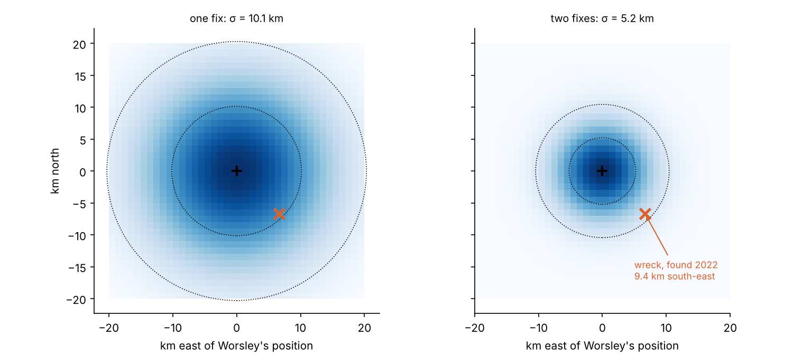
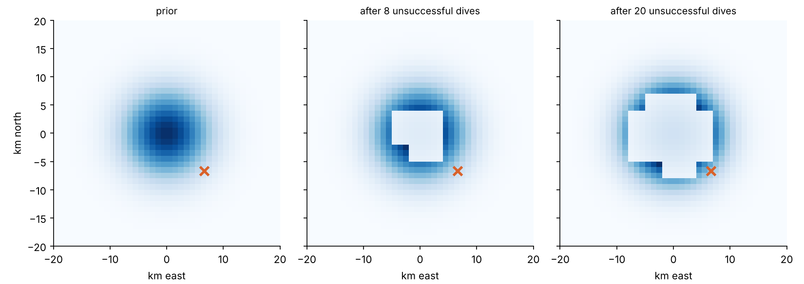
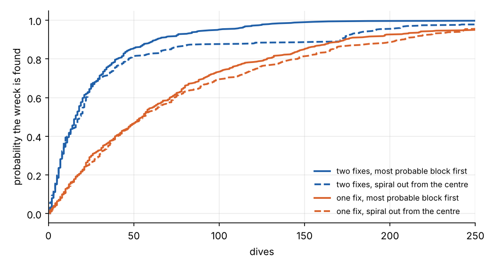

```{=html}
<style>
.sg-grid { display: grid; grid-template-columns: minmax(240px, 380px) 1fr; gap: 1rem; align-items: start; }
.sg-map { width: 100%; aspect-ratio: 1; border-radius: 4px; cursor: crosshair; }
.sg-side { display: flex; flex-direction: column; gap: .5rem; font-size: .86rem; }
.sg-side label { display: flex; gap: .35rem; align-items: center; }
.sg-row { display: flex; flex-wrap: wrap; gap: .4rem .8rem; }
.sg-row button { font-size: .82rem; padding: .12rem .6rem; border: 1px solid #999; border-radius: 5px; background: #fff; color: #222; cursor: pointer; }
.sg-out { font-size: .92rem; } .sg-note { color: #777; font-size: .8rem; }
@media (max-width: 640px) { .sg-grid { grid-template-columns: 1fr; } }
</style>
```

[Part 1](../../astronomy/caird-navigation/index.qmd) followed Frank Worsley's navigation of the *James Caird*,
where a handful of sun sights decided whether six men found an island. This part is about a position he recorded
five months earlier, and what it was worth 106 years later.

*Endurance* became trapped in the pack ice of the Weddell Sea in January 1915, a day's sail from her intended landing on the Antarctic coast.
She never got free. The ice carried her north-west through the winter, and in October it crushed her. The crew
abandoned ship on 27 October and camped on the floe nearby. On 21 November 1915 she sank. Worsley had taken
position fixes on 18 and 22 November, and from them estimated where she went down.

On 5 March 2022, the Endurance22 expedition found the wreck 3,008 m down, upright and remarkably intact,
**9.4 km south-east** of Worsley's estimated position. This post works out why the search area had to be
kilometres across, and how a search like that decides where to look first.

## How sea ice drifts

Sea ice in the open pack moves with the wind, but slowly and at an angle. Fridtjof Nansen noticed during the
*Fram*'s drift across the Arctic in the 1890s that the ice moved at roughly 2% of the wind speed, and 20° to 40°
to the right of the wind's direction. His observation led Vagn Walfrid Ekman to the theory of the wind-driven ocean
boundary layer. The Earth's rotation turns the stress, so in the southern hemisphere the deflection is to the left.

A recent reconstruction of *Endurance*'s last days took exactly this approach. De Vos and colleagues drove an ice
drift model with reanalysis winds for 1915, using a wind factor of 1.75 to 2.5% and turning angles of up to 25°. Their
most likely case put the sinking 3.5 km from the wreck. Others put it 10.8 km away, depending on the assumed wind
factor and turning angle. They concluded that the uncertainty from the drift was at least as large as the
uncertainty in Worsley's fixes.

## What the second fix is worth

Between fixes, the ship's position is a random walk on top of the mean drift: the uncertainty grows with the time
since the last fix. Model it as a diffusion that spreads by $q$ km² per day, with each fix good to 2 km. Both
numbers are assumptions, chosen to give drift errors of the size the reconstruction found.

With only the 18 November fix, three days of drift give the sinking position an uncertainty of

$$
\sigma = \sqrt{q\,t + \sigma_\text{fix}^2} \approx 10 \text{ km}.
$$

But Worsley also fixed the floe's position on 22 November, the day *after* the sinking. A random walk pinned at both
ends is a **Brownian bridge**, and its variance at a time $t$ between fixes at $0$ and $T$ is

$$
\sigma^2(t) = q\,\frac{t\,(T - t)}{T} \;+\; \text{(fix errors, weighted by nearness)} ,
$$

which is largest in the middle and shrinks to the fix error at each end. The sinking came three-quarters of the way
through the interval, and the uncertainty halves to about **5 km**:


Worsley had no way to know that his 22 November fix would one day be a search constraint. It was simply where the
crew were camped.

## A map of where the wreck could be

The ship sank where the ice released it, and fell 3 km through water moving at a few centimetres a second, which
adds only a little to the spread. So the starting point for a search is a probability map on the seabed: a Gaussian
centred on Worsley's estimate, with the width from the drift.



The real wreck lay 1.8 standard deviations out, in the outer part of the two-fix distribution. That is unremarkable:
there is about a 20% chance of a wreck lying at least that far out. It shows why a search plan cannot just look at
the centre.

## Bayesian search

Search theory began with Bernard Koopman's anti-submarine work in the Second World War, and its Bayesian form has
found some famous wrecks. It led to the submarine USS *Scorpion* in 1968, and in 2011 to the wreckage of Air France
447 in the Atlantic, nearly two years after the crash and after earlier searches had failed.

The idea is simple:

1. Divide the area into cells and give each a prior probability $p_i$ that the wreck is there.
2. Searching cell $i$ finds the wreck, if it is there, with probability $d$. It is less than one, because sonar
   misses things.
3. If a search of cell $i$ finds nothing, update every cell with Bayes' theorem:

$$
p_i \leftarrow \frac{p_i\,(1 - d)}{1 - p_i d}, \qquad
p_j \leftarrow \frac{p_j}{1 - p_i d} \quad (j \ne i) .
$$

The searched cell loses probability, and every other cell gains a little. A failed search is still information.

4. Search next wherever the chance of success, $p_i d$, is now highest.

For a search with a fixed detection probability, searching the most probable cell each time is optimal: it gives
the highest chance of having found the wreck after any number of searches. Here each "dive" is an autonomous
underwater vehicle sweeping a 3 km × 3 km block, with a 90% chance of detection:



The posterior forms a ring. After a block has been searched once, its leftover probability is less than that of the
unsearched blocks around it, so the search spreads outward. Once a searched block's leftover probability is again the highest, the search returns
to it for a second look. For the real wreck's position, the greedy search finds it on the 23rd dive.

How the plan performs depends on where the wreck is. Over thousands of wrecks drawn from the prior:



With two fixes, the median search takes about 16 dives. With one fix it takes about 55. The second fix is worth
two-thirds of the search. The greedy plan and a simple spiral out from the centre do about equally well at first.
The greedy plan pulls ahead in the long tail, because it goes back over the likeliest blocks where a single
spiral pass would have missed the wreck.

The actual Endurance22 search, from the South African icebreaker *S.A. Agulhas II* with Saab Sabertooth vehicles,
worked through a search box of about 150 square nautical miles. It also had a deadline: the end of the short
Antarctic summer.

## Search for it yourself

Click a block to send the vehicle there, or let it dive on the most probable block. The map is the posterior.
Choose whether the wreck is drawn at random from the prior, or placed where *Endurance* really is.

```{ojs}
//| echo: false
searchView = {
  const host = htl.html`<div></div>`;
  const mod = await import(new URL("searchgame.js", document.baseURI).href);
  mod.mountSearch(host);
  return host;
}
```

## Two kinds of uncertainty

The two posts on Worsley's positions are about the same problem in opposite directions. In the *James Caird*,
uncertainty grew between sights, and the response was to choose an aim point that tolerated it. In the search for
*Endurance*, the uncertainty was fixed by what Worsley had recorded in 1915, and the response was to spend search
effort where that uncertainty put the most probability.

*The figure scripts are in [`src/shackleton`](https://github.com/paulmilne/paulmilne.github.io/tree/main/src/shackleton).*

## References

- M. de Vos, P. Kountouris, L. Rabenstein, J. Shears, M. Suhrhoff and C. Katlein,
  ["Understanding the drift of Shackleton's *Endurance* during its last days before it sank in November 1915, using
  meteorological reanalysis data"](https://hgss.copernicus.org/articles/14/1/2023/), *History of Geo- and Space
  Sciences* 14, 1–13 (2023).
- ["Shackleton's legendary ship is finally found off the Antarctic coast"](https://www.nationalgeographic.com/magazine/article/endurance-shackleton-ship-found-off-antarctic-coast),
  National Geographic (2022).
- V. W. Ekman, "On the influence of the earth's rotation on ocean-currents", *Arkiv för Matematik, Astronomi och
  Fysik* 2(11) (1905).
- B. O. Koopman, *Search and Screening*, OEG Report 56 (1946).
- L. D. Stone, C. M. Keller, T. M. Kratzke and J. P. Strumpfer, "Search for the wreckage of Air France flight AF 447",
  *Statistical Science* 29(1), 69–80 (2014).
