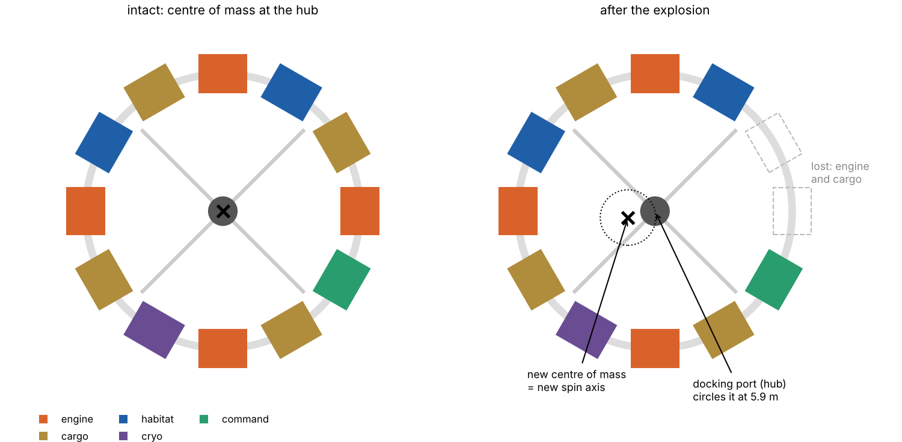
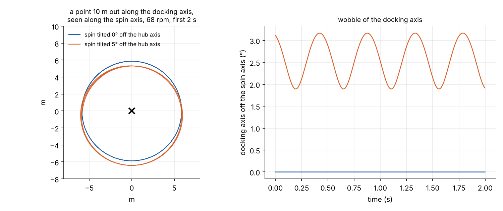
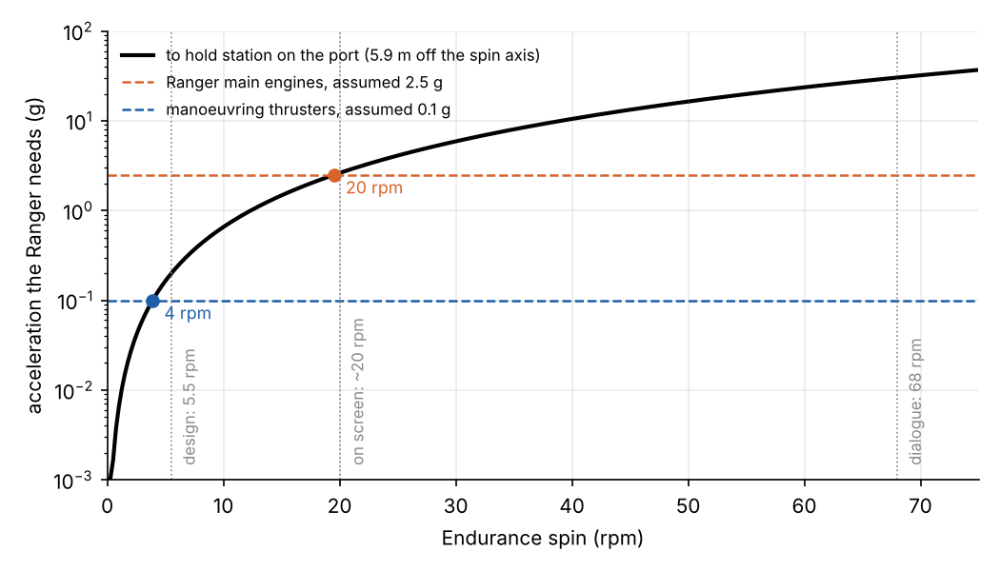
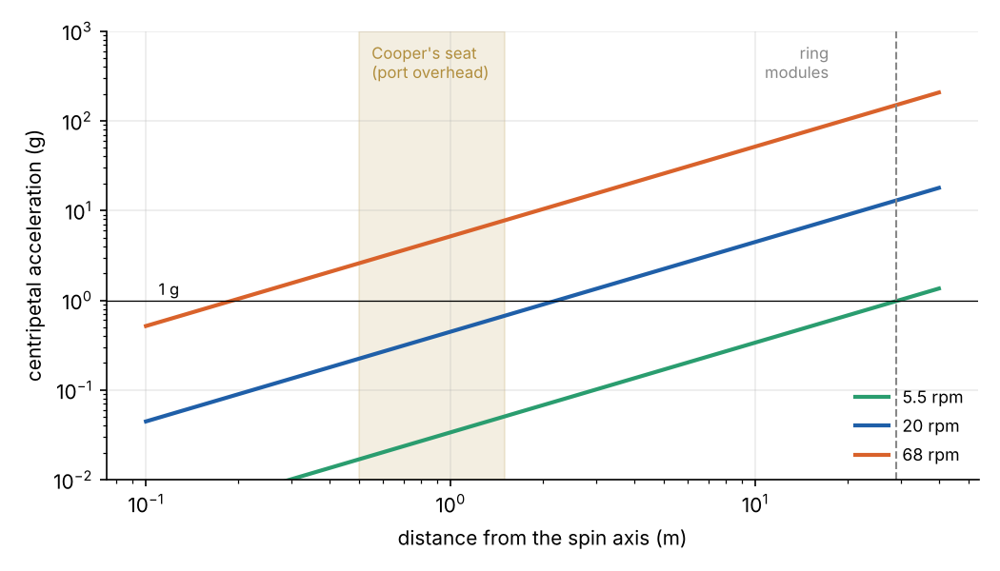

```{=html}
<style>
.ed-wrap { position: relative; }
.ed-view { width: 100%; height: 460px; border-radius: 6px; overflow: hidden; touch-action: none; cursor: grab; background: #02040a; }
.ed-reticle { display: none; position: absolute; left: 50%; top: 230px; width: 90px; height: 90px; margin: -45px 0 0 -45px; border: 2px solid rgba(77,216,255,.7); border-radius: 50%; pointer-events: none; }
.ed-reticle:after { content: ""; position: absolute; left: 50%; top: 50%; width: 8px; height: 8px; margin: -4px; border-radius: 50%; background: rgba(77,216,255,.8); }
.ed-hud { font-size: .78rem; line-height: 1.4; margin: .45rem 0 .2rem; }
.ed-hud .bad, .ed-msg.bad { color: #d9622b; }
.ed-msg { font-size: .9rem; font-weight: 600; min-height: 1.4em; margin-bottom: .3rem; }
.ed-msg.ok { color: #2a9d6f; }
.ed-controls { display: grid; grid-template-columns: 1fr 1fr; gap: .35rem 1.2rem; font-size: .85rem; }
.ed-controls label { display: flex; flex-direction: column; }
.ed-controls input[type=range] { width: 100%; margin: 0; }
.ed-row { grid-column: 1 / -1; display: flex; flex-wrap: wrap; gap: .4rem; align-items: center; }
.ed-row label { flex-direction: row; gap: .35rem; align-items: center; }
.ed-controls button { font-size: .8rem; padding: .12rem .55rem; border: 1px solid #999; border-radius: 5px; background: #fff; color: #222; cursor: pointer; }
.ed-controls button.on { background: #1f5fa8; color: #fff; border-color: #1f5fa8; }
.ed-gap { flex: 1; }
@media (max-width: 600px) { .ed-controls { grid-template-columns: 1fr; } .ed-view { height: 360px; } .ed-reticle { top: 180px; } }
</style>
```

```{ojs}
//| output: false
THREE = require("three@0.128.0/build/three.min.js")
```

Near the end of *Interstellar*, Dr Mann tries to dock his Ranger with the Endurance against the computer's
warnings, the airlock fails, and the explosion tears a section off the ship's ring. The Endurance is left
spinning and falling towards the atmosphere of Mann's ice planet. The readout puts the rotation at 67 to 68 rpm,
and Cooper decides to match it with the Ranger's thrusters and dock. "It's not possible," says CASE, the robot beside
him. "No," says Cooper. "It's necessary."

The scene is about a real problem in spaceflight: two spinning rigid bodies, one tumbling freely, that have to
end up joined. This post builds the physics behind it. It sets up a mass model of the Endurance, works out what
the explosion did to the way it spins, and asks what the Ranger would really need in order to dock. A 3D
simulation lets you try the approach yourself. It follows [Gargantua](../gargantua/index.qmd), the black hole
that Mann's planet orbits.

## The Endurance as built

The Endurance is a wheel about 64 m across: twelve modules on a ring, joined to a central hub where the landers and
Rangers dock. Production material lists four propulsion modules with three plasma engines each, four
detachable cargo modules, two crew habitats, a cryogenic bay and a command module. The ring turns at about 5.5 rpm
for artificial gravity.

The name is widely taken as a nod to Ernest Shackleton's ship *Endurance*, though the production does not seem to
have said so. It fits. Shackleton's 1914 expedition is the classic story of a crew surviving far beyond help, and his
*Endurance* was trapped and crushed by the ice of the Weddell Sea in 1915. Its namesake is broken over a planet of
frozen cloud. The wreck of the real ship was found in 2022, 3,008 m down and remarkably intact.

No masses were ever published, so this post assumes some. The results that matter depend only on how the masses
compare, so the assumptions are set out here to be changed:

| Part | Number | Mass each (assumed) |
| --- | --- | --- |
| Propulsion module | 4 | 50 t |
| Cargo module | 4 | 40 t |
| Habitat, cryogenic bay, command | 4 | 30 t |
| Hub, spokes and docking collar | 1 | 40 t |
| **Total** | | **520 t**, centres of the modules on a 29 m radius |

That is a little more than the International Space Station's 420 t. At 5.5 rpm the module centres feel

$$
a = \omega^2 r = (0.576\ \text{s}^{-1})^2 \times 29\ \text{m} = 9.6\ \text{m s}^{-2} \approx 1\ g ,
$$

so the design figure is right for Earth-like gravity in the modules. A real habitat that size would spin more
slowly than people would like. Experiments in rotating rooms found that most people can adapt to only a few rpm
before turning their heads makes them sick.

## What the explosion did

According to the production material, the explosion destroyed Mann's Ranger at the hub, shattered a cargo module and set
off one of the engine modules. The ring has lost two adjacent modules. That matters more than it looks.

A body spinning freely in space turns about its centre of mass, wherever that is. An intact ring has its centre of
mass at the hub. Remove 90 t from one side and the centre of mass moves across:



With these masses the centre of mass moves **5.9 m** from the hub. The damaged Endurance spins about that point,
so the docking port at the hub is no longer on the axis of rotation. It circles the axis once per turn.

## How fast it spins

The dialogue says 68 rpm. The ship on screen turns more slowly: viewers who have timed it put it at roughly
20 rpm. Both are far
outside anything the ship was built for:

| | Design, 5.5 rpm | On screen, ~20 rpm | Dialogue, 68 rpm |
| --- | --- | --- | --- |
| Acceleration at the modules | 1.0 g | 13 g | 150 g |
| Outward pull of one engine module | 49 t-force | 650 t-force | 7,500 t-force |
| Docking port's speed round the spin axis | 3.4 m/s | 12 m/s | 42 m/s |
| Docking port's acceleration | 0.2 g | 2.6 g | 30 g |
| Rotational energy | 0.01 t of TNT | 0.17 t | 1.9 t |
| Push needed to start the spin (at the ring) | 6 × 10⁶ N s | 2 × 10⁷ N s | 8 × 10⁷ N s |
| ... which also shoves the whole ship sideways by | 15 m/s | 54 m/s | 180 m/s |

At 68 rpm each engine module pulls outward with the weight of about 7,500 tonnes, 150 times what its
attachments carry in normal service. The ring would fly apart. At 20 rpm the pull is still thirteen times normal, but a
structure built with a large safety factor might hold.

The last line is a bonus. An explosion off to one side cannot give the ship angular momentum without also giving it
linear momentum. The kick that spins the Endurance at 68 rpm also pushes it sideways at about 180 m/s. If that push
was against the direction of its orbit, it would lower the orbit into the atmosphere, which is where the film puts
the ship next.

## Spinning, and wobbling

With no torque on it, a rigid body obeys Euler's equations in its own principal axes:

$$
I_1\dot\omega_1 = (I_2 - I_3)\,\omega_2\omega_3, \quad
I_2\dot\omega_2 = (I_3 - I_1)\,\omega_3\omega_1, \quad
I_3\dot\omega_3 = (I_1 - I_2)\,\omega_1\omega_2 .
$$

They are the torque-free form of the rotational equation in the
[quadcopter post](../../electronics/quadcopters-kalman/index.qmd), $J\dot{\boldsymbol\omega} +
\boldsymbol\omega\times J\boldsymbol\omega = \boldsymbol\tau$. Angular momentum is fixed in space, but the
angular velocity need not be parallel to it, and then the body wobbles.

For a flat ring, the moment of inertia about the axis through the hub is close to the sum of the other two:
$I_3 \approx I_1 + I_2$ (the perpendicular-axis theorem, exact for a perfectly flat body). The damaged ship has
principal moments of 1.21, 2.02 and 3.19 × 10⁸ kg m². The axis through the hub is still the axis of the largest
moment, and spin about the largest axis is stable. So the Endurance does not tumble end over end, as a tennis
racket spun about its middle axis would. What it can do is wobble.

If the explosion's kick leaves the spin tilted 5° from the hub's axis, the hub's axis swings round the fixed angular
momentum, between about 2° and 3° from it, twice per turn of the ship:



The wobble is small in angle, but at 68 rpm it changes direction several times a second. The Ranger would have to
follow it.

## What docking needs

To dock, the Ranger's port has to meet the hub's port with the two faces parallel, and stay there while the latches
close. Against a spinning target, that means three things.

**Match the spin.** The Ranger must turn at the Endurance's rate, about the same axis. The film gets the method right.
Cooper uses the thrusters to spin the Ranger up until, from the cockpit, the Endurance seems to stop and the stars
wheel past instead. The rate is a matter of angular momentum. For a 40 t Ranger about 15 m long, reaching 68 rpm in
fifteen seconds takes a torque of about 0.6 MN m: tens of kilonewtons from thrusters at its nose and tail.

**Follow the port.** This is the problem the film leaves out. With the damaged ring the port is 5.9 m off the spin
axis, moving at 42 m/s round a circle. To stay on it the Ranger must accelerate continuously towards the spin axis at
$\omega^2 d$:



At 68 rpm that is **30 g**, out of the question for any spacecraft carrying a person. There is a neat way to supply
it, though. Once the Ranger is spinning with the ship, a thrust that is fixed in the Ranger's own frame turns with
the ship. Pointed at the spin axis it is exactly the rotating centripetal force needed, so the Ranger can fly as if it
were already part of the Endurance. If the Ranger lies in the plane of the ring, its main engines point
the right way. With main engines worth about 2.5 g, the limit is **20 rpm**, about what the film shows on screen.

**Follow the wobble.** If the hub's axis is wobbling, the Ranger must wobble with it. That takes angular
acceleration as well as spin: about 2.6 rad/s² for a 3° tilt at 68 rpm. That is more than five times what reaching 68 rpm
in fifteen seconds needs, and it has to be applied in a direction that keeps changing.

## Cooper's seat

The full-size set put the airlock above the Ranger's cockpit, so Cooper sits close to the spin axis. That is
lucky for him. Acceleration in a rotating frame grows with distance from the axis:



Half a metre to a metre and a half from the axis, the seat sees 2.6 to 7.8 g at 68 rpm, directed forwards into the
harness. That is enough to grey a pilot's vision and plausibly enough for the near-blackout the film shows. At 20
rpm it is under 1 g. The worse problem at 68 rpm would be the inner ear. Turning your head in a frame spinning more
than once a second sends the semicircular canals violently wrong signals, and pilots in rotating trainers lose
orientation at far lower rates.

## After the latches close

Docking does not stop the spin. The joined craft still carries the Endurance's angular momentum, 2.3 × 10⁹ N m s at
68 rpm. The Ranger can apply torque about the spin axis only with thrust aimed sideways, at the length of the Ranger
from the hub, about 8 m. Its main engines point along its length, so they cannot help. A full meganewton of
sideways thrust would take nearly five minutes to stop 68 rpm. With manoeuvring thrusters of tens of kilonewtons
it would take hours. Meanwhile the docking collar would carry the Ranger's share of the 30 g centripetal load:
about 12 MN of shear, the weight of 1,200 tonnes.

## Fly it

The simulation below runs the physics in your browser. The Endurance is the rigid body above, integrated from
Euler's equations. The Ranger is flown by an autopilot that holds 40 m below the hub, spins up to match, and then
closes at 1 m/s. The Ranger's thrust and angular acceleration are limited by the sliders. The yellow line is the
fixed spin axis and the red line is the hub's axis.

```{ojs}
//| echo: false
dockView = {
  const host = htl.html`<div class="ed"></div>`;
  const S = await import(new URL("dockingsim.js", document.baseURI).href);
  const mod = await import(new URL("endurance3d.js", document.baseURI).href);
  mod.mountDocking(host, THREE, S);
  return host;
}
```

Things to try:

1. **5.5 rpm, damaged.** The design spin. The port wanders slowly round the axis and the Ranger follows it easily.
2. **20 rpm, damaged.** The on-screen spin. The Ranger needs 2.6 g to hold station and has 2.5 g, so it cannot quite
   keep up. Raise the thrust slider to 3 g and it docks.
3. **68 rpm, intact.** With the centre of mass back on the hub, the film's spin is easy to match, if you can stand it.
   Switch to *Cooper's seat* while the Ranger spins up: as the rates match, the Endurance stops turning overhead
   and the planet and stars start turning instead.
4. **68 rpm, intact, 3° wobble.** Now the Ranger needs about 2.6 rad/s² of angular acceleration to follow the hub. Watch the
   attitude error settle at a few degrees, too large to latch.
5. **68 rpm, damaged.** The film's numbers. The Ranger would need 30 g, and the autopilot loses the port
   immediately.

## The verdict

The scene's method is sound: match the rotation, and the target stops moving relative to you. Its numbers do not
add up. At the dialogue's 68 rpm the ring would come apart, and if it did not, a port off the spin axis would be
moving too fast to follow. At the roughly 20 rpm on screen, the docking sits right at the edge of what a powerful
spacecraft could do, provided the ship's centre of mass stayed close to its hub. With an engine module and a cargo module
gone, it would not have. Coincidentally, that edge is about where the film's animators set the spin.

*All masses and the module layout are assumptions; the scripts that produce the figures are in
[`src/endurance-docking`](https://github.com/paulmilne/paulmilne.github.io/tree/main/src/endurance-docking),
and the simulation is `dockingsim.js` and `endurance3d.js` beside this page.*

## References

- K. Thorne, *The Science of Interstellar*, W. W. Norton (2014).
- [Endurance](https://interstellarfilm.fandom.com/wiki/Endurance), Interstellar Wiki: modules, dimensions and the
  damage from the explosion.
- [The Spaceships of 'Interstellar' Explained](https://www.space.com/27694-interstellar-movie-spaceships-infographic.html),
  Space.com: twelve modules and the 5.6 rpm spin.
- [The insane attention to detail in Interstellar's big space scenes](https://gizmodo.com/the-insane-attention-to-detail-in-interstellars-big-spa-1683856057),
  Gizmodo: the full-size airlock above the cockpit set.
- [Interstellar mistakes](https://moviemistakes.com/film10773/other), Movie Mistakes: 68 rpm in the dialogue
  against about 20 rpm on screen.
- H. Goldstein, C. Poole and J. Safko, *Classical Mechanics*, 3rd edition, Addison-Wesley (2002), chapter 5:
  Euler's equations and torque-free motion.
