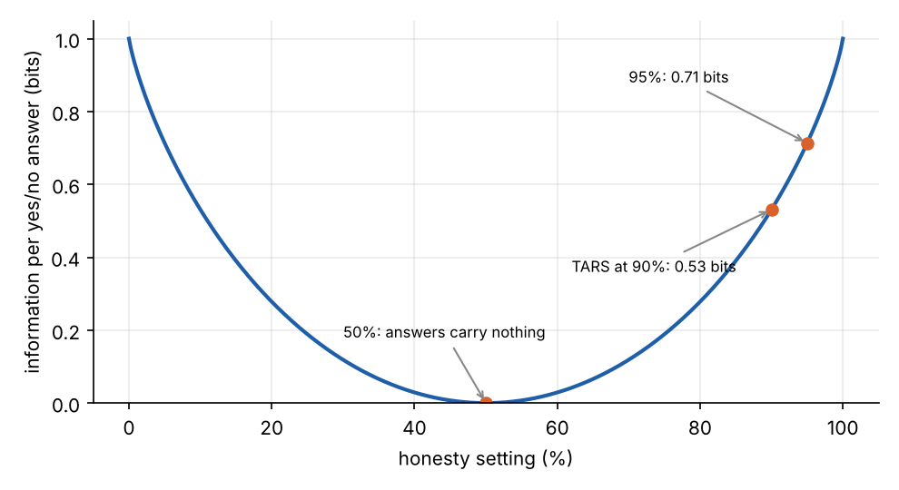
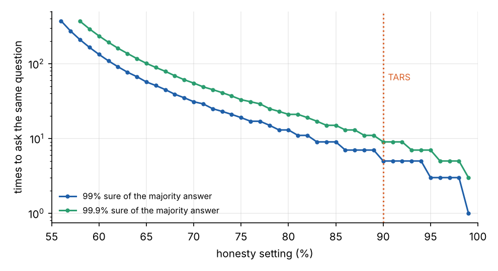

```{=html}
<style>
.ak { font-size: .9rem; border: 1px solid #ddd; border-radius: 6px; padding: .8rem 1rem; }
.ak-row { display: flex; flex-wrap: wrap; gap: .8rem; align-items: center; margin: .3rem 0; }
.ak-row label { display: flex; gap: .35rem; align-items: center; }
.ak-row button { font-size: .82rem; padding: .12rem .7rem; border: 1px solid #999; border-radius: 5px; background: #fff; color: #222; cursor: pointer; }
.ak-q { font-weight: 600; margin: .5rem 0 .2rem; }
.ak-ans { font-family: monospace; margin: .4rem 0; min-height: 1.4em; }
.ak-ans .y { color: #2a9d6f; } .ak-ans .n { color: #d9622b; }
.ak-belief { color: #1f5fa8; } .ak-score { color: #555; margin-top: .3rem; }
</style>
```

Early in *Interstellar*, Cooper asks TARS for its honesty parameter. It is 90%. TARS's explanation is that absolute
honesty is not always the most diplomatic, or the safest, way to talk to emotional beings. Its humour setting is at
100%, which Cooper asks it to bring down to 75%. At the end of the film he rebuilds TARS and raises its honesty to
95%.

It is played as a joke, but it describes a design: a machine whose character is a set of numbers that its users can
change. [Part 1](../tars-walking/index.qmd) built TARS's body and [part 2](../tars-watch/index.qmd) its slowest
data link. This part takes the dials seriously, with information theory, cybernetics, and the real dials that
language models have now.

## Honesty as a noisy channel

Suppose 90% means what it sounds like: each answer TARS gives is true with probability 0.9, and the 10% of lies fall
at random. Then TARS is a **binary symmetric channel**, the simplest noisy channel in information theory. A yes/no
answer that would carry one bit carries

$$
C = 1 - H(0.1) = 1 + 0.1\log_2 0.1 + 0.9\log_2 0.9 = 0.53 \text{ bits} .
$$

That is, by coincidence, almost exactly the 0.54 bits per unit of time that the
[watch hand](../tars-watch/index.qmd) could carry. Ten per cent dishonesty costs nearly half of every answer. At 95%
it costs 29%, and at 50% an answer is worthless:



Random lies can be beaten by asking again. With a 90% robot, the majority of five answers to the same question is
right 99% of the time, and the majority of nine is right 99.9% of the time:



## A robot that lies by policy

That is not what TARS described, though. It did not say it flips a coin before answering. It said it shades the truth
when the truth would be undiplomatic or unsafe. That is a **policy**: on certain topics, with certain people, in
certain moods, it gives a different answer, and it gives the same different answer every time.

Against a liar of that kind, asking again teaches you nothing. Every repeat agrees, and treating the agreement as
independent evidence makes you more confident in the lie. The only defences are the ones people use on each other:
ask about something the answer implies, compare it with what you can check, or ask someone else.

Try both kinds below. The robot knows a hidden yes/no fact. With random lies, asking five times nearly always gives
the truth. With lies by policy, the robot decides once, per topic, whether this is one of its 10% of topics, and then
answers the same way every time. The blue line is what you would believe if you treated the answers as independent.

```{ojs}
//| echo: false
askView = {
  const host = htl.html`<div></div>`;
  const mod = await import(new URL("ask.js", document.baseURI).href);
  mod.mountAsk(host);
  return host;
}
```

## What the good regulator says

Ross Ashby's cybernetics describes TARS's job well. A regulator stands between disturbances and the outcomes they
would cause, and chooses responses that keep the outcomes acceptable. Here the disturbances are what the crew ask
and how they feel, and the outcome is a crew that keeps functioning. Two results from Ashby's school apply.

**Requisite variety.** A regulator can hold outcomes steady only if it has at least as many distinct responses as
there are distinct disturbances to cancel. A robot that only ever states the bare truth has one response to each
question, whatever the state of the person asking. TARS's reason for 90% amounts to saying that it needs more variety
than that.

**The good regulator theorem.** Conant and Ashby proved in 1970 that the simplest optimal regulator is a model
of the system it regulates. Its response is a deterministic function of the situation. Randomness in the response,
$H(R \mid D) > 0$ in the notation of my paper on
[instrumenting agent cybernetics](../../papers/instrumenting-agent-cybernetics/index.qmd), is never needed for good
regulation in their setting, where the regulator is not playing against an opponent.

Put together, the theorem favours the policy liar over the random one. A TARS that lies at random adds noise and
gains nothing. A TARS that shades the truth deliberately, according to a model of who it is talking to, is regulating.
That is also the version you cannot catch by asking twice, which is why the setting should worry Cooper. A 90%
honesty dial is a promise that the robot holds a model of you and will act on it without saying so.

The humour dial is a different kind of setting. It does not change what TARS believes, only how it says it: how much
of its variety goes into jokes. At 100% it jokes constantly. Cooper's correction to 75%
regulates the regulator. In Stafford Beer's terms, the crew are the higher system that sets the operating
parameters of a lower one, and they need a channel back to do it.

## Real dials

When *Interstellar* came out in 2014, a dial for a machine's honesty was science fiction. Language models now have
several kinds of dial, at different depths.

**In the instructions.** The simplest dial is the system prompt: tell a model to be blunt, or playful. Training
by human feedback sets the defaults the prompt adjusts.

**In the activations.** A transformer carries each token's state through a *residual stream*, a vector of a few
thousand numbers that every layer reads and adds to (see [inside GPT-2](../../ai/transformer-part-2-inside-gpt-2/index.qmd)).
Many concepts turn out to correspond to *directions* in that space, much as "king minus man plus woman" lands near
"queen" in [word embeddings](../../ai/embeddings-part-1-words-to-vectors/index.qmd). Find the direction for a trait
and you can add a multiple of it to the residual stream while the model runs:

$$
\mathbf h \leftarrow \mathbf h + \alpha\, \mathbf v_\text{trait} .
$$

The coefficient $\alpha$ is a dial. Turner and colleagues showed in 2023 that the difference between the activations
for "Love" and "Hate" steers GPT-2's sentiment. Zou and colleagues extracted an *honesty* direction in the same year.
Reading it detected lies, and adding or subtracting it made models more or less truthful. Anthropic's
"Golden Gate Claude" in 2024 clamped a single learned feature high and produced a model that steered every
conversation towards the bridge: humour at 100%, in effect. In 2025, *persona vectors* extended the method to traits
such as sycophancy and the tendency to make things up, and used them to monitor and limit drift in a model's
character during training.

These dials behave much as the film's do. Small values shift tone, large values take over. And they share the
deeper problem of TARS's honesty setting. A vector that makes a model say what it believes is different from one that
makes it say what you want to hear, and from the outside you see only the answers. Interpretability research is
largely the attempt to read the regulator's model directly, rather than asking it twice.

## Three TARS posts, one robot

Four slabs on an axle can walk, and can roll if they fan into a star. Any rolling fast enough to outrun a wave needs
the power of a car. A watch hand carries about half a bit per unit of time, so the quantum data must have been a few
pages. And a dial on honesty is a promise that the robot models you. TARS is the film's most convincing machine
because its limits are real ones: mechanical, informational and moral.

## References

- C. E. Shannon, "A Mathematical Theory of Communication", *Bell System Technical Journal* 27 (1948).
- W. R. Ashby, *An Introduction to Cybernetics*, Chapman & Hall (1956): requisite variety.
- R. C. Conant and W. R. Ashby, "Every good regulator of a system must be a model of that system",
  *International Journal of Systems Science* 1(2), 89–97 (1970).
- S. Beer, *Brain of the Firm*, Allen Lane (1972).
- A. M. Turner et al., ["Steering Language Models With Activation Engineering"](https://arxiv.org/abs/2308.10248),
  arXiv:2308.10248 (2023).
- A. Zou et al., ["Representation Engineering: A Top-Down Approach to AI Transparency"](https://arxiv.org/abs/2310.01405),
  arXiv:2310.01405 (2023).
- A. Templeton et al., ["Scaling Monosemanticity"](https://transformer-circuits.pub/2024/scaling-monosemanticity/),
  Anthropic (2024): the Golden Gate feature.
- R. Chen, A. Arditi, H. Sleight, O. Evans and J. Lindsey, ["Persona Vectors: Monitoring and Controlling Character
  Traits in Language Models"](https://arxiv.org/abs/2507.21509), arXiv:2507.21509 (2025).
