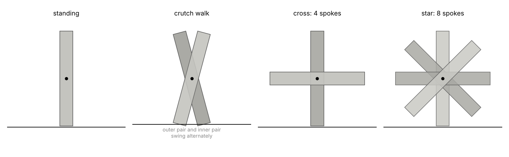
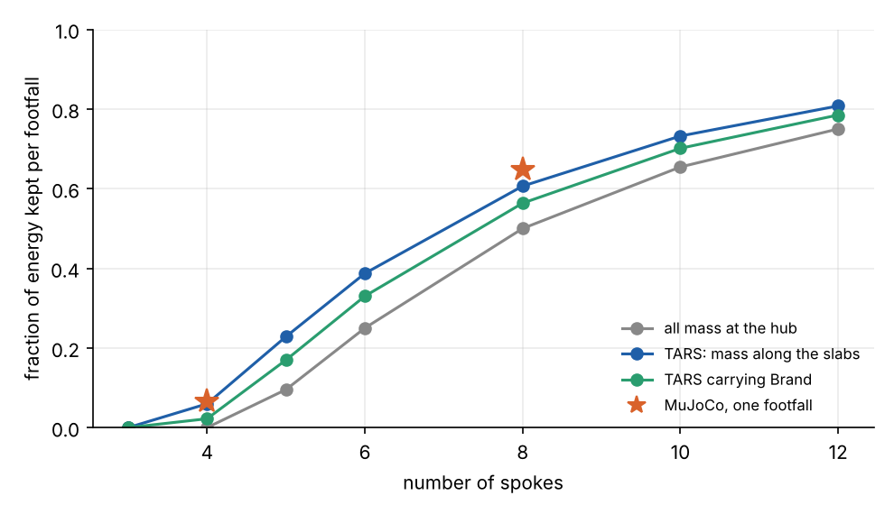
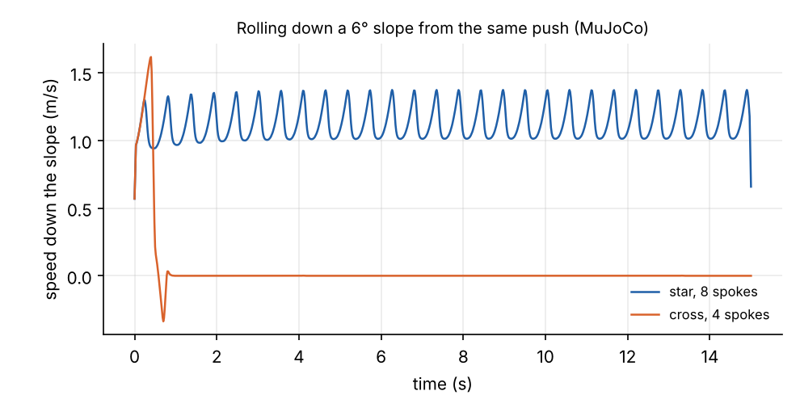
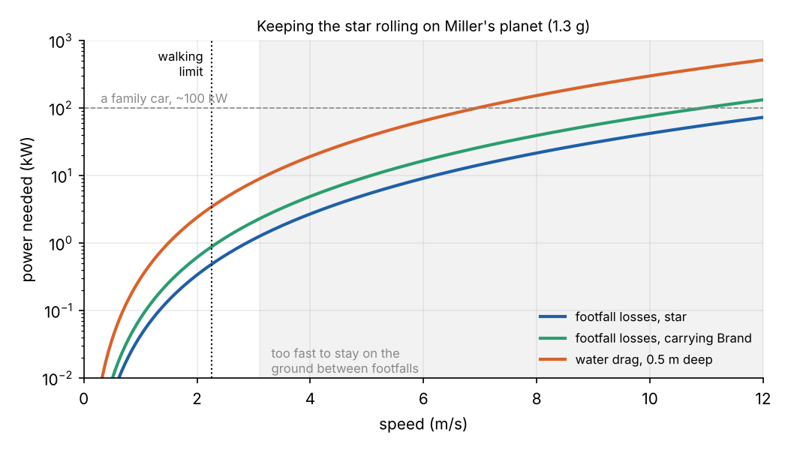

```{=html}
<style>
.tr-view { width: 100%; height: 420px; border-radius: 6px; overflow: hidden; cursor: grab; touch-action: none; background: #dfe6ec; }
.tr-hud { font-size: .8rem; margin: .45rem 0 .3rem; }
.tr-controls { display: flex; flex-wrap: wrap; gap: .4rem; align-items: center; font-size: .85rem; }
.tr-controls button { font-size: .8rem; padding: .12rem .55rem; border: 1px solid #999; border-radius: 5px; background: #fff; color: #222; cursor: pointer; }
.tr-controls button.on { background: #1f5fa8; color: #fff; border-color: #1f5fa8; }
.tr-gap { flex: 1; }
@media (max-width: 600px) { .tr-view { height: 320px; } }
</style>
```

```{ojs}
//| output: false
THREE = require("three@0.128.0/build/three.min.js")
```

The robots in *Interstellar* are not humanoid. TARS, CASE and KIPP are each four tall metal slabs joined by
an axle through their middles, a little like a folded ruler stood on end. They talk, they joke, and they move in
ways no one had seen a film robot move. They shuffle along by swinging pairs of slabs past each other, and on
Miller's planet CASE unfolds into a spinning star and cartwheels through the waves to carry Brand to safety.

This is the first of three posts on TARS. It builds the robot in MuJoCo, makes it walk, makes it roll, and asks
how much of what the film shows the physics allows. The next two posts look at TARS's other talents: sending
data through the second hand of a watch, and having its honesty set to 90%.

## The real robots were puppets

Most of what you see of TARS in the film was physically there. The production built puppets weighing about
200 lb (90 kg) each, about as tall as a person. Bill Irwin, who voiced TARS, walked behind them on set and worked
them by hand, and was removed from the shots afterwards. The crew named three walks: an "ape walk", a "crutch walk"
in which the two outside slabs and the middle pair move through alternately, and one with the slabs moving
independently. The cartwheel through the water was not a puppet. The splashes came from a water-wheel rig on a
quad bike, and the robot was added digitally.

That leaves a fair question for a simulation: could a real four-slab robot do it?

## A model

The film gives no dimensions, so the model assumes some:

| | Assumed |
| --- | --- |
| Slabs | 4, each 1.6 m × 0.30 m × 0.22 m, 22.5 kg |
| Total mass | 90 kg (the puppet's weight) |
| Axle | through the middle of every slab, 0.8 m above the ground when standing |
| Joints per slab | a hinge about the axle, and a slide along the slab's length (about 15 cm each way) |

The slide is what lets a slab lift its foot to swing past without scraping the ground. The puppet could do the same,
and so could the 25 cm *TARS3D* robot that Aditya Sripada and Abhishek Warrier built in 2025, whose legs telescope.

The four slabs act as two pairs, outer and inner. MuJoCo simulates the whole body with contacts at the slab ends
and stiff position servos at every joint.



## Walking: vaulting over a pair of slabs

In the crutch walk one pair is planted while the other swings forward, and then they swap. With its weight on the
axle, the robot vaults over the planted pair like an inverted pendulum, which is the same mechanics as the falling
walk in the [Martian tripod explainers](../../explainers/falling-walk/index.qmd) and the
[inverted-pendulum walker](../../explainers/inverted-pendulum-walker/index.qmd).

The controller is short. The swing pair mirrors the stance pair about the vertical, so that it arrives ahead by as
much as the stance pair is behind. It holds its slide up by 6 cm for most of the swing and lowers it at the end. Late
in each stance, the planted pair extends by 2 cm to push off. When the swing pair touches down, the roles swap.

With 15° steps the model settles into a steady gait: a step every 0.47 s, 0.41 m per step, **0.87 m/s**, about a
human's slow walk.

Walking like this has a speed limit. A body vaulting over a leg of length $\ell$ follows an arc, and gravity can only
hold it on the arc while the centripetal acceleration $v^2/\ell$ stays below $g$. In practice animals change gait
well before that. People break into a run at a Froude number $v^2/(g\ell)$ of about 0.5. For TARS, with
$\ell = 0.8$ m, that is about 2 m/s on Earth and 2.3 m/s at Miller's planet's 1.3 g. To go faster it has to stop
walking. A person runs. TARS turns into a wheel.

## Rolling: the rimless wheel again

Fanned out, the slab ends become the spokes of a **rimless wheel**: a hub that vaults from spoke to spoke with no
rim between them. The [Martian tripod post](../martian-tripod/index.qmd#can-a-tripod-roll-the-milking-stool-problem) used the
impact law for this. Each time a spoke strikes the ground, angular momentum about the new foot is conserved, and the
wheel keeps a fraction

$$
\frac{\omega^+}{\omega^-} = \frac{k^2 + \cos 2\alpha}{1 + k^2}
$$

of its angular velocity. Here $2\alpha$ is the angle between spokes and $k\ell$ the radius of gyration about the hub.
TARS's mass is spread along its slabs, so $k^2 = 0.32$.

How TARS fans out matters a great deal:

- **A cross**, two slabs each way at right angles, has four spokes. Then $\cos 2\alpha = \cos 90° = 0$, and only
  $k^2/(1 + k^2) = 0.25$ of the spin survives each footfall: **6% of the energy**.
- **A star**, the four slabs at 45° to each other, has eight spokes. Now $\cos 45° = 0.71$, and the wheel keeps
  0.78 of its spin: **61% of the energy** per footfall.



MuJoCo agrees with the formula to within a few per cent (0.26 against 0.25 for the cross, 0.81 against 0.78 for the
star), the difference coming from the rounded slab ends. Started rolling down the same 6° slope, the star settles
into a steady 1.1 m/s. The cross stops within a metre:



So a cartwheeling TARS has to be a star, as *TARS3D*'s designers also concluded: they modelled their rolling robot
as an eight-spoke wheel.

## Cartwheeling through water on Miller's planet

On level ground nothing replaces the energy lost at each footfall except the robot's own joints. Each slab can push
as it lands, which is how *TARS3D* keeps rolling. Two things limit how fast a star can go.

**Staying on the ground.** The same arc limit applies to the hub vaulting over each spoke. Above about
**3.1 m/s** at 1.3 g, the hub can no longer follow the arc and the wheel leaves the ground between footfalls. It
bounds rather than rolls, and every landing costs more energy.

**Power.** Footfall losses grow as the cube of the speed, and so does the drag of water:



At 2 m/s the footfalls cost a few hundred watts. At 5 m/s they cost 5–10 kW, and pushing the slabs through half a
metre of water adds another 40 kW. At the 10 m/s or so of a dash to outrun a wave, the total passes 300 kW, more
than a sports car's engine, in a 90 kg machine. Carrying Brand also helps the losses grow. Her mass sits at the hub,
which lowers $k^2$ and makes each footfall more wasteful.

It is not physically impossible, but CASE would need the power of a car in a body the size of a filing cabinet, and
everything it does at speed would be a series of bounds. The film's quad bike was the right engineering choice.

## Watch it

The runs above, replayed from MuJoCo. Drag to orbit the camera and scroll to zoom.

```{ojs}
//| echo: false
tarsView = {
  const host = htl.html`<div class="tr"></div>`;
  const mod = await import(new URL("tars3d.js", document.baseURI).href);
  await mod.mountTars(host, THREE, new URL("tars_frames.json", document.baseURI).href);
  return host;
}
```

*Next: the second hand of Murph's watch as a communication channel.*

*The model, gait controller and figure scripts are in
[`src/tars`](https://github.com/paulmilne/paulmilne.github.io/tree/main/src/tars).*

## References

- A. Sripada and A. Warrier, ["Walking, Rolling, and Beyond: First-Principles and RL Locomotion on a TARS-Inspired
  Robot"](https://arxiv.org/abs/2510.05001), arXiv:2510.05001 (2025).
- ["The Interstellar robot was actually a 200-pound puppet an actor carried on set"](https://businessinsider.in/the-interstellar-robot-was-actually-a-200-pound-puppet-an-actor-carried-on-set/articleshow/46762281.cms),
  Business Insider (2015): the puppets, the three walks and the water-wheel rig.
- ["How Interstellar's robots were made with hardly any CGI"](https://gizmodo.com/how-interstellars-robots-were-made-with-hardly-any-cgi-1661211650), Gizmodo (2014).
- T. McGeer, "Passive dynamic walking", *International Journal of Robotics Research* 9(2), 62–82 (1990): the
  rimless wheel.
- R. McN. Alexander, "Optimization and gaits in the locomotion of vertebrates", *Physiological Reviews* 69,
  1199–1227 (1989): the Froude number and gait transitions.
