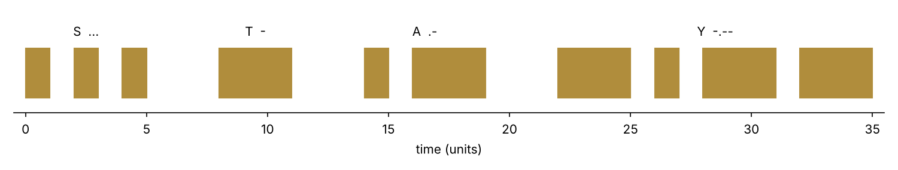
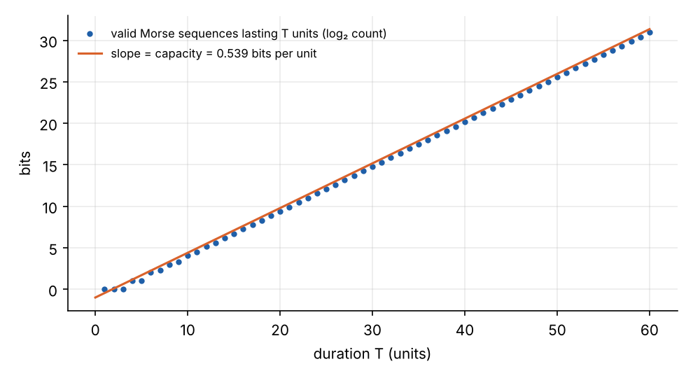
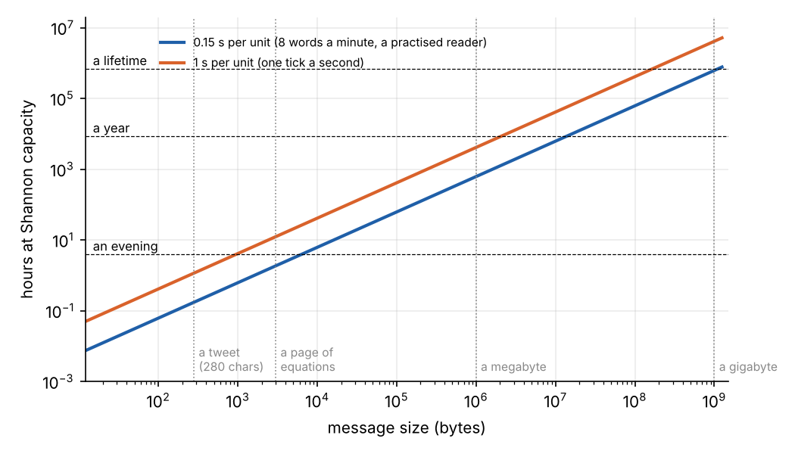
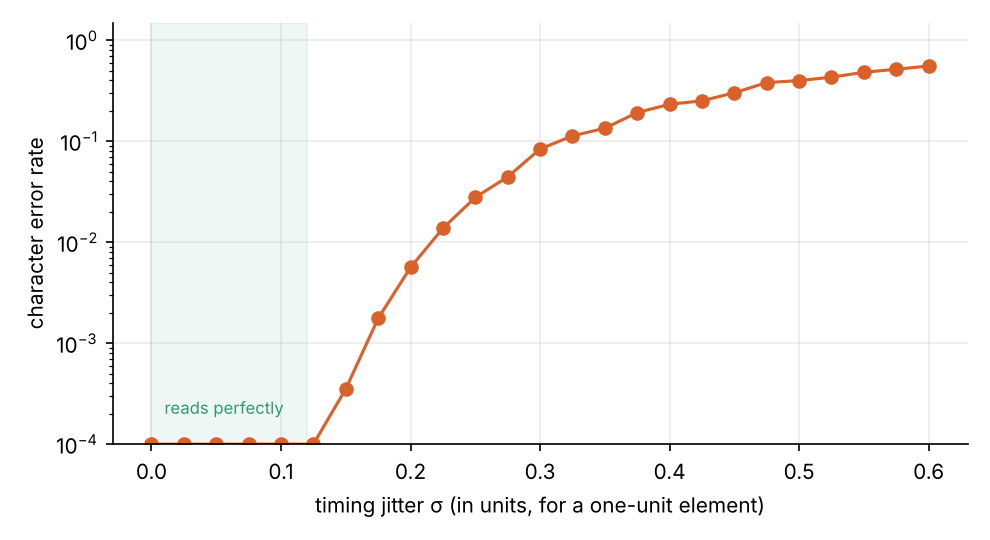

```{=html}
<style>
.wt-grid { display: grid; grid-template-columns: 240px 1fr; gap: 1.2rem; align-items: start; }
.wt-face { width: 240px; height: 240px; }
.wt-side { display: flex; flex-direction: column; gap: .45rem; font-size: .88rem; }
.wt-side label { display: flex; flex-direction: column; }
.wt-side input[type=range] { width: 100%; }
.wt-msg { font-family: monospace; font-size: .95rem; padding: .15rem .3rem; }
.wt-btns button { font-size: .85rem; padding: .15rem .8rem; border: 1px solid #1f5fa8; border-radius: 5px; background: #1f5fa8; color: #fff; cursor: pointer; }
.wt-out { font-family: monospace; font-size: .85rem; line-height: 1.5; }
.wt-out b { font-family: system-ui, sans-serif; font-weight: 600; display: inline-block; width: 3.6rem; }
.wt-read.bad { color: #d9622b; }
.wt-rate { font-family: system-ui, sans-serif; color: #777; font-size: .8rem; }
@media (max-width: 600px) { .wt-grid { grid-template-columns: 1fr; } .wt-face { margin: 0 auto; } }
</style>
```

Inside the tesseract, at the end of *Interstellar*, Cooper can reach Murph's bedroom only through gravity, and only
weakly. TARS has the quantum data that Murph needs to finish her equation. Cooper needs a way to get it to her, and
settles on the watch he gave her before he left. He will push its second hand, and TARS will translate the data
into Morse code. Years later, Murph picks up the watch, sees the hand twitching, and realises what it is.

[Part 1](../tars-walking/index.qmd) asked whether TARS's body could do what the film shows. This part asks the
same of the message: how much information can a twitching second hand carry, and how long would the data take?
The tool is Claude Shannon's 1948 paper *A Mathematical Theory of Communication*. Its first worked example of channel
capacity is the telegraph.

## Morse as a timing code

International Morse code is built from one unit of time:

| Element | Duration |
| --- | --- |
| Dot (hand pushed) | 1 unit |
| Dash (hand pushed) | 3 units |
| Gap between the dots and dashes of a letter | 1 unit |
| Gap between letters | 3 units |
| Gap between words | 7 units |

The earlier message from the bookcase, STAY, takes 35 units:



The code was designed by frequency. Common letters are short: E is a single dot and T a single dash, while Q and J
take thirteen units. That is a variable-length code in the same spirit as Huffman's, a century earlier.

## Shannon's capacity of the telegraph

What is the most information per unit of time that any message built from these timings can carry? Shannon's
answer is to count. Let $N(T)$ be the number of different valid sequences that last exactly $T$ units. Then the
capacity is the rate at which the count grows:

$$
C = \lim_{T\to\infty} \frac{\log_2 N(T)}{T} .
$$

Each element is followed by its gap, so a dot effectively costs 2 units and a dash 4, a letter space 3 more and a word
space 6 more. Spaces cannot follow spaces. Counting sequences with those rules leads to a two-state equation, and
$C = \log_2 X_0$, where $X_0$ is the largest root of the determinant condition

$$
\det\begin{pmatrix} X^{-2} + X^{-4} - 1 & X^{-3} + X^{-6} \\ X^{-2} + X^{-4} & -1 \end{pmatrix} = 0 ,
$$

which gives $X_0 = 1.4529$ and

$$
C = 0.539 \text{ bits per unit} .
$$

That is Shannon's number. Counting the sequences directly confirms it:



How close does ordinary Morse come? For English, with its uneven letter frequencies, letters carry about 4.2 bits
each and take an average of 9.1 units including the gap after them: **0.46 bits per unit, 85% of capacity**.
Morse and Vail did well by counting the type in a printer's case. For random letters and digits it falls to 0.40, and
for numbers alone, since every digit is five elements long, to **0.20 bits per unit, just over a third of capacity**.
If the quantum data is a table of numbers, sending the digits as Morse wastes nearly two-thirds of the channel.
TARS should compress it and send it as letters.

## How long would it take?

The rest depends on the unit. A practised operator reading a flashing light manages perhaps 8 words a minute, a
unit of about 0.15 s. A watch hand that moves once a tick allows one unit per second. At capacity:

| | 0.15 s per unit | 1 s per unit |
| --- | --- | --- |
| Rate | 3.6 bits/s | 0.54 bits/s |
| A page of equations (3 kB) | 1.9 hours | 12 hours |
| A megabyte | 26 days | 6 months |
| A gigabyte | 71 years | 470 years |



Murph decodes the data in what looks like an evening. If so, the quantum data is a page or two, which is
plausible. What she needed was not a dataset but a few numbers that pinned down the missing piece of the theory.
The film is consistent if the data is small. A gigabyte would not reach her in her lifetime.

## When the reader's timing slips

Murph reads the hand by eye. Her sense of whether a push was short or long, and whether a pause was a gap within a
letter or between letters, will wander. Model that by giving every duration she perceives a random error, with a
spread $\sigma$ per unit (growing with the square root of the duration):



Morse reads perfectly until the jitter reaches about an eighth of a unit, then breaks down quickly. A dot and a dash
are two units apart, but a dot-gap and a letter-gap are also two units apart, and the gaps are where it fails. A
misjudged gap does not just change a letter. It merges two letters or splits one, and everything after it shifts.
Errors in timing codes come as insertions and deletions, not substitutions, which makes them much harder to
correct.

## A message for someone who might look later

The watch channel has one more unusual property. Cooper cannot know when Murph will pick up the watch. It is a
one-way broadcast with no reply, to a reader who arrives at an unknown time.

The engineering answer is a **carousel**: send the message over and over, cut into numbered blocks, so that the
reader can start anywhere and stop once enough has arrived. Each block needs a check, so a misread block is
discarded rather than trusted. Better still is a **fountain code**, as used in satellite broadcasting. The sender
emits an endless stream of encoded blocks, each a combination of pieces of the message. Any set of slightly more
blocks than the message holds will reconstruct it, whichever blocks they happen to be. Murph would not need to catch
the start, or to see every block. For a channel this slow, and a reader whose timing may slip, that is the right
design.

The film's version works because the data is short and Murph is attentive. A real TARS would add a block number
and a checksum to every few letters.

## Send a message

Type a message and send it. The second hand twitches over for each dot and dash. Below the watch, a reader decodes
the twitches, with the timing jitter set by the slider. Try raising the jitter past about 0.15 and watch letters
merge and split.

```{ojs}
//| echo: false
watchView = {
  const host = htl.html`<div class="wt"></div>`;
  const mod = await import(new URL("watch.js", document.baseURI).href);
  mod.mountWatch(host);
  return host;
}
```

*Next: TARS's honesty and humour settings.*

*Scripts for the figures are in [`src/tars-watch`](https://github.com/paulmilne/paulmilne.github.io/tree/main/src/tars-watch).*

## References

- C. E. Shannon, "A Mathematical Theory of Communication", *Bell System Technical Journal* 27, 379–423 and
  623–656 (1948): section 1, the capacity of the telegraph.
- D. J. C. MacKay, *Information Theory, Inference, and Learning Algorithms*, Cambridge University Press (2003):
  chapter 17 on constrained channels and chapter 50 on fountain codes.
- M. Luby, "LT codes", *Proceedings of the 43rd IEEE Symposium on Foundations of Computer Science* (2002).
- ITU-R M.1677-1, *International Morse code* (2009).
